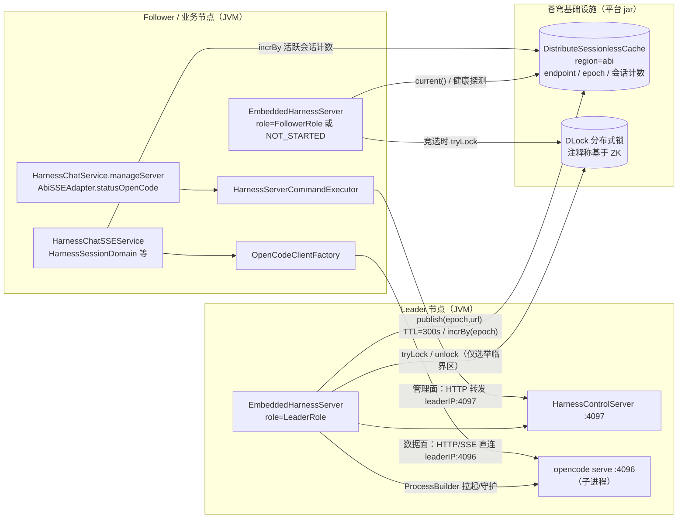
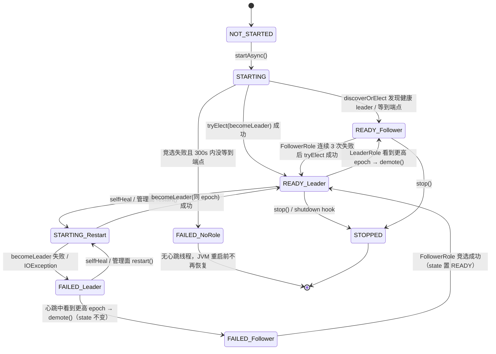
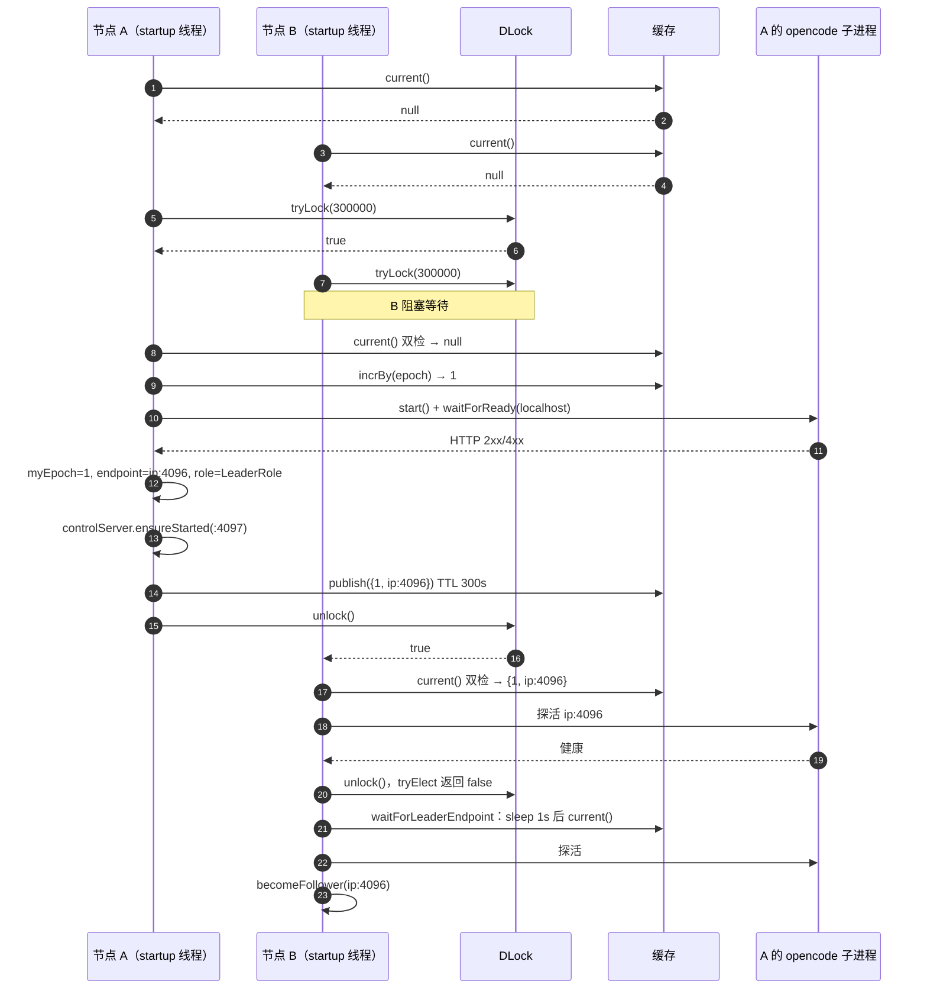
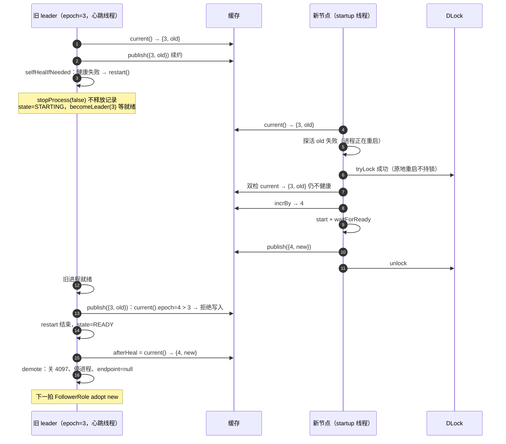

# 01 · 嵌入式 OpenCode 服务的 Leader 选举与 Fencing（源码精读）

> 基线：`abi-platform` 仓库 `feature_dev`，HEAD `ed64d16db78`（2026-10-20）。文中行号均按该版本逐一核对。
> 约定：路径前缀缩写如下，正文中只写文件名 + 行号。
>
> | 缩写 | 实际目录 |
> | --- | --- |
> | `ai/` | `bos-abi-mservice/code/abi-ai/src/main/java/com/kingdee/abi/ai/harness/` |
> | `ai-test/` | `bos-abi-mservice/code/abi-ai/src/test/java/com/kingdee/abi/ai/harness/` |
> | `ms/` | `bos-abi-mservice/code/mservice-abi/src/main/java/kd/bos/mservice/abi/` |
> | `base/` | `bos-abi-common/code/abi-base-common/src/main/java/com/kingdee/abi/` |
> | `cosmic/` | `bos-abi-common/code/abi-cosmic-common/src/main/java/` |
>
> 标注「仓库内无法确认」的内容，是指实现位于苍穹平台 jar（如 `kd.bos.dlock.DLock`、`kd.bos.cache.DistributeSessionlessCache`、`kd.bos.config.client.util.ConfigUtils`），本仓库没有源码。

---

## 1. 定位

### 1.1 解决什么问题

ABI 的「超级分析智能体」后端依赖一个 OpenCode 服务（Bun 编译的二进制 `opencode serve`）。`EmbeddedHarnessServer` 负责在 ABI 的 Java 进程里**拉起、守护、发现**这个子进程：

- 子进程监听 `0.0.0.0:4096`（`EmbeddedHarnessServer.java:566-567`），会话数据写到 `XDG_DATA_HOME = {base}/data`（`:624`），配置在 `{base}/config`。
- ABI 是多实例部署，如果每个实例都起一个 OpenCode，会话状态散落在多个进程里，同一个 sessionId 在不同节点上看到的是不同进程，且多个进程会同时写同一个 `{base}` 目录（`HarnessProperties.java:162-188`；`migrateDirectoryIfNeeded` 的注释 `EmbeddedHarnessServer.java:319-321` 也明确说这一步要「集群互斥」，暗示该目录是多节点共享的挂载盘——`SystemProperties.java:91` 的注释「避免重复挂载磁盘」佐证了这一点，但是否一定是共享存储仓库内无法确认）。

所以设计目标是：**全集群只有一个节点（leader）真正运行 OpenCode 进程，其他节点（follower）只做发现和直连**。类注释写得很直白（`EmbeddedHarnessServer.java:43-57`）。

### 1.2 两种部署形态

代码里存在两个启动入口，对应两种拓扑：

| 形态 | 入口 | 触发条件 | 参与选举的节点 |
| --- | --- | --- | --- |
| 内嵌模式 | `EmbeddedHarnessInitializer.initialize()`（`ai/oc/embedded/EmbeddedHarnessInitializer.java:20-28`） | `abi.initialize.service.key` 为默认值 `ABI_SERVICE_INITIALIZER`，且 `abi.ai.harness.embedded.enabled=true` | 所有开启开关的 mservice-abi 节点 |
| 独立容器模式 | `AbiHarnessInitializer.initialize()`（`ms/integration/service/AbiHarnessInitializer.java:28-35`） | `abi.initialize.service.key=ABI_HARNESS_INITIALIZER` | 所有 abi_harness 容器；业务节点不参与，只读注册表 |

初始化服务的装配机制在 `base/common/init/InitializeHelper.java:46-90`：按 `abi.initialize.service.key` 取出同 key 下的所有扩展，按 `initializationOrder()` 升序执行。

- 内嵌模式下同 key `ABI_SERVICE_INITIALIZER` 的扩展有 `COSMICDefaultInitializeService`(order 0，设置 `CosmicLockFactory` 与 `SessionFactoryStrategyImpl`)、`COSMICInitializeService`(1)、……、`EmbeddedHarnessInitializer`(200，`EmbeddedHarnessInitializer.java:31-34`)。order 200 保证锁和缓存实现已注入。
- 独立容器模式下只有 `AbiHarnessInitializer`，它继承 `COSMICDefaultInitializeService` 并先 `super.initialize()`（`AbiHarnessInitializer.java:30`），再关闭内存看门狗（`:33`）后 `startAsync()`。

### 1.3 拓扑与上下游



- **上游（调用方）**：数据面所有 OpenCode 调用都经 `OpenCodeClientFactory.getClient()`（如 `HarnessChatSSEService.java:64`、`HarnessSessionDomain`、`HarnessFileDomain`、`HarnessInteractionDomain`）；管理面经 `HarnessServerCommandExecutor`（`HarnessChatService.java:777-816`、`AbiSSEAdapter.java:355-378`）。
- **下游（依赖）**：分布式缓存 `IGlobalSession`（`cosmic/kd/bos/mservice/abishared/common/session/GlobalSessionImpl.java`）、分布式锁 `ILock`（`cosmic/kd/bos/mservice/abishared/common/lock/CosmicLock.java`）、本地子进程 `opencode`。

---

## 2. 代码地图

| 类 | 路径 | 行数 | 职责一句话 |
| --- | --- | ---: | --- |
| `EmbeddedHarnessServer` | `ai/oc/embedded/EmbeddedHarnessServer.java` | 1139 | 单例；状态机 + 角色机（LeaderRole/FollowerRole）+ 子进程生命周期 + 自愈 + 管理操作入口 |
| `LeaderElection` | `ai/oc/embedded/cluster/LeaderElection.java` | 33 | 选举接口 + `LeaderInitializer` 回调（在临界区内执行） |
| `LockBasedLeaderElection` | `ai/oc/embedded/cluster/LockBasedLeaderElection.java` | 62 | 基于全局锁的短临界区选举：抢锁→双检→分配 epoch→回调→解锁 |
| `LeaderEndpointRegistry` | `ai/oc/embedded/cluster/LeaderEndpointRegistry.java` | 35 | 注册表接口：publish / current / release / nextEpoch |
| `CacheLeaderEndpointRegistry` | `ai/oc/embedded/cluster/CacheLeaderEndpointRegistry.java` | 67 | 基于分布式缓存的注册表，publish/release 带 epoch 守卫，异常降级为 null |
| `LocalLeaderEndpointRegistry` | `ai/oc/embedded/cluster/LocalLeaderEndpointRegistry.java` | 36 | 本地开发用：永不发现、永远自当 leader |
| `LeaderEndpoint` | `ai/oc/embedded/cluster/LeaderEndpoint.java` | 43 | 值对象 `{epoch, url}`，JSON 存缓存 |
| `EmbeddedHarnessInitializer` | `ai/oc/embedded/EmbeddedHarnessInitializer.java` | 35 | 内嵌模式启动钩子（order 200） |
| `AbiHarnessInitializer` | `ms/integration/service/AbiHarnessInitializer.java` | 36 | 独立容器启动钩子，关内存看门狗 |
| `EmbeddedHarnessExtractor` | `ai/oc/embedded/EmbeddedHarnessExtractor.java` | 508 | 解压二进制/配置、写合并配置；只支持 Linux |
| `OpenCodeClientFactory` | `ai/oc/OpenCodeClientFactory.java` | 91 | 三级端点发现 + 按租户缓存客户端，端点变化即重建 |
| `HarnessControlServer` | `ai/oc/control/HarnessControlServer.java` | 108 | leader 专属管理端口（JDK `HttpServer`）：/status /restart /reload |
| `HarnessControlClient` | `ai/oc/control/HarnessControlClient.java` | 134 | 调远端管理端口的同步 HTTP 客户端 |
| `HarnessControlEndpointResolver` | `ai/oc/control/HarnessControlEndpointResolver.java` | 31 | 由 OpenCode 端点推导管理端点（换端口为本地配置的 control.port） |
| `HarnessOperationResult` / `HarnessServerStatus` | `ai/oc/control/` | 53 / 59 | 管理操作结果（completed/busy/failed）与状态快照 |
| `HarnessServerCommandExecutor` | `ms/ai/harness/HarnessServerCommandExecutor.java` | 79 | 管理操作路由：本机是 leader 就本地执行，否则转发 |
| `HarnessChatSSEService` | `ms/ai/harness/HarnessChatSSEService.java` | 561 | SSE 对话；维护全局活跃会话计数（影响内存自愈） |
| `HarnessChatService` | `ms/ai/harness/HarnessChatService.java` | 817 | `manageServer`：口令校验后调用 Executor |
| `HarnessProperties` | `ai/constant/HarnessProperties.java` | 189 | 配置枚举，新 key → 旧 key → 默认值 |
| `LockFactory` | `base/common/lock/LockFactory.java` | 48 | 锁工厂门面，统一加 `abi.` 前缀 |
| `ILock` | `base/common/lock/ILock.java` | 17 | 锁接口，`tryLock(timeout)` 单位毫秒 |
| `CosmicLockFactory` / `CosmicLock` | `cosmic/kd/bos/mservice/abishared/common/lock/` | 20 / 66 | 苍穹实现：拼 `.{accountId|globalLock}.abi` 后委托 `DLock` |
| `SessionUtil` / `GlobalSessionImpl` | `base/common/session/SessionUtil.java`、`cosmic/.../session/GlobalSessionImpl.java` | 87 / 318 | 全局缓存门面与苍穹实现，key 加 `{clusterName}.abi.` 前缀 |
| `InitializeHelper` | `base/common/init/InitializeHelper.java` | 100 | 初始化扩展加载与排序 |

**推荐阅读顺序**

1. `LeaderEndpoint` → `LeaderEndpointRegistry` → `LeaderElection`：先看三个契约，Javadoc 已经把「epoch 是 fencing token」「只在临界区分配 epoch」「异常降级为 null」讲清楚，后面读实现时有参照。
2. `LockBasedLeaderElection`：62 行，是选举的全部逻辑，读完就知道「锁只覆盖一次竞选」。
3. `CacheLeaderEndpointRegistry` + `LocalLeaderEndpointRegistry`：看 epoch 守卫具体怎么做（以及它不是原子的）。
4. `EmbeddedHarnessServer`：按「startAsync → doStart → discoverOrElect → becomeLeader → heartbeatLoop → LeaderRole/FollowerRole → demote → selfHeal/restart → stop」顺序读，跳过资源统计和 PID 细节，第二遍再补。
5. `LockFactory` / `CosmicLock` / `GlobalSessionImpl`：搞清楚锁 key 和缓存 key 最终长什么样。
6. `OpenCodeClientFactory`：数据面如何发现 leader。
7. `HarnessServerCommandExecutor` → `HarnessControlEndpointResolver` → `HarnessControlClient` → `HarnessControlServer`：管理面转发链。
8. 测试类：`EmbeddedHarnessServerRoleTest` 最有价值，它演示了用包级构造器注入假协作者的方式。

---

## 3. 核心概念与数据模型

### 3.1 State 枚举（进程/服务生命周期）

`EmbeddedHarnessServer.java:60-66`：

| 值 | 何时进入 | 代码位置 |
| --- | --- | --- |
| `NOT_STARTED` | 初始值 | `:94` |
| `STARTING` | `startAsync()`；`restart()` 停完旧进程后 | `:207`、`:804` |
| `READY` | 成为 leader 或 follower 成功；restart 成功；follower 竞选成功 | `:248`、`:303`、`:808`、`:443` |
| `FAILED` | 启动失败；restart 失败 | `:233`、`:812`、`:816` |
| `STOPPED` | `stop()` | `:768` |

注意 State 与「是否 leader」是两个正交维度：`READY` 既可能是 leader 也可能是 follower；`isLeader()` 只看 `role instanceof LeaderRole`（`:191-193`）。

### 3.2 Role：每拍心跳的行为

```java
// EmbeddedHarnessServer.java:385-387
interface NodeRole {
    NodeRole onHeartbeat();
}
```

`onHeartbeat()` 返回下一拍的角色。返回同一实例表示「保持」，返回另一类实例表示晋升/降级，由 `heartbeatLoop` 写回 `role` 字段（`:472`）。这是一个用多态表达的状态机，好处是所有角色迁移都发生在**唯一的心跳线程**里，不需要给角色迁移加锁。

- `LeaderRole`（`:393-415`）：续约 → 自愈 → 自愈后再检查 epoch。
- `FollowerRole`（`:421-450`）：跟随端点变化 → 健康探测 → 连续失败 3 次后竞选。

### 3.3 LeaderEndpoint 与 epoch

```java
// LeaderEndpoint.java:10-21
public final class LeaderEndpoint {
    private long epoch;
    private String url;
    public LeaderEndpoint() { }
    public LeaderEndpoint(long epoch, String url) { ... }
```

- 序列化：`JsonUtil.encodeToString`，底层是 Gson（`base/util/JsonUtil.java:53-56`），形如 `{"epoch":7,"url":"http://10.0.0.1:4096"}`。
- `url` 由 `NetUtil.getValidLocalIp()` + 端口拼成（`EmbeddedHarnessServer.java:281`），IP 优先取 `java.rmi.server.hostname`（`base/util/NetUtil.java:76-85`）。
- `epoch`：选举任期，**只在临界区内**通过 `registry.nextEpoch()` 分配（`LockBasedLeaderElection.java:48`），生产实现是缓存 `incrBy(EPOCH_KEY, 1)`（`CacheLeaderEndpointRegistry.java:64-66`）。本节点的任期存在 `myEpoch`（`EmbeddedHarnessServer.java:104`），follower 为 `-1`（`:300`、`:492`）。
- epoch 用在三处：`publish` 拒绝低 epoch 覆盖高 epoch（`CacheLeaderEndpointRegistry.java:26-29`）；`release` 只删自己 epoch 的记录（`:54-56`）；leader 看到更高 epoch 时自我降级（`EmbeddedHarnessServer.java:397-398`、`:410-411`）。三处都是**节点自觉遵守**，OpenCode 进程和磁盘目录本身并不校验 epoch（见第 7、9 节）。

### 3.4 缓存 key 与 TTL

`CacheLeaderEndpointRegistry.java:19-21` 定义的是逻辑 key，经 `GlobalSessionImpl.getKey()`（`GlobalSessionImpl.java:25-33`）加前缀：

```java
// GlobalSessionImpl.java:25-33
private static String getKey(String key) {
    String clusterName = SystemPropertyUtil.getString(ConfigUtils.CLUSTER_NAME_KEY);
    if (clusterName == null) {
        return "abi." + key;
    }
    return clusterName + ".abi." + key;
}
```

| 用途 | 逻辑 key | 实际传给 `DistributeSessionlessCache` 的 key | TTL | 写入方 |
| --- | --- | --- | --- | --- |
| leader 端点 | `abi.opencode.embedded.endpoint` | `{cluster}.abi.abi.opencode.embedded.endpoint` | 300s，每次 publish 刷新（`CacheLeaderEndpointRegistry.java:21,31`） | leader |
| 任期计数器 | `abi.opencode.embedded.epoch` | `{cluster}.abi.abi.opencode.embedded.epoch` | 代码未设置 TTL（`:65`）；`incrBy` 在平台侧是否附带过期仓库内无法确认 | 竞选者 |
| 活跃会话计数 | `abi.opencode.embedded.active.session.count`（`EmbeddedHarnessServer.java:77`） | `{cluster}.abi.abi.opencode.embedded.active.session.count` | 每次注册连接 `expireAfter` 30 分钟（`HarnessChatSSEService.java:56,493-494`） | 所有处理 SSE 的节点 |

- 缓存 region 是 `"abi"`（`SystemConstants.DISTRIBUTE_SESSION_LESS_CACHE`，`GlobalSessionImpl.java:22-23`）。平台是否再加命名空间、底层是否 Redis，仓库内无法确认。
- `ConfigUtils.CLUSTER_NAME_KEY` 的取值来自平台 jar，仓库内无法确认；为 null 时前缀退化为 `abi.`。
- 业务节点与 harness 节点能互相发现，前提是它们的 `clusterName` 一致——这是独立容器模式的隐性部署约束。

### 3.5 锁 key 的最终拼接

三层拼接，逐层核对：

1. `LockBasedLeaderElection.java:18`：`STARTUP_LOCK_KEY = "abi.opencode.embedded.startup"`
2. `LockFactory.createGlobalLock` → `getPrivateLockKey` 加 `"abi."`（`LockFactory.java:30-37, 44-47`）→ `abi.abi.opencode.embedded.startup`
3. `CosmicLockFactory.innerCreateGlobalLock` 传 `requestContext=null`（`CosmicLockFactory.java:15-19`），`CosmicLock` 构造器里 `accountKey="globalLock"`，再拼 `APPMetaData.APP_ID="abi"`（`CosmicLock.java:15-20`，`kd/data/abi/APPMetaData.java:8`）

```java
// CosmicLock.java:15-20
public CosmicLock(String lockKey,RequestContext requestContext) {
    String accountKey = null == requestContext ? "globalLock" : requestContext.getAccountId();
    String innerLock = lockKey + "." + accountKey + "." + APPMetaData.APP_ID;
    dLock = DLock.create(innerLock);
}
```

**最终交给 `DLock.create` 的字符串：`abi.abi.opencode.embedded.startup.globalLock.abi`**。

两个值得注意的点：

- 锁 key **不含 clusterName**，而缓存 key 含。若多套集群共用同一个锁服务，且 `DLock` 内部不加集群命名空间（仓库内无法确认），不同集群的竞选会互相串行化（只影响等待时间，不影响正确性，因为各自的缓存记录是隔离的）。
- 如果 `LockFactory.setImpl` 还没被调用，默认实现是 `ReentrantJvmLockFactory`（`LockFactory.java:13`），那就只是 JVM 内锁，跨节点没有互斥。生产上由 `COSMICDefaultInitializeService.setGlobalLockFactory()`（`COSMICDefaultInitializeService.java:71, 147-150`）注入，order 0 早于 order 200 的 `EmbeddedHarnessInitializer`。

### 3.6 关键常量（硬编码，不可配置）

`EmbeddedHarnessServer.java:80-92`：

| 常量 | 值 | 用途 |
| --- | ---: | --- |
| `HEARTBEAT_INTERVAL_SECONDS` | 60 | 心跳周期 |
| `FAILOVER_FAILURE_THRESHOLD` | 3 | follower 连续探测失败几次后竞选 |
| `HEALTH_CHECK_INITIAL_DELAY_SECONDS` / `MAX_DELAY` | 1 / 10 | 等待就绪/等待端点的指数退避 |
| `HEALTH_CHECK_TIMEOUT_SECONDS` | 300 | 同时用作 waitForReady、waitForLeaderEndpoint 的超时，以及**选举锁等待时间**（`:210`） |
| `SHUTDOWN_TIMEOUT_SECONDS` | 30 | `destroy()` 后等待退出时间 |
| `MAX_AUTO_RESTART_ATTEMPTS` / `AUTO_RESTART_WINDOW_SECONDS` | 3 / 300 | 自愈重启滑动窗口限流 |
| `CacheLeaderEndpointRegistry.TTL_SECONDS` | 300 | 端点记录 TTL（`CacheLeaderEndpointRegistry.java:21`） |

TTL(300s) = 5 个心跳周期；follower 判定失联约需 3 个心跳周期。

---

## 4. 主流程逐段精读

### 4.0 状态机总览

先看全貌，再逐段读。下图把 State（生命周期）和 Role（角色）合在一起画，括号里是触发方法。



> 图中 `READY_Leader` 等是为了可读性组合出来的名字，代码里只有 `State` 枚举 + `role` 字段两个变量。`FAILED_Leader → demote` 这条边要特别注意：`demote()` 不修改 `state`（`EmbeddedHarnessServer.java:487-496`），所以降级后会出现「FAILED + FollowerRole」的组合；`FollowerRole` 的 adopt 分支也不改 `state`，这个节点会一直 `isReady()==false`，直到它自己竞选成功（见 9.5）。

### 4.1 启动：initialize → startAsync → doStart → discoverOrElect

**(1) 入口**

```java
// EmbeddedHarnessInitializer.java:20-28
public void initialize() {
    boolean enabled = HarnessProperties.EMBEDDED_ENABLED.getTenantProperty();
    if (!enabled) {
        return;
    }
    LogUtil.info("Embedded harness server is enabled, starting async initialization...");
    EmbeddedHarnessServer.getInstance().startAsync();
}
```

`getTenantProperty` 会先读 `{tenantId}_abi.ai.harness.embedded.enabled`，再读集群级 key（`SystemPropertyUtil.java:168-180`）。`tenantId` 来自 `IIntegratedHelperStrategy.getTenantId()`（`SystemPropertyUtil.java:114-122`），启动阶段没有请求上下文时它返回什么取决于平台侧实现（仓库内无法确认）；若为 null，拼出的 `null_abi.ai...` 读不到，会落回集群级——所以实践中应按集群级配置这个开关。

单例通过 Holder 惰性初始化（`EmbeddedHarnessServer.java:68-70`），私有构造器里按环境选注册表：

```java
// EmbeddedHarnessServer.java:73, 118-120
private static final boolean IS_DEV_ENV = "http://localhost:8080/ierp".equals(System.getProperty("domain.contextUrl"));
...
private EmbeddedHarnessServer() {
    this.registry = IS_DEV_ENV ? new LocalLeaderEndpointRegistry() : new CacheLeaderEndpointRegistry();
}
```

**(2) startAsync：只做准备，真正启动丢给后台线程**

```java
// EmbeddedHarnessServer.java:201-215
public synchronized void startAsync() {
    if (state.get() != State.NOT_STARTED) { ...; return; }
    state.set(State.STARTING);
    port = HarnessProperties.EMBEDDED_PORT.getProperty();
    extractDir = new File(System.getProperty("java.io.tmpdir"), "opencode-embedded");
    election = new LockBasedLeaderElection(registry, healthProbe, TimeUnit.SECONDS.toMillis(HEALTH_CHECK_TIMEOUT_SECONDS));
    Thread startupThread = new Thread(this::doStart, "harness-embedded-startup");
    startupThread.setDaemon(true);
    startupThread.start();
}
```

为什么这么写：

- `synchronized` + `NOT_STARTED` 检查保证幂等，且只能启动一次——`STOPPED` 之后再调也会直接返回，没有「重新启动」的路径。
- 后台 daemon 线程，避免抢锁/等待就绪（最坏数分钟）阻塞 `InitializeHelper` 的同步初始化链。
- `extractDir` 放在 `java.io.tmpdir`，**不是**共享的 base 目录；PID 文件也在这里（`:1083-1085`），这让孤儿进程清理天然是「本机」语义。
- `election` 的锁等待时间复用了 `HEALTH_CHECK_TIMEOUT_SECONDS`（300s → 300000ms），`ILock.tryLock` 的单位注释是毫秒（`ILock.java:9-12`）；`DLock.tryLock(long)` 的单位仓库内无法确认，这里按 ABI 接口契约理解为毫秒。

**(3) doStart：成功才开心跳**

```java
// EmbeddedHarnessServer.java:226-235
private void doStart() {
    long startTime = System.currentTimeMillis();
    if (discoverOrElect()) {
        LogUtil.info(...);
        startHeartbeat();
        return;
    }
    state.set(State.FAILED);
    LogUtil.error(...);
}
```

失败分支**不启动心跳线程**。这意味着启动期失败的节点进入一个终态：`role == null`，`isLeader()` 为 false，`restart()` 会因为「不是 leader」抛异常（`:788-790`），只能重启 JVM 才能恢复（见 9.6）。它仍能作为「消费者」工作——`OpenCodeClientFactory` 会退到读注册表（`OpenCodeClientFactory.java:79-82`）。

**(4) discoverOrElect：三段式**

```java
// EmbeddedHarnessServer.java:237-255
private boolean discoverOrElect() {
    LeaderEndpoint current = registry.current();
    if (current != null && healthProbe.test(current.getUrl())) {
        becomeFollower(current.getUrl());
        return true;
    }
    if (election.tryElect(this::becomeLeader)) {
        role = new LeaderRole();
        state.set(State.READY);
        ...
        return true;
    }
    return waitForLeaderEndpoint();
}
```

- 第 1 步「无锁快路径」：已有健康 leader 就直接跟随，绝大多数节点重启都走这里，不碰锁。
- 第 2 步竞选：注意这里**没有**像 follower 那样的「连续 3 次失败」门槛——只要记录不健康（比如 leader 正在原地重启），新启动的节点会立刻竞选。这一点和 `stopProcess` 注释里「快速重启期间没有其他节点竞选的风险」（`:725-727`）并不完全一致，见 9.8。
- 第 3 步兜底：竞选失败（抢不到锁、或抢到后双检发现已有健康 leader、或自身启动失败）就退避轮询注册表 300s（`waitForLeaderEndpoint`，`:352-376`，1s→2s→4s→8s→10s 封顶）。
- `role = new LeaderRole()` 在 `becomeLeader` 内部已经赋过一次（`:284`），这里是重复赋值，无副作用。

`becomeFollower`（`:298-305`）只改内存字段：`endpoint=leaderUrl`、`myEpoch=-1`、`role=FollowerRole`、`healthFailures=0`、`state=READY`。follower **不注册 shutdown hook**，也不启动控制端口。

### 4.2 竞选：tryElect → becomeLeader

```java
// LockBasedLeaderElection.java:33-61
public boolean tryElect(LeaderInitializer initializer) {
    ILock lock = LockFactory.createGlobalLock(STARTUP_LOCK_KEY);
    boolean locked = false;
    try {
        if (!lock.tryLock(lockTimeoutMs)) {
            return false;
        }
        locked = true;
        LeaderEndpoint current = registry.current();
        if (current != null && healthCheck.test(current.getUrl())) {
            return false;
        }
        long epoch = registry.nextEpoch();
        return initializer.initialize(epoch);
    } catch (InterruptedException e) { Thread.currentThread().interrupt(); return false;
    } catch (Exception e) { LogUtil.error("Leader election failed", e); return false;
    } finally {
        if (locked) { lock.unlock(); }
    }
}
```

为什么这么写：

- **同线程加解锁**：接口注释（`LeaderElection.java:6-7`）和类注释（`LockBasedLeaderElection.java:12-14`）都强调底层 ZK 锁「线程绑定释放」，所以加锁、回调、解锁全在一个方法栈里完成；`locked` 标志防止没拿到锁也去 `unlock()`（测试 TC-ELECT-01 断言了 `never().unlock()`）。
- **双检**：等锁期间可能已有节点当选，拿到锁后必须再看一眼记录 + 探活。这是防止「排队的节点挨个当选」的关键。
- **epoch 在锁内分配**：`nextEpoch()` 是 `incrBy`，本身原子；放在锁内是为了让「分配任期」与「启动并发布」成为一个整体，后到的竞选者必然拿到更大的 epoch。
- **所有异常都吞成 false**：`nextEpoch()` 没有降级（`CacheLeaderEndpointRegistry.java:64-66` 不 catch），缓存不可用时竞选会在这里失败并被吞掉，而不是带着一个假 epoch 继续。
- **临界区很长**：`initializer` 就是 `becomeLeader`，包含解压、杀孤儿、起进程、`waitForReady`（最长 300s）。锁持有时间 = 一次完整的冷启动。

`becomeLeader` 在临界区内执行：

```java
// EmbeddedHarnessServer.java:268-296（节选）
private boolean becomeLeader(long epoch) throws IOException {
    migrateDirectoryIfNeeded();
    ensureExtractorReady();
    cleanupOrphanedProcess();
    start();
    registerShutdownHook();
    if (!waitForReady("http://localhost:" + port)) {
        LogUtil.error("Embedded harness process failed to become ready within timeout");
        return false;
    }
    myEpoch = epoch;
    endpoint = "http://" + NetUtil.getValidLocalIp() + ":" + port;
    role = new LeaderRole();
    try { controlServer.ensureStarted(this); }
    catch (Exception e) { LogUtil.error("Failed to start harness control server", e); }
    registry.publish(new LeaderEndpoint(epoch, endpoint));
    return true;
}
```

逐行要点：

- `migrateDirectoryIfNeeded()`（`:329-347`）放在最前、且在锁内：一次性把旧目录 `{QingAnalysis.TempDir}/OpenCode` 搬到新 base 目录，依赖锁实现集群互斥，失败只记日志。
- `ensureExtractorReady()`（`:310-316`）只在第一次成为 leader 时解压；restart/reload 复用。`EmbeddedHarnessExtractor.resolveLinuxArch()` 非 Linux 直接抛 `IOException`（`EmbeddedHarnessExtractor.java:178-192`），除非配置了 `abi.ai.harness.embedded.binary`（`:95-106`）。所以在 macOS 本地调试时，不配二进制路径就当不了 leader。
- 就绪探测用的是 `localhost`（`:275`），发布的却是 `getValidLocalIp()`（`:281`）。本机能通不代表其他节点能通（例如 `java.rmi.server.hostname` 配错），这种情况下其他节点探活失败会把它当成死 leader 竞选。
- **先设 `role` 再 `ensureStarted` 再 `publish`**（`:282-294` 的注释）：控制端口一旦随端点发布就可能收到请求，必须先让本机自认为是 leader，否则 `restartFromControl` 会因 `!isLeader()` 失败。
- 控制端口启动失败只记日志：管理面是「附加能力」，不能拖垮数据面。
- `publish` 的结果被忽略：缓存写失败（被吞）时仍然返回 true，本节点认为自己是 leader 并进入心跳，靠下一拍续约补写。
- `waitForReady` 失败直接 `return false`，**没有停掉已经 `start()` 的进程**（见 9.4）。

`waitForReady`（`:673-700`）先判进程是否已退出（提前退出立即失败），再指数退避探活。`checkHealth`（`:702-719`）用 `HttpURLConnection` GET 根路径，连接/读取各 10s，`200 <= code < 500` 视为健康——4xx 也算健康，这是为了兼容配置了 Basic Auth 时根路径返回 401 的情况。

竞选时序（两个节点同时冷启动）：



### 4.3 心跳：heartbeatLoop / LeaderRole / FollowerRole

```java
// EmbeddedHarnessServer.java:461-481
private void heartbeatLoop() {
    while (state.get() != State.STOPPED) {
        try {
            Thread.sleep(HEARTBEAT_INTERVAL_SECONDS * 1000L);
            if (state.get() == State.STARTING) { continue; }
            NodeRole currentRole = role;
            if (currentRole != null) {
                role = currentRole.onHeartbeat();   // 原代码此前有一行心跳日志
            }
        } catch (InterruptedException e) {
            Thread.currentThread().interrupt();
            break;
        } catch (Exception e) {
            LogUtil.error("Error in heartbeat loop", e);
        }
    }
}
```

- 单线程驱动：角色迁移、续约、自愈、竞选都在这一个线程里串行发生。代价是任何一步阻塞都会推迟下一拍：自愈 `restart()` 最长约 30s（停）+ 300s（就绪），竞选 `tryElect` 最长等锁 300s + 冷启动 300s。
- `STARTING` 跳过：管理面在另一线程 `restart()` 时，心跳不去干扰。但 `FAILED` **不跳过**——这让失败的 leader 还能继续续约和自愈重试。
- 只 catch `Exception`：`Error`（如 OOM）会让心跳线程静默死亡，leader 不再续约，记录 300s 后过期。
- `stop()` 通过 `interrupt()` 让 `sleep` 抛 `InterruptedException` 退出（`:771-773`）。

**LeaderRole.onHeartbeat**

```java
// EmbeddedHarnessServer.java:395-414
public NodeRole onHeartbeat() {
    LeaderEndpoint current = registry.current();
    if (current != null && current.getEpoch() > myEpoch) {
        return demote("superseded by epoch " + current.getEpoch());
    }
    registry.publish(new LeaderEndpoint(myEpoch, endpoint));
    LogUtil.info("Leader renewed endpoint=" + endpoint + ", epoch=" + myEpoch);
    selfHealIfNeeded();
    LeaderEndpoint afterHeal = registry.current();
    if (afterHeal != null && afterHeal.getEpoch() > myEpoch) {
        return demote("superseded during restart by epoch " + afterHeal.getEpoch());
    }
    return this;
}
```

为什么这么写：

- **唯一的下台信号是「严格更大的 epoch」**。`current == null`（记录过期、或缓存读失败被降级成 null）不被视为被取代，而是重新 publish。好处是缓存抖动不会导致 leader 自杀式重启；代价是 leader 与缓存分区时永远不会主动下台（见 5.8、9.3）。
- 续约在自愈之前：先把 TTL 刷新，再做可能耗时数分钟的重启，降低重启期间记录过期的概率。
- **自愈后二次检查**：原地重启不持有选举锁，期间别的节点可能已当选；若不检查，就会有两个 leader 都在跑进程直到下一拍。这是本设计里最典型的 self-fencing 动作。

**FollowerRole.onHeartbeat**

```java
// EmbeddedHarnessServer.java:423-449
public NodeRole onHeartbeat() {
    LeaderEndpoint current = registry.current();
    if (current != null && !current.getUrl().equals(endpoint) && healthProbe.test(current.getUrl())) {
        adoptEndpoint(current.getUrl());
        healthFailures = 0;
        return this;
    }
    if (endpoint != null && healthProbe.test(endpoint)) {
        healthFailures = 0;
        return this;
    }
    if (++healthFailures < FAILOVER_FAILURE_THRESHOLD) { ...; return this; }
    healthFailures = 0;
    boolean elected = election.tryElect(EmbeddedHarnessServer.this::becomeLeader);
    if (elected) { state.set(State.READY); ...; return new LeaderRole(); }
    LogUtil.warn("Leadership campaign failed, remaining follower");
    return this;
}
```

- 三个分支按优先级：**注册表有新的健康地址 → 换**；**旧地址还健康 → 留**；**都不行 → 计数，满 3 次竞选**。
- follower 判断 leader 活没活，看的是 **OpenCode 进程的 HTTP 健康**，不是注册表记录是否存在。记录过期但进程健康时 follower 不会动；这让 leader JVM 的 GC 停顿不会引发切换（OpenCode 是独立进程，不受 JVM 停顿影响）。
- `adoptEndpoint`（`:498-502`）会 `OpenCodeClientFactory.reset()` 关闭本节点所有租户的缓存客户端。
- 竞选失败后 `healthFailures` 已经清零，下一次竞选至少还要再等 3 拍。
- 判定失联的时间：leader 进程死后，follower 最早在第 3 次失败那拍竞选。按 60s 一拍、每次探测最长 20s（connect 10s + read 10s）估算，大约 2~4 分钟；再加上新 leader 冷启动时间。

### 4.4 降级：demote

```java
// EmbeddedHarnessServer.java:487-496
private NodeRole demote(String reason) {
    LogUtil.info("Demoting leader to follower: " + reason);
    controlServer.stop();
    stopProcess(true);
    endpoint = null;
    myEpoch = -1L;
    healthFailures = 0;
    restartTimestamps.clear();
    return new FollowerRole();
}
```

- 顺序：先关控制端口（不再接受管理请求）→ 停进程并 `release(myEpoch)` → 清字段。`release` 带 epoch 守卫，此时记录已经是更高 epoch，所以是 no-op（`CacheLeaderEndpointRegistry.java:54-56`）；TC-ROLE-01 断言的 `released == 2L` 是在假注册表上记录了「调用过」，不是真的删了别人的记录。
- `endpoint = null` 而 `state` 不变（通常仍为 `READY`）。下一拍 `FollowerRole` 走第一个分支：`!current.getUrl().equals(null)` 为 true → 探活 → `adoptEndpoint`。在这一拍之前的最长 60s 里，本节点 `isReady()==true` 且 `getEndpoint()==null`，`OpenCodeClientFactory.resolveBaseUrl()` 会返回 null（见 9.5）。

降级时序（原地重启期间被取代）：



### 4.5 自愈：selfHealIfNeeded / restart / 限流

```java
// EmbeddedHarnessServer.java:517-540（节选）
private void selfHealIfNeeded() {
    boolean autoRestart = HarnessProperties.EMBEDDED_AUTO_RESTART.getProperty();
    if (!autoRestart) { return; }
    boolean healthOk = healthProbe.test(endpoint);
    boolean memoryOk = !memoryWatchEnabled || !isMemoryExceeded();
    boolean shouldRestart = !healthOk || (!memoryOk && !hasActiveSession());
    if (!shouldRestart) { return; }
    if (isRestartRateLimited(System.currentTimeMillis())) { LogUtil.warn(...); return; }
    restart();
}
```

- 触发条件：**不健康**，或**内存超限且当前没有活跃 SSE 会话**。内存超限读 `/proc/{pid}/status` 的 `VmRSS`（`:974-996`），上限默认 `2G`；独立容器模式 `setMemoryWatch(false)` 关掉（`AbiHarnessInitializer.java:33`）。
- `hasActiveSession()` 读全局计数 > 0；**读失败返回 true**（保守不重启，`:1002-1010`）。
- 计数来源：`HarnessChatSSEService.registerConnection` 在建立事件流后 `incrBy +1` 并 `expireAfter 30min`（`HarnessChatSSEService.java:485-496`），`finally` 里 `unregisterConnection` `incrBy -1`，≤0 时删 key（`:501-517`，调用点 `:91`、`:112`）。这是集群全局计数，不区分节点；JVM 被强杀时 `-1` 不会执行，计数最多「泄漏」30 分钟（每次新连接都会刷新 TTL，所以持续有流量时泄漏可能更久）。

限流是一个滑动窗口：

```java
// EmbeddedHarnessServer.java:542-552
boolean isRestartRateLimited(long now) {
    long windowMs = TimeUnit.SECONDS.toMillis(AUTO_RESTART_WINDOW_SECONDS);
    while (!restartTimestamps.isEmpty() && now - restartTimestamps.peekFirst() > windowMs) {
        restartTimestamps.pollFirst();
    }
    if (restartTimestamps.size() >= MAX_AUTO_RESTART_ATTEMPTS) {
        return true;
    }
    restartTimestamps.addLast(now);
    return false;
}
```

- 注意副作用：**不被限流时会记录本次时间戳**，所以这个方法既是查询也是登记。时钟由参数注入，方便测试（`EmbeddedHarnessServerRestartLimitTest`）。
- 被限流时节点**保持 leader、心跳继续**（`:511-512` 注释），只是这一窗口不重启。leader 继续续约一个不健康的端点，follower 会在 3 拍后竞选接管——限流实际把「本地自愈」让位给「跨节点故障转移」。
- `restartTimestamps` 是非线程安全的 `ArrayDeque`，只在心跳线程使用（`demote` 也在心跳线程清空），没有并发问题。管理面的 `restartFromControl` 不经过这个限流。

`restart()` 本身：

```java
// EmbeddedHarnessServer.java:787-819（节选）
public synchronized void restart() {
    if (!isLeader()) throw new IllegalStateException(...);
    if (extractor == null) throw new IllegalStateException(...);
    State currentState = state.get();
    if (currentState != State.READY && currentState != State.FAILED) throw new IllegalStateException(...);
    long epoch = myEpoch;
    stopProcess(false);
    state.set(State.STARTING);
    try {
        if (becomeLeader(epoch)) { state.set(State.READY); startHeartbeat(); ... }
        else { state.set(State.FAILED); ... }
    } catch (IOException e) { state.set(State.FAILED); ... }
}
```

- **同 epoch 重启**：不重新竞选、不加锁，`stopProcess(false)` 不释放记录，避免重启期间出现「无记录」的发现空窗。
- `becomeLeader(epoch)` 会重新走一遍杀孤儿、起进程、等就绪、`publish`。`publish` 有 epoch 守卫，如果期间已有更高 epoch，写入被拒，随后 `LeaderRole` 的 `afterHeal` 检查触发降级。
- `startHeartbeat()` 在线程存活时是 no-op（`:452-455`）。方法注释说「FAILED 会停止心跳循环，所以这里是复活」（`:783-785`），但 `heartbeatLoop` 的退出条件只有 `STOPPED`（`:462`），FAILED 并不会让循环退出——注释与代码不符，实际 `startHeartbeat()` 在 restart 路径上基本总是 no-op。
- `restart()` 是 `synchronized`，`stop()` 也是。心跳线程在 `restart()` 里等就绪的几分钟内，shutdown hook 调 `stop()` 会被阻塞在监视器上（见 5.10）。

### 4.6 关闭：stop / shutdown hook / 孤儿进程清理

```java
// EmbeddedHarnessServer.java:762-777
public synchronized void stop() {
    State currentState = state.get();
    if (currentState == State.STOPPED) { return; }
    state.set(State.STOPPED);
    if (heartbeatThread != null) { heartbeatThread.interrupt(); }
    controlServer.stop();
    stopProcess(true);
}
```

`stopProcess(true)`（`:730-757`）：先 `registry.release(myEpoch)`（仅 `myEpoch >= 0` 时），再 `destroy()` 等 30s，超时 `destroyForcibly()` 再等 5s，`finally` 删 PID 文件、置空 `process`。

- shutdown hook 只在**第一次成为 leader** 时注册（`becomeLeader` → `registerShutdownHook`，`:1132-1138`），follower 没有。hook 就是 `this::stop`。
- 正常退出：hook 运行 → 释放记录（epoch 守卫）→ 停进程。follower 下一拍探活旧地址失败，3 拍后竞选；新启动节点看到 `current == null` 直接竞选。

孤儿进程清理（`:1087-1128`）只在 Unix 生效：

1. 读 `{tmpdir}/opencode-embedded/opencode.pid`；
2. `kill -0` 判活 → `kill`（SIGTERM）→ 再 `kill -0` → 还活就 `kill -9`；
3. 无论成功失败都删 PID 文件。

PID 由 `writePidFile` 写入（`:1036-1050`），`getProcessPid` 先反射调 Java 9+ 的 `Process.pid()`，失败再反射读 Java 8 `UNIXProcess.pid` 字段（`:1056-1071`）。清理只在 `becomeLeader` 开头执行，也就是「我要在这台机器上起进程之前，先把上一个 JVM 留下的进程杀掉」，用来解决 JVM 被 `kill -9` 后子进程仍占用 4096 端口的问题。PID 复用风险（PID 已被其他进程占用时会误杀）代码没有处理。

### 4.7 客户端发现：OpenCodeClientFactory

```java
// OpenCodeClientFactory.java:73-84
static String resolveBaseUrl() {
    EmbeddedHarnessServer server = EmbeddedHarnessServer.getInstance();
    if (server.isReady()) {
        return server.getEndpoint();
    }
    String published = EmbeddedHarnessServer.getInstance().getPublishedEndpoint();
    if (published != null) {
        return published;
    }
    return HarnessProperties.BASE_URL.getTenantProperty();
}
```

三级发现链：

1. 本机已 READY（leader 或 follower）→ 用本机缓存的 `endpoint`。follower 的 `endpoint` 每拍才更新一次，最多滞后 60s。
2. 本机没启动/没就绪（独立容器模式下的业务节点、启动中的节点、启动失败的节点）→ 直接读注册表。注意这一步**不探活**。
3. 都没有 → 静态配置 `abi.ai.harness.baseurl`，默认 `http://localhost:4096`。开发模式下注册表永远返回 null，所以非 harness 节点会落到这里。

客户端缓存按租户 + baseUrl：

```java
// OpenCodeClientFactory.java:38-49
static OpenCodeClient getOrRebuild(String tenantId, String baseUrl) {
    return clientMap.compute(tenantId, (id, existing) -> {
        if (existing != null && Objects.equals(existing.getBaseUrl(), baseUrl)) {
            return existing;
        }
        if (existing != null) {
            existing.close();
        }
        return createClientForTenant(id, baseUrl);
    });
}
```

每次 `getClient()` 都重新解析 baseUrl，地址一变就关闭旧客户端重建。所以即使没有 `adoptEndpoint` 里的 `reset()`，切换后也能自愈。`compute` 对同一租户是原子的；但关闭旧客户端时其他线程可能仍持有它（例如长时间的 SSE 流），这些调用会在旧 leader 上失败——旧 leader 本来也已经死了，影响有限。客户端用 `abi.ai.harness.username/password` 做 Basic Auth（`:53-60`），这是数据面唯一的认证。

### 4.8 管理面转发：HarnessServerCommandExecutor → HarnessControlServer

```java
// HarnessServerCommandExecutor.java:36-45, 58-73（节选）
public HarnessOperationResult restart() {
    EmbeddedHarnessServer server = EmbeddedHarnessServer.getInstance();
    if (server.isReady() && server.isLeader()) {
        return server.restartFromControl();
    }
    String endpoint = resolveRemoteControlEndpoint(server);
    return endpoint == null ? unavailable(server) : controlClient.restart(endpoint);
}
private String resolveRemoteControlEndpoint(EmbeddedHarnessServer server) {
    String openCodeEndpoint = server.getEndpoint();
    if (openCodeEndpoint == null) {
        openCodeEndpoint = server.getPublishedEndpoint();
    }
    try { return endpointResolver.resolve(openCodeEndpoint); }
    catch (IllegalArgumentException e) { return null; }
}
```

- 为什么要转发：只有 leader 的 JVM 持有 `Process` 句柄、`extractor`、`myEpoch`，重启/重载只能在 leader 本机执行。
- `HarnessControlEndpointResolver.resolve`（`HarnessControlEndpointResolver.java:10-30`）只是把 OpenCode 端点的端口替换成**本机配置**的 `abi.ai.harness.embedded.control.port`——隐含假设全集群这个配置一致。
- 远端由 `HarnessControlServer`（`HarnessControlServer.java:26-52`）承接：JDK 内置 `HttpServer` 绑定 `InetSocketAddress(port)`（所有网卡），三个 context，`handleChange` 把结果映射为 200 / 409(busy) / 500（`:86-96`）。
- 并发语义：`restartFromControl` / `reloadFromControl` 用 `controlOperationInProgress` CAS 做「快速失败」（`EmbeddedHarnessServer.java:825-844, 865-884`），第二个请求直接返回 busy → 409。自愈重启不走这个标志，两者通过 `restart()` 的 `synchronized` 串行。
- 客户端超时：连接 10s、读 90s（`HarnessControlClient.java:19-20`）。远端 `restart()` 最坏要 30s + 300s，超过 90s 时调用方拿到「failed: Read timed out」，但远端重启仍在继续。
- 鉴权：业务入口 `HarnessChatService.manageServer` 先校验口令会话（`HarnessChatService.java:781-784`）；但 4097 端口本身**没有任何鉴权**，`HarnessControlClient` 也不带凭证（`:42-46`）。能访问到 leader 内网 IP 的任何人都能 `POST /restart`（见 9.9）。

---

## 5. 异常与边界路径（按代码推演）

以下每个场景都按「哪段代码先执行、返回什么、下一步走哪」推演。平台组件（DLock、缓存）的具体失败语义仓库内无法确认，推演时只用 ABI 侧代码能确定的部分，假设部分会明确写出。

### 5.1 缓存不可达

`CacheLeaderEndpointRegistry` 的 `publish` / `current` / `release` 全部 catch `Exception` 降级（`CacheLeaderEndpointRegistry.java:32-34, 45-48, 58-60`），**只有 `nextEpoch` 不降级**（`:64-66`）。

| 角色 | 实际路径 | 结果 |
| --- | --- | --- |
| 启动中的新节点 | `discoverOrElect` 中 `current()` → null → `tryElect` 抢锁成功 → 双检 `current()` → null → `nextEpoch()` 抛异常 → `tryElect` 的 `catch (Exception)` 返回 false（`LockBasedLeaderElection.java:53-55`）→ `waitForLeaderEndpoint` 300s 内 `current()` 一直 null → `FAILED` | 不会凭空当选；进入启动失败终态 |
| 现任 leader | `current()` → null → 不降级，`publish` 失败被吞 → `selfHealIfNeeded` 照常 → `afterHeal` 仍 null → 保持 leader | 数据面不受影响；记录在缓存侧可能已过期 |
| 现任 follower | `current()` → null → 用本地 `endpoint` 探活 → leader 健康则保持 | 不受影响 |
| leader 自愈判断 | `hasActiveSession()` 读失败返回 true（`EmbeddedHarnessServer.java:1007-1008`） | 内存超限也不会触发重启；不健康仍会重启 |
| 业务节点（未启动嵌入服务） | `resolveBaseUrl` 中 `getPublishedEndpoint()` → null → 回落到 `abi.ai.harness.baseurl`（默认 `http://localhost:4096`） | 独立容器模式下业务节点会连错地址 |

结论：缓存故障期间「已经建立的拓扑」靠各节点内存里的 `endpoint` 维持，新的选举被阻断。

### 5.2 锁超时 / 锁服务异常

- **等锁超时**：`tryLock(300000)` 返回 false → `tryElect` 返回 false，不调用 `unlock`。启动路径进入 `waitForLeaderEndpoint`（再等最多 300s）；follower 路径记一条 warn 保持 follower。所以冷启动时排在后面的节点最坏耗时约 300s（等锁）+ 300s（等端点）。
- **锁服务抛异常**：`CosmicLock.tryLock` 把任何 `Throwable` 包成 `LockRequireException`（`CosmicLock.java:36-46`），它是 `AbstractException` 子类，被 `catch (Exception)` 吞掉返回 false。
- **unlock 抛异常**：`CosmicLock.unlock()` 直接调 `dLock.unlock()`，没有 try/catch（`:61-65`）。如果平台实现在会话失效时抛运行时异常（仓库内无法确认），它会从 `finally` 里抛出、覆盖 `tryElect` 的返回值：
  - 启动路径：异常穿出 `discoverOrElect` → `doStart` 没有 catch → startup 线程异常终止，`state` 停在 `STARTING`，且心跳线程未启动。但若 `becomeLeader` 已成功执行，进程已起、记录已发布、`role` 已经是 `LeaderRole`——一个没有心跳、不会续约的 leader，300s 后记录过期。
  - follower 路径：异常被 `heartbeatLoop` 的 `catch (Exception)` 记录，`role = currentRole.onHeartbeat()` 赋值没有发生，但 `becomeLeader` 内部已经把 `role` 设成了 `LeaderRole`（`EmbeddedHarnessServer.java:284`），下一拍按 leader 行为运行——结果反而是对的。
- **持锁期间 JVM 长时间停顿**：如果底层是 ZK 临时节点锁，会话超时会让锁被动释放（这是 ZK 的通用语义，DLock 是否如此仓库内无法确认）。另一节点进入临界区时，第一个节点可能还没 publish，双检看到 null 或旧的死记录 → 分配更大 epoch 并当选 → 两个进程同时存在。之后谁的 epoch 小谁在心跳里看到更大 epoch 而降级；如果大 epoch 的先 publish，小 epoch 的 publish 会被守卫拒绝。

### 5.3 waitForReady 超时 / 进程提前退出

`becomeLeader` 中 `start()` 已执行，`waitForReady` 返回 false 时直接 `return false`（`EmbeddedHarnessServer.java:275-278`）：

- **提前退出**（`:680-683`）：进程已死，返回 false。`process` 字段指向一个已退出的 Process，PID 文件残留，下次 `cleanupOrphanedProcess` 会发现 `kill -0` 失败并删除 PID 文件。
- **超时 300s 但进程还活着**：没有任何代码停掉它。进程继续占用 4096 端口、写 `{base}/data`。shutdown hook 已在 `:273` 注册，JVM 退出时 `stop()` 会把它停掉。
  - 若发生在启动路径：`tryElect` 返回 false → `waitForLeaderEndpoint` 再等 300s → `FAILED`，终态，进程一直挂着。
  - 若发生在 follower 竞选路径：保持 follower；3 拍后再次竞选，`becomeLeader` 开头的 `cleanupOrphanedProcess` 会通过 PID 文件把上次留下的进程杀掉——这条路径能自我修复。
  - 若发生在 `restart()`：`state=FAILED`，`role` 仍是 `LeaderRole`，下一拍 `selfHealIfNeeded` 再调 `restart()`，`stopProcess(false)` 会先停掉这个进程。
- 另外，就绪失败时 `myEpoch` 已分配但未使用，epoch 序列出现空洞，无害。

### 5.4 启动失败（解压失败 / 非 Linux / 端口占用）

- **非 Linux 且未配置 `abi.ai.harness.embedded.binary`**：`extractOpenCodeIfNeeded` → `resolveLinuxArch()` 抛 `IOException`（`EmbeddedHarnessExtractor.java:178-183`）。
- **关键细节**：`ensureExtractorReady` 先赋值再解压：

  ```java
  // EmbeddedHarnessServer.java:310-316
  private void ensureExtractorReady() throws IOException {
      if (extractor == null) {
          File configDir = new File(HarnessProperties.configDir());
          extractor = new EmbeddedHarnessExtractor(extractDir, configDir);
          extractor.extract();
      }
  }
  ```

  `extract()` 抛异常后 `extractor` 已非 null。之后任何一次 `becomeLeader`（follower 再次竞选）都会跳过解压，`start()` 中 `extractor.getBinaryFile()` 为 null → `binaryFile.getAbsolutePath()` 抛 `NullPointerException`（`:557, 565`）→ 被 `tryElect` 吞掉。如果失败发生在二进制解压之后（例如远程配置下载失败），二进制已就位但配置可能不完整，进程能否启动取决于残留配置。总之，**首次解压失败后，这个 JVM 后续的竞选都不会再尝试解压**。
- **4096 端口被占用**（例如孤儿进程不在 PID 文件记录里）：`opencode serve` 绑定失败退出 → `waitForReady` 检测到提前退出 → 返回 false。如果占用端口的恰好是另一个能响应 HTTP 的进程，`waitForReady` 会把它当作「就绪」（因为探测的是 `localhost:4096`，只看状态码）——一个错误的 leader 发布。
- **4097 端口被占用**：`controlServer.ensureStarted` 抛 `BindException`，被吞掉（`:285-293`），数据面正常，管理面转发会失败。

### 5.5 leader 进程崩溃（JVM 正常）

`LeaderRole.onHeartbeat` → `selfHealIfNeeded` → 健康失败 → 不限流 → `restart()`。整个过程同 epoch、不释放记录。前 3 次（300s 窗口内）会重启，第 4 次起被限流；被限流期间 leader 仍每拍续约一个不健康的端点。follower 侧：探测旧地址失败、注册表 url 没变（同一个地址）→ 计数，3 拍后竞选 → 双检时旧记录不健康 → 当选，epoch+1 → 旧 leader 下一拍看到更大 epoch 降级。

### 5.6 GC 停顿（leader JVM）

- OpenCode 是独立进程，JVM 停顿不影响它对外服务；follower 探活成功，**不会**触发切换。
- 停顿超过 300s（TTL）时记录过期。这期间：
  - 现有 follower：`current()==null`，本地 `endpoint` 健康，保持不动。
  - 新启动节点：`discoverOrElect` 中 `current()==null` → 直接竞选 → 双检 null → 当选，在自己机器上起第二个进程并发布更大 epoch。
  - 旧 leader 恢复：心跳看到更大 epoch → `demote`，停掉自己的进程。现有 follower 下一拍看到新 url 健康 → adopt。
- 停顿发生在持有选举锁期间，见 5.2 最后一条。

### 5.7 kill -9

`kill -9` 杀 JVM 时 shutdown hook 不执行，`release` 不执行，子进程不会被停：

- **容器部署且 JVM 是 PID 1**：容器整体退出，子进程随 PID namespace 一起消失（这是容器运行时的行为，不是 ABI 代码保证的）。记录残留至多 300s，follower 3 拍后竞选。
- **虚机/物理机部署**：子进程变成孤儿继续服务 `ip:4096`。推演：
  1. follower 探活旧地址**成功**，继续使用这个无人管理的进程；记录 300s 后过期，但 follower 不关心。
  2. 同一台机器的 JVM 重启：`discoverOrElect` 第 1 步看到记录（若未过期）指向自己 IP、探活成功 → `becomeFollower`，**成了自己孤儿进程的 follower**。此时集群没有 leader：没人续约、没人自愈、没人提供 4097 管理端口。
  3. 直到孤儿进程死亡（follower 探活失败 3 次后竞选），或该 JVM 启动时记录已过期（直接竞选，`becomeLeader` 开头 `cleanupOrphanedProcess` 杀掉孤儿后重新拉起），才回到正常态。
  4. 若另一台机器的新节点在记录过期后先当选，就会出现孤儿 + 新 leader 两个进程同时写 `{base}/data`。

### 5.8 网络分区

| 分区形态 | 代码路径 | 结果 |
| --- | --- | --- |
| leader ↔ 缓存断开，其他都通 | leader：`current()` 为 null → 续约失败被吞 → 不降级；follower：探活 leader 成功 → 不动；新节点：记录过期后 `current()` 为 null → 竞选当选 | 新节点加入后出现双 leader；旧 leader **永远不会自己下台**，因为它看不到更大 epoch |
| leader ↔ follower 断开，缓存都通 | follower 3 拍后竞选 → 双检旧地址不健康 → 当选 epoch+1；旧 leader 下一拍看到更大 epoch → 降级 | 约 3~4 分钟内收敛到单 leader；期间旧 leader 本机的请求仍打到旧进程 |
| leader 被整体隔离（缓存、follower 都不通） | 同第一行；follower 那一侧选出新 leader | 旧 leader 所在节点的请求一直落在旧进程（`resolveBaseUrl` 第 1 级就返回本机 `endpoint`），分区恢复后才通过 epoch 降级 |
| follower ↔ 锁服务断开 | 竞选时 `tryLock` 失败/异常 → false | 不会当选；该 follower 一直跟着注册表的健康地址 |

可以看出 fencing 在这里只做到「**能看见注册表的节点**会自觉让位」。看不见注册表的旧 leader 没有租约兜底，这是第 9 节改进点的来源。

### 5.9 publish / release 并发竞态

两个方法都是「先读后写」，不是原子操作：

```java
// CacheLeaderEndpointRegistry.java:24-35（publish 节选）
LeaderEndpoint current = current();
if (current != null && current.getEpoch() > endpoint.getEpoch()) {
    return;
}
String value = JsonUtil.encodeToString(endpoint);
SessionUtil.getGlobalSessionImpl().set(ENDPOINT_KEY, value, TTL_SECONDS, TimeUnit.SECONDS);
```

- **publish 回写**：旧 leader（epoch 3）在 `current()` 读到 3 之后、`set` 之前，新 leader 写入了 4 → 旧 leader 的 `set` 把 4 覆盖回 3。之后新 leader 下一拍看到 `3 < 4`，不降级并重新写 4；旧 leader 下一拍看到 4 降级。短时间内 follower/业务节点可能读到旧地址。
- **release 误删**：旧 leader 正常关机时 `current()` 读到自己的 3，新 leader 恰好写入 4，旧 leader 随后 `remove` 删掉的是 4（`:54-56`）。新 leader 下一拍看到 null，重新 publish（最多 60s 空窗）；空窗内新启动的节点会直接竞选，当选后又触发一次降级。
- 窗口都很小（一次缓存 RTT），但在「旧 leader 恢复 / 正常滚动发布」这类高并发时刻正好最容易撞上。

### 5.10 关闭与重启互相阻塞

`stop()` 与 `restart()` 都是 `synchronized`（`EmbeddedHarnessServer.java:762, 787`），`stopProcess` 也是（`:730`）。心跳线程在 `restart()` 里 `waitForReady`（最长 300s）时：

- shutdown hook 调 `stop()` 拿不到监视器，阻塞；hook 阻塞会拖住 JVM 退出，直到容器编排的优雅终止期限到了被强杀——回到 5.7 的场景。
- 管理面 `restartFromControl` 第二次调用会在 CAS 处直接返回 busy；但如果是自愈重启正在进行，管理面的 `restart()` 会阻塞在监视器上，HTTP 客户端 90s 后超时。
- 心跳线程在 `onHeartbeat` 中已算出 `shouldRestart=true` 后，如果管理面线程恰好在执行 `restart()`，心跳线程会等它结束再执行一次重启（`restart()` 不复查健康）——连续重启两次。

### 5.11 开发模式

`domain.contextUrl == "http://localhost:8080/ierp"` 时用 `LocalLeaderEndpointRegistry`：`current()` 恒 null、`publish/release` 空操作、`nextEpoch` 本地自增（`LocalLeaderEndpointRegistry.java:13-36`）。

- 每个开发机都自当 leader；`LeaderRole.onHeartbeat` 永远看不到更大 epoch，不会降级。
- **但选举锁仍是 `LockFactory.createGlobalLock`**：如果开发环境注入了 `CosmicLockFactory` 且连的是共享锁服务，多个开发者同时启动时会在同一把 `abi.abi.opencode.embedded.startup.globalLock.abi` 上串行，最长等 300s。只是串行，不会互相「发现」。
- `getPublishedEndpoint()` 恒为 null，非 harness 进程会落到 `abi.ai.harness.baseurl`。

### 5.12 epoch 计数器丢失

如果缓存侧 `{cluster}.abi.abi.opencode.embedded.epoch` 因淘汰/清库丢失，`incrBy` 从 1 重新开始（Redis 语义；平台实现仓库内无法确认）。此时现存记录若是 `{7, url}`：

- 新当选者拿到 epoch 1，`becomeLeader` 中 `publish({1,..})` 被守卫拒绝但返回 true，节点认为自己是 leader；
- 下一拍 `current().epoch=7 > 1` → 立刻降级。
- 只有等 epoch 7 的记录 TTL 过期后（前提是没人再续约它），新的选举才会成功。epoch 的单调性完全依赖这个计数器不丢。

---

## 6. 配置项全表

默认值逐项来自代码。`HarnessProperties` 的读取顺序是「新 key → 旧 key（`abi.ai.harness` 替换为 `abi.ai.opencode`）→ 枚举默认值」（`HarnessProperties.java:147-157`），`getProperty()` 只读 JVM System Property，`getTenantProperty()` 先读 `{tenantId}_key`。

| key | 默认值 | 作用 | 定义位置 / 读取位置 |
| --- | --- | --- | --- |
| `abi.ai.harness.embedded.enabled` | `false` | 内嵌模式是否启动（独立容器模式不读它） | `HarnessProperties.java:35`；`EmbeddedHarnessInitializer.java:21`（租户级读取） |
| `abi.ai.harness.embedded.port` | `4096` | OpenCode 监听端口，也是发布端点的端口 | `HarnessProperties.java:38`；`EmbeddedHarnessServer.java:208` |
| `abi.ai.harness.embedded.control.port` | `4097` | leader 管理端口；follower 也用**本地**这个值推算远端端口 | `HarnessProperties.java:41`；`HarnessControlServer.java:32`、`HarnessControlEndpointResolver.java:24` |
| `abi.ai.harness.embedded.auto.restart` | `true` | 是否启用 leader 本地自愈 | `HarnessProperties.java:83`；`EmbeddedHarnessServer.java:518` |
| `abi.ai.harness.embedded.memory.max` | `2G` | RSS 上限，支持 `G`/`M`/纯数字（按 MB） | `HarnessProperties.java:86`；`EmbeddedHarnessServer.java:975, 1016-1032` |
| `abi.ai.harness.embedded.log.level` | `WARN` | 传给 `opencode serve --log-level` | `HarnessProperties.java:44`；`EmbeddedHarnessServer.java:568` |
| `abi.ai.harness.embedded.binary` | `null` | 自定义二进制路径；配置后跳过 Linux 架构检测 | `HarnessProperties.java:89`；`EmbeddedHarnessExtractor.java:97-106` |
| `abi.ai.harness.embedded.process.env` | `null` | JSON，追加/覆盖子进程环境变量 | `HarnessProperties.java:92`；`EmbeddedHarnessServer.java:640-653` |
| `abi.ai.harness.directory` | `{QingAnalysis.TempDir}/ABIStorage/ABIHarness` | base 目录，派生 `config/ data/ cache/ workspace/` | `HarnessProperties.java:32, 117-119, 162-188` |
| `QingAnalysis.TempDir` | `""`（为空时 `FileSysUtil` 静态块抛异常） | 文件存储根，决定 base 目录与旧目录 `{root}/OpenCode` | `SystemProperties.java:91`；`FileSysUtil.java:22-35`；`HarnessProperties.java:107` |
| `abi.ai.harness.baseurl` | `http://localhost:4096` | 发现链第 3 级兜底地址 | `HarnessProperties.java:23`；`OpenCodeClientFactory.java:83` |
| `abi.ai.harness.username` / `password` | `null` | 数据面 Basic Auth | `HarnessProperties.java:26, 29`；`OpenCodeClientFactory.java:53-54` |
| `abi.ai.opencode.*` | — | 上述所有 key 的旧命名，新 key 缺省时回落读取 | `HarnessProperties.java:103-104, 149` |
| `abi.initialize.service.key` | `ABI_SERVICE_INITIALIZER` | 设为 `ABI_HARNESS_INITIALIZER` 进入独立容器模式 | `SystemProperties.java:84`；`InitializeHelper.java:46-50`；`mservice-abi/.../META-INF/abi-extension/com.kingdee.abi.common.extension.api.IInitializeService:2` |
| `domain.contextUrl` | 无 | 等于 `http://localhost:8080/ierp` 时判定为开发环境，改用本地注册表 | `EmbeddedHarnessServer.java:73`（JVM 属性，非 HarnessProperties） |
| `java.rmi.server.hostname` | 无（为空时取本机 IP） | 决定发布端点中的 IP | `NetUtil.java:76-85` |
| `java.io.tmpdir` | JVM 默认 | 解压目录 + PID 文件目录 `{tmpdir}/opencode-embedded` | `EmbeddedHarnessServer.java:209, 1083-1085` |
| `abi.opencode.sse.timeout` | `1800000`（30 分钟，毫秒） | SSE 超时（与选举无直接关系，影响会话计数生命周期） | `HarnessChatSSEService.java:53, 544-559` |
| `ConfigUtils.CLUSTER_NAME_KEY` | 未在仓库中定义（平台常量） | 缓存 key 的集群前缀 | `GlobalSessionImpl.java:27` |

**不可配置（硬编码）的协调参数**：心跳 60s、失败阈值 3、就绪/等端点/等锁超时 300s、退避 1s~10s、停进程 30s+5s、自愈 3 次/300s、端点 TTL 300s、会话计数 TTL 30min（`HarnessChatSSEService.java:56`）、健康探测 10s/10s（`EmbeddedHarnessServer.java:708-709`）、管理客户端 10s/90s（`HarnessControlClient.java:19-20`）、锁 key 与缓存 key。想调这些只能改代码。

---

## 7. 设计决策与取舍

### 7.1 短锁 + TTL 记录，而不是长期持有锁

**现状**：锁只覆盖「一次竞选」（双检 + 分配 epoch + 冷启动 + 发布），`finally` 里释放（`LockBasedLeaderElection.java:33-61`）。leader 身份之后由「TTL 记录 + 心跳续约 + 进程健康」维持。

**为什么**：注释两次强调底层 ZK 锁是线程绑定的（`LeaderElection.java:6-7`、`LockBasedLeaderElection.java:12-14`）。长期持锁意味着要有一个专门线程「永远不退出地」持有锁，而角色迁移、重启又发生在心跳线程/HTTP 线程上，线程模型会变复杂；ZK 会话失效时锁丢失的通知也需要额外处理。短锁让锁只承担「串行化竞选」这一件事。

**替代方案**：
- 长持锁 / 租约锁（如 Curator `LeaderLatch`、etcd lease）：锁本身就是 leader 身份，会话失效即失去领导权，语义更强；代价是需要监听会话状态并在丢锁时立刻停进程，且依赖锁服务提供可靠的失效通知。
- 只用缓存 `SET NX PX`：不需要 ZK，但等待/排队要自己实现。

**代价**：「持有锁」与「是 leader」脱钩。leader 是否仍然合法，只能靠 epoch 比较和健康探测间接判断，因此才需要后面的 self-fencing，并留下 5.6、5.8 中的双 leader 窗口。

### 7.2 用进程健康判活，而不是用记录是否存在判活

**现状**：follower 只在「探测 OpenCode 失败 3 次」后才竞选（`EmbeddedHarnessServer.java:430-441`）；`tryElect` 双检也是「记录存在且健康」才让位（`LockBasedLeaderElection.java:43-46`）。

**好处**：判断依据就是数据面本身。JVM 停顿、缓存抖动都不会导致切换。

**代价**：判活对象是 OpenCode 进程，不是 leader JVM。JVM 死了但子进程还活着（5.7）时，集群会处于「数据面正常、控制面无主」的状态，且不会自动修复。

### 7.3 Self-fencing，而不是资源侧 fencing

**现状**：epoch 只被 ABI 节点自己比较——`publish` 守卫、`release` 守卫、`LeaderRole` 两处降级检查。OpenCode 进程启动参数里没有 epoch（`EmbeddedHarnessServer.java:564-569`），数据目录没有锁文件，`OpenCodeClientFactory` 发请求也不带 epoch。

**替代方案**：
- 资源侧 fencing：把 epoch 交给被保护的资源校验，例如对 `{base}/data` 加带 epoch 的锁文件、或在 OpenCode 前加一层代理拒绝低 epoch 的写；客户端请求带 `X-Leader-Epoch`。
- 进程侧自杀：子进程定期读注册表，发现自己不是当前 epoch 就退出（需要改 OpenCode 或加 sidecar）。

**代价权衡**：self-fencing 实现成本最低（OpenCode 是第三方二进制，改不了），但正确性依赖「旧 leader 能看到注册表 + 心跳线程活着」。看不到时（5.8 第一行）就失效。

### 7.4 「null 不是被取代的证据」

**现状**：`LeaderRole` 读到 null 时重新发布而不是下台（`EmbeddedHarnessServer.java:400-402`），`CacheLeaderEndpointRegistry` 又把所有读失败降级成 null。

**取舍**：避免缓存一抖所有 leader 自杀式重启（可用性优先）。代价是 leader 没有「租约到期主动下台」的机制，分区时可能长时间与新 leader 并存（一致性让步）。

### 7.5 原地重启保留 epoch 与记录

**现状**：`restart()` 用 `stopProcess(false)`，不释放记录、不重新竞选（`:787-819`）。

**好处**：重启期间注册表一直指向自己，follower 看到 url 未变，只会走「探活失败计数」分支，一般 3 拍内重启完成就不会被抢。

**代价**：新启动的节点没有这个缓冲（`discoverOrElect` 直接竞选），且重启不持锁，所以必须依靠 `afterHeal` 二次检查做补偿。

### 7.6 数据面直连，管理面转发

**现状**：所有节点直接 HTTP/SSE 连 `leaderIP:4096`（`OpenCodeClientFactory`）；restart/reload/status 转发到 `leaderIP:4097`（`HarnessServerCommandExecutor`）。

**为什么不全部经 leader JVM 代理**：SSE 是长连接、流量大，多一跳代理会多一倍连接和带宽，且 leader JVM 会成为瓶颈。管理操作则必须落在持有 `Process` 句柄的 JVM 上，所以单独开一个轻量控制端口。

**代价**：
- 数据面安全只剩 Basic Auth（且 OpenCode 绑定 `0.0.0.0`，`EmbeddedHarnessServer.java:567`）。
- follower 的 `endpoint` 每 60s 才刷新一次，切换后最长 60s 内请求会打到旧地址。
- 控制端口没有鉴权（9.9）。
- 控制端口号用本地配置推算，要求全集群配置一致。

### 7.7 开发模式本地注册表

**现状**：`IS_DEV_ENV` 时用 `LocalLeaderEndpointRegistry`（`EmbeddedHarnessServer.java:73, 119`）。

**目的**：防止开发者本机的 `http://192.168.x.x:4096` 被发布到共享缓存，被测试环境其他节点发现并直连（类注释 `LocalLeaderEndpointRegistry.java:5-11`）。

**代价**：开发环境无法复现真实选举；判定条件是硬编码 URL 字符串，端口或 context 不同（例如 `localhost:8081`）的本地环境会被当成生产使用缓存注册表；选举锁仍是全局锁（5.11）。

### 7.8 单心跳线程驱动状态机

**好处**：所有角色迁移串行，`healthFailures`、`restartTimestamps` 不需要同步（字段注释 `:114`）。

**代价**：耗时操作（自愈重启、竞选冷启动）直接阻塞心跳，最长可达数分钟，期间不续约。TTL 取 300s（5 倍心跳）在一定程度上是为了容纳这种阻塞，但 `restart` 最坏 30+5+300s 已经超过 TTL。

### 7.9 epoch 放在缓存计数器而不是锁服务里

epoch 用缓存 `incrBy` 生成，而不是 ZK 的 zxid / 顺序节点。好处是注册表的读写和 epoch 在同一个存储里，比较时不跨系统；代价是 epoch 的单调性依赖缓存持久性（5.12），且注册表与锁分属两个系统，任一不可用都会削弱保证。

---

## 8. 测试

### 8.1 相关测试类与覆盖点

全部位于 `bos-abi-mservice/code/abi-ai/src/test/java/`，JUnit 4 + Mockito（`mockito-inline` 支持 `mockStatic`）。

| 测试类 | 用例 | 覆盖内容 |
| --- | --- | --- |
| `.../oc/embedded/EmbeddedHarnessServerRoleTest` | TC-ROLE-01 `testLeaderDemotesOnHigherEpoch` | leader 看到更高 epoch：返回 FollowerRole、不 publish、调用 release(自身 epoch)、endpoint=null、epoch=-1 |
| | TC-ROLE-02 `testLeaderRenewsWhenNotSuperseded` | 同 epoch：续约一次、保持同一实例 |
| | TC-ROLE-03 `testLeaderReassertsWhenRecordMissing` | 记录为 null：重新发布、不降级 |
| | TC-ROLE-04 `testFollowerAdoptsChangedEndpoint` | 注册表 url 变化且健康：adopt |
| | TC-ROLE-05 `testFollowerFailoverAfterThreshold` | 前 2 次失败不竞选，第 3 次竞选并返回 LeaderRole |
| | TC-ROLE-06 `testFollowerNoFailoverWhenHealthy` | 健康时 5 拍都不竞选 |
| `.../oc/embedded/EmbeddedHarnessServerRestartLimitTest` | TC-RL-01/02/03 | 滑动窗口：窗口内第 4 次被拒；最早一次滑出后放行；间隔大于窗口永不限流 |
| `.../oc/embedded/EmbeddedHarnessServerTest` | TC-STATE-01~04 | 单例、初始状态、枚举 5 个值 |
| | `testStatusAndControlRestartReturnFinalResultWhenNotLeader` | 非 leader 调 `restartFromControl` 返回 failed（非 busy），`currentStatus()` 在缓存不可用时也能返回 |
| `.../oc/embedded/cluster/LockBasedLeaderElectionTest` | TC-ELECT-01 | 抢锁失败：不当选、不回调、不 unlock |
| | TC-ELECT-02 | 拿到锁但已有健康 leader：让位、unlock 一次 |
| | TC-ELECT-03 | 无记录：用分配的 epoch(7) 回调、当选、unlock |
| | TC-ELECT-04 | 有记录但不健康：仍当选 |
| `.../oc/embedded/cluster/CacheLeaderEndpointRegistryTest` | TC-FENCE-01~04 | publish 的 epoch 守卫：低 epoch 不写；同/高 epoch 写；无记录写 |
| `.../oc/embedded/cluster/LeaderEndpointTest` | `testJsonRoundTrip` | Gson 序列化往返 |
| `.../oc/OpenCodeClientFactoryTest` | TC-FACTORY-01~03 | 同 url 复用、url 变化重建、租户隔离 |
| `.../constant/HarnessPropertiesTest` | TC-01~11 等 | 新旧 key 回落、默认值、派生目录；**其中 `testControlPortAndSigningKeyUseNewNeutralKeys` 断言的 key 与实现不一致**（9.10） |

测试手法值得借鉴的一点：`EmbeddedHarnessServer` 提供包级构造器 `(registry, election, healthProbe)`（`EmbeddedHarnessServer.java:126-130`），配合包级的 `NodeRole`、`setEpoch`、`setEndpoint`，可以 `server.new LeaderRole().onHeartbeat()` 直接驱动单拍状态机，不需要真实进程、HTTP 和缓存。

### 8.2 没有测试覆盖的部分

- `LocalLeaderEndpointRegistry`、`CacheLeaderEndpointRegistry.release / current / nextEpoch`：无测试。
- `LeaderRole` 的 `afterHeal` 二次检查分支（`:409-412`）：无测试。
- `discoverOrElect` / `waitForLeaderEndpoint` / `doStart` 启动路径：无测试。
- `demote` 之后 FollowerRole 下一拍的 adopt：无测试。
- `selfHealIfNeeded`（健康/内存/活跃会话组合）、`restart()`、`stop()`、`cleanupOrphanedProcess`：无测试。
- `HarnessControlServer`、`HarnessControlClient`、`HarnessControlEndpointResolver`、`HarnessServerCommandExecutor`：无测试（`mservice-abi` 测试目录下只有 `HarnessChatServiceExportTest`，与此无关）。
- `CosmicLock` 锁 key 拼接、`GlobalSessionImpl.getKey`：无测试。
- `bos-abi-test/code/abi-itest-*`（② 档集成单测）中没有 harness 选举相关用例；真实多节点选举（③ 档）短期不开展。

### 8.3 运行命令

```bash
# 在仓库根目录执行；必须用 JDK 8（项目 source/target 1.8）
mvn test -pl bos-abi-mservice/code/abi-ai -Dtest=EmbeddedHarnessServerRoleTest

# 一次跑全部选举相关测试；-am 构建上游模块，需加 failIfNoSpecifiedTests=false 避免上游模块因无匹配测试报错
mvn test -pl bos-abi-mservice/code/abi-ai -am \
  -Dtest='EmbeddedHarnessServerRoleTest,EmbeddedHarnessServerRestartLimitTest,EmbeddedHarnessServerTest,LockBasedLeaderElectionTest,CacheLeaderEndpointRegistryTest,LeaderEndpointTest,OpenCodeClientFactoryTest,HarnessPropertiesTest' \
  -Dsurefire.failIfNoSpecifiedTests=false

# 单个方法
mvn test -pl bos-abi-mservice/code/abi-ai -Dtest=EmbeddedHarnessServerRoleTest#testFollowerFailoverAfterThreshold
```

注意：

- 聚合 POM 把 `testFailureIgnore` 硬编码为 `true`（`bos-abi-mservice/code/pom.xml:88`），**测试失败不会让构建失败**，要看 `target/surefire-reports/` 或控制台的 `Tests run: ..., Failures: ...`。
- 本文撰写时在本机尝试运行未成功：Maven 默认使用 JDK 26，切换 JDK 8 后又因依赖未能解析（`com.google.gson` 等）在 `abi-base-common` 编译失败。因此第 8、9 节关于测试结果的结论（特别是 9.10）是**静态阅读得出的，未经运行验证**。需要在能访问公司 Maven 仓库的环境里，用 `-s bos-abi-other/maven-config/settings.xml` 跑一次确认。该 settings 里 `localRepository` 是 Windows 路径，在 macOS/Linux 上会在当前目录创建一个名为 `E:\apache-maven-3.9.7\repository\` 的目录，跑完记得删除或用 `-Dmaven.repo.local=~/.m2/repository` 覆盖。

---

## 9. 已知问题与改进点

按影响从大到小排列。每条给出证据、后果和改进思路。

### 9.1 publish 的 epoch 守卫不是原子 CAS

- **证据**：`CacheLeaderEndpointRegistry.java:26-31`，先 `current()` 再 `set()`，两次独立的缓存调用。
- **后果**：低 epoch 可在窗口内覆盖高 epoch（5.9），follower/业务节点短暂读到旧地址；靠下一拍心跳纠正。
- **改进**：用 Lua 脚本做比较并写入（读出 JSON 中的 epoch，`new >= old` 才 `SET ... EX 300`）；或把 epoch 拆成独立字段用 `WATCH/MULTI`。前提是平台 `DistributeSessionlessCache` 暴露脚本或事务能力（仓库内无法确认）；若不暴露，可把 epoch 编进 key（`endpoint:{epoch}`）+ 一个指针 key，读时取最大。

### 9.2 release 的守卫同样非原子

- **证据**：`CacheLeaderEndpointRegistry.java:54-56`。
- **后果**：旧 leader 关机可能删掉新 leader 的记录，造成最长 60s 的无记录窗口，期间新启动节点会多一次无谓的竞选和降级。
- **改进**：Lua compare-and-delete；或者干脆不删，只让记录自然过期（代价是正常关机后 follower 要多等）。

### 9.3 没有租约到期主动下台

- **证据**：`LeaderRole.onHeartbeat` 只在 `current.getEpoch() > myEpoch` 时降级（`EmbeddedHarnessServer.java:397, 410`），而 `current()` 的任何失败都返回 null（`CacheLeaderEndpointRegistry.java:45-48`）；`publish` 失败也被吞（`:32-34`）。
- **后果**：与缓存隔离的 leader 永远认为自己合法，与新 leader 长期并存（5.8）。
- **改进**：记录最近一次「确认写入成功」的时间 `lastRenewOkAt`（需要 publish 返回结果，而不是吞掉异常）；若 `now - lastRenewOkAt > TTL - 安全余量`（例如 300 - 60s），视为租约丢失，主动 `demote`。这要求 `publish` 改为返回 boolean 并区分「被守卫拒绝」与「写失败」。

### 9.4 becomeLeader 就绪失败时不停已启动的进程

- **证据**：`EmbeddedHarnessServer.java:272`（`start()`）之后，`:275-278` 失败直接 `return false`。
- **后果**：启动路径上会留下一个无人管理、占用 4096 端口的进程（5.3），且该节点随后进入 `FAILED` 终态。
- **改进**：失败分支调用 `stopProcess(false)`；或在 `tryElect` 外层统一兜底。

### 9.5 demote 后的过渡态对客户端不友好

- **证据**：`demote` 置 `endpoint = null` 但不改 `state`（`EmbeddedHarnessServer.java:487-496`）；`OpenCodeClientFactory.resolveBaseUrl` 只要 `isReady()` 就返回 `getEndpoint()`（`OpenCodeClientFactory.java:76-78`）。另外 FAILED 状态下降级后，`FollowerRole` 的 adopt 分支也不会把 state 改回 READY（`EmbeddedHarnessServer.java:425-429`）。
- **后果**：降级后最长 60s 内，本节点 `getClient()` 拿到 `baseUrl=null` 的客户端；FAILED 降级的节点则长期 `isReady()==false`，只能走注册表发现（功能上可用，但状态展示误导）。
- **改进**：`demote` 末尾立即读一次 `registry.current()` 并探活，可用就直接 adopt；`resolveBaseUrl` 对 null 做回落；follower adopt 时把 state 规整为 READY。

### 9.6 启动失败是终态；首次解压失败后永不重试解压

- **证据**：`doStart` 失败分支不启动心跳（`EmbeddedHarnessServer.java:226-235`）；`restart()` 要求 `isLeader()`（`:788-790`）；`ensureExtractorReady` 先赋值后解压（`:311-314`）。
- **后果**：一次启动失败（比如等锁超时 + 等端点超时）后，这个 JVM 再也不会参与选举；解压失败后后续竞选都会 NPE。
- **改进**：失败时以 FollowerRole 启动心跳（`endpoint=null`，靠 3 拍失败后重新竞选）；`extractor` 在 `extract()` 成功后再赋值。

### 9.7 没有资源侧 fencing

- **证据**：进程命令行（`EmbeddedHarnessServer.java:564-569`）、环境变量（`:611-629`）、客户端配置（`OpenCodeClientFactory.java:56-60`）都不含 epoch；`{base}/data` 没有锁文件。
- **后果**：双 leader 窗口内（5.2、5.6、5.7、5.8），两个 OpenCode 进程可能同时写同一份数据目录（若 base 是共享盘），后果取决于 OpenCode 自身存储实现，仓库内无法确认。
- **改进**：在 `start()` 前对 `{base}/data/.leader.lock` 写入 `{epoch, host}` 并用文件锁（NFS 上需谨慎）；或在启动参数/环境变量里注入 epoch，配合 sidecar 定期比对注册表、发现落后即杀进程。

### 9.8 原地重启的保护只对 follower 有效

- **证据**：`stopProcess` 注释称快速重启期间「no risk of another node campaigning」（`EmbeddedHarnessServer.java:725-727`）；但 `discoverOrElect` 对不健康记录立即竞选，没有失败阈值（`:239-246`），重启也不持锁（`:787-819`）。
- **后果**：leader 重启的几十秒里如果恰好有节点启动（如滚动发布），该节点会抢走领导权，触发一次额外的切换和降级。
- **改进**：启动路径对「记录存在但不健康」也等待若干次探测再竞选；或 restart 期间在记录里写 `restarting=true` 标志，双检时尊重该标志直到 TTL。

### 9.9 控制端口没有鉴权、绑定所有网卡

- **证据**：`HarnessControlServer.java:32`（`new InetSocketAddress(port)`）、`:39-41` 三个 context 无任何校验；`HarnessControlClient.java:42-46` 不带凭证。业务入口的口令校验在 `HarnessChatService.java:781-784`，绕过它直连 4097 即可。
- **后果**：任何能访问 leader 内网 IP 的主机都能 `POST /restart`、`/reload`，或 `GET /status` 看到进程资源信息。
- **改进**：复用已有的 `abi.ai.harness.signing.key`（`HarnessProperties.java:95`）对请求做 HMAC（时间戳 + 路径签名，服务端校验时间窗）；绑定到 `getValidLocalIp()` 而不是 `0.0.0.0`；网络层只放行集群网段。

### 9.10 HarnessPropertiesTest 与实现的 key 不一致

- **证据**：测试断言 `EMBEDDED_CONTROL_PORT.getConfigKey()` 为 `"abi.ai.harness.control.port"`（`ai-test/constant/HarnessPropertiesTest.java:151`），实现是 `"abi.ai.harness.embedded.control.port"`（`HarnessProperties.java:41`）。
- **后果**：该用例按静态阅读应当失败（未运行验证）；由于 `testFailureIgnore=true`，CI 不会因此变红。文档、运维配置该用哪个 key 存在歧义。
- **改进**：确认产品期望的 key 后统一实现或测试；若要改名，保留旧 key 回落以兼容已部署配置。

### 9.11 等锁时间复用了 300s 健康超时；锁 key 不含集群名

- **证据**：`EmbeddedHarnessServer.java:210` 把 `HEALTH_CHECK_TIMEOUT_SECONDS` 传作 `lockTimeoutMs`；锁 key 拼接见 3.5（`CosmicLock.java:17-19`），缓存 key 却带 `clusterName`（`GlobalSessionImpl.java:25-33`）。
- **后果**：冷启动排队节点最坏 600s 才就绪；follower 竞选时心跳线程最长阻塞 300s 等锁。若多集群共享锁服务，彼此串行化（DLock 是否隔离仓库内无法确认）。
- **改进**：锁等待独立成常量（例如 30~60s，抢不到就回去等端点）；锁 key 拼上集群名。

### 9.12 关闭/管理面超时与 restart 时长不匹配

- **证据**：`stop()` 与 `restart()` 同一把监视器（`EmbeddedHarnessServer.java:762, 787`）；`HarnessControlClient` 读超时 90s（`HarnessControlClient.java:20`），而 `restart()` 最坏 30s + 5s + 300s（`:743, 747, 675`）。
- **后果**：重启中收到 SIGTERM 时 shutdown hook 被阻塞，可能被编排平台强杀（落入 kill -9 场景）；远程 restart 超时后前端显示失败但实际仍在重启。
- **改进**：`stop()` 先置 STOPPED 并中断心跳/重启线程，再获取监视器；`waitForReady` 循环中检查 `state == STOPPED` 提前退出；管理面改为异步任务 + 轮询 `/status`。

### 9.13 注释与代码不符、会话计数可能泄漏

- **注释不符**：`restart()` 注释说 FAILED 会停止心跳循环（`EmbeddedHarnessServer.java:783-785`），但循环只在 STOPPED 时退出（`:462`）。读代码时以循环条件为准。
- **会话计数**：`HarnessChatSSEService.java:493-494` 每次 +1 都刷新 30 分钟 TTL，JVM 被强杀时对应的 -1 永远不会执行；`hasActiveSession()` 读失败返回 true（`EmbeddedHarnessServer.java:1007-1008`）。两者都会让「内存超限重启」长时间不触发。改进：按连接维度存带 TTL 的成员（如 ZSET/Hash，score 为心跳时间），统计时剔除过期成员。

---

## 10. 动手练习

### 练习 1：亲眼看到锁 key 和缓存 key

在测试环境（非 `localhost:8080/ierp`）起一个开启内嵌模式的节点，打断点：

- `CosmicLock.java:18`：观察 `innerLock`，应为 `abi.abi.opencode.embedded.startup.globalLock.abi`。
- `GlobalSessionImpl.java:27-32`：观察 `clusterName` 和返回值，对照 3.4 表格。
- `LockBasedLeaderElection.java:48`：观察分配到的 epoch；重启节点几次，看它是否单调递增。

思考：如果你把 `clusterName` 换成另一个值再起一个节点，它会和第一个节点竞争锁吗？会发现第一个节点吗？

### 练习 2：改阈值，看哪个测试失败

把 `EmbeddedHarnessServer.java:81` 的 `FAILOVER_FAILURE_THRESHOLD` 改成 `2`，运行 `EmbeddedHarnessServerRoleTest`：

- 预期 `testFollowerFailoverAfterThreshold` 在 `:132` 的第二个 `assertSame(follower, follower.onHeartbeat())` 处失败——第二次失败就已经竞选并返回 LeaderRole。
- 再把 `MAX_AUTO_RESTART_ATTEMPTS`（`:90`）改成 `2`，`EmbeddedHarnessServerRestartLimitTest.testFourthRestartWithinWindowBlocked` 应在 `:46` 失败。
- 把 `AUTO_RESTART_WINDOW_SECONDS`（`:91`）改成 `600`，`testRestartAllowedAfterWindowSlides` 应在 `:65` 失败（测试自己的 `WINDOW_MS` 仍是 300s）。

改完记得还原。注意 `testFailureIgnore=true`，要看报告里的 Failures 数，而不是构建是否成功。

### 练习 3：去掉 epoch 守卫

注释掉 `CacheLeaderEndpointRegistry.java:26-29` 的守卫，运行 `CacheLeaderEndpointRegistryTest`，`testPublishRejectsLowerEpoch`（TC-FENCE-01）应失败。然后思考：只看 `EmbeddedHarnessServerRoleTest`，为什么它发现不了这个回归？（提示：它用的是 `FakeRegistry`，守卫逻辑根本不在被测路径上。）

### 练习 4：为 afterHeal 降级分支补单测

目标分支：`EmbeddedHarnessServer.java:409-412`。思路：

1. 写一个 `FakeRegistry`，`current()` 第一次返回 `{2, me}`，第二次返回 `{5, other}`（用调用计数实现）。
2. `healthProbe` 恒为 true。此时 `selfHealIfNeeded` 中 `healthOk=true`；`memoryWatchEnabled` 默认 true，但 `process==null` → `getOpencodePid()==-1` → `isMemoryExceeded()` 返回 false，所以不会进入 `restart()`。`EMBEDDED_AUTO_RESTART` 默认 true，不需要设置系统属性。
3. `server.setEpoch(2L); server.setEndpoint("http://me:4096");` 后调用 `server.new LeaderRole().onHeartbeat()`。
4. 断言：返回 `FollowerRole`、`publishCount == 1`（第一段续约发生过）、`getEndpoint()` 为 null、`getEpoch() == -1`。

按项目规范命名为 `testLeaderDemotesWhenSupersededAfterHeal`，加 `// TC-ROLE-07:` 注释。

### 练习 5：复现 release 的非原子竞态

用 Mockito 模拟 `IGlobalSession`：`get(ENDPOINT_KEY)` 返回 `{3, old}` 的 JSON，并在 `doAnswer` 中模拟「读完之后有人写入了 4」（例如修改一个共享变量，让后续 `get` 返回 `{4, new}`）。调用 `new CacheLeaderEndpointRegistry().release(3)` 后 `verify(session).remove(ENDPOINT_KEY)` 会通过——说明它删掉的是此刻缓存里 epoch=4 的记录。这个测试应作为改造为 Lua compare-and-delete 之前的「红灯」用例。

### 练习 6：观察 demote 后的空窗

在 `EmbeddedHarnessServerRoleTest` 风格下：先跑一次 TC-ROLE-01 的场景得到降级后的 server，再调用 `server.isReady()` 与 `server.getEndpoint()`。注意包级构造器不会设置 state（初始 `NOT_STARTED`），要用反射或新增一个包级 setter 把 `state` 设成 `READY` 再降级，才能复现「READY + endpoint=null」。然后写下你认为 `OpenCodeClientFactory.resolveBaseUrl()` 在这一刻应该返回什么，并据此设计 9.5 的修复。

---

## 11. 自测题

**Q1.** 选举锁最终传给 `DLock.create` 的字符串是什么？分别由哪几处代码拼出来？

<details>
<summary>答案</summary>

`abi.abi.opencode.embedded.startup.globalLock.abi`。`LockBasedLeaderElection.java:18` 给出 `abi.opencode.embedded.startup`；`LockFactory.getPrivateLockKey` 加 `abi.`（`LockFactory.java:44-47`）；`CosmicLockFactory.innerCreateGlobalLock` 传 null 上下文（`CosmicLockFactory.java:15-19`），`CosmicLock` 拼 `.globalLock.` 和 `APPMetaData.APP_ID="abi"`（`CosmicLock.java:17-18`）。
</details>

**Q2.** 选举锁在 leader 运行期间是否一直被持有？如果不是，用什么防止两个 leader 同时存在？

<details>
<summary>答案</summary>

不是。锁只覆盖一次 `tryElect`（双检 + 分配 epoch + `becomeLeader` + 发布），`finally` 中释放。之后靠三件事：注册表 TTL 记录 + leader 每 60s 续约；follower 基于进程健康探测、连续 3 次失败才竞选，竞选时在锁内双检；epoch 守卫（publish 拒绝低 epoch）+ leader 每拍检查「严格更大 epoch」后自我降级。它们只能缩短双 leader 窗口，不能完全消除。
</details>

**Q3.** `LeaderRole` 读到注册表为 null 时为什么不下台？这个选择在什么场景下会出问题？

<details>
<summary>答案</summary>

null 可能是 TTL 到期，也可能是缓存读失败被降级成 null（`CacheLeaderEndpointRegistry.java:45-48`），都不能证明已被取代；重新 publish 还能恢复过期的自有记录（`EmbeddedHarnessServer.java:400-402`）。问题出在 leader 与缓存分区时：它看不到更大 epoch，永远不下台，而另一侧可能已选出新 leader。
</details>

**Q4.** 现任 leader 的 OpenCode 进程崩溃且自愈被限流，follower 最快多久开始竞选？新启动的节点呢？

<details>
<summary>答案</summary>

follower 需要连续 3 拍失败，心跳间隔 60s，加上每次探测最长 20s，大约 2~4 分钟后在第 3 次失败那拍竞选。新启动节点在 `discoverOrElect` 中发现记录不健康就立即竞选，没有阈值。
</details>

**Q5.** 三个 follower 同一拍达到阈值同时竞选，会发生什么？

<details>
<summary>答案</summary>

都调 `tryElect`，锁让它们串行。第一个拿到锁的分配 epoch、冷启动、发布后解锁。后面的拿到锁后双检，看到新记录且健康 → 返回 false，记 warn「Leadership campaign failed, remaining follower」，`healthFailures` 已清零；下一拍走 adopt 分支切到新地址。如果冷启动超过 300s，后面的节点等锁超时，同样返回 false。
</details>

**Q6.** 原地 `restart()` 为什么调用 `stopProcess(false)`？它留下了什么风险，代码如何补偿？

<details>
<summary>答案</summary>

保留注册表记录和 epoch，避免重启期间出现「无记录」的发现空窗，follower 看到 url 未变只会计数而不会立即竞选。风险是重启不持锁，新启动节点可能直接竞选当选（`discoverOrElect` 没有阈值）。补偿：`becomeLeader` 中的 `publish` 被 epoch 守卫拒绝，`LeaderRole.onHeartbeat` 在自愈后再读一次注册表，发现更大 epoch 即 `demote`（`EmbeddedHarnessServer.java:407-412`）。
</details>

**Q7.** leader 降级后的这一分钟内，这个节点上 `OpenCodeClientFactory.resolveBaseUrl()` 返回什么？

<details>
<summary>答案</summary>

若降级前 state 是 READY：`demote` 不改 state 且把 `endpoint` 置 null，`resolveBaseUrl` 第 1 级 `isReady()` 为 true，返回 `getEndpoint()` 即 null，直到下一拍 FollowerRole adopt 新地址。若降级前 state 是 FAILED：`isReady()` 为 false，走第 2 级读注册表，拿到新 leader 地址。
</details>

**Q8.** 节点启动时竞选失败、又在 300s 内没等到端点，进入 FAILED。它之后还能自动恢复成 leader 或 follower 吗？

<details>
<summary>答案</summary>

不能。`doStart` 失败分支不启动心跳线程（`EmbeddedHarnessServer.java:226-235`），`role` 为 null，`restart()` 因非 leader 直接抛异常，`startAsync()` 因 state 不是 NOT_STARTED 直接返回。只能重启 JVM。不过它仍可通过 `resolveBaseUrl` 第 2 级读注册表来使用集群里的 OpenCode。
</details>

**Q9.** follower 节点上执行「重启服务」时，请求是怎么到达 leader 的？有哪些隐含假设？

<details>
<summary>答案</summary>

`HarnessChatService.manageServer` 校验口令 → `HarnessServerCommandExecutor.restart()`：本机不是 READY 的 leader，就取本机 `endpoint`（为 null 则读注册表）→ `HarnessControlEndpointResolver` 把端口替换为本机配置的 control.port → `HarnessControlClient` POST `http://leaderIP:4097/restart` → leader 上 `HarnessControlServer.handleChange` → `restartFromControl()`。隐含假设：全集群 control.port 配置一致；leader 的 4097 已成功绑定；网络可达；4097 不做鉴权；重启在 90s 读超时内完成，否则调用方看到失败而远端仍在重启。
</details>

**Q10.** 开发模式下（`domain.contextUrl=http://localhost:8080/ierp`），两个开发者连同一套测试锁服务同时启动，会发生什么？

<details>
<summary>答案</summary>

两者都用 `LocalLeaderEndpointRegistry`，`current()` 恒为 null，都会去竞选。但 `tryElect` 用的仍是全局锁（假设已注入 `CosmicLockFactory`），所以会在同一把锁上串行：后到的人最长等 300s（第一个人冷启动期间）。拿到锁后双检仍是 null，于是各自当选、各自起本机进程，互不发现，也都不会降级。若是 macOS 且没配 `abi.ai.harness.embedded.binary`，解压阶段就会因非 Linux 抛异常而竞选失败。
</details>
