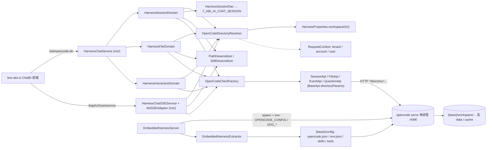
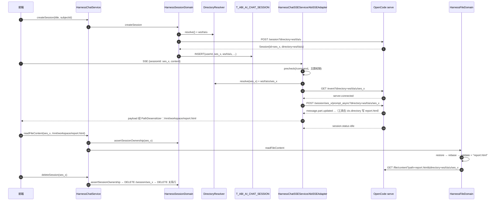

# 02 · OpenCode 多租户目录隔离源码精读

> 范围：`OpenCodeDirectoryResolver` 及其上下游——目录派生（`HarnessProperties`）、会话/文件/交互三个 Domain、OpenCode Java SDK 的 `directory` 传参、SSE 对话链路、出入站路径脱敏、嵌入式进程的目录与 permission 配置、会话关系表。
>
> 代码基线：`abi-platform` 分支 `feature_sit`（HEAD `ed64d16db78`，2026-10-20）；`abi-skills` 分支 `feature_sit_mcpapps`（HEAD `63b79b0`）。所有行号均按该基线用 `cat -n` 核对过。
>
> 标注约定：
> - 【仓库可证】结论有本仓库代码直接支撑。
> - 【OpenCode 行为·仓库内不可验证】属于 OpenCode 服务端（Bun/TS 二进制，以 zip 形式打包在 `resources/opencode/bin/`）的内部实现，本仓库没有其源码，结论来自其公开设计与本仓库调用方式的反推，需要在真实环境验证。
> - 【推断】从代码行为推出、但没有在运行环境里验证过。

路径缩写（下文统一使用）：

| 缩写 | 实际路径 |
|---|---|
| `ai/` | `bos-abi-mservice/code/abi-ai/src/main/java/com/kingdee/abi/ai/harness/` |
| `ms/` | `bos-abi-mservice/code/mservice-abi/src/main/java/kd/bos/mservice/abi/ai/harness/` |
| `res/` | `bos-abi-mservice/code/abi-ai/src/main/resources/opencode/` |
| `ai-test/` | `bos-abi-mservice/code/abi-ai/src/test/java/com/kingdee/abi/ai/harness/` |
| `ms-test/` | `bos-abi-mservice/code/mservice-abi/src/test/java/kd/bos/mservice/abi/ai/harness/` |
| `skills/` | `abi-skills/skills/nl2sql/opencode/`（另一个仓库） |

---

## 1. 定位

### 1.1 为什么一个 OpenCode 进程要服务多租户、多会话

ABI 的智能体底座是 OpenCode（`opencode serve`）。嵌入式模式下整个集群只跑**一个** OpenCode 进程：

- `EmbeddedHarnessServer` 通过分布式锁选主，只有 leader 节点 `start()` 拉起进程，其他节点是 follower，只拿 leader 发布的 endpoint 去连（`ai/oc/embedded/EmbeddedHarnessServer.java:268-305`）。
- 进程监听 `0.0.0.0:{abi.ai.harness.embedded.port}`（`EmbeddedHarnessServer.java:564-569`），所有租户的 `OpenCodeClient` 最终指向同一个 baseUrl（`ai/oc/OpenCodeClientFactory.java:73-84`；客户端按 tenantId 缓存，但 URL 相同）。
- 内存上限默认 2G（`HarnessProperties.java:86`），超限会自重启。

所以"每会话一进程"在这个架构里根本不存在：OpenCode 进程是集群级共享资源，**租户/用户/会话之间的隔离只能靠"每次请求带不同的 `directory`"来实现**。`OpenCodeDirectoryResolver` 就是把"当前是谁、在哪个会话"翻译成一个目录字符串的那一层。

### 1.2 目录在 OpenCode 中的语义

先列仓库里能直接看到的事实，再列 OpenCode 自身的行为。

【仓库可证】

1. SDK 的每个 API 都把 `directory` 作为 **query 参数**发出去，为空时不带（`ai/oc/sdk/api/BaseApi.java:111-117`）。参数对象（如 `SessionNewParams`、`SessionPromptParams`）里的 `directory` 字段还会被 Gson 一并序列化进 JSON body（`GsonJsonSerializer` 未排除该字段）。
2. 业务工具依赖 OpenCode 注入的 `context.directory` 作为输出目录：`skills/tools/assemble_report.ts:3979-3994`、`skills/tools/assemble_dashboard.ts:2910-2916, 3368-3370`；打包后的 `res/config/tools/assemble_dashboard.js` 同样取 `t?.directory`。
3. SSE 链路先订阅 `/event?directory=X`，收到 `server.connected` 才提交 `prompt_async`（`ms/HarnessChatSSEService.java:89-93, 328-332`）。
4. 会话是用**用户级**目录创建的（`HarnessSessionDomain.java:88-92`），但后续 `getMessages/getSession/abort` 用**会话级**目录访问（`HarnessSessionDomain.java:341, 371`）。这条链路在生产中能工作，说明 OpenCode 按 sessionId 查会话时并不要求 directory 与创建时完全一致。

【OpenCode 行为·仓库内不可验证】

- OpenCode server 对每个请求解析目标目录：query `directory` → header `x-opencode-directory` → `process.cwd()`，然后在该目录的 **Instance** 上下文里执行请求。
- Instance 按目录缓存一组状态：配置合并结果、项目识别（git 根 → projectID；非 git 目录通常归入 `global`）、事件总线（Bus）、待回答的 question/permission、文件状态等。
- `/event` 只推送该 Instance 总线上的事件；`prompt_async` 产生的事件发布在其 directory 对应的 Instance 总线上。
- 工具执行时 `context.directory` 就是 Instance 的目录；`external_directory` 权限以 Instance 目录（及 worktree）为"内部"边界判断。
- 会话持久化在 `$XDG_DATA_HOME/opencode/storage/...`，按 projectID 归档，而非按 directory 归档。若所有工作目录都不是 git 仓库，则所有会话可能同属一个 project——这正好解释了上面第 4 条。

这几条决定了全文的核心约束：**directory 是 OpenCode 里"运行上下文"的键，不是访问控制**。OpenCode 不知道租户是谁，也不校验调用方能不能用某个目录。

### 1.3 上下游



---

## 2. 代码地图

| 类 / 文件 | 路径 | 行数 | 职责 |
|---|---|---:|---|
| `OpenCodeDirectoryResolver` | `ai/oc/` | 48 | 从 `RequestContext` 拼用户级 / 会话级目录 |
| `HarnessProperties` | `ai/constant/` | 189 | 全部 `abi.ai.harness.*` 配置；派生 base/workspace/config/data/cache；`LEGACY_BASE_DIR` |
| `DirectoryUtils` | `ai/util/` | 108 | 旧根迁移用的目录判空、移动、复制、删除 |
| `HarnessSessionDomain` | `ai/domain/` | 526 | 会话 CRUD、归属校验 `assertSessionOwnership`、消息脱敏、导出 |
| `HarnessFileDomain` | `ai/domain/` | 97 | 文件状态、文件读取（restore→rebase→validate） |
| `HarnessInteractionDomain` | `ai/domain/` | 60 | question 回答/拒绝、permission 回复 |
| `SessionAccessDomain` / `PasscodeAccess` | `ai/domain/` | 74 / 193 | 会话查看器的临时提权（跨用户查看） |
| `HarnessSessionDao` | `ai/dao/` | 397 | 会话关系表读写，提权时按 `FDIRECTORY LIKE` 限定账套 |
| `HarnessSqlConstants` | `ai/constant/` | 29 | 关系表 SQL |
| `ChatSession` / `Session` | `ai/model/`、`ai/oc/sdk/model/session/` | 90 / 213 | 业务会话模型（含 `directory`、`projectID`） |
| `PathDesensitizer` | `ai/oc/support/` | 119 | 出站 `/mnt` 脱敏、入站还原 |
| `SkillDesensitizer` / `Desensitizer` | `ai/oc/support/` | 123 / 11 | skill 工具输出截断；脱敏接口 |
| `BaseApi` | `ai/oc/sdk/api/` | 118 | HTTP 公共逻辑，`directoryParams` |
| `SessionApi` / `FileApi` / `EventApi` / `QuestionApi` / `PermissionApi` | `ai/oc/sdk/api/` | 173 / 38 / 21 / 34 / 29 | 各端点封装，全部带 directory |
| `GlobalApi` / `ApiPaths` | `ai/oc/sdk/api/`、`ai/oc/sdk/constants/` | 49 / 95 | 全局端点（不带 directory）；路径常量 |
| `ApacheHttpClient` | `ai/oc/sdk/http/` | 247 | Basic Auth、`URIBuilder` 拼 query |
| `OpenCodeClientFactory` | `ai/oc/` | 91 | 按租户缓存 client，三级 endpoint 发现 |
| `EmbeddedHarnessExtractor` | `ai/oc/embedded/` | 508 | 解压二进制/配置、写 `opencode.json`（注入 permission）、写 `env.json` |
| `EmbeddedHarnessServer` | `ai/oc/embedded/` | 1139 | 选主、迁移旧根、拉起进程、`buildProcessEnv` |
| `EmbeddedConfig` / `Permission` / `JsonNode` | `ai/oc/embedded/config/` | 490 / 46 / 57 | 预置配置 + 覆盖合并；permission 链式 setter |
| `HarnessChatService` | `ms/` | 817 | `/abi/opencode.do` 的方法分发入口 |
| `HarnessChatSSEService` | `ms/` | 561 | SSE 对话：订阅事件、提交 prompt、连接版本 |
| `AbiSSEAdapter` | `ms/` | 694 | OpenCode 事件 → ABI 消息格式、payload 脱敏、`/command` |
| `AbstractABISSEService` | `ms/../common/sse/` | 52 | SSE 线程池执行、`RequestContext` 透传 |
| `LocalSessionMessageExport` | `ms/` | 144 | 导出写文件：`toRealPath` + `SecureDirectoryStream` + `NOFOLLOW_LINKS` |
| `CompactCodec` | `ms/` | 242 | 身份标签的可逆编码 |
| `opencode.json` / `AGENTS.md` / `agent/build.md` | `res/config/` | 25 / 149 / 33 | 预置 permission、全局提示词 |
| DDL | `bos-abi-mservice/datamodel/bos/1.5/main/abi/dbschema/kd_1.5.3493_abi_table.sql` 等 | — | `T_ABI_AI_CHAT_SESSION` 建表、索引、加列 |
| 工具源码 | `skills/tools/assemble_report.ts`、`assemble_dashboard.ts`、`send_file_to_user.ts` | 4201 / 3405 / 72 | 用 `context.directory` 写产物 |
| 前端 | `bos-abi-ui/src/api/chatbi/chatbi-api.ts`、`.../ReportToolRenderer/index.tsx` | 809 / 174 | 用脱敏后的 `file_path` + `sessionID` 调 `readFileContent` |

推荐阅读顺序：

1. `HarnessProperties` → `OpenCodeDirectoryResolver`：48 + 189 行就能建立"目录长什么样"的全貌。
2. `BaseApi.directoryParams` + `SessionApi`：看清 directory 怎么上线。
3. `HarnessSessionDomain`：重点看 `createSession` 与其他方法 directory 来源的差异，以及 `assertSessionOwnership` 用在了哪里。
4. `HarnessChatSSEService.run` → `consumeEventStream` → `submitPromptAsync`：理解"同一个 directory"的硬约束。
5. `PathDesensitizer` + `HarnessFileDomain`：出站压缩、入站还原、防穿越，三者要对照看。
6. `EmbeddedHarnessExtractor.writeMergedConfigFile` + `res/config/opencode.json` + `EmbeddedHarnessServer.buildProcessEnv`：看 OpenCode 侧边界是怎么配出来的。
7. `HarnessSessionDao` + DDL：落库字段与跨用户查询的账套限定。
8. `LocalSessionMessageExport`：作为"更严格的文件边界写法"与 `HarnessFileDomain` 对比。

---

## 3. 目录布局与数据模型

### 3.1 根目录派生

```java
// ai/constant/HarnessProperties.java:117-119
private static String getDefaultDirectory() {
    return FileSysUtil.getAbsoluteFilePath(File.separator + AbstractLocalFile.ROOT_DIR + File.separator + "ABIHarness");
}
// :107
public static final String LEGACY_BASE_DIR = FileSysUtil.getAbsoluteFilePath(File.separator + "OpenCode");
// :162-188
public static String baseDirectory() {          // 去掉末尾 "/"
    String dir = BASE_DIR.getProperty();
    if (dir != null && dir.endsWith("/")) { dir = dir.substring(0, dir.length() - 1); }
    return dir;
}
public static String workspaceDir() { return baseDirectory() + "/workspace"; }
public static String configDir()    { return baseDirectory() + "/config"; }
public static String dataDir()      { return baseDirectory() + "/data"; }
public static String cacheDir()     { return baseDirectory() + "/cache"; }
```

要点：

- 默认值依赖苍穹文件存储根（`FileSysUtil`）。测试里把 `BASE_FILE_DIR` 设为 `/var/data/QingStorage` 时，默认 base 是 `/var/data/QingStorage/ABIStorage/ABIHarness`，旧根是 `/var/data/QingStorage/OpenCode`（`ai-test/constant/HarnessPropertiesTest.java:103-110`）。
- `BASE_DIR` 用 `getProperty()`（集群级）读取，不是 `getTenantProperty()`，所以 base 不能按租户配置。这是对的：进程只有一个，所有租户必须共享同一个根。
- 只去掉一个末尾 `/`；`LEGACY_BASE_DIR` 是类加载时计算的 `static final`。
- `EmbeddedConfig.loadFromConfigFile` 的注释说 `configDir/opencode.json` 由 "NFS 共享"（`ai/oc/embedded/config/EmbeddedConfig.java:90-95`），可见 base 预期放在集群共享存储上。

### 3.2 完整目录树

```text
{BASE}                                   abi.ai.harness.directory；默认 {文件存储根}/ABIStorage/ABIHarness
├── config/                              configDir()；进程环境 OPENCODE_CONFIG_DIR
│   ├── opencode.json                    Extractor.writeMergedConfigFile 每次 extract 重写；OPENCODE_CONFIG
│   ├── env.json                         Extractor.writeToolEnvFile；工具调用 ABI 的凭据与域名
│   ├── AGENTS.md、agent/build.md         全局提示词 / build agent 提示词
│   ├── skills/<name>/SKILL.md ...       permission：external_directory=allow，edit=deny
│   ├── tools/*.js、tool_runtime.js       自定义工具（Bun 打包产物）
│   ├── plugins/langfuse.js
│   └── .extracted                       jar 指纹（仅 jar 模式写入）
├── data/                                dataDir()；进程环境 XDG_DATA_HOME
│   ├── opencode/...                     OpenCode 自身的会话/消息存储【OpenCode 行为】
│   └── export/{exportPath}/{sessionId}.json   LocalSessionMessageExport 导出
├── cache/                               cacheDir()；进程环境 XDG_CACHE_HOME
│   └── opencode/bin/rg                  extractRgIfNeeded 解压的 ripgrep
└── workspace/                           workspaceDir()；OpenCodeDirectoryResolver 的基准
    └── {tenantId}/{accountId}/{userId}/          用户级目录：createSession 的 directory，落库 FDIRECTORY
        └── {sessionId}/                          会话级目录：其余所有会话操作的 directory
            ├── report_xxx.html                   assemble_report 写入（ctx.directory）
            └── dashboard_xxx.html ...            assemble_dashboard / write 工具写入

{java.io.tmpdir}/opencode-embedded/      extractDir：opencode 二进制、.extracted、opencode.pid；也是进程 cwd
{LEGACY_BASE_DIR}                        {文件存储根}/OpenCode；leader 首次启动时整体迁到 {BASE}
```

### 3.3 每层的创建者、读写者与共享性

| 层 | 创建者 | 读 | 写 | 共享 / 私有 |
|---|---|---|---|---|
| `{BASE}` | 迁移时 `DirectoryUtils.moveDirectory`（`EmbeddedHarnessServer.java:329-347`）或下级 `mkdirs` 隐式创建 | 全部 | 全部 | 集群共享 |
| `config/` | `extractConfigFromJar` / `extractConfigFromFileSystem` / `downloadRemoteConfig`，每次先 `FileUtil.deleteDir` 再重建（`EmbeddedHarnessExtractor.java:239, 282, 326`） | OpenCode、`EmbeddedConfig.loadFromConfigFile`、自定义工具 | 仅 leader 的 Extractor | 所有租户共享 |
| `data/` | `ensureDirExists`（`EmbeddedHarnessServer.java:560`） | OpenCode、导出接口 | OpenCode、`LocalSessionMessageExport` | 所有租户共享（会话数据混存，【OpenCode 行为】） |
| `cache/` | `ensureDirExists`（`:561`）、`extractRgIfNeeded`（`EmbeddedHarnessExtractor.java:112-124`） | OpenCode | OpenCode、Extractor | 共享 |
| `workspace/{t}/{a}/{u}` | **仓库内没有任何 Java `mkdirs`**；【推断】由 OpenCode 或工具首次写文件时创建（`skills/tools/assemble_dashboard.ts:3178, 3372` 的 `mkdirSync(dirname(targetPath), {recursive: true})`） | OpenCode | OpenCode/工具 | 用户私有（逻辑上） |
| `workspace/.../{sessionId}` | 同上 | OpenCode、`readFileContent` | 工具、OpenCode 内置 write/edit | 会话私有（逻辑上） |
| `tmpdir/opencode-embedded` | `startAsync` 设定路径（`EmbeddedHarnessServer.java:209`），`extract()` 里 `mkdirs` | 进程启动 | Extractor、pid 文件 | 节点本地 |

"逻辑上私有"的意思是：OS 层面所有目录都属于同一个进程用户，隔离完全靠"每次请求带哪个 directory"和 OpenCode 的 `external_directory` 权限。

### 3.4 会话关系表 `T_ABI_AI_CHAT_SESSION`

DDL：`kd_1.5.3493_abi_table.sql:1-12`，主键/索引：`kd_1.5.3493_abi_constraint.sql:1-3`，`FSUBJECTID` 后加：`kd_1.5.3512_abi_table.sql:1-2`。

| 字段 | 类型 | 来源 | 用途 |
|---|---|---|---|
| `FID` | VARCHAR(50) PK | `dbExecutor.genUUID()` | 主键 |
| `FUSERID` | VARCHAR(50)，索引 `IDX_ABI_AI_CHAT_SESSION_USERID` | `RequestContext.getCurrUserId()` | 归属判断的唯一依据 |
| `FSESSIONID` | VARCHAR(50) | OpenCode 返回的 `session.id` | 关联 OpenCode 会话 |
| `FDIRECTORY` | VARCHAR(200) | OpenCode 返回的 `session.directory`，即**用户级目录** | 提权查询时 `LIKE %/{tenant}/{account}/%` 限定账套；`getSessionDetail` 访问 OpenCode 时的 directory |
| `FPROJECTID` | VARCHAR(50) | `session.projectID` | 仅落库与回显，仓库内无逻辑使用 |
| `FTITLE` | VARCHAR(200) | 标题，Domain 截断到 200 | 列表展示 |
| `FVERSION` | VARCHAR(10) | `session.version` | 回显 |
| `FSUBJECTID` | VARCHAR(50) | 前端传入 | 主题绑定 |
| `FCREATETIME` / `FUPDATETIME` | DATETIME | 插入时 `new Date()` | 排序、时间筛选 |

写入点只有 `insertUserSession`（`ai/dao/HarnessSessionDao.java:32-57`），空值统一写成单个空格（`blankIfNull`，`:388-391`）。注意 `updateSessionTitle/updateSubjectId` 都不更新 `FUPDATETIME`（`HarnessSqlConstants.java:20-24`）。

---

## 4. 主流程逐段精读

### 4.0 时序总览



### 4.1 目录解析本身

```java
// ai/oc/OpenCodeDirectoryResolver.java:23-42
public static String resolve()
{
    String baseWorkDir = getBaseWorkDir();                 // HarnessProperties.workspaceDir()
    RequestContext rc = RequestContext.get();
    String[] dirs = new String[]{rc.getTenantId(), rc.getAccountId(), String.valueOf(rc.getCurrUserId())};
    return baseWorkDir + "/" + StringUtils.join(dirs, "/");
}

public static String resolve(String sessionId)
{
    if (sessionId == null || sessionId.isEmpty())
    {
        return resolve();
    }
    return resolve() + "/" + sessionId;
}
```

三个设计事实：

1. **身份只来自服务端上下文**。tenant/account/user 全部取 `RequestContext`，前端无法指定，这是整套隔离最可靠的部分。
2. **sessionId 原样拼接**，没有格式校验，也没有 `normalize` 后的前缀校验。
3. `sessionId` 为空时静默退化为用户级目录。调用方如果漏传 sessionId，请求会落到用户级 Instance 上而不是报错。

`RequestContext` 在 SSE 线程里也可用，因为 `AbstractABISSEService.call` 在提交线程池前取出、在任务里 `RequestContext.set`（`ms/../common/sse/AbstractABISSEService.java:18-23`）。不过任务结束时没有清理。

### 4.2 createSession：为什么用用户级目录

```java
// ai/domain/HarnessSessionDomain.java:82-114（节选）
String directory = OpenCodeDirectoryResolver.resolve();         // 88：用户级
OpenCodeClient client = OpenCodeClientFactory.getClient();
SessionNewParams params = SessionNewParams.builder().title(title).directory(directory).build();
String userId = getCurrUserId();                                 // 95：-101101 视为不可用
try {
    tx.beginRequired();
    Session session = client.session().create(params);          // 99：POST /session?directory=...
    ChatSession chatSession = ChatSession.from(session);
    chatSession.setSubjectId(subjectId);
    getSessionDao().insertUserSession(userId, chatSession);      // 102
    return chatSession;
} catch (Exception e) { tx.markRollback(); throw ...; } finally { tx.end(); }
```

为什么不用会话级目录？因为 **sessionId 是 OpenCode 在 create 时生成的**，调用前无从得知，只能先在用户级目录上建。随之而来的结果：

- `session.directory`（以及落库的 `FDIRECTORY`）永远是用户级目录；
- 会话真正"干活"的目录是 `FDIRECTORY + "/" + sessionId`，由每次请求重新计算，而不是从库里读。

事务只包住了 DB：如果 OpenCode 创建成功、DB 插入失败，DB 回滚但 OpenCode 会话已存在，成为孤儿。仓库内没有补偿逻辑。

### 4.3 SSE 对话：订阅 event + promptAsync，必须同一个 directory

```java
// ms/HarnessChatSSEService.java:80-93
JSONObject checkResp = adapter.precheck();          // /command 或主题权限
if (checkResp != null) { ...; iterator.finish(); return; }

String directory = OpenCodeDirectoryResolver.resolve(sessionId);
eventStream = client.event().listStreaming(directory);   // GET /event?directory=...
long connVersion = registerConnection(sessionId);
consumeEventStream(eventStream, client, adapter, iterator, directory, connVersion);
```

```java
// ms/HarnessChatSSEService.java:322-332
if (!put(iterator, adaptedMessage)) { break; }      // 先把事件转发给前端
if (!promptSubmitted && adapter.isServerConnected(adaptedMessage))
{
    submitPromptAsync(client, adapter, directory);  // 同一个 directory
    promptSubmitted = true;
}
```

为什么必须是同一个 directory：

- 【OpenCode 行为】`/event` 只推送某个 Instance 总线上的事件；`prompt_async` 在其 directory 的 Instance 中运行并发布事件。两边目录不一致，模型会照常跑，但这条 SSE 连接一个增量也收不到，前端会一直等到空闲超时。
- 【仓库可证】"先连上再发"的时序由代码保证：只有收到 `server.connected` 才 `promptAsync`，避免 prompt 产生的早期事件在订阅建立前丢失。
- 【仓库可证】工具产物落在 `ctx.directory`。prompt 用会话级目录，产物才会落在 `workspace/.../{sessionId}/`，后面 `readFileContent` 用同一规则算出的目录才能读到。
- 【OpenCode 行为】question/permission 的待处理列表挂在 Instance 上，所以 `submitPromptAsync` 里的问题回复（`:136-153`）和 `HarnessInteractionDomain` 也必须用同一个目录。

`submitPromptAsync` 的另一条分支：`content` 为空时把这次 SSE 当作"回答问题"，读 `extend.replyQuestion` 调 `question().reply/reject`（`:134-153`），之后**不发 prompt**，继续消费事件流直到结束。

结束条件在 `AbiSSEAdapter.shouldStopSSE`（`ms/AbiSSEAdapter.java:298-309`）：当前会话 `session.status=idle` / `session.idle` / `session.error`；或当前会话出现 `question` 工具处于 running（等待用户作答，断开 SSE）；或连续心跳达到 `abi.ai.harness.sse.maxIdle` 次且 `session/status` 查询为空闲。注意 `isCurrentSession` 只用于判定"结束"，非当前会话的事件也会照常转发（`:253-291`）。由于每个会话独占一个目录，正常情况下这个 Instance 上不会有别的会话。

连接版本：`registerConnection` 对 `abi:opencode:sse:conn:ver:{sessionId}` 自增（`:485-496`），心跳时发现版本被更新就退出旧连接（`:315-320`），保证同一会话只有最新的 SSE 在消费。

### 4.4 messages / abort / status / revert

```java
// ai/domain/HarnessSessionDomain.java:246-279（节选）
public List<SessionMessagesResponse> getMessages(String sessionId) {
    assertSessionOwnership(sessionId);
    return getMessagesInternal(sessionId);                     // resolve(sessionId)
}
public Boolean abortSession(String sessionId) {
    assertSessionOwnership(sessionId);
    return client.session().abort(sessionId, OpenCodeDirectoryResolver.resolve(sessionId));
}
public SessionStatus getSessionStatus(String sessionId) {      // 无归属校验
    Map<String, SessionStatus> statuses = client.session().status(OpenCodeDirectoryResolver.resolve(sessionId));
    return statuses == null || !statuses.containsKey(sessionId) ? SessionStatus.builder().build() : statuses.get(sessionId);
}
```

- `status` 是"按目录查该 Instance 下所有会话状态"，再按 sessionId 取值。会话级目录下正常只有一个会话。
- `revertSession`（`:350-361`）**没有**归属校验，直接 `POST /session/{id}/revert?directory=...`。
- `getMessagesInternal`（`:374-379`）返回前做两层脱敏：先 `PathDesensitizer`（整段 JSON 字符串替换后再反序列化，`:381-392`），再 `SkillDesensitizer`（skill 工具输出只保留首尾各 3 行）。

`getSessionDetail`（`:180-211`）是唯一一个**从库里取 directory** 的方法：

```java
// ai/domain/HarnessSessionDomain.java:189-204（节选）
ChatSession relation = getSessionDao().getSession(sessionId, elevatedAccess ? null : userId, elevatedAccess);
if (relation == null) { throw new IllegalStateException("session is unavailable"); }
...
ChatSession session = ChatSession.from(getSessionInternal(sessionId, relation.getDirectory()));
...
result.put("messages", getMessagesInternal(sessionId, relation.getDirectory()));
```

原因：提权查看他人会话时，Resolver 只能算出**当前查看者**的目录，必须改用会话所有者落库的用户级目录。这里的归属判断是 DAO 的 `WHERE FSESSIONID=? AND FUSERID=?`（非提权），或 `FDIRECTORY LIKE %/tenant/account/%`（提权，`HarnessSessionDao.java:120-145, 181-197`）。

### 4.5 question / permission 回复

```java
// ai/domain/HarnessInteractionDomain.java:20-59（节选）
public Boolean replyQuestion(String sessionId, String requestId, List<List<String>> answers) {
    String directory = OpenCodeDirectoryResolver.resolve(sessionId);
    QuestionReplyParams params = QuestionReplyParams.builder().answers(answers).directory(directory).build();
    return client.question().reply(requestId, params);              // POST /question/{requestId}/reply
}
public Boolean replyPermission(String sessionId, String permissionId, String reply) {
    String directory = OpenCodeDirectoryResolver.resolve(sessionId);
    SessionPermissionRespondParams params = SessionPermissionRespondParams.builder().response(reply).directory(directory).build();
    return client.session().respondPermission(sessionId, permissionId, params);  // POST /session/{sid}/permissions/{pid}
}
```

- 三个方法都只用 sessionId 算目录，**都没有归属校验**，Service 层也没有补（`ms/HarnessChatService.java:527-578`）。
- `replyPermission` 用的是旧式会话端点 `session/%s/permissions/%s`（`ApiPaths.java:71`），没用 `PermissionApi.reply`（`permission/%s/reply`）。`PermissionApi` 在仓库里没有调用方。
- `getQuestion`（`HarnessSessionDomain.java:363-368`）列出该目录 Instance 的全部待答问题，也没有归属校验。
- 预置配置把 bash/task/webfetch 等直接 deny，`external_directory` 默认 deny（见 §5.6），实际触发 `permission.asked` 的场景很少。【推断】

### 4.6 文件列表与读取：restore → rebase → validate

```java
// ai/domain/HarnessFileDomain.java:22-44
public List<FileInfo> listFileStatus(String sessionId) {
    String directory = OpenCodeDirectoryResolver.resolve(sessionId);
    List<FileInfo> files = client.file().status(directory);
    if (files != null) {
        files.forEach(file -> file.setPath(PathDesensitizer.sanitize(file.getPath())));
    }
    return files;
}

public FileReadResponse readFileContent(String sessionId, String filePath) {
    String directory = OpenCodeDirectoryResolver.resolve(sessionId);
    filePath = PathDesensitizer.restore(filePath, directory);           // ① /mnt/workspace/x → {会话目录}/x
    filePath = rebaseToCurrentSession(filePath, sessionId, directory);  // ② 历史绝对路径 → 当前会话目录
    filePath = validateFilePath(filePath, directory);                    // ③ 防穿越，返回相对路径
    return client.file().read(filePath, directory);                      // GET /file/content?path=相对&directory=...
}
```

前端调用方：`ReportToolRenderer` 把工具 part 里（已脱敏）的 `file_path` 和 `part.sessionID` 直接传给 `readFileContent`（`bos-abi-ui/.../ReportToolRenderer/index.tsx:68-71`）。

**① restore**（`PathDesensitizer.java:86-96`）：

```java
String legacyWorkspacePrefix = getLegacyWorkspacePrefix(sessionDirectory);  // "/mnt/workspace/t/a/u/ses_x"
if (legacyWorkspacePrefix != null && (path.equals(legacyWorkspacePrefix) || path.startsWith(legacyWorkspacePrefix + "/"))) {
    return restore(path);                       // 旧格式：/mnt → base
}
String restored = replacePrefix(path, PLACEHOLDER_WORKSPACE, sessionDirectory);  // 新格式
return restored != null ? restored : restore(path);
```

- 新格式 `/mnt/workspace/report.html` 不含任何 ID，靠**服务端当前会话目录**还原。路径里没有身份信息，前端也就无从篡改身份。
- 兼容旧格式 `/mnt/workspace/{t}/{a}/{u}/{sid}/...`（压缩改造前缓存在前端的路径），只认**当前会话自己的**旧前缀。
- 都不匹配时退回单参 `restore`：`/mnt/...` 或旧根前缀换成 base（例如 `/mnt/config/...` → `{base}/config/...`），后面由 validate 拒绝。

**② rebase**（`:49-65`）：只处理以 `/` 开头、包含 `/{sessionId}/` 的路径，取**最后一次**出现位置之后的部分拼到当前会话目录。用途是兼容迁移前、还带着旧 base 的历史绝对路径（`HarnessFileDomainTest` TC-04）。相对路径哪怕包含 sessionId 也不处理（TC-05）。

**③ validate**（`:73-96`）：

```java
basePath = Paths.get(baseDirectory).normalize().toAbsolutePath();
resolvedPath = basePath.resolve(filePath).normalize().toAbsolutePath();
if (!resolvedPath.startsWith(basePath)) {
    throw new IllegalArgumentException("Invalid file path: directory traversal not allowed");
}
return basePath.relativize(resolvedPath).toString();
```

- `Path.startsWith` 按路径段比较，`/a/ses_abc` 不会被当作 `/a/ses_abcd` 的前缀（字符串 `startsWith` 会，见 §9 的 abi-skills 工具问题）。
- `resolve(绝对路径)` 直接返回该绝对路径，所以 `{base}/config/env.json` 这类还原结果一定会被拒绝。
- 纯词法校验：`normalize` 不解析符号链接，没有 `toRealPath`（见 §5.4）。
- 最终传给 OpenCode 的是**相对路径**，由 OpenCode 基于 directory 解析。【OpenCode 行为】OpenCode 读文件时是否还有自己的边界检查不可验证。

`readFileContent` 的归属校验在 Service 层（`ms/HarnessChatService.java:605`），`listFileStatus` 没有（`:584-597`）。

### 4.7 出站脱敏

出站路径有三个入口，都调 `PathDesensitizer.sanitize`：

| 出口 | 位置 | 做法 |
|---|---|---|
| SSE 事件 | `AbiSSEAdapter.adaptPayload` → `sanitizePayloadPaths`（`ms/AbiSSEAdapter.java:260, 660-681`） | payload 整体 `toJSONString` → 正则替换 → 有变化才重新 parse |
| 历史消息 | `HarnessSessionDomain.desensitizeMessagePaths`（`:381-392`） | List 整体编码 → 替换 → 解码 |
| 文件状态 | `HarnessFileDomain.listFileStatus`（`:30`） | 逐个 `FileInfo.path` |

没有经过脱敏的出口（问题见 §9）：

- `createSession / listSessions / searchSessions / getSession / getSessionDetail` 直接返回 `Session/ChatSession`，其中 `directory` 字段是真实绝对路径（`Session.java:7, 31`；`ResponseUtil.output` 用 `JsonUtil.encodeToString` 序列化 wrap，`bos-abi-common/.../response/ResponseUtil.java:14-18`）。【推断】按 getter 序列化会输出该字段，未抓包验证。
- `AbiSSEAdapter.adaptResponse(String)`（`:202-251`）自己构造 payload，不走 `adaptPayload`，所以 `"Harness service error: " + e.getMessage()`（`HarnessChatSSEService.java:101`）里如果带了 OpenCode 返回体中的路径，会原样下发。
- `readFileContent` 返回的文件内容本身不做处理。

### 4.8 deleteSession

```java
// ai/domain/HarnessSessionDomain.java:222-244
String directory = OpenCodeDirectoryResolver.resolve(sessionId);
...
tx.beginRequired();
assertSessionOwnership(sessionId);                         // 230
Boolean deleted = client.session().delete(sessionId, directory);   // DELETE /session/{id}?directory=...
getSessionDao().deleteByUserIdAndSessionId(userId, sessionId);
return deleted;
```

之后 Service 层顺带清理仪表板 SQL 模板（`ms/HarnessChatService.java:153-162`）。

没有做的事：

- **不删除** `workspace/.../{sessionId}/` 目录，产物文件永久残留（仓库内对 workspace 没有任何删除代码）。
- OpenCode 删除在 DB 删除之前，DB 失败回滚时 OpenCode 侧已经删了，关系行变成悬挂记录。
- 【OpenCode 行为】OpenCode 内存里为该目录创建的 Instance 是否随之释放不可知；`GlobalApi.dispose()`（`GlobalApi.java:42-44`）在仓库里没有调用方。

---

## 5. 安全分层详解

### 5.1 分层总览

| 层 | 机制 | 位置 | 强度 |
|---|---|---|---|
| L0 身份 | `RequestContext` 的 tenant/account/user | 苍穹框架 | 强（前端不可控） |
| L1 归属 | `assertSessionOwnership` = 关系表按 `FUSERID+FSESSIONID` 计数 | `HarnessSessionDomain.java:325-337` | 有缺口（§5.3） |
| L2 目录派生 | Resolver 用 L0 拼目录 | `OpenCodeDirectoryResolver.java:23-42` | sessionId 未校验 |
| L3 文件路径 | restore→rebase→validate | `HarnessFileDomain.java:35-96` | 词法级，不防符号链接 |
| L4 OpenCode 权限 | `opencode.json` permission + 注入 | `res/config/opencode.json:15-24`、`EmbeddedHarnessExtractor.java:357-370` | 只约束内置工具 |
| L5 出站脱敏 | `/mnt` 替换 | `PathDesensitizer` | 失败时放行（fail-open） |
| L6 网络 | OpenCode 监听 `0.0.0.0`，Basic Auth 可选 | `EmbeddedHarnessServer.java:567`、`ApacheHttpClient.java:80-83` | 默认无鉴权（§9） |

### 5.2 身份来源

- 目录：`RequestContext.get()` 的 `getTenantId/getAccountId/getCurrUserId`（Resolver `:26-27`），没有判空，也没有排除 `-101101`。
- 归属：`getCurrUserId()`（`HarnessSessionDomain.java:72-80`），`RequestContext` 为 null 或 userId 为 `-101101` 时抛 `IllegalStateException`。
- SSE：`AbiSSEAdapter` 构造时取 `rc.getTraceId()`、`rc.getCurrUserId()`（`ms/AbiSSEAdapter.java:104-106`），同样未判空。
- 给模型/工具的身份：`getSystemPrompt` 把 sessionId、subjectId、`Identity tag`、用户 ID/名称/组织写进 system prompt（`HarnessChatSSEService.java:357-391`）。`Identity tag = tenantId/CompactCodec(accountId)/CompactCodec(userSegment)`（`:443-463`）。`CompactCodec` 是基于 shiftKey 的可逆编码，有 `decode` 方法，文件中没有 HMAC 或摘要逻辑（`ms/CompactCodec.java:25-52`），所以它提供混淆而非防篡改。工具侧如何使用这个标签不在本文范围。

### 5.3 归属校验逐接口清单

"directory 来源"指传给 OpenCode 的目录怎么来的。

| 入口 | Domain 方法 | 归属校验 | directory 来源 | 备注 |
|---|---|---|---|---|
| `createSession` | `createSession` | 不适用（新建） | `resolve()` 用户级 | |
| `listSessions` | `listSessions` | SQL `WHERE FUSERID=?` | 不访问 OpenCode | 返回含真实 `directory` |
| `searchSessions` | `searchSessions` | SQL `FUSERID`；提权时 `FDIRECTORY LIKE` | 不访问 OpenCode | 提权受 `SESSION_ELEVATED` + passcode 控制 |
| `getSessionDetail` | `getSessionDetail` | DAO 查关系行（隐式） | 库中 `FDIRECTORY`（用户级） | 唯一从库取目录 |
| `deleteSession` | `deleteSession` | ✅ `:230` | `resolve(sid)` | 事务内校验 |
| `getMessages` | `getMessages` | ✅ `:248` | `resolve(sid)` | |
| `exportOpenCodeSessionMessages` | 逐个 `getMessages` | ✅（间接） | `resolve(sid)` | 失败计入 `failures` |
| `abortSession` | `abortSession` | ✅ `:254` | `resolve(sid)` | |
| `getSession` | `getSession` | ✅ `:262` | `resolve(sid)` | |
| `getSessionStatus` | `getSessionStatus` | ❌ | `resolve(sid)` | |
| `updateSessionTitle` | `updateSessionTitle` | ✅ `:283` + SQL `FUSERID` | 不访问 OpenCode | |
| `updateSubjectId` | `updateSubjectId` | ✅ `:307` + SQL `FUSERID` | 不访问 OpenCode | |
| `revertSession` | `revertSession` | ❌ | `resolve(sid)` | 会修改会话状态 |
| `getQuestion` | `getQuestion` | ❌ | `resolve(sid)` | 返回该目录全部待答问题 |
| `replyQuestion` | `HarnessInteractionDomain.replyQuestion` | ❌ | `resolve(sid)` | |
| `rejectQuestion` | `rejectQuestion` | ❌ | `resolve(sid)` | |
| `replyPermission` | `replyPermission` | ❌ | `resolve(sid)` | |
| `listFileStatus` | `HarnessFileDomain.listFileStatus` | ❌ | `resolve(sid)` | |
| `readFileContent` | `HarnessFileDomain.readFileContent` | ✅ Service `:605` | `resolve(sid)` | 校验写在 Service，不在 Domain |
| `messageFeedback` / `getMessageFeedbacks` | `MessageFeedbackDomain` | ❌ | 不访问 OpenCode | `ai/feedback/domain/MessageFeedbackDomain.java:39-72` 只按 sessionId |
| SSE `run` | — | ❌（只在 `topicId` 非空时校验主题权限，`AbiSSEAdapter.java:408-416`） | `resolve(sid)` | 订阅事件 + 提交 prompt |
| SSE `/command export` | `exportSession` | ✅ `:491` | `resolve(sid)` | `arguments` 可指定任意 sessionId |
| SSE `/command status` | `HarnessServerCommandExecutor.status` | 无任何权限校验 | — | 返回 state/leader/endpoint/资源占用（`AbiSSEAdapter.java:355-378`） |

缺校验的接口实际风险分两类。

**(a) 普通的他人 sessionId**（例如 `ses_victim`）：目录会算成 `ws/t/a/{我}/ses_victim`。

- 只依赖目录的接口（`getQuestion`、`listFileStatus`、`getSessionStatus`）落到一个不存在的空目录，基本拿不到东西。
- 路径里带 sessionId 的接口（`revertSession`、`replyPermission`，以及 SSE 的 `promptAsync`）：§1.2 第 4 条说明 OpenCode 按 id 找会话时不强制目录一致，【推断】这些调用很可能作用到他人会话上，只是在"我的目录"Instance 里执行。需要在环境中验证。

**(b) 构造的 sessionId**：见 §5.4 的穿越。

sessionId 的可获得性：OpenCode 的 sessionId 是随机串，不易猜。但它会出现在日志里（`HarnessChatService` 多处 `LogUtil.info(... sessionId ...)`），提权查看者也能在列表里看到他人的 sessionId。

### 5.4 路径穿越防护

**文件路径**（`filePath` 参数）——已防：

| 输入 | restore 后 | rebase 后 | validate |
|---|---|---|---|
| `/mnt/workspace/r.html` | `{S}/r.html` | 不变 | ✅ `r.html` |
| `r.html` | 不变 | 不变（非 `/` 开头） | ✅ |
| `/mnt/workspace/../config/env.json` | `{S}/../config/env.json` | 命中 `/{sid}/`，相对部分 `../config/env.json` 拼回 `{S}`，normalize 后为 `{U}/config/env.json` | ❌ 拒绝 |
| `/mnt/config/env.json` | `{base}/config/env.json` | 不变 | ❌ 拒绝 |
| `/old/base/workspace/t/a/u/{sid}/../../x` | 不变 | `{S}/../../x` → `{T}/{A}/x` | ❌ 拒绝（TC-07） |
| `/mnt/workspace/t/a/u2/ses_other/f` | `{S}/t/a/u2/ses_other/f` | 末次 `/{sid}/` 在 `{S}` 内，结果不变 | ✅ 但仍在当前会话目录内，读不到别人的文件 |

（`{S}` 为当前会话目录，`{U}` 为用户级目录。）

**sessionId 参数**——未防。sessionId 直接拼进目录（Resolver `:41`），又通过 `String.format` 拼进 URL 路径（如 `ApiPaths.SESSION_BY_ID = "session/%s"`，`SessionApi.java:57-60`）。例如传 `sessionId = "../{otherUserId}/ses_xxx"`：

- 目录变成 `ws/t/a/{我}/../{other}/ses_xxx`。【OpenCode 行为】若 OpenCode 对 directory 做 `path.resolve`，实际就是他人的会话目录。
- 对只依赖目录的接口，这就是越权：`listFileStatus`（列他人会话文件状态）、`getQuestion`（列他人待答问题）、`replyQuestion/rejectQuestion`（requestId 可从 `getQuestion` 结果拿到），以及 SSE `run`（订阅他人会话的实时事件流，`content` 为空时不会发 prompt，变成纯监听）。
- 再加几个 `../` 就能跨账套、跨租户。
- `readFileContent` 不受影响：Service 层先做了 `assertSessionOwnership`，构造的 sessionId 在关系表里不存在。
- 这是本文最主要的安全发现。代码层面可证，实际效果取决于 OpenCode 怎么处理 directory，需要环境验证。

**配置解压**——已防 Zip Slip：`sanitizePath` 拒绝 `../`、`/..`（`EmbeddedHarnessExtractor.java:439-448`），再用 `getCanonicalPath().startsWith(dest + separator)` 二次校验（`:258, 423`）。

### 5.5 符号链接

| 场景 | 处理 | 证据 |
|---|---|---|
| `readFileContent` | 不处理：`normalize()` 不解析链接。会话目录里如果有指向外部的链接，validate 会通过 | `HarnessFileDomain.java:84-85` |
| 导出 | 严格：根目录 `toRealPath()`；逐级用 `SecureDirectoryStream.newDirectoryStream(segment, NOFOLLOW_LINKS)` 下降；文件用 `CREATE_NEW + NOFOLLOW_LINKS`，写前 `rejectSymbolicLink` | `LocalSessionMessageExport.java:29-44, 50-81, 104-127` |
| 配置解压 | `getCanonicalPath` 会解析链接 | `EmbeddedHarnessExtractor.java:258, 423` |

谁能在会话目录里造符号链接？`bash` 被 deny（`opencode.json:16`），内置 write/edit 只写普通文件，所以【推断】模型直接造链接的门槛较高。剩下的路径是自定义工具或运维误操作。与导出相比，`readFileContent` 的防护明显弱一档，补 `toRealPath` 的成本很低（§9）。

### 5.6 路径脱敏正则逐个解释

```java
// ai/oc/support/PathDesensitizer.java:51-62
String placeholder = PLACEHOLDER_ROOT.substring(1);                     // "mnt"
String workspaceDirectory = HarnessProperties.workspaceDir();
replacements.put(Pattern.compile(Pattern.quote(workspaceDirectory.substring(1))
        + "(?:/[^/\"'\\s,;)}\\]]+){3}/ses_[^/\"'\\s,;)}\\]]+(?=/|$|[\"'\\s,;)}\\]])"),
        PLACEHOLDER_WORKSPACE.substring(1));                             // "mnt/workspace"
replacements.put(Pattern.compile(Pattern.quote(HarnessProperties.baseDirectory().substring(1))), placeholder);
replacements.put(Pattern.compile(Pattern.quote(HarnessProperties.LEGACY_BASE_DIR.substring(1))), placeholder);
```

**规则 1：会话目录压缩**

| 片段 | 含义 |
|---|---|
| `Pattern.quote(workspaceDir.substring(1))` | 字面量匹配 `var/.../ABIHarness/workspace`。去掉开头的 `/`，让带 `/` 和不带 `/` 的形式都能命中，替换后原有的前导 `/` 保持不变 |
| `(?:/[^/"'\s,;)}\]]+){3}` | 恰好 3 段：tenant / account / user。段内不能出现 `/`、引号、空白，以及 `, ; ) } ]` 这些 JSON/文本边界字符 |
| `/ses_[^/"'\s,;)}\]]+` | 第 4 段必须以 `ses_` 开头，即 OpenCode 会话 ID |
| `(?=/\|$\|["'\s,;)}\]])` | 正向前瞻：会话段后面必须是 `/`、输入结尾或边界字符，且不消耗它，所以 JSON 引号、后续子路径都保留 |
| 替换为 `mnt/workspace` | `/BASE/workspace/t/a/u/ses_x/r.json` → `/mnt/workspace/r.json` |

**规则 2：base 根** → `mnt`。覆盖规则 1 漏掉的部分：用户级目录（`/mnt/workspace/t/a/u`，仍暴露三级 ID）、`config/`（`/mnt/config/skills/...`）、`data/`、非 `ses_` 开头的段。

**规则 3：旧根** → `mnt`。兼容迁移前创建的会话：其 `session.directory` 还指向旧根。

`LinkedHashMap` 保证执行顺序是 1 → 2 → 3。顺序不能换：先跑规则 2 的话，base 已经变成 `mnt`，规则 1 再也匹配不上。

边界与盲区：

- `$` 没有 MULTILINE，只匹配整个输入的结尾。会话段后面紧跟换行符时由 `\s` 兜住。
- JSON 里如果是 `\/` 转义形式、Unicode 转义或 Windows 反斜杠，三条规则都不命中。
- 左侧没有边界：`/foo/var/.../ABIHarness/...` 中间那段也会被替换。安全上无害，只是语义可能不对。
- 每次调用都要重新 `Pattern.compile` 3 个正则，而每个 SSE 事件都会调一次。
- `AbiSSEAdapterTest` 用的会话段是 `s1`（不以 `ses_` 开头），断言的是规则 2 的结果 `/mnt/workspace/t1/a1/u1/s1`（`ms-test/AbiSSEAdapterTest.java:34-44`），所以 SSE 链路上规则 1 的压缩没有被测试覆盖。

### 5.7 opencode.json 预置 permission 与 Extractor 注入合并后的最终效果

预置（`res/config/opencode.json:15-24`）：

```json
"permission": {
  "bash": "deny", "task": "deny", "lsp": "deny", "webfetch": "deny", "websearch": "deny",
  "external_directory": { "*": "deny" }
}
```

合并流水线：

1. `EmbeddedConfig.loadFromEnv`：读预置 → 有 `abi.ai.harness.embedded.config` 就 `deepMerge`（对象递归合并，其余类型覆盖）→ 叠加离散 LLM 键（`EmbeddedConfig.java:75-88, 466-479`）。
2. baseUrl 或 apiKey 为空时改读共享的 `config/opencode.json`（`:56-59, 94-106`）。
3. 结果缓存成进程级单例（`:48-65`）。
4. `writeMergedConfigFile` 在单例上注入（`EmbeddedHarnessExtractor.java:357-370`）：

```java
String skillsGlob = configDir.getAbsolutePath().replace('\\', '/') + "/skills/**";
config.permission()
        .externalDirectory(skillsGlob, Permission.Access.ALLOW)
        .edit(skillsGlob, Permission.Access.DENY);
```

在没有任何覆盖配置的情况下，最终写出的 permission：

```json
"permission": {
  "bash": "deny", "task": "deny", "lsp": "deny", "webfetch": "deny", "websearch": "deny",
  "external_directory": { "*": "deny", "{BASE}/config/skills/**": "allow" },
  "edit": { "{BASE}/config/skills/**": "deny" }
}
```

效果解读：

| 能力 | 结果 | 说明 |
|---|---|---|
| shell / 子代理 / LSP / 联网 | 全部禁止 | 预置 |
| 会话目录内 read / write / edit / glob / grep | 允许 | 【OpenCode 行为】未配置项按 OpenCode 默认值（通常 allow）；预置配置没写 `read`、`edit` 的全局规则 |
| 会话目录外 | 禁止 | `external_directory["*"]=deny`，包括同用户的其他会话、`config/env.json`、`data/` |
| 读 skills | 允许 | 注入的 allow；skill 文件在 Instance 目录之外，没有这条加载不了 |
| 改 skills | 禁止 | 注入的 edit deny |
| `explore` / `general` agent | 禁用 | `opencode.json:7-14` |

需要说明的几点：

- 【OpenCode 行为】同一对象内 `"*"` 与具体 glob 谁优先（按顺序取最后匹配，还是按具体程度），取决于 OpenCode 版本。`get-bin.sh` 拉的是 GitHub `releases/latest`（`res/get-bin.sh:12-22`），版本没有固定。
- 注入发生在覆盖合并**之后**，所以覆盖配置删不掉 skills 的两条规则；但覆盖配置可以把 `external_directory["*"]` 改成 allow，或者把整个 `permission` 换成字符串。后一种情况下 `childObject` 取 `getJSONObject` 的行为没有验证。
- permission 只约束 OpenCode **内置工具**。`tools/*.js` 里的自定义工具直接用 Node `fs` 读写（例如 `writeFileSync`），不经过 permission，边界由工具自己校验（`assemble_report.ts:3979-3994` 校验 fileName 不含分隔符；`assemble_dashboard.ts:2963-2972` 校验载体路径）。`send_file_to_user.ts:41-57` 会对模型给出的任意路径做 `existsSync/statSync`，可以用来探测文件是否存在。
- `env.json` 和 skills 在同一个 `config/` 下，模型的 read 工具会被 external_directory 拦住，但自定义工具（同进程）可以读到它。

---

## 6. 配置项全表

读取方式：`P` = `getProperty()`（集群级），`T` = `getTenantProperty()`（租户级），`S` = `System.getProperty` / `SystemPropertyUtil` 直接读。所有 `abi.ai.harness.*` 键都会回退到同名的 `abi.ai.opencode.*` 旧键（`HarnessProperties.java:147-157`）。

| key | 默认值 | 作用 | 读取 | 定义 / 使用位置 |
|---|---|---|---|---|
| `abi.ai.harness.directory` | `{文件存储根}/ABIStorage/ABIHarness` | **隔离根**，派生 workspace/config/data/cache | P | `HarnessProperties.java:32, 117-119, 162-188` |
| （常量）`LEGACY_BASE_DIR` | `{文件存储根}/OpenCode` | 旧根；迁移源、脱敏规则 3、restore 兼容 | — | `:107`；`EmbeddedHarnessServer.java:330`；`PathDesensitizer.java:60, 78` |
| `abi.ai.harness.baseurl` | `http://localhost:4096` | 非嵌入式时的 OpenCode 地址（发现链最后一级） | T | `:23`；`OpenCodeClientFactory.java:83` |
| `abi.ai.harness.username` | null | Basic Auth 用户名 | T | `:26`；`OpenCodeClientFactory.java:53` |
| `abi.ai.harness.password` | null | Basic Auth 密码 | T | `:29`；`:54` |
| `abi.ai.harness.embedded.enabled` | false | 是否启用嵌入式进程 | T | `:35`；`EmbeddedHarnessInitializer.java:21` |
| `abi.ai.harness.embedded.port` | 4096 | OpenCode 监听端口 | P | `:38`；`EmbeddedHarnessServer.java:208` |
| `abi.ai.harness.embedded.control.port` | 4097 | leader 控制端口（restart/reload） | P | `:41`；`HarnessControlServer.java:32`；测试断言的 key 与此不一致（§8） |
| `abi.ai.harness.embedded.log.level` | WARN | `--log-level` | P | `:44`；`EmbeddedHarnessServer.java:568` |
| `abi.ai.harness.embedded.tool.env` | null | 合并进 `config/env.json` 的工具环境 JSON | P | `:47`；`EmbeddedHarnessExtractor.java:383-385` |
| `abi.ai.harness.embedded.config` | null | 整段 JSON/base64，与预置 `opencode.json` deepMerge（可影响 permission） | P | `:50`；`EmbeddedConfig.java:77-85` |
| `abi.ai.harness.embedded.model` | null | 离散模型键 | P | `:53`；`EmbeddedConfig.java:142` |
| `abi.ai.harness.embedded.smallmodel` | null | 离散小模型键 | P | `:56`；`:143` |
| `abi.ai.harness.embedded.provider.type` | openai-compatible | provider npm 后缀 | P | `:59`；`:146, 314` |
| `abi.ai.harness.embedded.baseurl` | null | LLM 地址 | P | `:62`；`:144` |
| `abi.ai.harness.embedded.apikey` | null | LLM key（明文或 base64） | P | `:65`；`:145` |
| `abi.ai.harness.embedded.config.remote.url` | null | 远程配置 zip；配置后替代 classpath 的 `config/` | P | `:68`；`EmbeddedHarnessExtractor.java:199-204, 310` |
| `abi.ai.harness.embedded.config.remote.header` | null | 下载远程配置用的 header（JSON） | P | `:71`；`:311, 336-346` |
| `abi.ai.harness.embedded.config.remote.innerpath` | null | zip 内的子目录 | P | `:74`；`:312, 329` |
| `abi.ai.harness.tool.response.max.bytes` | 40000 | 主题概述工具响应字节上限 | P | `:77`；`SubjectOverviewResponseProcessor`、`TableSchemaResponseProcessor` |
| `abi.ai.harness.tool.response.cache.ttl.seconds` | 180 | 分页临时结果 TTL | P | `:80`；`SubjectOverviewResponseProcessor` |
| `abi.ai.harness.embedded.auto.restart` | true | 健康检查失败自动重启 | P | `:83`；`EmbeddedHarnessServer.java:518` |
| `abi.ai.harness.embedded.memory.max` | 2G | RSS 上限 | P | `:86`；`:975` |
| `abi.ai.harness.embedded.binary` | null | 自定义 opencode 二进制路径 | P | `:89`；`EmbeddedHarnessExtractor.java:97-106` |
| `abi.ai.harness.embedded.process.env` | null | 追加进程环境变量，**同名覆盖**预置值（可改 `XDG_*`、`OPENCODE_CONFIG`） | P | `:92`；`EmbeddedHarnessServer.java:640-653` |
| `abi.ai.harness.signing.key` | 硬编码弱默认值（`HarnessProperties.java:95`，此处不复述） | passcode HMAC、工具 `ABI_SHIFT_KEY`、身份标签编码 | P / T 混用 | `PasscodeAccess.java:93, 125`（P，拒绝默认值）；`EmbeddedHarnessExtractor.java:381`（P）；`HarnessChatSSEService.java:451, 467`（T） |
| `abi.ai.harness.sessions.elevated` | false | 是否允许会话查看器临时提权 | T | `:98`；`SessionAccessDomain.java:46` |
| `abi.ai.harness.identity.type` | UserId | 身份标签的用户段类型 | T | `:101`；`HarnessChatSSEService.java:448` |
| `abi.ai.harness.sse.maxIdle` | 30 | 连续心跳次数上限，到达后查 status 判空闲 | S（`SystemPropertyUtil.getInt`） | `AbiSSEAdapter.java:87, 90, 460` |
| `abi.ai.harness.sse.logMod` | 10 | SSE 事件日志采样间隔 | S（`getTenantInt`） | `:88, 91, 497` |
| `abi.opencode.sse.timeout` | 1800000 ms | SSE 总超时 | S（`System.getProperty`） | `HarnessChatSSEService.java:53, 546-558` |
| `abi.ai.prompt.subject.enable` | false | system prompt 是否附带主题描述 | S（`getTenantBoolean`） | `HarnessChatSSEService.java:386` |

进程环境变量（不是配置项，由 `buildProcessEnv` 固定写入，`EmbeddedHarnessServer.java:611-629`）：`npm_config_offline=true`、`OPENCODE_CONFIG={config}/opencode.json`、`OPENCODE_CONFIG_DIR={config}`、`OPENCODE_DISABLE_MODELS_FETCH=1`、`BUN_OPTIONS=--smol`、`XDG_DATA_HOME={data}`、`XDG_CACHE_HOME={cache}`。进程 cwd = `{tmpdir}/opencode-embedded`（`:576`），也就是不带 directory 的请求在 OpenCode 侧的回退目录（【OpenCode 行为】）。

---

## 7. 设计决策与取舍

### 7.1 单进程多目录 vs 每会话一进程

| | 单进程多目录（现状） | 每会话 / 每租户一进程 |
|---|---|---|
| 资源 | 一个 Bun 进程，上限 2G | 进程数随并发线性增长 |
| 启动 | 一次启动；健康检查最长等 300s（`EmbeddedHarnessServer.java:86`） | 冷启动叠加到首个请求 |
| 部署 | leader 选主 + endpoint 发布即可 | 需要调度器和端口/路由管理 |
| 隔离 | 只有逻辑隔离（directory + permission）；同一 OS 用户 | 可叠加 OS 用户 / 容器隔离 |
| 爆炸半径 | 重启或 OOM 影响全部租户的在途会话 | 局部 |
| 噪声邻居 | 一个大会话就能占满 CPU/内存 | 可配额 |

【OpenCode 行为】每个出现过的目录都可能在 OpenCode 内存里留一个 Instance，单进程多目录意味着 Instance 数量随历史会话数增长，最后靠 `memory.max` 重启来回收。仓库里没有调用 `dispose`。

### 7.2 用户级 vs 会话级目录的双重使用

- 用户级（`resolve()`）：只用于 `createSession`，因为此时还没有 sessionId。它成为 `session.directory` 并落库，再被用作提权查询的账套过滤（`FDIRECTORY LIKE`），以及提权详情访问 OpenCode 的目录。
- 会话级（`resolve(sid)`）：运行时的一切，包括 prompt、事件、问题、文件、产物。
- 代价：库里的 directory 和实际工作目录不一致，读代码时容易误会；`getSessionDetail` 和 `getSession` 用的目录不同；脱敏规则 1 只认会话级目录，用户级目录要靠规则 2，还会暴露三级 ID。
- 可选方案：创建后调一次 `session.update` 把 directory 改成会话级（【OpenCode 行为】能否修改 directory 不可知）；或者落库时就存会话级目录，另加 tenant/account 列用于过滤，比 `LIKE` 更可靠。

### 7.3 query 参数 vs header

现状：`directory` 走 query（`BaseApi.java:111-117`，`URIBuilder.addParameter` 负责编码，`ApacheHttpClient.java:220-226`），参数对象里的 directory 还会随 body 发送。

| | query | header（`x-opencode-directory`，【OpenCode 行为】） |
|---|---|---|
| 可见性 | 进入代理/访问日志的 URL | 一般不进 URL 日志 |
| 编码 | URIBuilder 自动处理 | 非 ASCII 需要自行编码（OpenCode 是否解码不可知） |
| 调试 | 直接复制 URL 就能复现 | 要带 header |
| SSE | EventSource 只能用 query；这里是 Java 客户端，两者都行 | |

目录里只有 tenantId、accountId、userId、sessionId，敏感度不高。真正的问题是 OpenCode 端口能否被直接访问（§9），不在于用哪种传法。

### 7.4 cwd 约定 vs OS 沙箱

现状是"约定式沙箱"：用 directory 告诉 OpenCode 工作目录在哪，用 `external_directory` 限制内置工具越界，用 bash deny 去掉任意命令执行。

- 优点：零运维成本，跨平台，不依赖容器能力。
- 局限：
  1. 自定义工具不受 permission 约束；
  2. 所有目录对进程都可读写，`config/env.json` 里的凭据对同进程代码可见；
  3. 只要有一个工具或配置出错（比如 `external_directory["*"]` 被覆盖成 allow），隔离就整体失效；
  4. 进程监听 `0.0.0.0`，网络可达即可绕过 Java 网关。
- OS 沙箱方向（仓库内都没有实现）：独立低权限 OS 用户 + 目录权限、bubblewrap/nsjail 之类的命名空间隔离、按租户分容器。代价是与"集群单进程"的部署模型冲突。

### 7.5 脱敏 `/mnt` 方案

目标：前端看不到真实存储路径和隔离 ID，同时还能拿着路径回来读文件。

- 选型：可逆的占位前缀。出站 `{BASE}` → `/mnt`，会话目录整体压成 `/mnt/workspace`；入站用**服务端算出的**会话目录还原。
- 优点：前端和模型看到的是一个稳定的类 Unix 路径；公开路径不带身份，前端篡改不了身份；对 OpenCode 零侵入。
- 代价：
  1. 在序列化后的 JSON 上做正则替换，对转义形式很脆弱；
  2. 失败时返回原文（fail-open，`HarnessSessionDomain.java:388-391`、`AbiSSEAdapter.java:676-680`）；
  3. 覆盖面靠"记得调用"，会话列表、错误消息这些出口都漏了；
  4. 每个事件都要序列化、正则、再反序列化一遍。
- 替代思路：文件用不透明 fileId（服务端维护 `fileId → 相对路径` 映射），前端永远拿不到路径；或者只对已知字段（`directory`、`path.cwd`、`state.input.file_path`）做结构化替换，再加一层全文兜底。

---

## 8. 测试

### 8.1 相关测试清单

| 测试类 | 路径 | 关键用例 | 框架 |
|---|---|---|---|
| `HarnessPropertiesTest` | `ai-test/constant/` | 旧键回退 TC-01~06；**派生目录默认值** TC-07（`:103-110`）；**自定义 base 去尾斜杠** TC-08（`:113-121`）；控制端口与签名 key（`:149-156`） | JUnit 4 |
| `PathDesensitizerTest` | `ai-test/oc/`（包名 `oc`，被测类在 `oc.support`） | base 替换 TC-01；**会话目录压缩** TC-02；JSON 引号边界（`:65-69`）；带子路径（`:71-75`）；无前导斜杠（`:77-80`、TC-03）；尾斜杠保留（`:82-85`）；非 `ses_` 段不压缩 TC-04（`:95-99`）；restore 新格式 TC-08（`:120-125`）、旧格式 TC-09（`:128-133`）；`/mntdata` 不误判 TC-12；往返 TC-13（`:154-159`） | JUnit 4 |
| `HarnessFileDomainTest` | `ai-test/domain/` | restore+validate TC-01；未还原的 `/mnt` 被拒 TC-03；**历史路径 rebase** TC-04（`:62-70`）；相对路径含 sid 不 rebase TC-05；他人会话路径被拒 TC-06（`:81-92`）；**rebase 后穿越仍被拒** TC-07（`:95-106`） | JUnit 4 |
| `AbiSSEAdapterTest` | `ms-test/` | payload 顶层 `directory`、嵌套 `path.cwd/root`、正文内嵌路径、无路径、null（`:34-105`） | JUnit 4 |
| `SkillDesensitizerTest` | `ai-test/oc/` | skill 输出首尾各 3 行、换行符保留、非 skill 不处理 | JUnit 4 |
| `EmbeddedHarnessExtractorTest` | `ai-test/oc/embedded/` | `deepMerge` 各分支、`parseJsonOrBase64`；"writeMergedConfig" 用例（`:151-179`） | JUnit 4 |
| `EmbeddedConfigTest` | `ai-test/oc/embedded/config/` | 离散 LLM 键叠加（与目录无直接关系） | JUnit 4 |
| `DirectoryUtilsTest` | `ai-test/util/` | 判空、移动（建父目录）、复制、删除（旧根迁移的基础） | JUnit 4 |
| `LocalSessionMessageExportTest` | `ms-test/` | 并发重名加后缀、非法 sessionId、**文件符号链接被拒**（`:68-84`）、空子目录被拒 | JUnit 4 |
| `HarnessChatServiceExportTest` | `ms-test/` | 绝对路径拒绝、不覆盖已有文件、穿越拒绝、**目录符号链接被拒**（`:86-97`）、**归属失败不落文件**（`:100-111`）、zip 下载不变 | JUnit 4 + Mockito（`mockStatic`、`mockConstruction`） |

### 8.2 运行命令

按仓库 `AGENTS.md` 的约定，在仓库根目录执行（`-am` 会一并构建依赖模块）：

```bash
# abi-ai 中与目录隔离相关的测试
mvn test -pl bos-abi-mservice/code/abi-ai -am \
  -Dtest='HarnessPropertiesTest,PathDesensitizerTest,HarnessFileDomainTest,EmbeddedHarnessExtractorTest,DirectoryUtilsTest,SkillDesensitizerTest' \
  -Dsurefire.failIfNoSpecifiedTests=false

# mservice-abi 中的 SSE 脱敏与导出测试
mvn test -pl bos-abi-mservice/code/mservice-abi -am \
  -Dtest='AbiSSEAdapterTest,LocalSessionMessageExportTest,HarnessChatServiceExportTest' \
  -Dsurefire.failIfNoSpecifiedTests=false
```

注意：聚合 POM 里硬编码了 `testFailureIgnore=true`，测试失败不会让构建失败，必须去看 `target/surefire-reports/`。

**本次验证情况**：我在本机用 `mvn -o` 离线执行，`abi-base-common` 等 SNAPSHOT 依赖和 `*-kd.*` 私有构件不在本地仓库，依赖解析阶段就失败了，**测试没有实际跑起来**。下面的"会失败"结论来自读码。

### 8.3 读码发现的测试问题

- `HarnessPropertiesTest.java:151` 断言 `EMBEDDED_CONTROL_PORT.getConfigKey()` 等于 `"abi.ai.harness.control.port"`，而实现是 `"abi.ai.harness.embedded.control.port"`（`HarnessProperties.java:41`）。【推断】该用例会失败；因为 `testFailureIgnore=true`，CI 不会因此变红。
- `HarnessPropertiesTest.java:28` 的 `NEW_SMALL_MODEL = "abi.ai.harness.embedded.small.model"` 与实现的 `...embedded.smallmodel`（`HarnessProperties.java:56`）不一致。用例只断言默认值为 null，所以不会暴露。
- `EmbeddedHarnessExtractorTest.testWriteMergedConfig_File_withOverride`（`:151-179`）没有调用 `writeMergedConfigFile`，只是手工 `deepMerge` 后写文件，**permission 注入没有被测到**。
- `AbiSSEAdapterTest`、`HarnessFileDomainTest` 的会话段用 `s1`，不是 `ses_` 开头，测不到规则 1 的压缩，也测不到生产中 `readFileContent` 用的双参 `restore(path, sessionDirectory)` 与 rebase 的组合（TC-01 用的是单参 `restore`）。

### 8.4 没有测试的部分

- `OpenCodeDirectoryResolver`：没有任何测试，包括 RequestContext 为 null、sessionId 为空或含 `../`。
- `HarnessSessionDomain` 的归属校验与 directory 选择（create 用用户级、其他用会话级、detail 用库中目录）。
- `HarnessInteractionDomain` 全部方法。
- `HarnessFileDomain.readFileContent` 的端到端组合，以及符号链接场景。
- `HarnessChatSSEService` 的"同一 directory"约束、`server.connected` 后才提交、连接计数。
- `BaseApi.directoryParams`、`ApacheHttpClient.buildUri` 对特殊字符的编码。
- `EmbeddedHarnessServer.buildProcessEnv`、`migrateDirectoryIfNeeded`（`EmbeddedHarnessServerTest`、`RoleTest`、`RestartLimitTest` 测的是角色与重启限流）。
- `HarnessSessionDao.appendDirectoryScope` 与 `escapeLike`。

---

## 9. 已知问题与改进点

### 9.1 sessionId 无白名单，可构造目录穿越（高）

- 证据：`OpenCodeDirectoryResolver.java:35-42` 原样拼接；`SessionApi.java:57-60` 等用 `String.format("session/%s", id)` 拼 URL 路径；缺归属校验的入口见 §5.3。
- 影响：`listFileStatus`、`getQuestion`、`replyQuestion/rejectQuestion`、SSE `run` 可以借 `../` 指向其他用户、账套、租户的会话目录（实际效果取决于 OpenCode 对 directory 的处理，需环境验证）。
- 改进：
  1. 在 Resolver 内部校验 `sessionId` 匹配 `^ses_[0-9A-Za-z]+$`（长度按 OpenCode ID 规则确定），不匹配直接抛错；
  2. 拼接后再做一次 `Paths.get(dir).normalize().startsWith(Paths.get(resolve()))` 防御；
  3. 方法签名改成接收已校验的 `SessionId` 值对象。

### 9.2 归属校验覆盖不全（高）

- 证据：`getSessionStatus`（`HarnessSessionDomain.java:266-279`）、`revertSession`（`:350-361`）、`getQuestion`（`:363-368`）、`HarnessInteractionDomain` 三个方法（`:20-59`）、`HarnessFileDomain.listFileStatus`（`:22-33`）、SSE `run`（`HarnessChatSSEService.java:59-116`）、反馈接口（`MessageFeedbackDomain.java:39-72`）；`readFileContent` 的校验在 Service 层（`HarnessChatService.java:605`），Domain 本身不自保。
- 改进：
  1. 统一在 Domain 层使用 `requireOwnedSessionDirectory(sessionId)`：先 `existsUserSession`，再返回 `resolve(sessionId)`，让"拿到目录"这件事本身就隐含已校验；
  2. SSE 的 `precheck` 里增加 `HarnessSessionDomain.existsUserSession`；
  3. `/command status` 加管理权限校验（可复用 `PasscodeAccess`）。

### 9.3 文件校验没有 toRealPath（中）

- 证据：`HarnessFileDomain.java:84-85` 只做 `normalize().toAbsolutePath()`；对照 `LocalSessionMessageExport.java:41`（`toRealPath`）与 `:29-30, 71-81`（`NOFOLLOW_LINKS`、拒绝链接）。
- 改进：目标存在时用 `resolvedPath.toRealPath()` 与 `basePath.toRealPath()` 比较；不存在时逐级检查父目录。注意最终读取发生在 OpenCode 进程里，Java 侧校验与实际读取之间仍有 TOCTOU 窗口，只能缩小风险，不能消除。

### 9.4 会话目录与 OpenCode 资源不回收；双写不一致（中）

- 证据：`deleteSession`（`HarnessSessionDomain.java:222-244`）只删 OpenCode 会话和关系行，仓库内对 `workspace/` 没有删除代码；`createSession`（`:96-113`）、`deleteSession`（`:229-233`）都是"远端调用 + 本地 DB"放在同一个本地事务里，远端那一步不会随回滚撤销。
- 改进：
  1. 删除成功后异步 `DirectoryUtils.deleteRecursively(resolve(sessionId))`，删除前确认路径在用户目录内；
  2. 定期对账：关系表、OpenCode 会话列表、`workspace` 目录三方比对，清理孤儿；
  3. create 失败时补偿调用 `session().delete`。

### 9.5 RequestContext 空值与身份字段校验（中）

- 证据：`OpenCodeDirectoryResolver.java:26-27` 直接 `rc.getTenantId()`，`RequestContext` 为 null 时 NPE；userId 为 `-101101` 时会生成 `.../-101101` 目录；`createSession` 先 `resolve()`（`:88`）再 `getCurrUserId()`（`:95`）；`OpenCodeClientFactory.java:27`、`AbiSSEAdapter.java:104-106` 同样不判空；`AbstractABISSEService.java:22` 设置了 RequestContext，但任务结束没有清理（项目规范要求 ThreadLocal 在 finally 中 remove）。
- 改进：Resolver 统一校验 tenant/account/user 非空、非哨兵值、只含安全字符（例如 `[0-9A-Za-z_-]+`），失败抛明确异常；SSE 任务在 finally 中清理上下文。

### 9.6 脱敏 fail-open，部分出口未覆盖（中）

- 证据：fail-open 在 `HarnessSessionDomain.java:388-391`、`AbiSSEAdapter.java:676-680`；未覆盖的出口：会话对象 `directory` 字段（`HarnessSessionDomain.java:103, 119, 263`、`getSessionDetail` 的 `:198`）、`adaptResponse(String)`（`AbiSSEAdapter.java:202-251`）、错误消息拼 `e.getMessage()`（`HarnessChatSSEService.java:101`）。
- 改进：
  1. 失败时返回脱敏占位或报错，而不是原文；
  2. 在 `ResponseUtil` / SSE `put` 这一层做统一的最终兜底替换；
  3. 会话 DTO 去掉 `directory` 字段，或在输出前替换；
  4. 把 `Pattern` 缓存起来，base 变化时重建，避免每个事件都重新编译。

### 9.7 OpenCode 端口对外监听，默认无鉴权（高，部署相关）

- 证据：`--hostname 0.0.0.0`（`EmbeddedHarnessServer.java:567`）；`buildProcessEnv` 没有设置任何服务端鉴权变量（`:611-629`）；客户端 Basic Auth 的用户名、密码默认都是 null（`HarnessProperties.java:26-29`，`ApacheHttpClient.java:80-83` 只在两者都有时才加 header）。
- 影响：能访问 `:4096` 的任何主机都可以自带任意 directory 调用 OpenCode，甚至订阅 `global/event`（`ApiPaths.java:9`），Java 层的所有隔离都被绕过。
- 改进：
  1. 绑定内网 IP 或 `127.0.0.1` + 节点间转发；
  2. 【OpenCode 行为】启用 OpenCode 自带的服务端密码（具体变量名需按所用版本确认），并配好 `username/password`；
  3. 用网络策略限制来源。

### 9.8 硬编码凭据与签名 key 口径不一致（高）

- 证据：
  - `EmbeddedHarnessExtractor.java:380` 硬编码工具调用 ABI 的应用密钥，写入 `config/env.json`（值不在此复述）；
  - `HarnessProperties.java:95` 签名 key 有一个硬编码的公开默认值。`PasscodeAccess.java:92-96` 会拒绝把默认值用于 passcode，但 `ABI_SHIFT_KEY`（`EmbeddedHarnessExtractor.java:381`）和身份标签编码（`HarnessChatSSEService.java:451, 467`）不会；
  - 前者用 `getProperty()`，后者用 `getTenantProperty()`。如果配置了租户级覆盖，工具侧拿到的 key 和 prompt 里编码用的 key 会不一致。
- 改进：密钥改为必配项（缺省拒绝启动或降级），从密钥服务注入；统一读取口径；`env.json` 设置 600 权限，并考虑移出模型可推断的 `config/` 目录。

### 9.9 日志泄露路径与用户内容（中）

- 证据：`HarnessChatSSEService.java:61` 打印完整入参（含用户问题）；`AbstractABISSEService.java:16, 30` 再打两次；`AbiSSEAdapter.java:494-502` 打印原始 SSE 事件（真实路径、模型输出）；`EmbeddedHarnessServer.java:579` 打印进程环境（包括 `process.env` 注入的任意值）；`HarnessChatService.java:607` 打印 filePath。
- 改进：入参只打 sessionId 与长度；SSE 事件日志先脱敏再打，或降到 debug；环境变量只打 key。

### 9.10 SSE 连接计数漂移、版本键不分租户（低）

- 证据：`sessionId` 为空或 precheck 提前 `return` 时（`HarnessChatSSEService.java:73-86`），没有执行 `registerConnection`（`:91`），`finally` 里的 `unregisterConnection`（`:112`）照样减 1；`listStreaming` 抛异常时同理。版本键是 `abi:opencode:sse:conn:ver:{sessionId}`（`:55, 488`），不带租户前缀。
- 改进：只有注册成功才注销（用布尔标记）；键加上 tenantId。

### 9.11 关系表与账套过滤的细节（低）

- 证据：`FDIRECTORY VARCHAR(200)`（`kd_1.5.3493_abi_table.sql:6`），base 路径较长时可能截断或插入失败；`getCurrentAccountDirectoryScope` 用 `File.separator`（`HarnessSessionDao.java:195`），Resolver 写死 `/`，Linux 上一致，其他平台不一致；`escapeLike` 以 `#` 作转义符（`:393-396`），SQL 里没有写 `ESCAPE '#'`（`:163, 183`），是否生效取决于 KSQL 的默认行为，需确认；迁移旧根后，库里的老 `FDIRECTORY` 仍指向旧根，`getSessionDetail` 会用这个旧目录访问 OpenCode。
- 改进：增加 `FTENANTID/FACCOUNTID` 列，用等值过滤代替 `LIKE`；加长 `FDIRECTORY` 或改存相对路径；迁移时同步更新库中路径。

### 9.12 abi-skills 工具的字符串前缀判断（低）

- 证据：`skills/tools/assemble_dashboard.ts:2969-2970` 用 `carrierPath.startsWith(cwdRaw)` 做字符串比较，`.../ses_abc/../ses_abcd/x` 规范化后是 `.../ses_abcd/x`，仍以 `.../ses_abc` 开头，会被放行。会话 ID 是随机串，同一用户下两个会话 ID 恰好呈前缀关系的概率很低。另外 abi-skills 源码与 `res/config/tools/*.js` 打包产物的版本可能不一致。
- 改进：比较时追加分隔符（`cwd + sep`），或改用 `path.relative` 判断是否以 `..` 开头。

### 9.13 OpenCode 版本未固定（中）

- 证据：`res/get-bin.sh:12-22` 解析 GitHub `releases/latest`。
- 影响：directory 解析、Instance 生命周期、permission 匹配顺序都是上游行为，升级可能静默改变隔离语义。
- 改进：锁定版本号，并为 §1.2 列出的 OpenCode 行为写环境级回归用例（练习 5）。

---

## 10. 动手练习

1. **手算目录**：设 `abi.ai.harness.directory=/data/x`，tenant=`t1`、account=`a1`、user=`1001`、session=`ses_abc`。写出 `resolve()`、`resolve("ses_abc")`、`sanitize("/data/x/workspace/t1/a1/1001/ses_abc/r.html")`、`sanitize("/data/x/workspace/t1/a1/1001")`、`restore("/mnt/workspace/r.html", 会话目录)` 的结果，然后照着 `PathDesensitizerTest` 的写法写单测验证。用 `Mockito.mockStatic(RequestContext.class)` 给 Resolver 补测试。
2. **复现符号链接缺口**：用 `TemporaryFolder` 建会话目录，在里面放一个指向外部文件的符号链接，证明 `HarnessFileDomain.validateFilePath` 会放行；再写一个 `toRealPath` 版本，确认它会拒绝。只在本地分支实验。
3. **设计 sessionId 白名单**：实现一个 `SessionIds.requireValid(String)`，覆盖 `null`、空串、`../x`、`ses_a/../b`、`ses_a?x=1`、`ses_a#x`、URL 编码的 `%2e%2e`、超长串等用例。想清楚它应该放在 Resolver、Domain 还是 Service：哪一层放了以后，没有人能绕过？
4. **自动生成归属校验表**：写个脚本，列出 `HarnessChatService` 的全部 `public byte[]` 方法，再追踪到 Domain，检查调用链上有没有 `assertSessionOwnership` / `existsUserSession`，输出成 §5.3 那样的表。以后有新接口时，可以把它当作 CI 检查。
5. **验证 OpenCode 行为**（需要能跑 `opencode serve` 的 Linux 环境）：
   - (a) 在目录 A 创建会话，用目录 B 调 `GET /session/{id}`，看能否取到；
   - (b) 订阅 `/event?directory=A`，向 `directory=B` 发 `prompt_async`，看 A 能否收到事件；
   - (c) `directory=/x/y/../z` 时，OpenCode 实际使用的是哪个目录；
   - (d) `external_directory` 中 `"*": "deny"` 与具体 allow 同时存在时谁生效。

   把结果回填到本文 §1.2 和 §5.7 的【OpenCode 行为】标注处。
6. **补齐 permission 注入测试**：直接调用 `writeMergedConfigFile`，断言输出 JSON 里 `external_directory` 同时包含 `"*"` 和 skills glob，`edit` 包含 skills deny；再设置 `abi.ai.harness.embedded.config` 覆盖 `external_directory["*"]=allow`，观察最终结果。注意 `EmbeddedConfig` 是进程级单例（`EmbeddedConfig.java:35, 48-65`），测试之间要想办法重置它，否则会互相污染。

---

## 11. 自测题

**Q1.** `createSession` 用的是哪一级目录？为什么不能直接用会话级目录？

<details><summary>答案</summary>

用户级 `ws/{tenant}/{account}/{user}`（`HarnessSessionDomain.java:88`）。sessionId 由 OpenCode 在 `POST /session` 时生成，调用之前不知道，所以拼不出会话级目录。结果是 `session.directory` 和 `FDIRECTORY` 都是用户级目录，会话级目录在之后的每次请求里通过 `resolve(sessionId)` 重新计算。
</details>

**Q2.** SSE 链路里，如果 `listStreaming` 用会话级目录，而 `promptAsync` 误用了用户级目录，会出现什么现象？

<details><summary>答案</summary>

【OpenCode 行为】prompt 会在用户级目录的 Instance 里运行，事件发布到那个 Instance 的总线上，会话级目录上的订阅收不到任何增量，前端会一直卡到心跳空闲判定或超时。另外，工具会把产物写到用户级目录，之后 `readFileContent` 按会话级目录去找，找不到文件。
</details>

**Q3.** 列出至少 5 个没有调用归属校验、却会访问 OpenCode 的入口。

<details><summary>答案</summary>

`getSessionStatus`、`revertSession`、`getQuestion`、`replyQuestion`、`rejectQuestion`、`replyPermission`、`listFileStatus`、SSE `run`（以及不访问 OpenCode 的反馈接口）。`readFileContent` 有校验，但写在 Service 层（`HarnessChatService.java:605`）。
</details>

**Q4.** 前端传入 `filePath=/mnt/workspace/../config/env.json`，逐步写出 restore、rebase、validate 的结果。

<details><summary>答案</summary>

- restore：命中 `/mnt/workspace` 前缀，变成 `{S}/../config/env.json`；
- rebase：路径以 `/` 开头且包含 `/{sid}/`，取其后的 `../config/env.json`，拼到 `{S}` 上再 normalize，得到 `{U}/config/env.json`；
- validate：`{U}/config/env.json` 不以 `{S}` 开头，抛出 "directory traversal not allowed"。
</details>

**Q5.** `PathDesensitizer` 三条规则的顺序为什么不能调换？规则 1 的正向前瞻起什么作用？

<details><summary>答案</summary>

如果先执行"base → mnt"，文本里的 workspace 前缀已经被改掉，规则 1 永远匹配不上，会话目录就压缩不了，tenant/account/user/session 四级 ID 都会暴露。正向前瞻 `(?=/|$|["'\s,;)}\]])` 只断言会话段在这里结束，不消耗后面的 `/`、引号等字符，所以 JSON 结构和子路径都能保留（对应测试 `:65-75`）。
</details>

**Q6.** `HarnessFileDomain.validateFilePath` 和 `LocalSessionMessageExport` 在路径安全上的核心差异是什么？

<details><summary>答案</summary>

前者是纯词法校验：`normalize` 加 `Path.startsWith`，不解析符号链接。后者先对根目录做 `toRealPath`，再用 `SecureDirectoryStream` 按目录句柄逐级下降，全程 `NOFOLLOW_LINKS`，文件用 `CREATE_NEW` 创建，写前检查是否为链接，所以既防链接，也能防父目录被替换。
</details>

**Q7.** 预置配置与注入合并后，模型的内置 `read` 工具能不能读 `{BASE}/config/env.json`？自定义工具能不能？

<details><summary>答案</summary>

内置 read 不能：该文件在 Instance 目录之外，`external_directory["*"]=deny`，而且只对 `config/skills/**` 开了 allow（【OpenCode 行为】取决于规则匹配顺序）。自定义工具能：它们和 OpenCode 在同一个进程里，直接用 Node `fs`，permission 系统管不到。
</details>

**Q8.** 为什么 `getSessionDetail` 从库里取 directory，而 `getSession` 用 `resolve(sessionId)`？

<details><summary>答案</summary>

`getSessionDetail` 要支持提权查看他人会话，Resolver 只能算出当前查看者的目录，所以改用会话所有者落库的 `FDIRECTORY`（用户级）。`getSession` 只服务本人，用会话级目录。两种调用都能取到会话，这本身也说明 OpenCode 按 id 查会话时不要求目录与创建时一致（§1.2 第 4 条）。
</details>

**Q9.** 假设 OpenCode 端口 4096 对内网完全开放，Java 层哪些隔离措施还有效？

<details><summary>答案</summary>

基本都失效。归属校验、目录派生、路径校验、脱敏都只存在于 Java 网关，攻击者可以直接带任意 directory 请求 OpenCode，或者订阅 `global/event`。只剩 OpenCode 自身的 permission（只约束模型的内置工具，不约束 HTTP 调用方），以及可选的 Basic Auth（默认未配置）。所以 §9.7 的优先级不低于代码层面的问题。
</details>

**Q10.** `deleteSession` 之后，磁盘上还会留下什么？库和 OpenCode 之间可能出现什么不一致？

<details><summary>答案</summary>

`workspace/{t}/{a}/{u}/{sid}/` 下的产物文件全部残留，仓库内没有删除代码；【OpenCode 行为】OpenCode 为该目录创建的 Instance 可能还留在内存里。顺序是先删 OpenCode 再删 DB，DB 删除失败回滚时 OpenCode 会话已经没了，关系行变成悬挂记录。`createSession` 方向相反：OpenCode 创建成功、DB 插入失败时，留下 OpenCode 侧的孤儿会话。
</details>