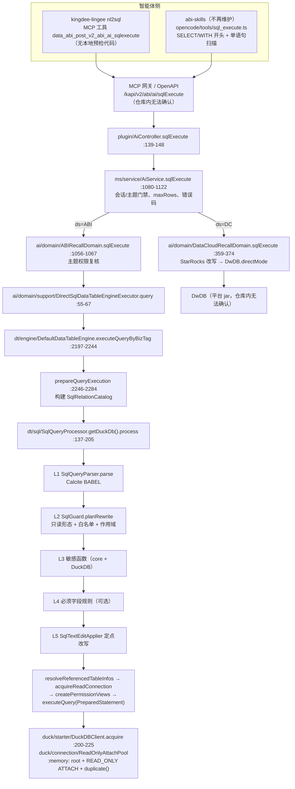

# 03 · NL2SQL / 直连 SQL 的校验与执行管线（源码精读）

> 基线：`abi-platform` 仓库 HEAD `ed64d16db78`（2026-10-20，工作区分支名 `feature_sit`，与 `feature_dev` 同一提交）；`abi-skills` HEAD `63b79b0`（2026-10-13）；`kingdee-lingee` HEAD `95d15d0`（2026-10-19）。文中行号均按该版本逐一核对。
> 约定：路径前缀缩写如下，正文中只写缩写 + 文件名 + 行号。
>
> | 缩写 | 实际目录 |
> | --- | --- |
> | `plugin/` | `bos-abi-plugin/code/abi-plugin/src/main/java/kd/bos/abi/plugin/openapi/ai/` |
> | `ms/` | `bos-abi-mservice/code/mservice-abi/src/main/java/kd/bos/mservice/abi/ai/` |
> | `ms-test/` | `bos-abi-mservice/code/mservice-abi/src/test/java/kd/bos/mservice/abi/ai/` |
> | `ai/` | `bos-abi-mservice/code/abi-ai/src/main/java/com/kingdee/abi/ai/recall/` |
> | `ai-test/` | `bos-abi-mservice/code/abi-ai/src/test/java/com/kingdee/abi/ai/recall/` |
> | `dt/` | `bos-abi-mservice/code/abi-data-table/src/main/java/com/kingdee/abi/table/` |
> | `dt-test/` | `bos-abi-mservice/code/abi-data-table/src/test/java/com/kingdee/abi/table/` |
> | `duck/` | `bos-abi-mservice/code/abi-duckdb/src/main/java/com/kingdee/abi/duckdb/` |
> | `duck-test/` | `bos-abi-mservice/code/abi-duckdb/src/test/java/com/kingdee/abi/duckdb/` |
> | `skills/` | `/Users/kehua/Desktop/workspace/code/abi-skills/skills/` |
> | `lingee/` | `/Users/kehua/Desktop/workspace/code/kingdee-lingee/skills/` |
>
> 标注「仓库内无法确认」的内容，是指实现位于苍穹平台 jar 或外部服务（如 `DwDB`、`CustomApiResult`、MCP 网关），本仓库没有源码。
> 标注「实测」的内容，是用本地 `~/.m2` 里与仓库同版本的 Calcite 1.41.0 / DuckDB JDBC 1.4.3.0，以及从仓库源码编译出的 `SqlQueryProcessor`，在 `qoder-workspace/sql-pipeline-probe/` 下跑的探针（JDK 1.8，未改仓库、未在仓库内产生文件）。实测只说明该版本库的行为，不等同于线上部署形态。

---

## 1. 定位

### 1.1 解决什么问题

智能体（nl2sql skill）生成的 SQL 是**不可信输入**：可能写错表名、引用别人的表、调文件读取函数、写 DML，或者只是方言不兼容。`/sqlExecute` 这条链路要在执行前完成「只读 + 表白名单 + 敏感函数 + 业务必须字段」校验，把逻辑表名改写成带行列权限的视图名，然后在 DuckDB 只读挂载上执行，并把结果行数限制在 JVM 可控范围内。

整条链路里**真正生效的校验器是 abi-data-table 的 Calcite 管线**（`SqlQueryProcessor` + `SqlGuard` + 各 `ISqlValidationRule`）。`DirectSqlQueryValidator`（JSqlParser 反射 + 正则）在主代码中没有任何调用方，见第 5 章。

### 1.2 完整链路



### 1.3 每跳职责

| 跳 | 位置 | 职责 | 不做什么 |
| --- | --- | --- | --- |
| L0 工具 | `lingee/nl2sql/SKILL.md:12`（工具名）、`skills/nl2sql/opencode/tools/sql_execute.ts:91-110` | 维护版只是声明 MCP 工具；旧版做开头关键字和多语句扫描 | 不做任何安全保证，服务端不信任它 |
| Controller | `plugin/AiController.java:139-148` | 声明 OpenAPI 参数，`AiServiceDispatcher.invoke("sqlExecute", …)` 转发 | 无业务逻辑 |
| Service | `ms/service/AiService.java:1080-1122` | 切换集成用户上下文、`checkOpenApiAccess`（ABI 渠道校验 sessionId，ABI 数据源校验主题权限）、按数据源创建 `RecallDomain`、设置 `maxRows`、错误码映射、截断提示文案 | 不解析 SQL |
| RecallDomain(ABI) | `ai/domain/ABIRecallDomain.java:1056-1083` | 再次校验主题权限（`checkSubjectPermissionIfNeeded`）、调执行器、时间类型转字符串、异常统一包成 `RuntimeException` | 不解析 SQL |
| 执行器 | `ai/domain/support/DirectSqlDataTableEngineExecutor.java:55-104` | 取 `IDataTableEngineFactory` 策略，`executeQueryByBizTag(subjectId=bizTag, …)`，在 `ResultSet` 回调里按 `maxRows` 截断物化 | 不追加 LIMIT |
| 数据表引擎 | `dt/engine/DefaultDataTableEngine.java:2197-2364` | 列主题下资源 → 构建关系目录 → 跑 SQL 管线 → 只挂载被引用表 → 建权限 TEMP VIEW → `PreparedStatement` 执行 | 不做行数限制 |
| SQL 管线 | `dt/sql/` | 解析、只读/白名单/作用域、敏感函数、必须字段、原文定点改写 | 不连库，纯逻辑 |
| 连接层 | `duck/` | `:memory:` root、READ_ONLY ATTACH、`duplicate()` 派生会话、语句超时、`memory_limit` | 不做 SQL 语义校验 |

### 1.4 ABI 与 DataCloud 数据源分叉

`DataSourceType.fromString` 空值默认 `ABI`（`ai/enums/DataSourceType.java:17-21`），由 `RecallDomainFactory.create(ds, ch, dbExecutor)` 选择实现（`ms/service/AiService.java:1100`）。两条分支的差异很大：

| 维度 | ABI（`ABIRecallDomain`） | DC（`DataCloudRecallDomain`） |
| --- | --- | --- |
| Service 层主题门禁 | `checkSubjectAccess` 只对 ABI 生效，且「主题不存在默认允许」（`ms/service/AiService.java:5516-5536`） | 直接放行（同一方法 `:5517-5519`） |
| Domain 层主题复核 | `SubjectPermissionCheckDomain.checkPermission`，拒绝抛 `SubjectPermissionDeniedException`（`ABIRecallDomain.java:1069-1083`） | 空实现，注释「DataCloud 不校验主题权限」（`DataCloudRecallDomain.java:611-613`） |
| SQL 校验 | Calcite 管线全量（第 4 章） | **仓库内没有任何 SQL 校验**；只有可选的 StarRocks 引号改写（`:393-408`）。注意 `DataCloudRecallDomain.java:381` 的 Javadoc 写的开关是 `abi.ai.dc.sql.starrocks.compatible`，但 `ai/domain/support/StarRocksCompatSwitch.java:40-52` 实际读的是租户属性 `dc_database_<accountId>` 里 MC 配置的库类型是否为 STARROCKS，注释已过时 |
| 执行 | DuckDB 只读挂载 + 权限视图 | `DwDB.directMode(null).querySql(DwSql.create(route, sql, SqlType.STANDARD, null))`（`:367-371`），平台 jar，仓库内无法确认它做了哪些校验 |
| 行数限制 | `mapResultSet` 循环里截断（`DirectSqlDataTableEngineExecutor.java:91`） | `parseResultSet` 循环里截断（`DataCloudRecallDomain.java:474`） |
| 特殊值 | — | `subjectId == "dc_root_catalog"` 时置空（`:361-363`） |

结论：**本文讲的 L1~L5 只覆盖 ABI 数据源**。DC 分支的只读性、表范围、权限完全依赖 `DwDB` 与数据空间自身的权限模型，本仓库无法确认。

### 1.5 旁路入口（同一执行器，不同前置）

| 入口 | 前置校验 | 行数控制 | 证据 |
| --- | --- | --- | --- |
| `/sqlExecute` | 第 4 章管线 | `abi.ai.sqlExecute.maxRows`（默认 1000），JVM 截断 | `ms/service/AiService.java:1102-1103` |
| 注册制仪表板取数 `executeRegisteredQuery` | 先 `RegisteredQueryExecutor.validateSelectOnly`（正则，关键字表与 `DirectSqlQueryValidator` 几乎相同），再 `OuterRowLimitGuard.ensureRowLimit` 追加 `LIMIT 501`，最后同样走 `recallDomain.sqlExecute`（不设 `maxRows`），ABI 数据源时同样经过第 4 章管线 | SQL 内 LIMIT + 响应层 500 行截断 | `ms/rest/util/RegisteredQueryExecutor.java:256-260`、`:1085-1107`；`ms/service/AiService.java:2010-2011` |
| `AiServiceDelegate`（mservice 内部委托） | 主题权限后直接 `DirectSqlDataTableEngineExecutor.query`（同样经过第 4 章管线） | `SqlExecuteRowLimitConfig.maxRows()` | `ms/delegate/AiServiceDelegate.java:98-105` |

注意：`OuterRowLimitGuard` 容易被当成 `/sqlExecute` 链路的一部分，**核实结果是它只接在注册制仪表板的 `RegisteredQueryExecutor.prepare`**（`RegisteredQueryExecutor.java:260`），`/sqlExecute` 不追加任何 LIMIT。两条路径的取舍对比见 8.3。

---

## 2. 代码地图

### 2.1 类清单

| 类 | 模块 | 路径 | 行数 | 职责 |
| --- | --- | --- | ---: | --- |
| `AiController` | abi-plugin | `plugin/AiController.java` | 313 | OpenAPI 声明，`/sqlExecute` 转发 |
| `AiService` | mservice-abi | `ms/service/AiService.java` | 5565 | `sqlExecute`、`rootCauseMessage`、`fillSqlExecuteMessage`、门禁 |
| `SqlExecuteRowLimitConfig` | mservice-abi | `ms/rest/util/SqlExecuteRowLimitConfig.java` | 37 | `abi.ai.sqlExecute.maxRows` 解析 |
| `DirectSqlQueryParam` | mservice-abi | `ms/param/DirectSqlQueryParam.java` | 75 | `DirectSqlQueryValidator` 的数值参数（主链路未用） |
| `DirectSqlQueryValidator` | mservice-abi | `ms/rest/util/DirectSqlQueryValidator.java` | 403 | 正则 + JSqlParser 反射校验（无调用方） |
| `OuterRowLimitGuard` | mservice-abi | `ms/rest/util/OuterRowLimitGuard.java` | 288 | 注册制取数追加 LIMIT（不在 `/sqlExecute`） |
| `DirectSqlValidationException` | abi-ai | `ai/domain/support/DirectSqlValidationException.java` | 11 | `RuntimeException` 子类 |
| `ABIRecallDomain` | abi-ai | `ai/domain/ABIRecallDomain.java` | 1966 | ABI 数据源 `sqlExecute` |
| `DataCloudRecallDomain` | abi-ai | `ai/domain/DataCloudRecallDomain.java` | 614 | DC 数据源 `sqlExecute` |
| `DirectSqlDataTableEngineExecutor` | abi-ai | `ai/domain/support/DirectSqlDataTableEngineExecutor.java` | 158 | 调引擎、结果物化与截断、时间格式化 |
| `DefaultDataTableEngine` | abi-data-table | `dt/engine/DefaultDataTableEngine.java` | 3312 | 白名单构建、管线调用、挂载、权限视图、执行 |
| `DataTableAccessException` | abi-data-table | `dt/exception/DataTableAccessException.java` | 99 | 错误码 1032000~1032007 |
| `SqlQueryProcessor` | abi-data-table | `dt/sql/SqlQueryProcessor.java` | 321 | 管线编排、规则分组、诊断归一化 |
| `SqlQueryParser` / `ParsedSql` | abi-data-table | `dt/sql/parser/` | 107 / 32 | Calcite 解析、尾分号规范化、查询形态判定 |
| `SqlGuard` | abi-data-table | `dt/sql/SqlGuard.java` | 800 | 白名单、作用域、命名冲突、改写计划 |
| `SqlRuleContext` | abi-data-table | `dt/sql/SqlRuleContext.java` | 71 | 规则共享上下文、懒计算核心改写计划 |
| `SqlRelationCatalog` / `SqlRelationTarget` / `LegacyRelationCatalogAdapter` | abi-data-table | `dt/sql/catalog/` | 136 / 79 / 39 | 逻辑关系目录 |
| `ISqlRule` / `ISqlValidationRule` / `ISqlRewriteRule` / `OrderedSqlRuleSet` / `SqlRuleOrders` | abi-data-table | `dt/sql/rule/` | 12 / 17 / 15 / 62 / 26 | 规则契约与排序 |
| `AbstractSensitiveFunctionValidationRule` 及两个子类 | abi-data-table | `dt/sql/rule/core/`、`rule/dialect/duckdb/` | 143 / 26 / 30 | 敏感函数黑名单 |
| `SqlGuardValidationRule` | abi-data-table | `dt/sql/rule/core/` | 32 | 占位规则（保留 ID） |
| `RequiredFields*Rule` ×5 + `AbstractRequiredFieldsRule` | abi-data-table | `dt/sql/rule/required/` | 55~96 | 必须字段规则 |
| `SqlQueryAnalyzer` / `SqlQueryMetadata` | abi-data-table | `dt/sql/analysis/` | 1510 / 216 | 查询块与字段血缘 |
| `RequiredFields*`、`AiConfigRequiredFieldsProvider` | abi-data-table | `dt/sql/required/` | 12~90 | 必须字段配置加载与传递闭包 |
| `SqlDiagnostic*`、`SqlRuleViolationException` | abi-data-table | `dt/sql/diagnostic/` | 12~72 | 诊断、日志、多语言渲染 |
| `SqlTextEdit*`、`SqlRewriteContribution`、`LogicalTableNameRewriteRule` | abi-data-table | `dt/sql/rewrite/` | 25~107 | 改写计划与原文替换 |
| `DuckDBClient` | abi-duckdb | `duck/starter/DuckDBClient.java` | 622 | `IDirectEngine` 实现，借出时装监听器、跨账套路径校验 |
| `PooledConnectionProxy` | abi-duckdb | `duck/connection/PooledConnectionProxy.java` | 323 | 代理连接，创建语句时派发 `onStatement` |
| `ReadOnlyAttachPool` | abi-duckdb | `duck/connection/ReadOnlyAttachPool.java` | 1048 | root、ATTACH/DETACH、LRU、重建 |
| `DuckDBConnectionFactory` | abi-duckdb | `duck/connection/DuckDBConnectionFactory.java` | 80 | 建连接、执行初始化 `SET` |
| `QueryTimeoutListener` | abi-duckdb | `duck/connection/QueryTimeoutListener.java` | 48 | `setQueryTimeout` |
| `ConnectionPoolConfig` / `ConfigurationLoader` / `DuckDBConnectionProperties` | abi-duckdb | `duck/config/` | 174 / 629 / 123 | 池与连接配置 |

### 2.2 推荐阅读顺序

1. `dt/sql/SqlQueryProcessor.java:137-205`：先看 `process` 主干，弄清「核心规则 → 业务规则 → 改写」三段和短路点。
2. `dt/sql/parser/SqlQueryParser.java`：全文 107 行，理解解析配置和「只接受查询节点」。
3. `dt/sql/SqlGuard.java:311-656`：`collectTableRefs` → `handleFrom` → `judgeTableRef` → 冲突检测，这是安全核心。配合 `dt-test/sql/SqlGuardTest.java` 的用例对照读。
4. `dt/sql/SqlGuard.java:658-730` + `dt/sql/rewrite/SqlTextEditApplier.java`：坐标换算与原文替换。
5. `dt/sql/rule/core/AbstractSensitiveFunctionValidationRule.java` 与两个子类。
6. `dt/engine/DefaultDataTableEngine.java:2197-2364` 与 `:1239-1289`、`:1434-1495`：白名单从哪来、改写后的名字是什么（`perm_<表名>`）、怎么执行。
7. `duck/connection/ReadOnlyAttachPool.java:42-75`（类注释）、`:220-236`、`:460-498`、`:729-761`：只读到底只读到哪一层。
8. 回到入口：`ms/service/AiService.java:1080-1122`、`:5356-5386`，看错误怎么回到 LLM。
9. 最后选读 `dt/sql/analysis/SqlQueryAnalyzer.java` 与 `rule/required/`（1500 行血缘分析，只在配置了聚合依赖字段时启用）。


---

## 3. 核心抽象

### 3.1 规则模型

**契约**（`dt/sql/rule/`）：

```java
// ISqlRule.java:8-12
public interface ISqlRule { String getId(); int getOrder(); }
// ISqlValidationRule.java:14-17
List<SqlDiagnostic> evaluate(SqlRuleContext context) throws DataTableAccessException;
// ISqlRewriteRule.java:12-15
SqlRewriteContribution plan(SqlRuleContext context) throws DataTableAccessException;
```

校验规则有两种失败方式，读代码时要分清：

| 方式 | 何时用 | 例子 |
| --- | --- | --- |
| 返回 `SqlDiagnostic`（`ERROR` / `WARNING`） | 可汇总、可结构化、需多语言渲染 | 敏感函数、必须字段规则 |
| 直接抛 `DataTableAccessException` | 结构性失败，没有继续分析的意义 | `SqlGuard` 所有拒绝、解析失败、血缘分析无法安全完成 |

**严重级别**只有两档（`dt/sql/diagnostic/SqlDiagnosticSeverity.java:8-12`）：`ERROR` 阻断，`WARNING` 记日志并放进 `SqlProcessResult.getDiagnostics()`（但引擎没有把它带到 `/sqlExecute` 响应，见 4.5）（目前只有 `RequiredFieldsTopNWarningRule` 产 WARNING，`RequiredFieldsTopNWarningRule.java:90`）。枚举声明顺序就是排序优先级，`normalizeDiagnostics` 用 `compareTo` 让 ERROR 排在前面（`SqlQueryProcessor.java:277`）。

**排序**：`OrderedSqlRuleSet` 构造期按 `(order, id)` 排序，并拒绝 null、空 ID、重复 ID（`OrderedSqlRuleSet.java:22-56`）。内置顺序常量在 `SqlRuleOrders.java:10-21`：

| 常量 | 值 | 对应规则 |
| --- | ---: | --- |
| `CORE_SENSITIVE_FUNCTION` | 250 | `SensitiveSqlFunctionValidationRule` |
| `DIALECT_DUCKDB_SENSITIVE_FUNCTION` | 260 | `DuckDbSensitiveFunctionValidationRule` |
| `CORE_TABLE_ACCESS` | 300 | `SqlGuardValidationRule` |
| `REQUIRED_FIELDS_SELECT` ~ `TOP_N` | 1000~1400 | 五个必须字段规则 |
| `REWRITE_LOGICAL_TABLE` | 2000 | `LogicalTableNameRewriteRule` |
| `CORE_QUERY_SHAPE` / `CORE_SUPPORTED_RELATION` / `CORE_RELATION_CONFLICT` | 100 / 200 / 400 | **全仓无引用**，预留常量 |

**core vs 业务规则**（`SqlQueryProcessor.java:64-80`）：

```java
List<ISqlValidationRule> fixedCore = new ArrayList<ISqlValidationRule>();
fixedCore.add(new SensitiveSqlFunctionValidationRule());
fixedCore.add(new SqlGuardValidationRule());
appendValidationExtensions(fixedCore, coreExtensions, SqlGuardValidationRule.ID);
List<ISqlRewriteRule> fixedRewrites = new ArrayList<ISqlRewriteRule>();
fixedRewrites.add(new LogicalTableNameRewriteRule());
appendRewriteExtensions(fixedRewrites, rewriteExtensions, LogicalTableNameRewriteRule.ID);
...
validateGlobalRuleIds();
```

- 核心规则由构造器**硬编码装入**，扩展只能追加不能替换；扩展若占用保留 ID（`core.sql-guard`、`rewrite.logical-table-name`）直接抛 `IllegalArgumentException`（`:82-94`、`:96-108`），三组规则的 ID 还要全局唯一（`:110-124`）。测试 `testProcessor_coreSecurityCannotBeRemoved`（`dt-test/sql/SqlQueryProcessorTest.java:443`）钉住这一点。
- 两个单例：`DEFAULT` 只有通用核心规则，`DUCKDB` 额外装 `DuckDbSensitiveFunctionValidationRule`（`:53-57`）。生产执行路径用 `getDuckDb()`（`DefaultDataTableEngine.java:2274`）；`SqlGuard.guard` 静态门面用 `getDefault()`（`SqlGuard.java:289`），后者只在建表回填改写 `rewriteSourceRefsToQualified`（`DefaultDataTableEngine.java:1027-1048`）用到。
- 业务规则固定是五个必须字段规则（`:309-320`），改写规则只有逻辑表名一条，`createDefault` 传入空扩展。

**短路**：

```java
// SqlQueryProcessor.java:230-245
for (ISqlValidationRule rule : coreRules.getRules()) {
    List<SqlDiagnostic> evaluated = rule.evaluate(context);
    if (evaluated == null) continue;
    for (SqlDiagnostic diagnostic : evaluated) {
        diagnostics.add(diagnostic);
        if (diagnostic.getSeverity() == SqlDiagnosticSeverity.ERROR) {
            return;
        }
    }
}
```

核心规则遇到第一个 ERROR 立即停，`process` 随即抛异常（`:152-162`），**业务规则不跑、必须字段元数据不加载、改写不生成**（测试 `testProcessor_coreErrorShortCircuitsBusinessAndRewrite`、`testProcessor_sensitiveRulesInstalledByScopeAndBeforeMetadataLoad`）。业务规则则**全部跑完**再汇总（`:180-192`），这样 LLM 一次能拿到「所有」必须字段违规，测试 `testDiagnostics_multipleErrorsRetainedOnException`（`SqlQueryProcessorTest.java:562`）。

**一个容易误读的点：`SqlGuardValidationRule` 的 order=300 不是它的真实执行时机。** `SqlGuard.planRewrite` 在 `process` 第 144-145 行的 `planCoreRewrite` 里就已执行，早于所有核心规则；`SqlGuardValidationRule.evaluate` 只是调一次 `context.getCoreRewriteContribution()`（`SqlGuardValidationRule.java:26-31`），而这个值在构造 `coreContext` 时已经传入（`SqlQueryProcessor.java:148-150`），所以是空操作。它存在的意义是占住 `core.sql-guard` 这个保留 ID。实测：`SELECT * FROM "user"`（`user` 在白名单里）被敏感函数规则拒绝，而 `SELECT version() FROM 不存在` 先命中 SqlGuard 的 `TABLE_NOT_EXISTS`（实测），敏感函数规则根本没机会执行。

### 3.2 SqlRelationCatalog：白名单的结构化形态

```java
// SqlRelationCatalog.java:27-54（节选）
for (SqlRelationTarget target : source) {
    String key = normalize(target.getLogicalName());           // trim + toLowerCase(ROOT)
    SqlRelationTarget previous = targetMap.put(key, target);
    if (previous != null && !sameTarget(previous, target)) {
        throw DataTableAccessException.invalidSql("Conflicting logical table aliases.");
    }
    int lastDot = key.lastIndexOf('.');
    if (lastDot > 0) parentNames.add(key.substring(0, lastDot));
}
```

- 一个 `SqlRelationTarget` = 逻辑名 + 执行表名 + `resourceId` + `entityName` + 必须字段元数据（或懒加载器）（`SqlRelationTarget.java:14-79`）。执行表名为空串表示「在白名单但未物化」（`isMaterialized()`，`:78`）。
- 大小写折叠后冲突且目标不同 → 失败关闭，错误文案刻意不带来源标识。
- `parentsWithChildren` 只存父名，用于区分「多实体资源漏写子表名」和「资源未物化」两种拒绝（四态见 4.3.3）。
- `toExecutionMap()`（`:110-118`）把目录退化成 `逻辑名 → 执行表名` 的 Map 交给 `SqlGuard`；`LegacyRelationCatalogAdapter`（`catalog/LegacyRelationCatalogAdapter.java:22-38`）做反方向适配，**value 为 null 的条目被跳过**，所以 null 等价于「不在白名单」，空串才表示「未物化」。
- 必须字段元数据按需加载：`loadRequiredFields(referencedLogicalRelations)` 只加载 SQL 实际引用的关系（`:81-90`），`SqlRelationTarget.loadRequiredFieldsMetadata` 用双检锁保证单次请求只加载一次（`SqlRelationTarget.java:51-62`）。

**生产环境白名单从哪来**（`DefaultDataTableEngine.java:1239-1289`、`:1434-1495`）：

1. 列出主题（bizTag = subjectId）下 `DATA_SOURCE`、`DATA_ANALYSIS`、`DATA_REFERENCE` 三类资源（`:2249-2254`），引用表映射到来源表 ID（`resolvePhysicalResourceIds`，`:1506-1529`）。
2. `registerLogicalResources`：每个资源先登记 `resourceName → ""`（`:1434-1448`）。
3. `registerMaterializedAliases`：每个已物化实体文件登记 `resourceName[.subTableName] → perm_<tableName>`（`:1450-1470`），覆盖空串。
4. `putLogicalAlias`：同一逻辑别名指向不同物理资源或不同表名时抛「Conflicting logical table aliases.」（`:1472-1495`）。

所以**白名单的 value 不是物理表名，而是权限视图名 `perm_<tableName>`**（前缀常量 `DefaultDataTableEngine.java:118`，`getPermissionViewName` `:275-278`）。LLM 写的逻辑名被改写后只能落到权限视图上，物理表和挂载别名（`alias.tableName`）都不在白名单里，写了也会被拒（实测 `SELECT * FROM s_b.t_other`、`SELECT * FROM perm_t_sales` 均返回 `TABLE_NOT_EXISTS`）。

### 3.3 改写计划与 SqlTextEditApplier 原文定点替换

**计划**：`SqlGuard.planRewrite` 不改 SQL，只产出 `SqlRewriteContribution`（`SqlGuard.java:658-688`）：

```java
Whitelist whitelist = normalizeWhitelist(catalog.toExecutionMap());
List<TableRef> refs = new ArrayList<TableRef>();
collectTableRefs(parsedSql.getRoot(), whitelist, refs, null);
int[] lineStart = buildLineStartOffsets(parsedSql.getSql());
for (TableRef ref : refs) {
    int start = offsetOf(lineStart, len, pos.getLineNum(), pos.getColumnNum());
    int end   = offsetOf(lineStart, len, pos.getEndLineNum(), pos.getEndColumnNum() + 1);
    if (start < 0 || end < 0 || start > end || end > len) throw invalidSql(...);
    edits.add(new SqlTextEdit(start, end, ref.physicalName, "rewrite.logical-table-name",
            ref.tableSource, ref.tableSource ? ref.physicalName : null));
    if (ref.tableSource && ref.logicalName != null) referencedLogicalRelations.add(ref.logicalName);
}
```

- `TableRef` 有两种：FROM 位置的表源（`tableSource=true`，计入「被引用执行表」与「被引用逻辑关系」），以及列限定符（`t.col` 的 `t`，`tableSource=false`，只替换文本）。
- 坐标：Calcite `SqlParserPos` 是 1-based 行列、结束列包含，`buildLineStartOffsets` 只按 `\n` 切行（`:694-710`），`offsetOf` 转绝对偏移（`:716-728`）。实测 Calcite 1.41 对 Tab 按 1 列计（`SELECT * FROM t⇥JOIN s` 中 `s` 位于第 22 列），所以 Tab 不会造成偏移错位；`\r\n` 下 `\r` 属于上一行末尾，不影响下一行起点。
- 替换范围覆盖整个标识符（含引号），替换文本是**不加引号**的 `perm_<tableName>`：`"订单"."明细"` → `t_phys_order_detail`（`SqlGuardTest.testCompoundVirtualName_replaced`）。`tableName` 是否总是合法的未加引号标识符，仓库内未找到生成规则的约束说明，属于隐含前提。

**应用**（`dt/sql/rewrite/SqlTextEditApplier.java:27-100`）：

```java
Collections.sort(edits, byStartThenEnd);
for (SqlTextEdit edit : edits) {
    if (edit.getEndOffset() > sql.length()) throw invalidSql("SQL 改写位置无效");
    if (!unique.isEmpty()) {
        SqlTextEdit previous = unique.get(unique.size() - 1);
        if (sameRange(previous, edit)) {
            if (!previous.getReplacement().equals(edit.getReplacement())) throw invalidSql("SQL 改写规则存在冲突");
            continue;                                        // 同范围同文本去重
        }
        if (edit.getStartOffset() < previous.getEndOffset()) throw invalidSql("SQL 改写范围发生重叠");
    }
    unique.add(edit);
}
for (int index = unique.size() - 1; index >= 0; index--)     // 从后往前替换，前面的偏移不失效
    rewritten.replace(edit.getStartOffset(), edit.getEndOffset(), edit.getReplacement());
```

为什么要单独一个 Applier：改写规则是可扩展的（`ISqlRewriteRule`），多条规则的编辑必须统一做冲突/重叠检测，否则两条规则改同一段文本会产生不可预测的结果。当前只有一条规则，冲突检测是为扩展预留的护栏。测试 `testTextEditApplier_appliesBackwardAndRejectsConflict`（`SqlQueryProcessorTest.java:76`）。

### 3.4 作用域模型

`SqlGuard` 内部的 `RelationScope`（`SqlGuard.java:167-222`）是一棵父指针链：

```java
final RelationScope parent;
final Map<String, RelationBinding> bindings;   // 名字 → 替换目标；replacement==null 表示 CTE 或显式别名
final Set<String> cteNames;
```

**绑定规则** `bind`（`:178-197`）：同一作用域同名再次绑定，只要任一方是 null 或两者目标不同，就把该名字降级为 `RelationBinding(null)`——「同一作用域出现歧义或显式别名时不猜测，保留原限定符交由数据库判定」。

**CTE 可见性**（`collectTableRefs` 的 `SqlWith` 分支，`:336-361`）：

```java
RelationScope withScope = new RelationScope(parentScope);
for (SqlNode item : with.withList) {
    boolean recursive = withItem.recursive != null && TRUE.equals(withItem.recursive.getValueAs(Boolean.class));
    if (recursive && withItem.name != null) withScope.bindCte(joinNames(withItem.name));   // 先绑定：自身可见
    collectTableRefs(withItem.query, whitelist, refs, withScope);
    if (!recursive && withItem.name != null) withScope.bindCte(joinNames(withItem.name));  // 后绑定：只对后续可见
}
return collectTableRefs(with.body, whitelist, refs, withScope);
```

- 非递归 CTE 只对**后续** CTE 和 WITH body 可见；在自己的定义体里写自己的名字，会被当成普通表查白名单。测试 `testQualifiedColumn_laterCteNotVisibleToEarlierItem`（`SqlGuardTest.java:528`）。
- 递归 CTE 先绑定，自引用可见（`testCte_recursiveSelfReferenceVisible`，`:581`）。
- `judgeTableRef` 只在 `scope.isCteVisible(key)` 为真时豁免白名单（`:615-618`）；`isCteVisible` 沿父链查找（`:210-222`）。内层子查询里定义的同名 CTE 不会豁免外层的未知表（`testWhitelist_innerCteDoesNotExemptOuterTable`，`:571`）。

**别名遮蔽**（`handleFrom` 的 `AS` 分支，`:445-457`）：

```java
RelationScope sourceScope = new RelationScope(scope);   // 源关系在独立子作用域内绑定
handleFrom(source, whitelist, refs, sourceScope);
validateLocalReplacementNameConflicts(sourceScope);
if (operands.size() > 1 && operands.get(1) instanceof SqlIdentifier)
    scope.bind(joinNames((SqlIdentifier) operands.get(1)), null);   // 外层只看见别名
```

- `FROM sales AS s` 后，外层作用域只有 `s`（replacement=null），`sales.id` 不会被改写，保留原文让 DuckDB 报「表不存在」——这与标准 SQL「别名隐藏原名」一致（`testQualifiedColumn_sourceNameHiddenByAliasPreserved`，`:434`）。
- 无别名时 `bindRelation` 同时绑定全名和最后一段（`schema.table` 也能用 `table.col` 限定），`:485-495`。
- 列限定符匹配 `findQualifierMatch`（`:516-538`）：先匹配最长前缀，再沿作用域链取最近的绑定；不支持 `alias.struct.field` 方言（注释 `:519`）。

**命名冲突**（防权限视图绕过的关键）：改写后的名字 `perm_xxx` 如果恰好与当前可见的 CTE 或别名同名，改写后的 SQL 会被 DuckDB 绑定到那个 CTE/别名上，等于绕开权限视图。三处检查都抛 `invalidSql("Replacement relation name conflicts with visible alias or CTE: …")`（`:576-580`）：

| 检查点 | 位置 | 场景 |
| --- | --- | --- |
| FROM 标识符改写前 | `handleFrom` `:463-466` + `hasPersistentBinding` `:557-574` | 外层已有同名 CTE/别名 |
| 列限定符改写前 | `findQualifierMatch` `:525-530` | 限定符解析到的目标被内层同名别名遮蔽 |
| 作用域收尾 | `validateLocalReplacementNameConflicts` `:540-555`，在 SELECT 的 FROM 处理后（`:324`）和 AS 源处理后（`:452`）调用 | 后声明的 JOIN 别名与前表改写目标同名 |

实测：`WITH perm_t_sales AS (SELECT 1 AS id) SELECT * FROM sales` → `SQL_INVALID`「Replacement relation name conflicts … perm_t_sales」。对应测试 `testQualifiedColumn_twoStageAliasCollisionRejected`、`…CteCollisionRejected`、`…laterJoinAliasCollisionRejected`、`…laterCteMatchingSourceCannotBypassPermissionView`（`SqlGuardTest.java:477-569`）。

**血缘分析器有自己的一套作用域**：`SqlQueryAnalyzer.Scope`（`dt/sql/analysis/SqlQueryAnalyzer.java:1419-1425`，含 `bindings`、`cteBindings`、`ambiguousBindings`、`localSources`），用于字段级血缘，与 `SqlGuard.RelationScope` 互不共享。两套作用域对同一条 SQL 的理解若不一致，只会造成必须字段规则误判，不会影响白名单与改写（后者只看 `SqlGuard`）。


---

## 4. 逐层精读

### 4.0 主干：`SqlQueryProcessor.process`

```java
// dt/sql/SqlQueryProcessor.java:137-205（节选）
ParsedSql parsedSql = SqlQueryParser.parse(request.getSql(), request.getUserContext());     // L1
SqlRewriteContribution coreRewriteContribution = planCoreRewrite(parsedSql, request);         // L2（抛异常）
evaluateCoreRules(coreContext, diagnostics);                                                  // L3（首个 ERROR 短路）
if (coreError != null) { ...; throw new SqlRuleViolationException(...); }
if (request.isRequiredFieldsEnabled())
    request.getRelationCatalog().loadRequiredFields(coreRewriteContribution.getReferencedLogicalRelations());
SqlQueryMetadata metadata = requiredFieldsActive ? new SqlQueryAnalyzer(...).analyze(parsedSql) : new SqlQueryMetadata();
for (ISqlValidationRule rule : businessRules.getRules()) diagnostics.addAll(rule.evaluate(context)); // L4（全跑）
if (error != null) throw new SqlRuleViolationException(...);
List<SqlRewriteContribution> contributions = planRewrites(context);                           // L5
SqlTextEditResult rewritten = textEditApplier.apply(parsedSql.getSql(), contributions, userContext);
return new SqlProcessResult(rewritten.getSql(), rewritten.getReferencedExecutionTables(), diagnostics);
```

顺序上的两个设计意图：L2 放在 L3 前面，是因为 L2 的产物（被引用逻辑关系）决定 L4 要加载哪些元数据；改写放在最后，注释原文「所有阻断校验通过后才生成并应用改写计划」（`:194`），保证被拒的 SQL 不会产生任何改写副作用。

### 4.1 L0 · 工具层预检

**当前维护版（kingdee-lingee）没有本地预检代码。** `lingee/nl2sql/SKILL.md:12` 声明的是 MCP 工具 `data_abi_post_v2_abi_ai_sqlexecute`，由 OpenAPI 契约生成（预插 SQL `bos-abi-mservice/datamodel/bos/1.5/main/abi/preinsdata/kd_1.5_sys_openapi_ai_mcp_sync_0921.sql` 中可见 `/kapi/v2/abi/ai/sqlExecute` 的 OpenAPI 文档）。约束全部写在 skill 文本里：

- 方言：「`ABI` 为 DuckDB，`DC` 为 StarRocks」（`lingee/nl2sql/SKILL.md:161`）。
- 标识符：表名只能用 `tableName`、列名只能用 `sqlFields[].fieldName`，双引号、禁止反引号（`:162-163`）。
- 执行前自检 7 条（`:190-200`），全部是语义层要求（字段来源、计算字段展开、币种、`aggregationDependencies` 等），没有安全层要求。

**旧版（abi-skills，已不再维护）**：`skills/nl2sql/opencode/tools/sql_execute.ts`

```ts
// :91-110
const normalizedSql = normalizeSql(args.sql)          // trim + 去尾部分号 (:23-25)
if (!startsWithAllowedKeyword(normalizedSql))          // /^(select|with)\b/iu (:87-89)
  return "仅允许执行 SELECT 或 WITH 查询。"
if (hasMultipleStatements(normalizedSql))              // 跳过引号/注释后找 ';' (:27-85)
  return "仅允许执行单条 SQL；不要提交多语句。"
```

它的 `hasMultipleStatements` 比服务端 `DirectSqlQueryValidator` 更严谨（识别 `''` 转义、行注释、块注释、反引号），但请求体只发 `sessionId/subjectId/sql`（`:142-149`），**不带 `dataSourceType` 和 `channel`**，服务端分别默认 `ABI` 和 `ChannelType.fromString(null)` 的默认值（后者未展开核实）。`skills/test/test_sql_execute.ts` 是一个手工脚本：硬编码作者本机路径（`:3-4`）、没有 `userIdentityTag`、没有断言、示例 SQL 里未加引号的表名含 `-`（`:20`，Calcite 下必然语法错误），不能算自动化测试。

为什么 L0 不重要：服务端完全不信任工具层（AiService 不看来源），L0 的价值只是**省一次往返**——把明显的非查询语句在本地拦掉，给 LLM 更快的反馈。

### 4.2 L1 · 解析与规范化

```java
// dt/sql/parser/SqlQueryParser.java:27-32
private static final SqlParser.Config CONFIG = SqlParser.config()
        .withQuoting(Quoting.DOUBLE_QUOTE)
        .withQuotedCasing(Casing.UNCHANGED)
        .withUnquotedCasing(Casing.UNCHANGED)
        .withCaseSensitive(true)
        .withConformance(SqlConformanceEnum.BABEL);
```

- `DOUBLE_QUOTE`：与 DuckDB、skill 约定一致；反引号不是合法 token（实测 `` SELECT `a` FROM t `` → `Lexical error … Encountered: "`"`）。
- 两种大小写都 `UNCHANGED`：保留原文，让改写阶段的定点替换和 DuckDB 的大小写语义不被 Calcite 篡改；白名单匹配另行小写折叠（`SqlGuard.normalize`，`:759-762`）。
- `BABEL` conformance 放宽了 `LIMIT`、`QUALIFY`、`ILIKE` 等语法（实测 `SELECT * FROM t QUALIFY …`、`ILIKE`、`LIMIT 1 OFFSET 2`、`list_value(1,2)[1]` 均可解析）。但**注意它只是 conformance，不是 Babel 解析器**：实测 `a::int`、`SELECT * EXCLUDE (a)`、`FROM t SELECT a`、`USING SAMPLE 10%`、`FROM 'x.csv'` 全部 `SqlParseException`。这些都是 DuckDB 合法语法，见 8.1。

```java
// :44-67（节选）
String normalized = normalize(sql, userContext);           // 空白拒绝、循环去掉尾部 ';'
SqlNode root = SqlParser.create(normalized, CONFIG).parseQuery();
if (!isQueryNode(root)) throw DataTableAccessException.unsupportedSqlOperator(...);
...
catch (SqlParseException e) {
    // Calcite 异常可能回显路径、配置值等输入 token，日志仅记录稳定事件。
    LogUtil.error("[SqlQueryParser] SQL parse failed.");
    throw new DataTableAccessException(DataTableAccessException.SQL_INVALID, "SQL 语法无效，请检查查询语句", e);
}
```

- **只读的第一道闸**：`parseQuery()` 只接受单条查询，DML/DDL/`ATTACH`/`COPY`/`PRAGMA`/`INSTALL` 都是语法错误（`SqlGuardTest.testEngineSpecificStatements_rejected`，`:105-111`）；多语句在第一个 `;` 处报错（实测 `SELECT 1; SELECT 2` → `Encountered ";" at line 1, column 9`）。尾部任意个 `;` 先被 `normalize` 剥掉（`:84-87`，实测 `SELECT 1;;;` 通过）。
- `isQueryNode`（`:98-106`）只认 `SqlSelect`、`SqlWith`、`SqlOrderBy` 和 `UNION/INTERSECT/EXCEPT`。顶层 `VALUES (1)` 能解析但被判为不支持（实测 `UNSUPPORTED_SQL_OPERATOR`）。
- 日志里不写原 SQL 和 Calcite 异常文本，但**异常 cause 链保留了 `SqlParseException`**，第 6 章会看到它最终原样回到 LLM。

### 4.3 L2 · SqlGuard

#### 4.3.1 递归入口：`collectTableRefs`

```java
// dt/sql/SqlGuard.java:319-335
if (node instanceof SqlSelect) {
    RelationScope scope = new RelationScope(parentScope);
    handleFrom(select.getFrom(), whitelist, refs, scope);          // 先绑定 FROM
    validateLocalReplacementNameConflicts(scope);
    collectExpressionRefs(select.getSelectList(), whitelist, refs, scope);
    collectExpressionRefs(select.getWhere(), ...);  // GROUP/HAVING/WINDOW/QUALIFY/ORDER/OFFSET/FETCH 同理
    ...
    return scope;
}
```

先处理 FROM 再处理表达式，是因为列限定符只能在 FROM 绑定完成后解析。`collectExpressionRefs`（`:392-424`）遇到 `SqlIdentifier` 收集限定符，遇到查询节点（标量子查询、`IN (SELECT…)`、`EXISTS`）就以当前作用域为父递归，这保证了**表达式里的子查询同样走白名单**（`testRepeatedTable_allReplaced`、`testQualifiedColumn_correlatedSubqueryReplaced`）。

#### 4.3.2 `handleFrom` 各分支（`:429-483`）

| 分支 | 判定 | 处理 | 典型 SQL（实测结果） |
| --- | --- | --- | --- |
| `SqlJoin` | `:437-444` | 左、右分别 `handleFrom`，再收集 `ON` 条件 | `sales JOIN customer ON …` 通过 |
| `AS` | `:445-457` | 源在子作用域处理，外层只绑定别名（3.4） | `FROM sales AS s` 通过；`FROM (VALUES (1)) AS v(a)` → 源走到兜底分支被拒 |
| `SqlIdentifier` | `:459-469` | `judgeTableRef` 定性，检查改写目标冲突，`bindRelation` | `FROM sales` 改写为 `perm_…` |
| 子查询 `SqlSelect/SqlWith/SqlOrderBy` | `:470-474` | 递归 `collectTableRefs` | `FROM (SELECT …) sub` |
| 集合运算 | `:475-480` | 递归 | `FROM (SELECT … UNION SELECT …)` |
| 其它 | `:481-482` | `unsupportedSqlOperator("exists unsupported function on FROM : " + kind)` | `read_csv(...)`→`COLLECTION_TABLE`、`LATERAL`、`UNNEST`、`TABLESAMPLE`、`VALUES` 全部拒绝 |

兜底分支是**白名单式**的：只列举认识的形态，其余一律拒绝。`planCoreRewrite` 再把这个英文消息替换成多语言的「SQL 包含不支持的查询结构」，原异常作 cause（`SqlQueryProcessor.java:207-228`）。

#### 4.3.3 `judgeTableRef` 的四种结果（`:609-653`）

```java
String key = normalize(joinNames(id));
if (scope != null && scope.isCteVisible(key)) return null;            // ① 可见 CTE：放行、不改写
if (whitelist.contains(key)) {
    String physical = whitelist.physicalOf(key);
    if (physical == null || physical.isEmpty()) {
        if (whitelist.hasChildren(key)) throw entityNameRequired(...);   // ③a 多实体资源漏写子表名 1032007
        throw notMaterial(...);                                          // ③b 资源未物化 1032002
    }
    refs.add(new TableRef(id, key, physical)); return physical;          // ② 命中：记录改写
}
int lastDot = key.lastIndexOf('.');
if (lastDot > 0 && whitelist.contains(parentKey)) {
    if (parentMaterialized && !whitelist.hasChildren(parentKey)) throw notExists(...); // 单实体表后接 .B
    throw notMaterial(...);                                              // 子表未物化
}
throw notExists("table " + joinNames(id) + " not exist.");              // ④ 不在白名单 1032003
```

| 结果 | 错误码 | 实测 SQL（白名单 `订单→""`, `订单.明细→perm_…`, `库存→""`） | 文案 |
| --- | --- | --- | --- |
| ① CTE 放行 | — | `WITH t AS (…) SELECT * FROM t` | — |
| ② 命中改写 | — | `SELECT * FROM sales` → `SELECT * FROM perm_t_sales` | — |
| ③a 漏写子表名 | `TABLE_ENTITY_NAME_REQUIRED` 1032007 | `SELECT * FROM 订单` | `table 订单 is not a table name, use 订单.<subTableName> instead.` |
| ③b 未物化 | `TABLE_NOT_MATERIAL` 1032002 | `SELECT * FROM 库存`、`SELECT * FROM "订单"."汇总"` | `table 库存 not material.` |
| ④ 不存在 | `TABLE_NOT_EXISTS` 1032003 | `SELECT * FROM 不存在`、`FROM s_b.t_other` | `table 不存在 not exist.` |

- 父级判定按完整名最后一个 `.` 切分，所以 `"A"."B"`（两段）和 `"A.B"`（整串一段）走同一逻辑（Javadoc `:602-606`，测试 `testQuotedWholeCompound_*`，`SqlGuardTest.java:372-400`）。
- ③a 的文案**只给写法、不列子表名**（`testMultiEntityResourceWithoutSubTable_messageLeaksNoSubTableName`，`:601`），因为调用方未必有权知道该资源下的全部实体。`Whitelist.parentsWithChildren` 只存父名也是同一考虑（`:236-243` 注释）。
- 文案里回显的只是 LLM 自己写的名字，不泄露白名单内容。

#### 4.3.4 命名冲突

已在 3.4 列出三个检查点。补充一个白名单自身的冲突：`normalizeWhitelist` 在小写折叠后发现同一 key 指向不同物理名，抛「Conflicting logical table aliases.」（`:769-800`，测试 `testWhitelist_normalizedAliasConflictRejected`，`:706`）。这避免「`Sales` 与 `sales` 是两张表，按 HashMap 最后插入者取值」这种静默错误。

### 4.4 L3 · 敏感函数与上下文关键字

**完整黑名单**（大小写不敏感，取最后一个 `.` 之后的名字，去掉 `"…"`、`` `…` ``、`[…]` 包裹，`AbstractSensitiveFunctionValidationRule.java:125-142`）：

| 规则 | 拦截方式 | 名单 | 位置 |
| --- | --- | --- | --- |
| `core.sensitive-sql-function` | 算子名（函数调用） | `USER` `CURRENT_USER` `SESSION_USER` `SYSTEM_USER` `CURRENT_ROLE` `CURRENT_CATALOG` `CURRENT_SCHEMA` `CURRENT_PATH` `VERSION` `CURRENT_DATABASE` `CURRENT_SETTING` | `SensitiveSqlFunctionValidationRule.java:19-22` |
| 同上 | 未加引号的简单标识符 | `USER` `CURRENT_USER` `SESSION_USER` `SYSTEM_USER` `CURRENT_ROLE` `CURRENT_CATALOG` `CURRENT_SCHEMA` `CURRENT_PATH` | `:22-24` |
| `dialect.duckdb.sensitive-function` | 算子名 | `CURRENT_QUERY` `CURRENT_QUERY_ID` `CURRENT_CONNECTION_ID` `CURRENT_TRANSACTION_ID` `CURRENT_SCHEMAS` `TXID_CURRENT` `GETENV` `READ_TEXT` `READ_BLOB` `CHECKPOINT` `FORCE_CHECKPOINT` `CURRVAL` `NEXTVAL` | `DuckDbSensitiveFunctionValidationRule.java:20-24` |
| 同上 | **带双引号**的简单标识符 | `USER` `CURRENT_USER` `SESSION_USER` `CURRENT_ROLE` `CURRENT_CATALOG` `CURRENT_SCHEMA` | `:24-28` |

```java
// AbstractSensitiveFunctionValidationRule.java:76-114（节选）
context.getParsedSql().getRoot().accept(new SqlShuttle() {
    public SqlNode visit(SqlCall call) {
        if (call.getKind() == SqlKind.AS) {           // AS 后面是别名声明，只访问左侧表达式
            SqlNode expression = call.getOperandList().get(0);
            if (expression != null) expression.accept(this);
            return call;
        }
        if (blockedOperatorNames.contains(normalizeOperatorName(call.getOperator().getName()))) matched = …;
        return super.visit(call);
    }
    public SqlNode visit(SqlIdentifier identifier) {
        if (identifier.isSimple()) {
            boolean quoted = identifier.isComponentQuoted(0);
            if ((!quoted && blockedContextKeywords.contains(kw)) || (quoted && blockedQuotedContextKeywords.contains(kw))) matched = kw;
        }
        return super.visit(identifier);
    }
});
```

**为什么要拦这些**：它们泄露运行环境（版本、配置、当前 SQL 文本、环境变量），或产生副作用（`CHECKPOINT`、`NEXTVAL`），或读文件（`READ_TEXT`/`READ_BLOB` 的标量用法；表函数用法已被 L2 的兜底分支拦住）。

**DuckDB 带引号标识符回退绑定**：标准 SQL 里 `"current_user"` 是标识符而非关键字，所以 core 规则只拦未加引号形式。但 DuckDB 1.4.3 在找不到同名列时会把它回退成上下文函数。实测：

```
SELECT "current_user"                      -> duckdb
SELECT "current_user" FROM perm_t_sales     -> duckdb   （视图里没有该列）
SELECT "user"                               -> duckdb
```

所以 DuckDB 规则额外拦带引号的简单标识符；`alias."current_user"` 是复合标识符，不受影响（`DuckDbSensitiveFunctionValidationRule.java:25-26` 注释）。测试 `testProcessor_duckDbQuotedContextKeywordsRejected`（`SqlQueryProcessorTest.java:693`）。

**副作用（误杀）**：这条规则不区分标识符出现的位置。实测以下 SQL 都被拒（`SQL_INVALID`「SQL 不允许调用敏感函数或上下文关键字：USER」，CTE 那条为 `CURRENT_USER`）：

```sql
SELECT * FROM "user"                                   -- 逻辑表恰好叫 user
SELECT u."user" FROM "user" u                          -- 列是限定的，但 FROM 里的表名是简单标识符
WITH "current_user" AS (SELECT 1 AS a) SELECT a FROM "current_user"   -- CTE 名
```

也就是说，**逻辑表名、CTE 名、无限定列名一旦是这 6 个词之一就无法查询**。这是有意的 fail-closed 取舍，代价是业务上叫 `user` 的表需要改名。

**黑名单之外**：实测 `SELECT getvariable('x')` 通过（返回 null）。DuckDB 还有不少会话/环境类函数未列入（如 `getvariable`、`duckdb_*` 系列表函数——后者是表函数，会被 L2 拦住；标量类需逐个核对）。黑名单的完备性依赖维护者跟进 DuckDB 版本，见 8.2。


### 4.5 L4 · 必须字段规则（聚合依赖）

**业务背景**：数值字段可以在 AI 表配置里声明 `aggregationDependencyFields`（例如「金额」依赖「币种」）。直接 `SUM(金额)` 而不按币种分组，结果没有业务意义。这一层把 skill 文本里的「聚合依赖字段约束」（`lingee/nl2sql/SKILL.md:170-178`）在服务端强制执行。

**何时启用**：

```java
// dt/engine/DefaultDataTableEngine.java:2274-2277
SqlProcessResult result = SqlQueryProcessor.getDuckDb().process(
        new SqlProcessingRequest(sql, relationCatalog,
                relationCatalog.hasRequiredFieldsLoader() || relationCatalog.hasRequiredFields(), userContext));
```

工厂每次创建引擎都注入 `AiConfigRequiredFieldsProvider`（`dt/engine/DefaultDataTableEngineFactory.java:47`），而 `buildSqlRelationCatalog` 给每个已物化目标挂懒加载器（`DefaultDataTableEngine.java:1266-1279`），所以生产上开关几乎总是开的；真正决定跑不跑血缘分析的是 `requiredFieldsActive`——**SQL 实际引用的关系里至少有一个配置了依赖**（`SqlQueryProcessor.java:165-178`）。没配置的主题只付出按需加载的 DB 查询（每个被引用的关系一次，同一来源有缓存，`AiConfigRequiredFieldsProvider.java:33-63`、`DefaultDataTableEngine.java:1324-1327`），不跑 1500 行的血缘分析。

**元数据加载**：`AiConfigRequiredFieldsProvider.load` 读 `AiTableConfigDomain.findBySubjectConfigIdAndTableId`，按 `subTableName` 匹配实体，只取 `NumericFieldConfigVO.getAggregationDependencyFields()`（`:33-63`）。引用表要先找到来源表所属主题再取配置（`DefaultDataTableEngine.java:1297-1323`），失败统一报「加载查询字段依赖配置失败」，fail-closed（测试 `testExecuteQuery_providerFailureFailsClosed`）。

**传递闭包**：`RequiredFieldsResolver`（`dt/sql/required/RequiredFieldsResolver.java:48-73`）对 `A→B→C` 展开成 `[B, C]`，带 memo；遇到环抛「查询字段依赖关系无法解析」（`:56-62`，测试 `testRequiredFieldsResolver_cycleFailsClosed`）。

**血缘分析** `SqlQueryAnalyzer`：把 SQL 拆成 `QueryBlock`，为每个输出列、聚合表达式、排序项、窗口表达式记录 `ColumnOrigin(sourceOccurrenceId, entityName, fieldName)`。几个 fail-closed 点（启用时才生效）：

| 情形 | 位置 | 文案 key |
| --- | --- | --- |
| 递归 CTE 不是集合运算 / 锚点为空 | `SqlQueryAnalyzer.java:140-158` | `sqlRecursiveCteUnsupported` |
| `SELECT *` 展开时受约束表缺字段元数据 | `:633-640`（另一处在 `:491-495`） | `sqlRequiredFieldsMetadataMissing` |
| 派生表字段解析不到 | `:784-791` | `sqlDerivedFieldNotFound` |
| 无限定列在多个源中都能匹配 | `:804-810` | `sqlRequiredFieldsAmbiguous` |
| GROUPING SETS/CUBE/ROLLUP 组合数 > 4096 | `:50`、`:937-946` | `sqlGroupingSetsTooComplex` |
| 遇到不认识的查询节点 | `:84-107` | `sqlUnsupportedQueryStructure` |

**五条规则**：

| 规则 | 级别 | 判定 | 位置 |
| --- | --- | --- | --- |
| `required-fields.select` | ERROR | 输出受约束字段（或其派生列）时，必须字段要在**它之前**作为直接输出出现 | `RequiredFieldsSelectRule.java:30-54`，`missingDirectOutputs` 在 `AbstractRequiredFieldsRule.java:49-69` |
| `required-fields.aggregate` | ERROR | 聚合了受约束字段的查询块，每个分组集都要包含必须字段 | `RequiredFieldsAggregateRule.java:30-73` |
| `required-fields.order-by` | ERROR | 排序项含受约束字段时，必须字段要么被 `WHERE` 限定为单值，要么在更前的排序项里；明细 TopN 且无聚合的排序项交给 TopN 规则 | `RequiredFieldsOrderByRule.java:30-73` |
| `required-fields.window` | ERROR | 窗口计算前必须字段要么单值，要么在 `PARTITION BY`；排名型 TopN 窗口跳过 | `RequiredFieldsWindowRule.java:30-60` |
| `required-fields.top-n-warning` | **WARNING** | 明细 LIMIT TopN、`ROW_NUMBER() … <= N` 排名截取时提示「按必须字段组合分别取前 N」 | `RequiredFieldsTopNWarningRule.java:30-95` |

TopN 只给 WARNING 的原因：明细取前 N 条在业务上有合理用法（例如「最近 10 条订单」），强制阻断会误杀；但它可能把不同币种的行混在一起截断，所以只提示。WARNING 只写日志（`SqlQueryProcessor.java:198-204`），**不会随 `/sqlExecute` 响应返回给 LLM**——`SqlProcessResult.getDiagnostics()` 在 `prepareQueryExecution` 里没有被读取（`DefaultDataTableEngine.java:2282-2283` 只取 `getSql()` 与 `getReferencedExecutionTables()`）。这是一个值得注意的断点，见第 10 章。

**同表自连接隔离**：`ColumnOrigin` 带 `sourceOccurrenceId`，同一张表在 FROM 里出现两次是两个 occurrence，`a.金额` 的依赖必须由 `a.币种` 满足，不能用 `b.币种` 凑数（`testSelectRule_selfJoinOccurrenceIsolation`，`SqlQueryProcessorTest.java:163`）。

### 4.6 L5 · 改写

```java
// dt/sql/SqlQueryProcessor.java:248-258
for (ISqlRewriteRule rule : rewriteRules.getRules()) {
    SqlRewriteContribution contribution = rule.plan(context);
    if (contribution != null) result.add(contribution);
}
```

唯一的改写规则 `LogicalTableNameRewriteRule.plan` 直接返回 `context.getCoreRewriteContribution()`（`dt/sql/rewrite/LogicalTableNameRewriteRule.java:20-24`），也就是 L2 早已算好的编辑列表，再交给 `SqlTextEditApplier`（3.3）。产物有两样：

- 改写后的 SQL：逻辑名 → `perm_<tableName>`，其余字符零改动（`testStringLiteral_notReplaced`、`testColumnName_notReplaced`）。
- `referencedExecutionTables`：只收 `tableSource=true` 的编辑的 `executionTable`（`SqlTextEditApplier.java:94-97`），后面决定挂载哪些文件、建哪些权限视图。

`SqlRuleContext.getCoreRewriteContribution` 用 `volatile` + 双检锁懒计算（`dt/sql/SqlRuleContext.java:54-70`）。在 `process` 里它总是在构造时就被注入，懒计算分支只服务于直接 `new SqlRuleContext(...)` 的外部调用（如测试）。

### 4.7 执行层

#### 4.7.1 编排：`executeQueryByBizTagInternal`

```java
// dt/engine/DefaultDataTableEngine.java:2219-2244
QueryExecutionContext context = prepareQueryExecution(bizTag, sql, userContext);   // 白名单 + 管线
List<TableInfo> referencedTableInfos = resolveReferencedTableInfos(context);       // 只取被引用的表
List<RuntimeDataTable> referencedDataTables = referencedTableInfos.isEmpty()
        ? Collections.<RuntimeDataTable>emptyList() : describeAll(referencedTableInfos, userContext);
Set<String> satellitePaths = collectSatelliteMountPaths(referencedDataTables, userContext);
// 纯常量查询没有表源，但 DirectEngine 的只读连接要求至少一个挂载文件；仅借一个载体文件
List<TableInfo> mountTableInfos = referencedTableInfos.isEmpty()
        ? Collections.singletonList(context.allTableInfos.get(0)) : referencedTableInfos;
Connection connection = acquireReadConnection(mountTableInfos, satellitePaths);
try {
    createPermissionViews(connection, referencedDataTables, userContext);
    return executeQuery(connection, context.sql, parameters, handler);
} finally { closeSafety(connection); }
```

- `resolveReferencedTableInfos`（`:2301-2314`）用 `getPermissionViewName(tableName)` 去匹配管线返回的执行表集合，反推出要挂载的实体文件。
- `prepareQueryExecution` 在**跑完管线之后**才检查 `entityFiles.isEmpty()`（`:2278-2281`），所以未物化资源的错误优先由 SqlGuard 的精确分支给出（③b），只有完全没有实体文件时才落到兜底。
- 外层 `executeQueryByBizTag`（`:2197-2217`）要求 `userContext` 非空，并把非 `AbstractDataSourceException`/`SQLException` 的异常包成 `DataTableAccessException.unknown(e)`（错误码 1032000，message 为 null）。

#### 4.7.2 只读连接：只读到哪一层

```java
// duck/connection/ReadOnlyAttachPool.java:220-236（节选）
// :memory: root 提供可写 catalog 承载 TEMP VIEW；数据文件全部 READ_ONLY ATTACH
createdRoot = connectionFactory.createConnection(MEMORY_ROOT, false);
if (globalMemoryLimitBytes > 0) stmt.execute("SET memory_limit = '" + globalMemoryLimitBytes + "B'");
```

```java
// :745-749
String attachSql = readOnly
        ? "ATTACH '" + escapedPath + "' AS " + alias + " (READ_ONLY)"
        : "ATTACH '" + escapedPath + "' AS " + alias;
try (Statement stmt = root.createStatement()) { stmt.execute(attachSql); }
```

```java
// :474-477
Connection logicalConn = ((DuckDBConnection) root).duplicate();
ConnectionSession session = new ConnectionSession(this, logicalConn, listener, ...);
```

要点（含实测）：

1. **root 是可写的 `:memory:` 实例**（`createConnection(MEMORY_ROOT, false)`），只有被 ATTACH 的数据文件是 `READ_ONLY`。只读语义来自两层：SQL 管线保证只有查询语句能到这里，`READ_ONLY` ATTACH 保证即使到了也写不进数据文件。`DuckDBConnectionFactory` 的 `duckdb.read_only=true` 只读打开分支（`DuckDBConnectionFactory.java:50-55`）在主代码里**没有调用方**（全仓 `createConnection(` 只有 `ReadOnlyAttachPool.java:224` 一处，且传 `false`），`ReadOnlyConnectionTest` 测的正是这条未使用的分支。
2. **同一个池同时承担写借出**：`DuckDBClient.acquireForWrite` 走同一个 `readPool`，写目标以读写方式 ATTACH，归还即 DETACH（`DuckDBClient.java:228-246`、`ReadOnlyAttachPool.java:881-916`）。
3. **「只挂载被引用表」不是隔离边界。** ATTACH 是 root 实例级的 catalog 变更，`duplicate()` 出来的所有会话共享它；LRU 还会把其它请求挂上的文件保留下来（`DEFAULT_MAX_ATTACHED_SHARDS = 1024`）。实测：会话 A 能直接 `SELECT x FROM s_b.t_other` 读到另一个挂载别名下的数据。真正的隔离边界是 L2——别名限定名不在白名单里。只挂载被引用表的意义在于**性能**（少 ATTACH）和**卫星表可解析**（`DefaultDataTableEngine.java:626-637` 注释）。
4. **TEMP VIEW 是会话私有的**：实测在 `duplicate()` 的会话 1 里建的 `perm_t_sales`，会话 2 报 `Catalog Error: Table with name perm_t_sales does not exist!`。会话随连接关闭而销毁（`closeSession` 关闭物理连接，`:881-882`），所以不同用户的权限视图不会串。
5. 借出前 `requireOwnedPath` 硬阻断跨账套路径（`DuckDBClient.java:206-210`）。

#### 4.7.3 权限视图

```java
// dt/engine/DefaultDataTableEngine.java:2495-2516（节选）
String permissionViewName = PERMISSION_VIEW_PREFIX + tableName.replace("\"", "\"\"");
viewSql.append("CREATE OR REPLACE TEMP VIEW \"" + permissionViewName);
viewSql.append("\" AS SELECT ").append(selectList).append(" FROM ").append(qualifiedSource);
if (!whereClause.isEmpty()) viewSql.append(" WHERE ").append(whereClause);
boolean needProbe = !denyAll && !whereClause.isEmpty();
try (Statement stmt = conn.createStatement()) {
    stmt.execute(viewSql.toString());
    if (needProbe) stmt.execute("select 1 from \"" + permissionViewName + "\"");
}
```

- 行权限编译成 `WHERE`，无实体权限时 `denyAll` → `1=0`（`:2435-2438`）；列权限把隐藏字段替换为 `CAST(NULL AS <type>) AS "<col>"`（`:2479-2493`），所以 LLM 对视图 `SELECT *` 也拿不到隐藏列的值。
- 视图 DDL 用 `Statement` 拼接，拼进去的是**权限配置编译产物**而非 LLM 输入，LLM 的 SQL 只经过 `PreparedStatement`。
- 探测查询 `select 1 from "perm_…"` 不加 LIMIT（`:2513` 注释：避免漏检只在后面行触发的逐行转换错误），代价是每个被引用的有行权限的表每次查询都要全量扫一遍，见第 10 章。
- 行列权限的编译细节见 `04-行列数据权限.md`，本文不展开。

#### 4.7.4 PreparedStatement、超时、内存、行数

```java
// dt/engine/DefaultDataTableEngine.java:2349-2364
try (PreparedStatement statement = connection.prepareStatement(sql)) {
    for (int index = 0; index < safeParameters.size(); index++) statement.setObject(index + 1, safeParameters.get(index));
    try (ResultSet resultSet = statement.executeQuery()) { return handler.apply(resultSet); }
}
```

- `/sqlExecute` 的 `parameters` 恒为空列表（`executeQueryByBizTag` 4 参重载，`:2189-2194`），`PreparedStatement` 在这里不起参数化作用，只是统一执行入口。SQL 注入防线是「整条 SQL 都是不可信输入、必须过 L1~L3」，而不是参数绑定。
- **超时**：`PooledConnectionProxy` 对代理连接上创建的每个 `Statement`（含 `prepareStatement`）调用 `fireStatement`（`duck/connection/PooledConnectionProxy.java:113-115`），`QueryTimeoutListener.onStatement` 设 `setQueryTimeout(readTimeoutSeconds)`（`QueryTimeoutListener.java:36-47`），默认 60 秒（`ConnectionPoolConfig.java:17`）。实测 DuckDB 1.4.3 在 1 秒超时下约 1004ms 返回 `INTERRUPT Error: Interrupted!`。注意超时是**每条语句**的：权限视图 DDL、探测查询、用户查询各算一次，一次请求的总耗时上限是它们之和。
- **内存**：`memory_limit` 设在 root 上，是**整个 DuckDB 实例**（所有会话共享）的上限，不是单次查询的上限。实测在 `duplicate()` 会话里读到的就是 root 的值，会话里 `SET memory_limit` 会改到全局（LLM 写不出 `SET`，因为 L1 只收查询）。取值顺序见第 7 章。
- **行数**：`/sqlExecute` 不改 SQL、不调 `setMaxRows`，在回调里数行：

```java
// ai/domain/support/DirectSqlDataTableEngineExecutor.java:90-99
List<Map<String, Object>> rows = new ArrayList<>();
while (hasRemainingCapacity(rows.size(), maxRows) && rs.next()) {
    ...
    rows.add(row);
}
```

  读满 `maxRows` 就不再 `next()`，随后 `ResultSet`/`Statement` 被 try-with-resources 关闭。根连接初始化时 `SET jdbc_stream_results = 'true'`（`duck/config/DuckDBConnectionProperties.java:31`，实测该 `SET` 在 1.4.3 可执行），流式结果下提前关闭理论上可以让 DuckDB 少产出后续数据块（节省量未实测，见 10.11）；但带 `ORDER BY`、聚合、窗口的查询在出第一行前就已算完全部数据，这部分开销截断救不了。

  截断后的提示：`rowCount == maxRows` 时写 `message = "查询结果已按最大行数 %s 截断"`（`ms/service/AiService.java:1124-1128`）。**判据是「等于」**：结果恰好有 1000 行也会被标成截断，因为没有多读一行做探针（对比 `OuterRowLimitGuard` 的 `maxRows + 1` 设计，`OuterRowLimitGuard.java:32-40` 注释）。


---

## 5. DirectSqlQueryValidator 专章

### 5.1 现状核实

| 事实 | 证据 |
| --- | --- |
| 主代码无调用方 | 全仓 `*.java/*.ts/*.xml/*.md` 搜 `DirectSqlQueryValidator`，只命中类自身和 `bos-abi-ui/docs/chatbi/` 两份文档 |
| 无测试 | `src/test` 下无引用 |
| JSqlParser 不在任何 pom 依赖里 | 全仓 `pom.xml` 搜 `jsqlparser` 为空，本机 `~/.m2` 也没有该构件；它用 `Class.forName("net.sf.jsqlparser.parser.CCJSqlParserUtil")` 反射加载（`ms/rest/util/DirectSqlQueryValidator.java:101`）。部署环境的平台 lib 是否带 JSqlParser，仓库内无法确认 |
| 文档与代码不一致 | `bos-abi-ui/docs/chatbi/智能问数智能体执行过程全解析.md:131` 写「工具侧 → Java 侧 DirectSqlQueryValidator」；`问数链路详解-Schema到SQL执行.md:264-266`、`:501`、`:534` 把它列为直连 SQL 门禁并声称「强制 LIMIT 正整数上限」 |
| 它的正则遗产仍在用 | `RegisteredQueryExecutor.validateSelectOnly` 的关键字表（`ms/rest/util/RegisteredQueryExecutor.java:1085-1090`）与本类 `:45-49` 几乎一致（少了 `explain`），服务于注册制仪表板 |
| 配套参数类同样闲置 | `DirectSqlQueryParam` 只被本类与 `DirectSqlOuterLimitAppender` 引用，后者的 `ensureDefaultOuterLimit` 在主代码中也无调用方 |

实测（只编译本类 + `DirectSqlQueryParam` + `DirectSqlValidationException`，classpath 不含 JSqlParser）：通过正则层的 SQL 一律在 AST 层失败，消息为「SQL 解析失败（AST）: net.sf.jsqlparser.parser.CCJSqlParserUtil」——`ClassNotFoundException` 被 `:84-88` 包装。也就是说，**如果有人今天把它接回链路而环境里没有 JSqlParser，所有 SQL 都会被拒**（fail-closed，但等于服务不可用）。

### 5.2 设计解读

类注释（`:12-27`）描述的是「正则快筛 + AST 精确校验」双层：

```java
// :74-90
if (sql == null || sql.trim().isEmpty()) throw new DirectSqlValidationException("sql不能为空");
validateSelectOnlySql(stripComments(sql.trim()));     // 正则层：开头、禁用关键字、单语句
try {
    AstByReflection.validate(sql.trim(), limits);       // AST 层：Select 类型、* 、列数、LIMIT
} catch (DirectSqlValidationException e) { throw e; }
catch (Exception e) {
    Throwable c = e.getCause() != null ? e.getCause() : e;
    throw new DirectSqlValidationException(String.format("SQL 解析失败（AST）: %s", c.getMessage()));
}
```

- 正则层（`:351-363`）：去注释 → 必须 `^\s*(with|select)\b` 开头 → 掩码引号内容后扫 36 个禁用关键字 → 第一个 `;` 后不能有非空内容。
- AST 层（`:100-115`、`:176-224`）：必须是 `Select`；每个 `PlainSelect` 禁 `SELECT *`、列数 ≤ `maxSelectColumns`（默认 10）；`LIMIT` 必须是正整数常量且 ≤ `maxLimitInSql`（默认 1000）；**全树至少出现一次** LIMIT；递归 CTE、集合运算、FROM/JOIN 子查询。
- 用反射是为了「避免对 jsqlparser 的编译期依赖（兼容 Java 8 与 4.x/5.x 类名差异）」（`:92-94`），代价是没有编译期检查，`getSubSelect`/`getSelect`、`SubSelect`/`ParenthesedSelect` 这类 4.x/5.x 差异全靠运行时 `NoSuchMethodException` 回退或按类简单名分派（`:141-149`、`:151-174`）。
- 它的定位是**查询形态约束**（限行、限列、禁星号），不是**数据访问约束**：没有表白名单、没有函数黑名单、没有作用域概念。

### 5.3 与 Calcite 管线能力对比

| 能力 | DirectSqlQueryValidator | Calcite 管线（`getDuckDb()`） |
| --- | --- | --- |
| 只读语句 | 正则开头 + 关键字黑名单 | `parseQuery()` 语法级保证 |
| 多语句 | 第一个 `;` 后非空即拒（不区分引号内外） | 语法级，`;` 只能出现在尾部 |
| 表白名单 | 无 | 有，含 CTE/别名作用域 |
| 表值函数（`read_csv` 等） | 无（JSqlParser 能解析 `FROM read_csv(...)`，按代码不拦） | FROM 兜底分支拒绝 |
| 敏感标量函数 | 无 | 两组黑名单 |
| `WHERE/HAVING/QUALIFY` 内子查询 | **不递归**（`scanExpressionTree` 是空方法，`:302-303`） | 递归，同样走白名单 |
| `SELECT *` | 拒绝 | 允许（列权限由视图 NULL 占位保证） |
| 列数上限 | 10 | 无 |
| LIMIT | 必须有、正整数、≤1000；**任意一层**有即可 | 不要求；JVM 侧 `maxRows` 截断 |
| 改写 | 无 | 逻辑名 → 权限视图名 |
| 业务必须字段 | 无 | 五条规则 |
| 错误类型 | `DirectSqlValidationException`（`RuntimeException`），文案可直出 | `DataTableAccessException` 带错误码 + 结构化诊断 |
| 依赖 | 运行时 JSqlParser（未声明） | Calcite 1.41.0（`abi-data-table/pom.xml:45-46`） |

### 5.4 误杀案例

正则层结果均为**实测**；Calcite 列为同一 SQL（表 `t` 在白名单）在 `getDuckDb()` 管线上的实测结果。

| SQL | DirectSqlQueryValidator | 走的分支 | Calcite 管线 |
| --- | --- | --- | --- |
| `SELECT REPLACE(name, 'a', 'b') AS n FROM t LIMIT 10` | 拒绝「不允许 DELETE、INSERT…」 | `FORBIDDEN_NON_SELECT_KEYWORD` 命中 `replace`（常用字符串函数） | 通过 |
| `SELECT comment FROM t LIMIT 10` | 拒绝（同上） | 命中 `comment`（常见列名）；写成 `"comment"` 会被掩码而放过 | 通过 |
| `SELECT name FROM t WHERE name = 'a;b' LIMIT 10` | 拒绝「不允许一次提交多条 SQL 语句」 | `validateAtMostOneStatement` 在**未掩码**的文本上找 `;`（`:366-374`） | 通过 |
| `SELECT a FROM t WHERE x = 'it''s; ok' LIMIT 1` | 拒绝（同上） | 同上 | 通过（按代码推断） |
| `(SELECT a FROM t LIMIT 1)` | 拒绝「仅允许 SELECT 查询…」 | `ALLOWED_LEADING_STATEMENT` 要求以 `select/with` 开头 | 通过 |
| `SELECT * FROM t LIMIT 10` | 拒绝「不允许使用 SELECT *」（按代码，AST 层） | `isStarSelectItem` | 通过 |
| `SELECT a1,…,a11 FROM t LIMIT 1` | 拒绝「查询列不能超过 10 列」（按代码，AST 层） | `items.size() > maxSelectColumns` | 通过 |
| `SELECT a FROM t` | 拒绝「SQL 必须包含 LIMIT」（按代码，AST 层） | `limitClauseCount == 0` | 通过，JVM 截断 |

另有一个正则层的隐患：`stripComments` 的行注释正则 `--[^\n]*`（`:34`）不识别字符串，`'x--y' LIMIT 10` 中 `--y' LIMIT 10` 会被当注释删掉，导致后续掩码阶段引号不配平（实测该 SQL 通过了正则层，进入 AST 层；结果依赖 JSqlParser，未实测）。

### 5.5 漏拦案例

AST 层结论按代码推演（JSqlParser 未实测）：

| SQL | DirectSqlQueryValidator | 原因 | Calcite 管线（实测） |
| --- | --- | --- | --- |
| `SELECT a FROM read_csv('/etc/passwd') LIMIT 1` | 正则层通过（实测）；AST 层 `validateFromItem` 只处理 `SubSelect`/`ParenthesedSelect`（`:260-276`），表函数直接放过 | 无表/函数白名单 | 拒绝 `UNSUPPORTED_SQL_OPERATOR`（`COLLECTION_TABLE`） |
| `SELECT getenv('HOME') LIMIT 1` | 通过 | 无函数黑名单 | 拒绝「…GETENV」 |
| `SELECT a FROM t WHERE id IN (SELECT * FROM secret) LIMIT 1` | 通过 | `scanExpressionTree` 空实现，WHERE 内子查询既不查 `*` 也不查表 | 拒绝 `TABLE_NOT_EXISTS`（`secret`） |
| `WITH x AS (SELECT a FROM big LIMIT 1) SELECT a FROM big` | 通过 | LIMIT 计数是全树的，CTE 里有一个就满足，外层对 `big` 的全表查询不受限制 | 不要求 LIMIT；`big` 在白名单则通过并由 JVM 截断，否则 `TABLE_NOT_EXISTS` |
| `SELECT a FROM other_subject_table LIMIT 1` | 通过 | 无白名单 | 拒绝 `TABLE_NOT_EXISTS` |

结论：它即使接回链路，也只能作为**附加的形态约束**叠在 Calcite 管线前面，不能替代后者；而它的列数、`SELECT *`、强制 LIMIT 三条规则与当前 skill 的取数要求（明细查询、必须字段先输出等）有冲突，接回之前需要重新评估。两份 UI 文档应改为描述 `SqlQueryProcessor`。

---

## 6. 错误处理与 LLM 反馈

### 6.1 异常类型与错误码

| 来源 | 异常 | 错误码 | 典型文案（zh_CN 默认值） |
| --- | --- | --- | --- |
| 空 SQL / 解析失败 | `DataTableAccessException` | `SQL_INVALID` 1032004 | `SQL 语法无效，请检查查询语句`（cause=`SqlParseException`） |
| 非查询节点 / FROM 不支持的构造 | `DataTableAccessException` | `UNSUPPORTED_SQL_OPERATOR` 1032005 | `SQL 包含不支持的查询结构` |
| 表不在白名单 | `DataTableAccessException` | `TABLE_NOT_EXISTS` 1032003 | `table X not exist.` |
| 资源/子表未物化 | `DataTableAccessException` | `TABLE_NOT_MATERIAL` 1032002 | `table X not material.` |
| 多实体漏写子表名 | `DataTableAccessException` | `TABLE_ENTITY_NAME_REQUIRED` 1032007 | `table X is not a table name, use X.<subTableName> instead.` |
| 改写目标与别名/CTE 冲突、白名单冲突、坐标异常 | `DataTableAccessException` | `SQL_INVALID` | `Replacement relation name conflicts …` / `Conflicting logical table aliases.` / `Failed to replace tableName …` |
| 敏感函数、必须字段（ERROR） | `SqlRuleViolationException extends DataTableAccessException` | `SQL_INVALID`（固定，`SqlRuleViolationException.java:18-24`） | `SQL 不允许调用敏感函数或上下文关键字：%s`、`SELECT 中输出必须字段 %2$s，并将其放在字段 %1$s …` 等 |
| 血缘分析无法安全完成 | `DataTableAccessException` | `SQL_INVALID` / `UNSUPPORTED_SQL_OPERATOR` | 见 4.5 表 |
| 权限视图建立失败 | `PermissionConfigException` / `DataTableAccessException(PERMISSION_VIEW_CREATE_FAILED 1032006)` | — | 见 `04-行列数据权限.md` |
| 主题无资源 | `DataSourceAccessException` | — | `No data source resource found for bizTag: <subjectId>` |
| DuckDB 执行错误 | `SQLException`（原样上抛） | — | DuckDB 原文，如 `Binder Error: …` |
| 超时 | `SQLException` | — | `INTERRUPT Error: Interrupted!`（实测） |
| 结果集读取异常 | `RuntimeException(SQLException)`（`DirectSqlDataTableEngineExecutor.java:101-103`）→ `DataTableAccessException.unknown`（`UNKNOWN_ERROR` 1032000，message 为 null） | — | 取 root cause 文本 |

错误码常量在 `dt/exception/DataTableAccessException.java:13-41`。

### 6.2 回到 LLM 的路径

```java
// ai/domain/ABIRecallDomain.java:1058-1066
try { ... DirectSqlDataTableEngineExecutor.query(...) ... }
catch (Exception e) {
    LogUtil.error("sqlExecute failed for subjectId=" + param.getSubjectId(), e);
    throw new RuntimeException(e.getMessage(), e);
}
```

```java
// ms/service/AiService.java:1113-1117
} catch (DirectSqlValidationException ex) {
    return CustomApiResult.fail("ABI_AI_SQL_EXECUTE_VALIDATE_ERROR", ex.getMessage());
} catch (Exception e) {
    return CustomApiResult.fail("ABI_AI_SQL_EXECUTE_ERROR", rootCauseMessage(e));
}
```

```java
// ms/service/AiService.java:5356-5386（节选）
Throwable root = ex;
while (root.getCause() != null && root.getCause() != root) root = root.getCause();
if (message == null || message.trim().isEmpty())      formatted = rootMessage == null ? ex.toString() : rootMessage;
else if (root == ex || rootMessage 为空 || message.contains(rootMessage)) formatted = message;
else                                                  formatted = message + "; rootCause=" + rootMessage;
// 超过 2048 字符时保留前 3/4 与后 1/4，中间插入 "\n...[truncated]...\n"
```

几个实际效果（结合代码与测试）：

1. **`ABI_AI_SQL_EXECUTE_VALIDATE_ERROR` 在 `/sqlExecute` 上实际不可达。** 两个 RecallDomain 都在 `catch (Exception)` 里把一切（包括 `DirectSqlValidationException`）包成普通 `RuntimeException`（ABI `:1063-1066`，DC `DataCloudRecallDomain.java:372-374`），`AiService` 的第一个 `catch` 永远接不到。所以所有 SQL 校验失败对外都是 `ABI_AI_SQL_EXECUTE_ERROR`，而 OpenAPI 契约（预插 SQL `kd_1.5_sys_openapi_ai_mcp_sync_0921.sql` 中 `/kapi/v2/abi/ai/sqlExecute` 的 `x-ai-error-recovery`，与 `skills/nl2sql/kwork/mcp/abi_sqlExecute_contract.yaml` 内容一致）把 `VALIDATE_ERROR` 标为 `auto_recoverable: true`、`EXECUTE_ERROR` 标为 `false`——**语义恰好反了**：可自愈的校验错误被打上了不可自愈的码。
2. 校验类异常的 message 就是多语言文案，root cause 往往是同一个异常，所以返回的就是文案本身，如 `table 不存在 not exist.`。
3. **解析失败会带上 Calcite 的原始位置信息**：`SQL 语法无效，请检查查询语句; rootCause=Encountered ":" at line 1, column 9.`（测试 `AiServiceSqlExecuteRowLimitTest.testSqlExecute_executionFailureIncludesRootCause`，`ms-test/service/AiServiceSqlExecuteRowLimitTest.java:97-109`，注释写明「便于模型修正 SQL」）。
4. **DuckDB 执行错误原文直达 LLM**，而 DuckDB 执行的是**改写后**的 SQL，所以报错里的表名与 `LINE 1:` 片段都是权限视图名。实测（对视图直接执行与改写后形态相同的 SQL）：`Binder Error: Referenced table "x" not found! Candidate tables: "perm_t_a"`、`… LINE 1: SELECT amout FROM "perm_t_a"`。也就是说，权限视图名 `perm_<tableName>`（进而物理表名）会通过错误信息暴露给 LLM。
5. 主题无权限：Service 层 `ABI_AI_SUBJECT_PERMISSION_ERROR` 固定文案（`AiService.java:5532-5533`）；Domain 层 `SubjectPermissionDeniedException` 走 `ABI_AI_SQL_EXECUTE_ERROR`，文案带主题名或固定话术（`ABIRecallDomain.java:1099` 起的 `buildSubjectNoPermissionMessage`）。

### 6.3 故意不回显的点

| 不回显什么 | 在哪 | 原因（源码注释） |
| --- | --- | --- |
| 解析失败的原 SQL 和 Calcite 消息（**仅日志**） | `SqlQueryParser.java:60-61` | 「Calcite 异常可能回显路径、配置值等输入 token」；测试 `SqlDiagnosticInternationalizationTest.testParserLog_doesNotIncludeSensitiveToken`（`dt-test/sql/diagnostic/…:194`）。注意响应侧见 6.2 第 3 点，会回显 |
| 多实体资源下有哪些子表 | `SqlGuard.java:622-629`、`:236-243` | 调用方未必有权知悉全部实体 |
| 白名单冲突的来源标识 | `SqlGuard.java:786-791`、`SqlRelationCatalog.java:41-44` | 「对外保持通用错误，避免暴露来源标识」 |
| 引用表的来源表 ID | `DefaultDataTableEngine.java:2289-2293` | 「避免泄露来源表 ID」 |
| 诊断日志只记 ruleId/code/字段名，不记 SQL | `SqlDiagnosticLogger.java:29-38` | 固定英文模板，避免把用户数据写进日志 |
| Service 层主题拒绝不带主题名 | `AiService.java:5527-5531` | 防止枚举 subjectId 探测主题存在性（CWE-209） |
| `maxRows` 截断提示只给数字 | `AiService.java:1124-1128` | — |

第 4 点（DuckDB 错误回显 `perm_` 名）与表中第 2、3 行的意图存在张力：SqlGuard 小心不泄露表名清单，执行层却把单个物理名带出去了。风险有限（只泄露 LLM 本次 SQL 涉及的表，且命名冲突检查能防止利用该名字绕过视图），但属于不一致。


---

## 7. 配置项全表

逐项核对了定义位置与默认值。「读取时机」决定改配置是否要重启。

### 7.1 SQL 链路相关

| key | 默认值 | 作用 | 定义位置 | 读取时机 |
| --- | --- | --- | --- | --- |
| `abi.ai.sqlExecute.maxRows` | 1000（空、非数字、≤0 都回退 1000） | `/sqlExecute` 与 `AiServiceDelegate` 的 JVM 物化行数上限 | `ms/rest/util/SqlExecuteRowLimitConfig.java:11-15`、`:26-36` | 类加载时一次（`static final`），改后需重启 |
| `abi.ai.dashboard.executeRegisteredQuery.maxRows` | 500（`Math.max(1, …)`） | 注册制取数追加 `LIMIT maxRows+1` 与响应截断（不影响 `/sqlExecute`） | `ms/rest/util/OuterRowLimitGuard.java:56-57` | 类加载时一次 |
| `dc_database_<accountId>`（租户属性） | 未配置视为关闭 | DC 分支是否做 StarRocks 引号改写（库类型为 STARROCKS 时开启） | `ai/domain/support/StarRocksCompatSwitch.java:30`、`:40-52` | 每次调用 |
| 硬编码 `MAX_ERROR_RESPONSE_MESSAGE_CHARS` | 2048 | 错误消息截断长度 | `ms/service/AiService.java:195` | 常量 |
| 硬编码 `MAX_GROUPING_SET_COUNT` | 4096 | 分组集组合数上限 | `dt/sql/analysis/SqlQueryAnalyzer.java:50` | 常量 |
| 硬编码 `PERMISSION_VIEW_PREFIX` | `perm_` | 权限视图名前缀 | `dt/engine/DefaultDataTableEngine.java:118` | 常量 |
| `DirectSqlQueryParam` 四个常量 | 1000 / 10 / 10000 / 100000，另 `DEFAULT_APPEND_LIMIT=30` | 仅供 `DirectSqlQueryValidator` / `DirectSqlOuterLimitAppender`，主链路未使用 | `ms/param/DirectSqlQueryParam.java:9-23` | — |

### 7.2 DuckDB 连接层

配置源优先级：JVM `-D` > 环境变量 `DUCKDB_XXX` > 本地 `duckdb.properties` > 配置中心扩展点（`duck/starter/PropertySourceLoader.java:19-29`）。全部在 `DuckDBClientFactory.create()` 时一次性加载（`duck/starter/DuckDBClientFactory.java:44-53`），改后需重启。

| key | 默认值 | 作用 | 定义位置 |
| --- | --- | --- | --- |
| `duckdb.pool.readTimeoutSeconds` | 60 | 读借出上每条语句的 `setQueryTimeout`；≤0 不设 | `duck/config/ConfigurationLoader.java:91`；默认 `ConnectionPoolConfig.java:17`；应用 `DuckDBClient.java:258-261` |
| `duckdb.pool.writeTimeoutSeconds` | 600 | 写借出语句超时 | `ConfigurationLoader.java:92`；`ConnectionPoolConfig.java:24` |
| `duckdb.pool.globalMemoryLimit` | 留空时推导（见下） | root 实例 `SET memory_limit`，所有会话共享 | `ConfigurationLoader.java:98`；推导 `:441-470`；应用 `ReadOnlyAttachPool.java:225-229` |
| `duckdb.connection.memoryLimit` | 无 | 旧配置；全局上限留空时 × `maxTotalConnections` 推导全局值 | `ConfigurationLoader.java:118`、`:448-457` |
| `duckdb.pool.maxTotalConnections` | 4 | 仅作上式的倍数 | `ConfigurationLoader.java:89`、`:115` |
| （兜底） | `(物理内存 − 最大堆 − 元空间) × 0.6`；≤0 时启动失败 | 两个内存 key 都没配时 | `ConfigurationLoader.java:492-506` |
| （兜底 2） | `100MB` | 全局上限 ≤0 且连接属性无 `memory_limit` 时写入连接属性 | `ConnectionPoolConfig.java:30`、`:155-159` |
| `duckdb.pool.maxAttachedShards` | 1024 | 已 ATTACH 文件数的 LRU 容量 | `ConfigurationLoader.java:100`；`ConnectionPoolConfig.java:13` |
| `duckdb.pool.acquireTimeoutMillis` | 60000 | 借出时等待实例重建的上限 | `ConfigurationLoader.java:90`；`ConnectionPoolConfig.java:11` |
| `duckdb.pool.validationQuery` | `SELECT 1`（键存在但为空则关闭自愈） | 借出前在 root 上校验 | `ConfigurationLoader.java:103`、`:224-226`；`ConnectionPoolConfig.java:26` |
| `duckdb.pool.validationQueryTimeoutSeconds` | 5 | 校验语句超时 | `ConfigurationLoader.java:106`；`ConnectionPoolConfig.java:28` |
| `duckdb.connection.threads` | 不设（DuckDB 默认 CPU 核数） | 连接初始化 `SET threads` | `ConfigurationLoader.java:119`；`DuckDBConnectionProperties.java:53-56` |
| `duckdb.connection.tempDirectory` | 不设 | `SET temp_directory`（溢写目录） | `ConfigurationLoader.java:122` |
| `duckdb.connection.checkpointThreshold` | `256MB` | `SET checkpoint_threshold` | `DuckDBConnectionProperties.java:25` |
| `duckdb.connection.preserveInsertionOrder` | `false` | `SET preserve_insertion_order` | `DuckDBConnectionProperties.java:26` |
| 硬编码 | `scheduler_process_partial=true`、`jdbc_stream_results=true` | 每个由工厂创建的连接都 `SET` | `DuckDBConnectionProperties.java:28-32` |
| `duckdb.concurrency.maxPermits` / `maxReadRatio` / `maxWriteRatio` / `acquireReadTimeoutMillis` / `acquireWriteTimeoutMillis` | 8 / 0.5 / 0.5 / 60000 / 300000 | 读写并发许可 | `ConfigurationLoader.java:125-129`；`ConcurrencyConfig.java:16-20`（`ConfigurationLoader.java:56` 注释写读占比默认 70%，与常量 0.5 不符） |
| `enable_external_access` / `lock_configuration` / `allowed_directories` / `allowed_paths` | **全仓不存在** | — | 全仓 grep 为空（含 `.properties`、`.xml`、`.sql`） |

初始化 `SET` 的执行方式：`DuckDBConnectionFactory.initializeConnection` 遍历 `getInitSqlSettings()` 返回的 **`HashMap`**，逐条 `SET k = 'v'`（`DuckDBConnectionFactory.java:68-79`、`DuckDBConnectionProperties.java:47-70`）——执行顺序不确定。对现有这几项无所谓，但如果将来往里加 `allowed_directories` 与 `enable_external_access`，顺序就是关键（见 10.1）。

---

## 8. 设计决策与取舍

### 8.1 BABEL 校验 + DuckDB 执行的方言差异

**决策**：用 Calcite（`BABEL` conformance）做语法与语义分析，用 DuckDB 执行。校验器和执行器不是同一个解析器。

**带来的好处**：Calcite 是成熟的、可编程的 AST，有精确的行列坐标，支持作用域分析；`parseQuery()` 天然拒绝一切非查询语句，比关键字黑名单可靠得多。

**代价**（实测）：

| DuckDB 合法写法 | Calcite 结果 | LLM 侧影响 |
| --- | --- | --- |
| `a::int` | `SqlParseException` `Encountered ":"` | 必须改写为 `CAST(a AS INT)` |
| `SELECT * EXCLUDE (a)` | 解析失败 | 只能显式列字段 |
| `FROM t SELECT a` | 解析失败 | — |
| `USING SAMPLE 10%` / `TABLESAMPLE` | 前者解析失败，后者解析成功但 FROM 兜底拒绝 | 不能抽样 |
| `FROM 'x.csv'` | 解析失败 | 正好挡住文件替换扫描 |
| `UNNEST`、`LATERAL`、`VALUES` 作为 FROM | 解析成功，FROM 兜底拒绝 | 合法分析写法被拒 |
| 列名 `show` 等 Calcite 保留字不加引号 | 解析失败（实测 `Encountered "show"`） | 需要加双引号 |

而 skill 文案说「需要使用数据库方言时，`ABI` 为 DuckDB」（`lingee/nl2sql/SKILL.md:161`），这与上表冲突：LLM 被鼓励写 DuckDB 方言，服务端却只接受「Calcite BABEL 能解析 ∩ DuckDB 能执行」的交集。另一个方向的风险是**语义差**：某个构造 Calcite 解析成 A、DuckDB 理解成 B，校验就可能落空。DuckDB 带引号上下文关键字回退绑定（4.4）就是一个被发现并补上的实例；这类差异只能靠逐个发现。

**为什么还这么做**：仓库里没有可用的 DuckDB 方言 Java 解析器；在可解析子集上做严格校验，比在完整方言上做模糊校验安全。缓解手段是让 skill 明确「用标准 SQL，不要用 `::`、`EXCLUDE` 等 DuckDB 扩展」，并让解析错误的位置信息回到 LLM（6.2 第 3 点）。

### 8.2 白名单 vs 黑名单

管线对**表**用白名单、对**FROM 构造**用白名单、对**函数**用黑名单：

- 表白名单：key 集合 = 主题下资源名；没在里面的一律 `TABLE_NOT_EXISTS`。这让挂载别名、物理表名、`information_schema`、`duckdb_*` 系统视图全部不可达，且不依赖 DuckDB 的权限能力。
- FROM 构造白名单：只认识标识符、JOIN、AS、子查询、集合运算，其它（表函数、`LATERAL`、`UNNEST`、`VALUES`、`TABLESAMPLE`）全拒。`read_csv`、`read_parquet`、`glob`、`query`、`duckdb_settings()` 这些表函数不用逐个列名单。
- 函数黑名单：标量函数数量太多（数百个，且多数是业务需要的字符串/日期/数学函数），白名单维护成本高、误杀多，所以只列已知会泄露环境或有副作用的。代价是**对 DuckDB 新版本新增的敏感标量函数默认放行**，例如实测 `getvariable('x')` 通过。

这种组合的思路是：**数据访问面用白名单收紧，计算面用黑名单兜底**，再由执行层（只读挂载、权限视图）做纵深防御。缺的一层是 DuckDB 自身的外部访问开关（10.1）。

### 8.3 不注入 LIMIT 而 JVM 截断

`/sqlExecute` 不改 SQL 的行数语义，只在 `ResultSet` 回调里读到 `maxRows` 为止（4.7.4）。对比同仓库 `OuterRowLimitGuard` 在注册制取数上追加 `LIMIT maxRows+1`：

| | `/sqlExecute`（不注入） | 注册制取数（注入） |
| --- | --- | --- |
| SQL 语义 | 不变，用户写的 `LIMIT`/`ORDER BY` 原样执行 | 末尾可能多一个 `LIMIT 501` |
| 改坏风险 | 无 | 类注释专门论证「宁可漏兜，不可改坏」，用正则判「有无限制关键字」，误判有/无各有后果（`OuterRowLimitGuard.java:17-30`） |
| 数据库少扫 | 流式结果下部分节省；排序/聚合/窗口无节省 | 能下推的 LIMIT 可以少扫 |
| 截断可判定 | `rowCount == maxRows` 即提示截断，恰好等于时误报 | `maxRows+1` 探针，可准确判定 |
| 与改写的耦合 | 无 | 需要在 `validateSelectOnly` 之后、且只处理单语句 |

`/sqlExecute` 的选择与它已经在做「原文定点改写」的哲学一致：**除了表名，不动 LLM 写的任何字符**。在 SQL 末尾追加 LIMIT 会破坏 `ORDER BY … LIMIT` 的组合、`UNION` 的语义，也会让 `SqlTextEditApplier` 之外多出第二种改写机制。代价是内存安全依赖 `maxRows`（1000 行 × 宽表仍可控）和 `memory_limit`。

### 8.4 原文定点改写 vs AST 反序列化

另一种做法是改 AST 后用 `SqlNode.toSqlString(dialect)` 输出。管线没有这么做（`SqlGuard` 类注释 `:58-59`、`:71`），理由：

- Calcite 反序列化输出的是 Calcite 方言的 SQL，`BABEL` 解析能接受但 DuckDB 不一定能执行（标识符引号、函数名大小写、`FETCH`/`LIMIT` 形式都可能被规范化）。原文替换保证执行的 SQL 与 LLM 写的只差表名。
- 错误位置（DuckDB 报 `LINE 1: …`）与 LLM 原 SQL 基本对齐，便于自修复。
- 代价：必须自己处理坐标（行首偏移、Tab、`\r\n`、结束列包含），必须做编辑冲突/重叠检测，且替换文本不加引号，依赖物理名本身是合法标识符。

### 8.5 fail-closed

管线里几乎每个「不确定」都选择拒绝：

| 场景 | 处理 | 位置 |
| --- | --- | --- |
| 解析失败 / 非查询 | 拒 | `SqlQueryParser.java:49-66` |
| FROM 里不认识的构造 | 拒 | `SqlGuard.java:481-482` |
| 坐标换算越界 | 拒 | `SqlGuard.java:674-677` |
| 白名单大小写冲突 | 拒 | `SqlGuard.java:786-791` |
| 改写目标与别名/CTE 同名 | 拒 | `SqlGuard.java:576-580` |
| 编辑范围重叠/冲突 | 拒 | `SqlTextEditApplier.java:56-83` |
| 必须字段配置加载失败、依赖成环 | 拒 | `DefaultDataTableEngine.java:1309-1319`、`RequiredFieldsResolver.java:56-62` |
| 血缘歧义、递归 CTE 无法分析、分组组合过多 | 拒（仅启用时） | 4.5 表 |
| 列元数据查询失败时建权限视图 | 拒，不降级 `SELECT *` | `DefaultDataTableEngine.java:2407-2409` 注释 |
| 核心安全规则被扩展替换 | 构造期抛异常 | `SqlQueryProcessor.java:82-124` |

反例（fail-open 的地方）：`checkSubjectAccess` 中「主题不存在默认允许访问」（`AiService.java:5522-5525`）；DC 分支不做任何 SQL 校验；`QueryTimeoutListener` 设置超时失败只告警（`QueryTimeoutListener.java:42-46`，注释「优先于超时保护」）。前两者的后果分别由引擎层「主题无资源」报错和 `DwDB` 兜住（后者仓库内无法确认）。


---

## 9. 测试

### 9.1 测试类与覆盖层

| 测试类 | 框架 | 覆盖层 | 关键用例（`方法名` 行号） |
| --- | --- | --- | --- |
| `dt-test/sql/SqlGuardTest.java`（715 行） | JUnit 4 | L1、L2、L3（通用）、L5 | 只读：`testNonQuery_rejected` 95、`testEngineSpecificStatements_rejected` 105、`testMultiStatement_rejected` 115；白名单：`testWhitelist_unknownTable_rejected` 140、`testTableFunction_rejected` 148、`testEmptyWhitelist_rejected` 156；作用域：`testCte_notReplaced` 172、`testShadowing_ctePriority` 190、`testWhitelist_innerCteDoesNotExemptOuterTable` 571、`testCte_recursiveSelfReferenceVisible` 581；改写：`testStringLiteral_notReplaced` 202、`testQualifiedColumn_allClausesReplaced` 402、`testQualifiedColumn_sourceNameHiddenByAliasPreserved` 434；冲突：`testQualifiedColumn_twoStageAliasCollisionRejected` 477、`…laterCteMatchingSourceCannotBypassPermissionView` 556、`testWhitelist_normalizedAliasConflictRejected` 706；四态：`testUnmaterializedSingleEntity_notMaterializedCode` 321、`testMultiEntityResourceWithoutSubTable_entityNameRequiredCode` 593、`…messageLeaksNoSubTableName` 601、`testMaterializedSingleEntityWithChildSuffix_notExistsCode` 617；敏感函数：`testSensitiveCommonFunctionsAndKeywords_rejected` 635、`testSensitiveFunctions_allExpressionPositionsRejected` 652、`testSensitiveDuckDbFunctions_commonGuardPasses` 669（钉住 `getDefault()` 不装 DuckDB 规则）、`testSensitiveFunctions_safeExpressionsPass` 695 |
| `dt-test/sql/SqlQueryProcessorTest.java`（844 行） | JUnit 4 | 管线编排、L3（DuckDB）、L4、L5 | `testParser_normalizesTrailingSemicolon` 49、`testOrderedRuleSet_sortsAndRejectsDuplicateId` 57、`testTextEditApplier_appliesBackwardAndRejectsConflict` 76、`testProcessor_coreErrorShortCircuitsBusinessAndRewrite` 193、`testProcessor_coreSecurityCannotBeRemoved` 443、`testDiagnostics_multipleErrorsRetainedOnException` 562、`testProcessor_duckDbRuntimeIdFunctionsRejected` 671、`testProcessor_duckDbQuotedContextKeywordsRejected` 693、`testProcessor_sensitiveRulesInstalledByScopeAndBeforeMetadataLoad` 726；必须字段系列 100-651（SELECT/聚合/ORDER BY/窗口/TopN/自连接隔离/环检测/分组集预算） |
| `dt-test/sql/analysis/SqlPipelineInfrastructureTest.java`（280 行） | JUnit 4 | 值对象边界 | `testRelationCatalog_boundaries` 50、`testTextEdit_boundaries` 92、`testRuleRegistration_boundaries` 150 |
| `dt-test/sql/diagnostic/SqlDiagnosticInternationalizationTest.java`（271 行） | JUnit 4 | 多语言、日志 | `testResources_containSameRuleKeys` 52、`testParserLog_doesNotIncludeSensitiveToken` 194 |
| `dt-test/sql/required/AiConfigRequiredFieldsProviderTest.java`（138 行） | JUnit 4 | L4 元数据加载 | — |
| `dt-test/engine/DefaultDataTableEngineRequiredFieldsTest.java`（243 行） | JUnit 4 + Mockito | 引擎 × L4 | `testExecuteQuery_missingRequiredFieldRejectedBeforeAcquire` 124（拒绝发生在取连接前）、`testExecuteQuery_providerFailureFailsClosed` 153、`testExecuteQuery_unreferencedRelationsDoNotLoadProvider` 178 |
| `dt-test/engine/DefaultDataTableEngineReferenceTableTest.java`（698 行） | JUnit 4 + Mockito | 白名单构建、引用表 | `…referenceTableOnly_rewritesToSourcePermView` 195、`…brokenReference_doesNotResolveToOtherTable` 275、`…unmaterializedReference_hasStableDesensitizedError` 298、`…conflictingRawLogicalAliases_rejected` 390 |
| `dt-test/integration/DefaultDataTableEngineSatellitePermissionIntegrationTest.java`（262 行） | 真实 DuckDB | 引擎 × 权限视图 × 挂载 | `executeQueryByBizTag` 端到端（`:154`） |
| `dt-test/engine/DefaultDataTableEnginePermission*Test`、`…OwnerColOverlayTest`、`…SkipPersistCfgTest` 等 | 混合 | 权限视图 | 见 `04-行列数据权限.md` |
| `ai-test/domain/support/DirectSqlDataTableEngineExecutorTest.java`（235 行） | JUnit 4 + Mockito | 执行器、两个 RecallDomain | `testMapResultSet_withLimit_boundsMaterialization` 73、`testAbiSqlExecute_withMaxRows_passesLimitToExecutor` 99、`testDataCloudSqlExecute_limited_stopsAndBoundsFetchSize` 118、`testFix_sqlExecuteErrorPrefix_abi/_dc` 154/173（钉住「异常包成 RuntimeException、message 不加前缀」） |
| `ms-test/service/AiServiceSqlExecuteRowLimitTest.java` | JUnit 4 + Mockito | Service 层 | `testResolveMaxRows_handlesDefaultInvalidAndPositiveValues` 44、`testFillSqlExecuteMessage_atLimit_setsMessage` 68、`testSqlExecute_executionFailureIncludesRootCause` 99、`testSqlExecute_longErrorMessageKeepsHeadAndTail` 113 |
| `ms-test/delegate/AiServiceDelegateSqlExecuteTest.java` | JUnit 4 | 委托入口 | 主题权限与 `maxRows` 传递 |
| `ms-test/rest/util/OuterRowLimitGuardTest.java`（497 行） | — | 注册制取数限行（非 `/sqlExecute`） | 追加、跳过、换行起头、`outerLimit` 尾部解析 |
| `duck-test/connection/ReadOnlyAttachPoolTest.java` | JUnit 5 | 连接池 | `readOnlyAttach_rejectsWrite` 108、`tempView_inMemoryCatalog` 122、`acquireList_attachFailureMidBatch_noActiveCountLeak` 167 |
| `duck-test/connection/PooledConnectionProxyTest.java` | JUnit 5 | 超时监听 | `readTimeout_appliedToStatement` 577、`…ToPreparedStatement` 586、`…nonPositiveNotApplied` 605、`…setFailureOnlyWarns` 647 |
| `duck-test/connection/ReadOnlyConnectionTest.java`（121 行） | JUnit 5 | 工厂 `readOnly=true` 分支 | TC-ROC-01~03；**该分支主代码未使用**（4.7.2） |
| `duck-test/config/ConnectionPoolConfigTest.java`、`ConfigurationLoaderMemoryTest.java` 等 | JUnit 5 | 配置默认值与内存推导 | — |
| `dt-test/sql/SqlCteHelperTest.java`（1162 行） | JUnit 4 | **不在本链路**：测的是 `abi-biz-common` 的 `com.kingdee.abi.data.domain.source.db.util.SqlCteHelper`（`:22-23`），用于外部数据源 CTE 拆分，只是放在了同名测试包下 | — |
| `skills/test/test_sql_execute.ts` | 手工脚本 | L0 | 无断言，见 4.1 |

`bos-abi-test/code/abi-itest-*`（② 集成单测）中没有覆盖 `executeQueryByBizTag`、`SqlQueryProcessor` 或 `/sqlExecute` 的用例（全文搜索为空）。

### 9.2 运行命令

按项目约定从仓库根执行、带 `-am`（`AGENTS.md`「单元测试」章节）。注意聚合 POM 硬编码 `testFailureIgnore=true`，失败不会让构建变红，需要看 `target/surefire-reports`。

```bash
# L1~L5 纯逻辑
mvn test -pl bos-abi-mservice/code/abi-data-table -am -Dtest='SqlGuardTest,SqlQueryProcessorTest,SqlPipelineInfrastructureTest,SqlDiagnosticInternationalizationTest' -DfailIfNoTests=false

# 引擎 × 管线
mvn test -pl bos-abi-mservice/code/abi-data-table -am -Dtest='DefaultDataTableEngineRequiredFieldsTest,DefaultDataTableEngineReferenceTableTest,DefaultDataTableEngineSatellitePermissionIntegrationTest' -DfailIfNoTests=false

# 执行器 / Service
mvn test -pl bos-abi-mservice/code/abi-ai -am -Dtest=DirectSqlDataTableEngineExecutorTest -DfailIfNoTests=false
mvn test -pl bos-abi-mservice/code/mservice-abi -am -Dtest='AiServiceSqlExecuteRowLimitTest,AiServiceDelegateSqlExecuteTest' -DfailIfNoTests=false

# 连接层
mvn test -pl bos-abi-mservice/code/abi-duckdb -am -Dtest='ReadOnlyAttachPool*Test,PooledConnectionProxyTest,ConnectionPoolConfigTest' -DfailIfNoTests=false
```

本文未在仓库内执行上述命令（任务约束不在仓库内产生文件）；第 4 章的「实测」来自 `qoder-workspace/sql-pipeline-probe/` 下的独立探针。

### 9.3 空白点

| 空白 | 说明 |
| --- | --- |
| 管线 + 真实 DuckDB 的安全回归 | `SqlGuardTest` 只断言「被拒」，没有一组「若放行，DuckDB 会怎样」的对照；`"current_user"` 回退绑定这类方言语义差没有执行层回归 |
| 跨会话可见性 | 没有测试断言「会话 A 能看到会话 B 挂载的别名」这一事实，也没有断言 SqlGuard 拦住了它 |
| 外部访问 | 没有测试覆盖 `read_csv` 在 DuckDB 层是否可用（当前可用，靠 L2 拦） |
| 错误回显 | 没有测试钉住「DuckDB 错误里会出现 `perm_` 名」或防止它 |
| 截断边界 | 没有 `rowCount == maxRows` 但结果恰好等于上限的误报用例 |
| `ABI_AI_SQL_EXECUTE_VALIDATE_ERROR` | 没有测试证明它可达（实际不可达，6.2） |
| TopN WARNING 的去向 | 没有测试断言 WARNING 会被返回给调用方（实际不会） |
| DC 分支 SQL 校验 | 只测了截断与异常包装 |
| `DirectSqlQueryValidator` | 零测试 |
| 误杀回归 | 没有「逻辑表名为 `user`」之类的用例来显式记录这一取舍 |


---

## 10. 已知问题与改进点

按影响排序。每条给出证据和建议；「需实测」表示本文探针只验证了 DuckDB 单机 JDBC 行为，线上形态（配置中心、容器、多实例）仓库内无法确认。

### 10.1 DuckDB 外部访问未关闭（纵深防御缺一层）

**证据**：全仓不存在 `enable_external_access`、`lock_configuration`、`allowed_directories`、`allowed_paths`（7.2 末行）。root 以默认配置打开（`ReadOnlyAttachPool.java:224`），初始化只 `SET` 内存、线程、checkpoint 等几项（`DuckDBConnectionProperties.java:47-70`）。实测在同样形态下：

```
SELECT * FROM read_csv('<dir>/secret.csv')           -> TOPSECRET
SELECT current_setting('enable_external_access')     -> true
```

当前能挡住文件读取的只有 L2（FROM 兜底）和 L3（`READ_TEXT`/`READ_BLOB`）。任何一处解析差异或黑名单遗漏都会直接变成任意文件读取（DuckDB 进程有权读的范围）。

**为什么不能简单加一行 `SET enable_external_access = false`**（实测，DuckDB 1.4.3）：

| 步骤 | 结果 |
| --- | --- |
| ATTACH `a.duckdb` 后执行 `SET enable_external_access = false` | 成功；`allowed_paths` 自动变为 `[a.duckdb.wal, a.duckdb]` |
| 再 ATTACH 另一个**已存在**的分片 `d.duckdb` | `Permission Error: Cannot access file … - file system operations are disabled by configuration` |
| DETACH 再 ATTACH 之前挂过的文件 | 成功（仍在 `allowed_paths` 里） |
| 想改回 `SET enable_external_access = true` | `Cannot change enable_external_access setting while database is running` |

而连接池是**按需懒挂载**的（`ensureAttached`，`ReadOnlyAttachPool.java:729-761`），root 建好后还会挂成百上千个新文件。只关开关会让所有新分片的首次查询失败，且无法恢复。

**可行顺序**（实测成功）：

```sql
SET allowed_directories = ['<duckdb.dataDir>/'];   -- 必须在关闭之前
SET enable_external_access = false;
SET lock_configuration = true;                      -- 之后任何会话都无法 SET 回去
```

实测效果：`dataDir` 内新分片 ATTACH 成功；`dataDir` 外 ATTACH 被拒；会话里 `SET enable_external_access = true`、`SET allowed_directories = ['/']`、`SET memory_limit` 全部报「the configuration has been locked」。

**仍需注意 / 需实测**：

1. `allowed_directories` 放行的是整个目录，`read_csv('<dataDir>/…')` 依然可读（实测 `in.csv` 可读）。它把爆炸半径从「整机」收窄到「数据目录」，不能替代 L2/L3。跨账套目录如果在同一个 `dataDir` 下，`requireOwnedPath`（`DuckDBClient.java:206-210`）只管借出路径，管不到 SQL 里写的路径。
2. **顺序必须在 `createRoot` 里显式控制**。实测把这两项作为 JDBC `Properties` 传入，DuckDB 报 `Cannot change allowed_directories when enable_external_access is disabled`（`Properties` 是哈希表，顺序不可控）。现有 `initializeConnection` 遍历 `HashMap` 执行 `SET`（`DuckDBConnectionFactory.java:68-79`），不能把这两项塞进 `getInitSqlSettings()`。
3. 写借出、`temp_directory` 溢写、`checkpoint`、`ParquetWriteService` 的导入导出路径都要落在允许目录内，否则写侧会被拒。导入走的 `COPY`/`read_parquet` 路径需要逐一核对（本文未展开写侧）。
4. `ReadOnlyAttachPool` 的实例重建（`completeRebuild`，`:533` 起）会新建 root，必须走同一个初始化函数（当前 `createRoot` 被 init 与重建共用，`:219`，这一点是有利的）。
5. 扩展：DuckDB 的 `autoinstall_known_extensions` / `autoload_known_extensions` 也没配置。L1 拦住了 `INSTALL`/`LOAD`，但函数调用可能触发自动加载（如 `httpfs` 相关的 URL 读取），开启外部访问限制后这条路自然断掉；建议同时显式关闭两项。需实测 1.4.3 下的默认值。

**建议落点**：`ReadOnlyAttachPool.createRoot`（`:220-236`）在 `SET memory_limit` 之后按上述顺序执行三条 `SET`，`allowed_directories` 取 `StorageConfig.getDataDir()`（与 `tempDirectory`）；加一个配置开关便于灰度；补一个 `duck-test` 用例同时断言「`dataDir` 内新分片可挂载」「`read_csv('/etc/hosts')` 被拒」「会话无法改回」。

### 10.2 `ABI_AI_SQL_EXECUTE_VALIDATE_ERROR` 不可达，错误码语义倒置

**证据**：6.2 第 1 点。`ABIRecallDomain.java:1063-1066`、`DataCloudRecallDomain.java:372-374` 把所有异常包成 `RuntimeException`；`AiService.java:1113-1114` 的 `catch (DirectSqlValidationException)` 永远接不到；OpenAPI 契约里 `VALIDATE_ERROR` 是 `auto_recoverable: true`、`EXECUTE_ERROR` 是 `false`。

**影响**：LLM 侧若按契约路由（「可自愈错误自动修正重试」），所有 SQL 校验失败都会被当成不可自愈。

**建议**：在 `AiService.sqlExecute` 的通用 `catch` 里沿 cause 链找 `DataTableAccessException`，按错误码（1032002~1032007）映射到 `VALIDATE_ERROR`；或在 RecallDomain 里不再包装 `DataTableAccessException`。同时补测试。

### 10.3 DuckDB 错误回显改写后的 SQL 与 `perm_` 视图名

**证据**：6.2 第 4 点实测；`rootCauseMessage` 原样拼接 root cause（`AiService.java:5356-5386`）。

**影响**：信息泄露面有限（只泄露本次 SQL 涉及的权限视图名），且命名冲突检查（3.4）能挡住利用该名字绕过视图。但它与 SqlGuard「不持有可外泄表名清单」的设计意图不一致，也会让 LLM 在后续 SQL 里直接写 `perm_xxx`（会被 `TABLE_NOT_EXISTS` 拒绝，白白浪费一轮）。

**建议**：在 `DefaultDataTableEngine.executeQuery` 捕获 `SQLException` 时，用本次 `SqlTextEdit` 的反向映射（`perm_<tableName>` → 逻辑名）替换消息文本；需要保证只替换完整标识符。

### 10.4 TopN WARNING 只进日志，不回到 LLM

**证据**：`SqlQueryProcessor.java:198-204` 只记日志；`DefaultDataTableEngine.java:2282-2283` 丢弃 `getDiagnostics()`；`IDataTableEngine.executeQueryByBizTag` 返回值只有 handler 结果。

**影响**：这条规则的文案是写给使用者看的建议（「建议确认必须字段的取值，或按这些字段的组合分别取前 N 条」），现在没人看得到。

**建议**：把 WARNING 诊断带出到 `SqlExecuteResponse.message`（已有字段，目前只用于截断提示）。

### 10.5 DC 分支没有任何 SQL 校验与主题权限

**证据**：1.4 表；`DataCloudRecallDomain.java:359-375`、`:611-613`；`AiService.checkSubjectAccess` 对非 ABI 直接放行（`:5517-5519`）。

**影响**：DC 的安全性完全依赖 `DwDB.directMode(null)` 与数据空间权限，仓库内无法确认。`directMode(null)` 传 null 的含义（是否以当前用户身份执行）也无法确认。

**建议**：至少复用 L1（`SqlQueryParser`）做只读与单语句保证；在 `spaceId` 维度确认 DwDB 侧是否有用户级权限，并在本仓库留一条可追溯的说明。

### 10.6 `/sqlExecute` 截断误报

**证据**：`AiService.java:1124-1128` 判 `rowCount == maxRows`；`DirectSqlDataTableEngineExecutor.java:91` 恰好读到 `maxRows` 停止，不多读一行。

**建议**：`mapResultSet` 读 `maxRows + 1` 行、返回前裁掉最后一行并置 `truncated=true`，与 `OuterRowLimitGuard` 的探针手法一致。

### 10.7 权限视图探测查询全量扫描

**证据**：`DefaultDataTableEngine.java:2511-2515`，`select 1 from "perm_…"` 不加 LIMIT，每次查询、每张有行权限的表都执行一次，单独占一份 60 秒超时。

**影响**：大表上每次问数先多扫一遍全表。

**建议**：评估改为按类型检查（`PermissionLeafTypeChecker` 已前置做了一部分，`:2445-2448`），或对探测结果按「权限配置版本 + 文件版本」做缓存（需设置 TTL）。

### 10.8 敏感函数规则的误杀与覆盖面

**证据**：4.4 实测——逻辑表名、CTE 名为 `user`/`current_user` 等时被拒；`getvariable` 未拦。

**建议**：带引号上下文关键字只在「表达式位置的简单标识符」上拦（跳过 FROM 表位置与 `SqlWithItem.name`），这需要在 `SqlShuttle` 里区分上下文；黑名单按 DuckDB 版本做一次系统梳理（`duckdb_functions()` 里 `function_type='scalar'` 且与会话/环境/文件/序列相关的项），并在 `DuckDbSensitiveFunctionValidationRule` 注释里注明对应的 DuckDB 版本（当前注释写的是 1.4.3，`:12`）。

### 10.9 方言子集与 skill 文案不一致

**证据**：8.1 表；`lingee/nl2sql/SKILL.md:161`。

**建议**：在 skill 的「SQL 生成规则」里列出 Calcite 不接受的 DuckDB 写法（`::`、`EXCLUDE`、`FROM`-first、`USING SAMPLE`、`UNNEST`/`LATERAL`/`VALUES` 作 FROM）和替代写法；或在服务端对 `SqlParseException` 识别 `::` 等常见模式，给出更具体的提示。

### 10.10 文档与死代码

- `bos-abi-ui/docs/chatbi/` 两份文档把 `DirectSqlQueryValidator` 写成链路组件（5.1）。
- `DirectSqlQueryValidator`、`DirectSqlQueryParam`、`DirectSqlOuterLimitAppender` 主代码无调用方，JSqlParser 未声明依赖。
- `DuckDBConnectionFactory` 的 `readOnly=true` 分支与 `ReadOnlyConnectionTest` 只覆盖未使用路径。
- `SqlRuleOrders` 里三个常量无引用（3.1）。
- `DataCloudRecallDomain.java:381` 的开关说明与 `StarRocksCompatSwitch` 实现不符（1.4）。
- `ConfigurationLoader.java:56` 注释的读占比默认值与 `ConcurrencyConfig.java:17` 不符（7.2）。

建议：删除或标注 `@Deprecated` 并在类注释写明「未接入」，修正 UI 文档。

### 10.11 需要实测才能下结论的点（汇总）

| 点 | 现状 | 怎么测 |
| --- | --- | --- |
| ATTACH 与关闭外部访问的先后 | 本文已在 DuckDB 1.4.3 单机实测（10.1） | 在测试环境的完整启动流程（含 `ParquetWriteService`、重建）里复测 |
| 自动加载扩展的默认值 | 未测 | `SELECT current_setting('autoload_known_extensions')` 等 |
| `jdbc_stream_results` 对 `duplicate()` 会话是否生效、提前关闭能省多少 | 只验证了 `SET` 可执行 | 大表 `SELECT *` 读 1000 行后关闭，对比耗时与内存 |
| 部署环境是否带 JSqlParser | 仓库内无法确认 | 线上类路径检查 |
| `DwDB.directMode(null)` 的权限语义 | 仓库内无法确认 | 查平台文档或源码 |
| 超时后 DuckDB 会话是否可复用 | 会话归还即关闭，理论上无影响 | 压测超时场景下的池指标 |


---

## 11. 动手练习

练习都在 `qoder-workspace` 下做，不改仓库。探针编译方式参考 `qoder-workspace/sql-pipeline-probe/`：把 `abi-data-table/src/main/java/com/kingdee/abi/table/sql/**`（排除 `AiConfigRequiredFieldsProvider.java`）和 `exception/DataTableAccessException.java` 与 Calcite 1.41.0、avatica-core 1.27.0、guava、slf4j、`abi-base-common` 快照 jar、log4j 1.2 一起 `javac` 到工作区目录即可。

1. **画出作用域树**。对下面这条 SQL，手工列出 `SqlGuard` 创建的每个 `RelationScope`、每个作用域里的 `bindings` 与 `cteNames`，标出哪些标识符会被改写。然后用探针跑 `SqlQueryProcessor.getDuckDb().process(...)` 核对。

   ```sql
   WITH a AS (SELECT sales.id FROM sales),
        b AS (SELECT a.id FROM a JOIN customer c ON c.id = a.id)
   SELECT b.id, (SELECT COUNT(*) FROM sales s WHERE s.id = b.id) AS n FROM b
   ```

2. **构造命名冲突**。白名单 `sales → perm_t_sales`。分别写出能触发 `handleFrom` 冲突、`findQualifierMatch` 冲突、`validateLocalReplacementNameConflicts` 冲突的三条 SQL，并说明如果没有这三处检查，改写后的 SQL 在 DuckDB 里会绑定到什么对象。

3. **坐标与 Tab**。构造一条含 Tab、`\r\n`、中文标识符、emoji 字符串字面量的多行 SQL，验证改写结果。思考：如果 Calcite 把 Tab 算成 8 列，`offsetOf` 会出什么问题？`buildLineStartOffsets` 只认 `\n`，单独的 `\r` 换行（老 Mac 风格）会怎样？

4. **复现外部访问实验并补齐方案**。用 DuckDB JDBC 1.4.3 复刻 `:memory:` root + READ_ONLY ATTACH + `duplicate()`，按 10.1 的顺序关闭外部访问。额外验证：(a) `temp_directory` 在 `allowed_directories` 之外时，大查询溢写是否失败；(b) 重建 root 后配置是否需要重新执行；(c) `autoload_known_extensions` 的默认值。写一段 `createRoot` 的改造伪代码。

5. **修复 VALIDATE_ERROR 映射**。在工作区写一个最小复现：`RuntimeException(DataTableAccessException(TABLE_NOT_EXISTS))` 进入 `rootCauseMessage` 与错误码选择，给出你的映射函数（沿 cause 链查找、按错误码分类），并列出 1032000~1032007 每个码应映射到哪个对外错误码、为什么。

6. **对比两种限行**。分别对 `SELECT * FROM sales ORDER BY amount DESC`（无 LIMIT）和 `SELECT * FROM sales UNION ALL SELECT * FROM sales` 推演：`/sqlExecute` 的 JVM 截断与 `OuterRowLimitGuard.ensureRowLimit` 的追加 LIMIT 各自的执行 SQL、DuckDB 扫描量、返回行数与「是否截断」判定，指出哪种情况下两者结果集不同。

---

## 12. 自测题

**Q1.** `SqlGuardValidationRule` 的 order 是 300，敏感函数规则是 250/260。那么对 `SELECT version() FROM 不存在`，用户看到的是哪个错误？为什么？

<details>
<summary>答案</summary>

`TABLE_NOT_EXISTS`（`table 不存在 not exist.`）。`SqlGuard.planRewrite` 在 `process` 的 `planCoreRewrite`（`SqlQueryProcessor.java:144-145`）里就执行了，早于 `evaluateCoreRules`；`SqlGuardValidationRule.evaluate` 只是读取已注入的结果，是空操作。order 只决定核心规则列表内部的顺序和诊断排序。
</details>

**Q2.** 白名单里 `订单 → ""`、`订单.明细 → perm_x`。`SELECT * FROM 订单`、`SELECT * FROM "订单"."汇总"`、`SELECT * FROM "订单.明细"` 分别得到什么？

<details>
<summary>答案</summary>

1. `TABLE_ENTITY_NAME_REQUIRED`（1032007）：`订单` 命中、value 为空、有子名。
2. `TABLE_NOT_MATERIAL`（1032002）：`订单.汇总` 未命中，父级 `订单` 命中且无物理名（或有子名），判为子表未物化。
3. 改写为 `perm_x`：整串加引号的单段标识符经 `joinNames` 还原为 `订单.明细`，与分段写法同 key。
</details>

**Q3.** 为什么 DuckDB 方言规则要额外拦**带双引号**的 `"current_user"`，而通用规则只拦不带引号的？这条规则的代价是什么？

<details>
<summary>答案</summary>

标准 SQL 里带引号的是标识符，不是关键字，通用规则按标准语义不拦。但 DuckDB 1.4.3 在找不到同名列时会把带引号的简单标识符回退绑定为上下文函数（实测 `SELECT "current_user"` 返回 `duckdb`），所以 DuckDB 规则要补拦。代价是不区分出现位置：逻辑表名、CTE 名、无限定列名为这几个词时都会被拒（实测 `SELECT * FROM "user"` 被拒）。
</details>

**Q4.** 「只挂载被引用表」能否防止 LLM 读到其它主题的数据？真正的防线在哪？

<details>
<summary>答案</summary>

不能。ATTACH 发生在共享的 `:memory:` root 上，`duplicate()` 出的所有会话都能看到所有已挂载别名，LRU 还会保留其它请求挂上的文件（实测会话可直接读 `s_b.t_other`）。防线是 L2：白名单 key 只有本主题的逻辑名，`alias.table`、`perm_xxx`、物理表名都不在其中，一律 `TABLE_NOT_EXISTS`。只挂载被引用表的作用是性能和卫星表可解析。
</details>

**Q5.** `/sqlExecute` 默认最多返回多少行？配置项是什么？什么时候生效？响应里怎么告诉 LLM 被截断了，这个判断有什么缺陷？

<details>
<summary>答案</summary>

1000 行，`abi.ai.sqlExecute.maxRows`，非法值回退 1000；`static final`，类加载时读一次，改后需重启（`SqlExecuteRowLimitConfig.java:11-36`）。`rowCount == maxRows` 时 `message` 写「查询结果已按最大行数 1000 截断」（`AiService.java:1124-1128`）。缺陷：没有多读一行做探针，结果恰好 1000 行时也会误报截断。
</details>

**Q6.** 为什么改写用「原文定点替换」而不是改 AST 再 `toSqlString`？列出两条收益和两条代价。

<details>
<summary>答案</summary>

收益：执行的 SQL 与 LLM 原文只差表名，避免 Calcite 方言输出在 DuckDB 上不可执行或语义漂移；DuckDB 报错的行列与原文对齐，便于 LLM 自修复。代价：要自己处理坐标换算（行首偏移、结束列包含、换行符），要做编辑冲突/重叠检测；替换文本不加引号，隐含要求物理名本身是合法的未加引号标识符。
</details>

**Q7.** 一条 SQL 在 SqlGuard 里因为 `FROM read_csv(...)` 被拒，LLM 最终收到的错误码和消息是什么？

<details>
<summary>答案</summary>

对外错误码 `ABI_AI_SQL_EXECUTE_ERROR`（不是 `VALIDATE_ERROR`，因为 RecallDomain 把异常包成了普通 `RuntimeException`）。消息由 `rootCauseMessage` 生成：外层 message 为「SQL 包含不支持的查询结构」，root cause 为 `exists unsupported function on FROM : COLLECTION_TABLE`，两者不同，所以是「SQL 包含不支持的查询结构; rootCause=exists unsupported function on FROM : COLLECTION_TABLE」。内部错误码是 `UNSUPPORTED_SQL_OPERATOR` 1032005。
</details>

**Q8.** 如果在 `ReadOnlyAttachPool.createRoot` 里只加一行 `SET enable_external_access = false`，会发生什么？正确的做法是什么？

<details>
<summary>答案</summary>

root 刚建好时还没有任何 ATTACH，`allowed_paths` 为空；之后池子按需 ATTACH 新分片会全部失败（`Permission Error … file system operations are disabled by configuration`），且无法在运行中改回。正确做法是在关闭前先 `SET allowed_directories = ['<dataDir>/']`，关闭后 `SET lock_configuration = true`；三条要按顺序显式执行，不能放进 `HashMap` 遍历的初始化设置或 JDBC `Properties`。还要把 `temp_directory`、写侧路径纳入允许目录。
</details>

**Q9.** `DirectSqlQueryValidator` 若接回 `/sqlExecute` 之前，会让下面哪些 SQL 的结果改变？(a) `SELECT REPLACE(name,'a','b') FROM t` (b) `SELECT a FROM t WHERE id IN (SELECT * FROM secret) LIMIT 1` (c) `SELECT * FROM t LIMIT 10` (d) `SELECT getenv('HOME') LIMIT 1`

<details>
<summary>答案</summary>

(a) 由通过变为被拒（`replace` 命中关键字黑名单，且无 LIMIT）。(b) 不变：它会放过（WHERE 子查询不递归），Calcite 管线仍以 `TABLE_NOT_EXISTS` 拒绝。(c) 由通过变为被拒（`SELECT *`）。(d) 不变：它放过，Calcite 管线以敏感函数拒绝。另外如果运行环境没有 JSqlParser，所有通过正则层的 SQL 都会以「SQL 解析失败（AST）」被拒。
</details>

**Q10.** 必须字段规则里，为什么 TopN 只给 WARNING？这个 WARNING 现在能被 LLM 看到吗？

<details>
<summary>答案</summary>

明细取前 N 条在业务上常有合理用途（如最近 10 条），强制阻断会误杀；但它可能跨必须字段（如币种）混合截断，所以只提示。现在看不到：`SqlQueryProcessor` 只把 WARNING 写日志（`:198-204`），`prepareQueryExecution` 只取 SQL 与执行表集合（`DefaultDataTableEngine.java:2282-2283`），诊断没有带到响应里。
</details>
