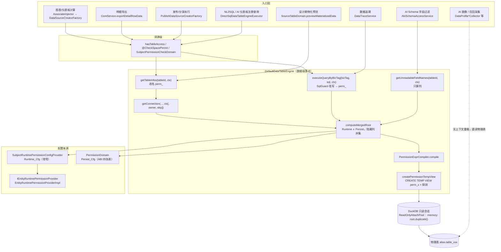
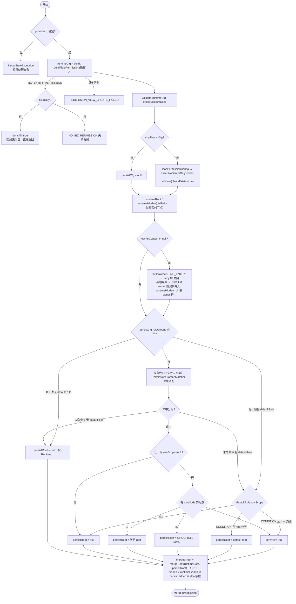
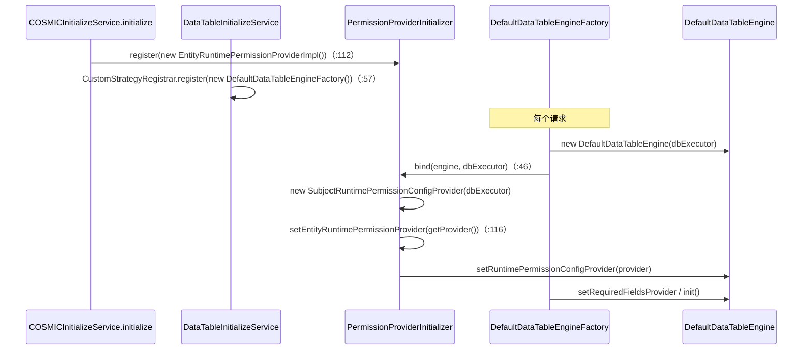

# 04 · 行级 / 列级数据权限源码精读

> 适用对象：想把 ABI「数据权限」从配置到 DuckDB 视图整条链路读懂的开发者。
> 依据：`abi-platform` 当前工作区源码（只读核对）。文中 `文件:行号` 均已对照源码；无法从代码确认的地方会标注「未验证」。
>
> 路径缩写（下文统一使用）：
>
> | 缩写 | 实际路径前缀 |
> | --- | --- |
> | `[dt]` | `bos-abi-mservice/code/abi-data-table/src/main/java/com/kingdee/abi/table/` |
> | `[ms]` | `bos-abi-mservice/code/mservice-abi/src/main/java/kd/bos/mservice/abi/` |
> | `[mg]` | `bos-abi-mservice/code/abi-manager/src/main/java/com/kingdee/abi/` |
> | `[ai]` | `bos-abi-mservice/code/abi-ai/src/main/java/com/kingdee/abi/ai/` |
> | `[bc]` | `bos-abi-common/code/abi-base-common/src/main/java/com/kingdee/abi/` |
> | `[dk]` | `bos-abi-mservice/code/abi-duckdb/src/main/java/com/kingdee/abi/duckdb/` |
> | `DTE` | `[dt]engine/DefaultDataTableEngine.java` |
> | `PEC` | `[dt]engine/PermissionExprCompiler.java` |
> | `PD` | `[dt]domain/PermissionDomain.java` |
> | `SRP` | `[dt]permission/SubjectRuntimePermissionConfigProvider.java` |
> | `QFC` | `[dt]permission/util/QFilterToExprNodeConverter.java` |

---

## 1. 定位

### 1.1 两类控制：资源级 vs 数据级

| 维度 | 资源级访问控制 | 数据级权限（本文主题） |
| --- | --- | --- |
| 回答的问题 | 「这个用户能不能打开这张表 / 这个主题？」 | 「打开之后能看到哪些行、哪些列有值？」 |
| 结果形态 | 布尔：放行或拒绝整次请求 | SQL：`WHERE` 条件 + 列 `CAST(NULL)` 占位 |
| 典型代码 | `DataSourceCreatorFactory.hasTableAccess`（`[mg]common/datasource/DataSourceCreatorFactory.java:74`，空间成员或发布反查，异常即拒绝）；`@CheckSpacePermit`（如 `[dt]service/DataTableService.java:1003`）；AI 问数前的 `SubjectPermissionCheckDomain.checkPermission`（`[ms]ai/delegate/AiServiceDelegate.java:99`） | `DTE.computeMergedRoot` → `PEC.compile` → `DTE.createPermissionTempView` |
| 失败表现 | `UnkownDataSouceCreator`、权限异常 | 0 行（`1=0`）、列为 NULL、或「权限配置异常」报错 |

介于两者之间的是**苍穹实体权限校验**（`SRP.checkEntityPermission`，`SRP:568`）：它判断「操作人能否查看这个苍穹实体」，但不在资源级入口拦截，而是在数据级构造时抛 `NO_ENTITY_PERMISSION`，由引擎翻译为 `denyAll`（取数返回 0 行）或 `NO_BIZ_PERMISSION`（字段可见性查询失败关闭）。

### 1.2 架构落点

行列权限的唯一落点是 `DefaultDataTableEngine`：在一次借出的 DuckDB 连接上，为每张物理表创建会话级 TEMP VIEW `perm_<物理表名>`。

- 行权限编译进视图 `WHERE`；`denyAll` 时为 `WHERE 1=0`。
- 列权限在视图 `SELECT` 列表里以 `CAST(NULL AS <原类型>) AS "<列名>"` 占位，列仍存在。
- 上层所有「受权限管控」的入口都对着 `perm_` 名查询：图表/仪表板通过 `getTableInfos(tableId, ctx)` 拿到已改名的 `TableInfo`；NL2SQL / 数据追溯通过 `SqlGuard` 把逻辑表名改写为 `perm_` 名。



---

## 2. 代码地图

| 类 | 模块 | 路径 | 行数 | 职责 |
| --- | --- | --- | ---: | --- |
| `IDataTableEngine` | abi-base-common | `[bc]engine/IDataTableEngine.java` | 402 | 引擎接口：有/无 `UserContext` 两套重载、`executeQueryByBizTag`、`getUnreadableFieldNames` |
| `DefaultDataTableEngine` | abi-data-table | `DTE` | 3312 | 权限视图落点：改名、借连接、合并、建视图、bizTag 查询 |
| `DefaultDataTableEngineFactory` | abi-data-table | `[dt]engine/DefaultDataTableEngineFactory.java` | 53 | 每次 `create` 新建引擎并 `bind` Provider |
| `PermissionExprCompiler` | abi-data-table | `PEC` | 878 | `ExprNode` → DuckDB `WHERE` 片段；隐藏字段旧格式提取 |
| `PermissionLeafTypeChecker` | abi-data-table | `[dt]engine/PermissionLeafTypeChecker.java` | 392 | 编译前两侧类型一致性闸（2026-10-16 合入）：LIKE 族左须文本、BETWEEN/日期模型左须日期、CONST/SYSTEM_VAR/CUSTOM_VAR 值类型与列类型比对、字段已删检测 |
| `CompareOperatorMapper` | abi-analysis-etl-core | `bos-abi-mservice/code/abi-analysis-etl-core/src/main/java/com/kingdee/abi/etl/batch/util/CompareOperatorMapper.java` | 218 | 设计器操作符 → SQL 操作符；LIKE 通配包装 |
| `ResolveContext` | abi-data-table | `[dt]engine/ResolveContext.java` | 53 | 查询级自定义变量缓存 |
| `CustomVarResolver` | abi-data-table | `[dt]engine/CustomVarResolver.java` | 263 | 自定义变量三态解析入口 + 审计 |
| `PermTableVarResolver` | abi-data-table | `[dt]engine/PermTableVarResolver.java` | 893 | 自定义变量解析内核（数据连接/数据中心/本地文件/基础资料四口径） |
| `ExprNode` | abi-data-table | `[dt]model/ExprNode.java` | 431 | 权限表达式树节点（两通道共用） |
| `PermissionConfigDTO` / `PermissionRuleGroupDTO` / `DisFieldItem` / `GranteeItem` | abi-data-table | `[dt]model/` | 105/135/49/46 | Persist_Cfg 与 Runtime_Cfg 的共用 DTO |
| `PermissionExprNodeEntity` 等 4 个 Entity | abi-data-table | `[dt]model/Permission*Entity.java` | 63~146 | 四张表的行映射 |
| `IPermissionDao` 等 4 个 DAO + `*SqlConstant` | abi-data-table | `[dt]dao/`、`[dt]dao/impl/` | 43~96 | 四张表的 SELECT / DELETE / INSERT |
| `PermissionDomain` | abi-data-table | `PD` | 2053 | Persist_Cfg 读写、树组装、结构/字段校验、服务端专用节点封堵 |
| `PermissionGranteeMatcher` | abi-data-table | `[dt]permission/PermissionGranteeMatcher.java` | 106 | 用户直配 OR 角色命中 |
| `IRuntimePermissionConfigProvider` | abi-data-table | `[dt]permission/IRuntimePermissionConfigProvider.java` | 152 | Runtime_Cfg 构造契约（引擎侧） |
| `SubjectRuntimePermissionConfigProvider` | abi-data-table | `SRP` | 1472 | 唯一实现：解算数据表、实体权限校验、身份过滤股 + 行权限股、列权限、注入字段、卫星表 |
| `PermissionProviderInitializer` | abi-data-table | `[dt]permission/PermissionProviderInitializer.java` | 121 | SPI 注册（`register`）与绑定（`bind`），未注册回退 EMPTY |
| `IEntityRuntimePermissionProvider` | abi-data-table | `[dt]permission/spi/IEntityRuntimePermissionProvider.java` | 302 | 平台 SPI：11 个 default 方法 |
| `RuntimeDataTable` / `SatelliteTableSpec` | abi-data-table | `[dt]permission/spi/` | 223/235 | 运行期数据表描述 / 卫星表规格 |
| `QFilterToExprNodeConverter` | abi-data-table | `QFC` | 1248 | 苍穹行权限 `QFilter` → `ExprNode` |
| `FilterItemToExprNodeConverter` | abi-data-table | `[dt]permission/util/FilterItemToExprNodeConverter.java` | 553 | 设计期实体过滤条件中的身份项 → `ExprNode` |
| `BaseDataCtrlQFilterRecognizer` | abi-data-table | `[dt]permission/util/BaseDataCtrlQFilterRecognizer.java` | 227 | 识别基础数据管控 QFilter 形态 |
| `PermissionConfigException` / `RuntimePermissionConvertException` / `PermissionCompileException` / `CustomVarResolveException` / `DataTableAccessException` | abi-data-table | `[dt]exception/` | 90/96/23/24/99 | 权限链路异常分类 |
| `DataTableService`（`/abi/dataPermission.do`） | abi-data-table | `[dt]service/DataTableService.java` | 1333 | 权限配置读/存/体检/删接口 |
| `DataTableInitializeService` | abi-data-table | `[dt]customservice/DataTableInitializeService.java` | 79 | 注册 `.do` 与 `DefaultDataTableEngineFactory` |
| `SqlGuard` / `SqlQueryProcessor` | abi-data-table | `[dt]sql/` | 800/321 | 不可信 SQL 只读 + 白名单 + 定点改写 |
| `SourceTableDomain` | abi-data-table | `[dt]domain/SourceTableDomain.java` | 5715 | 设计期物化预览（`skipPersistCfg` + `ownerContext`） |
| `AnalysisTableDomain` / `AnalysisTableMaterialTask` | abi-data-table | `[dt]domain/`、`[dt]analysis/` | 3896/583 | 分析表预览/候选值/物化计数（无上下文直读） |
| `EntityRuntimePermissionProviderImpl` | mservice-abi | `[ms]permission/EntityRuntimePermissionProviderImpl.java` | 893 | SPI 苍穹实现 |
| `COSMICInitializeService` | mservice-abi | `[ms]integration/service/COSMICInitializeService.java` | 225 | 启动期 `register` SPI |
| `DataSourceCreatorFactory` / `GeneralDirectQueryDataSourceCreator` | abi-manager | `[mg]common/datasource/` | 96/969 | 图表取数数据源：资源级校验 + 带权限连接 |
| `PublishDataSourceCreatorFactory` | abi-manager | `[mg]publish/domain/support/PublishDataSourceCreatorFactory.java` | 53 | 发布侧跨模块获取上面的 creator |
| `SingleFileDataSource` / `FormDataSource` | abi-manager | `[mg]common/cache/` | 112/– | 会话缓存数据源（表单嵌入场景） |
| `AbiSchemaAccessService` | abi-ai | `[ai]permission/AbiSchemaAccessService.java` | 283 | AI Schema 列过滤 |
| `DirectSqlDataTableEngineExecutor` | abi-ai | `[ai]recall/domain/support/DirectSqlDataTableEngineExecutor.java` | 158 | NL2SQL 执行（bizTag 链路） |
| `DataTraceService` | abi-ai | `[ai]sqltrace/service/DataTraceService.java` | 879 | 数据追溯明细 SQL（bizTag 链路） |
| `DataProfile*Collector` / `DataProfileAggregationEvidenceExecutor` | abi-ai | `[ai]dataprofile/` | 278~985 | AI 画像采集，无上下文直读物理表 |
| `SystemVarType` | abi-base-common | `[bc]common/systemvar/SystemVarType.java` | 34 | 系统变量枚举 |
| `ReadOnlyAttachPool` | abi-duckdb | `[dk]connection/ReadOnlyAttachPool.java` | – | 只读会话：`:memory:` root + `duplicate()` 派生 |

**推荐阅读顺序**（由内到外）：

1. `ExprNode` → `PermissionConfigDTO` / `PermissionRuleGroupDTO`：先认识数据结构。
2. `PEC`：纯函数，最容易建立「树 → SQL」的直觉，配合 `PermissionExprCompilerTest` 读。
3. `DTE.mergeRoot`（`DTE:413`）→ `DTE.computeMergedRoot`（`DTE:1884`）：合并语义。
4. `DTE.createPermissionTempView`（`DTE:2428`）→ `buildViewSelectList`（`DTE:2687`）：落地。
5. `DTE.getConnection(List, op, owner, skip)`（`DTE:1696`）、`executeQueryByBizTag`（`DTE:2197`）：两条主入口。
6. `PD.getPermissionConfig`（`PD:118`）、`PD.savePermissionConfig`（`PD:1514`）：Persist_Cfg 的持久化。
7. `IRuntimePermissionConfigProvider` → `SRP` → `IEntityRuntimePermissionProvider` → `QFC`：Runtime_Cfg。
8. 入口调用方（第 5 章）与 `BUG2026057946Test`（真实 DuckDB 全链路）。

---

## 3. 数据模型

### 3.1 Persist_Cfg：四张表

DDL 位于 `bos-abi-mservice/datamodel/bos/1.5/main/abi/dbschema/`（`kd_1.5.3493_abi_table.sql`、`kd_1.5.360_abi_table.sql`、`kd_1.5.3572_abi_table.sql`）。

| 表 | 列（DDL） | 对应实体 | 说明 |
| --- | --- | --- | --- |
| `T_ABI_PERM_RULE_GROUP` | `FID`、`FTABLEID`、`FGROUPNAME`、`FISDEFAULT INT`、`FROWSCOPE VARCHAR(20)`、`FSORTORDER INT` | `PermissionRuleGroupEntity` | 一行一个分组；`FISDEFAULT=1` 为默认分组；读取 `ORDER BY FSORTORDER` |
| `T_ABI_PERM_RULE_GROUP_GRANTEE` | `FID`、`FGROUPID`、`FTYPE INT`、`FGRANTEEID` | `PermissionRuleGroupGranteeEntity` | `FTYPE=0` 角色、`1` 用户（`PD:1582`、`PD:1594`） |
| `T_ABI_PERM_RULE_GROUP_DISFIELD` | `FID`、`FGROUPID`、`FFIELDID VARCHAR(50)`、`FFIELDALIAS` | `PermissionRuleGroupDisFieldEntity` | 列隐藏，一字段一行 |
| `T_ABI_TABLE_SOURCE_PERM_NODE` | `FID`、`FPARENT_ID`、`FTABLE_ID`、`FNODE_TYPE VARCHAR(10)`、`FLOGIC_TYPE`、`FFIELD_ID`、`FOPERATOR`、`FVALUE_MODE`、`FVALUE VARCHAR(500)`、`FALIAS`（3572 补）、`FGROUPID`（360 补） | `PermissionExprNodeEntity` | 表达式树平铺存储，靠 `FPARENT_ID` 还原 |

几个直接影响语义的事实：

- **节点表没有 `fieldIdType`、`values`、`subQuery` 列**。因此：`IN/NOT_IN` 的集合存成 JSON 数组字符串放进 `FVALUE`（`PD:1998-2001`），回读时 `[` 开头按 JSON 解，否则按逗号拆（`PD:570-583`）；`CONST` 左操作数不可持久化，`nodeToEntity` 直接抛 `CONFIG_CORRUPTED`（`PD:1977-1981`）；`subQuery` 不入库，也就天然不可能来自 Persist 通道。
- **所有标量值都以字符串入库**（`entity.setValue(String.valueOf(value))`，`PD:2002-2005`）。数值列上的 `CONST` 比较会编译成 `"amount" = '100'`，依赖 DuckDB 的隐式转换（本地 duckdb_jdbc 1.4.3 验证：整型列 `IN ('1','3')` 可正确命中）。
- `FVALUE` 只有 500 字符，长 IN 列表会受限（DDL 约束，写入时的报错形态未验证）。
- 预置迁移脚本 `preinsdata/kd_1.5_abi_perm_rule_group.sql` 为旧数据（无分组的节点）补一个名为「其他人员」的默认分组：有行规则则 `CONDITION`，否则 `ALL`，并把节点 `FGROUPID` 指向它。

**读取组装**（`PD.getPermissionConfig`，`PD:118-317`）：一次查四张表 → 按 `FGROUPID` 分桶 → 每组 `buildGroupTree`（`PD:436`）找 `FPARENT_ID` 为空的根；多根、孤立节点、环都抛 `IntegratedRuntimeException`。`FISDEFAULT=1` 的分组放进 `defaultRule`，其余进 `ruleGroups`。同时会解析用户名（`PD:214`）、角色名（`PD:251`）、加载存活自定义变量（`PD:294`）——这些是给配置弹窗展示用的，但引擎在**取数热路径**上也调用的是同一个方法（`DTE:457`），见 9.6。

**写入**（`PD.savePermissionConfig`，`PD:1514`）：先 `assertNoServerOnlyNodes`（`PD:1531`，事务外），再在事务内「先删四表 → 插分组 → 插授权主体与隐藏字段 → 逐组 `flattenTree` + `validateNodes` + `reallocateNodeIds` + 插节点」。写入侧校验比读取侧严格：

- `nodeType` 只允许 `GROUP/LEAF`，`logicType` 只允许 `0/1`（`PD:1759-1827`）；旧值只读不写。
- `LEAF` 必须有 `fieldId`、`operator`（`PD:1835-1846`），且 `operator ∈ ALLOWED_OPERATORS`（`PD:53-59`）。这意味着**新数据里的 LEAF 只能是行规则**，列隐藏只能走 `hiddenFields`。
- `MATCH` 必须配 `SYSTEM_VAR` 或 `CUSTOM_VAR`；`BETWEEN` 必须配 `CONST`；其余操作符 `valueMode ∈ {CONST, SYSTEM_VAR, MACRO_VAR, CUSTOM_VAR}`（`PD:62-63`）。注意 `MACRO_VAR` 允许保存，但编译期一律拒绝（4.4）。
- `rowScope` 为 null 时落库为 `"ALL"`（`PD:1684`）。

### 3.2 DTO 与 `ExprNode`

```text
PermissionConfigDTO
├── tableId / tableName
├── ruleGroups: List<PermissionRuleGroupDTO>     // 非默认分组
├── defaultRule: PermissionRuleGroupDTO          // 默认分组（Runtime_Cfg 只用这个槽位）
└── invalidCustomVarCodes / customVarNameMap / customVarTypeMap   // 弹窗展示用
PermissionRuleGroupDTO
├── groupId / groupName / isDefault / sortOrder
├── rowScope: "ALL" | "CONDITION"
├── roles / users: List<GranteeItem{id,name}>
├── rootNode: ExprNode                           // 仅行权限
└── disFields: List<DisFieldItem{fieldId,fieldAlias}>   // JSON 名 hiddenFields（@SerializedName）
```

`ExprNode` 字段与取值全集（`[dt]model/ExprNode.java`）：

| 字段 | 取值 | 新旧兼容 | 备注 |
| --- | --- | --- | --- |
| `nodeType` | `GROUP` / `LEAF` | 旧 `ROW_RULE`≡LEAF 行规则，旧 `COL_RULE`≡列隐藏 | 编译器只认 `GROUP`/`LEAF`/`ROW_RULE`，其余返回空串（`PEC:97-121`）；`PD.pruneAndValidate` 会先拒绝未知 nodeType（`PD:888-895`） |
| `logicType` | `"0"` AND / `"1"` OR | 旧 `"AND"`/`"OR"` | 编译器：只有 `"1"`/`"OR"` 当 OR，其余（含 null）都当 AND（`PEC:159`） |
| `fieldIdType` | `REF`（默认）/ `CONST` | getter 对 null 返回 `REF` | `CONST` 只允许 `"1"`/`"2"`，用于 BOS 的 `1=1`/`1!=1`（`PEC:712-726`）；仅 Runtime 通道产生 |
| `operator` | 见下表 | — | 空串/空 → 不编译（旧列权限节点） |
| `valueMode` | `CONST` / `SYSTEM_VAR` / `MACRO_VAR` / `CUSTOM_VAR` | 旧 `FIXED` / `SYSTEM_PARAM` / `EXPRESSION` | `MACRO_VAR`/`EXPRESSION` 编译期拒绝 |
| `value` | 标量（String/Number/Boolean） | — | 日期类为 RelativeDateModel JSON 字符串 |
| `values` | `List<Object>` | 为空时回退 `value`（含逗号即拆） | 仅 `IN`/`NOT_IN` |
| `subQuery` | 整段 SQL | — | 仅 `IN_SUBQUERY`/`NOT_IN_SUBQUERY`；仅 Runtime 通道 |
| `alias` / `groupId` / `nodeId` | — | — | 展示 / 分组 / 父子映射 |

操作符全集（设计器名 → SQL，依据 `CompareOperatorMapper.toSqlOperator`，`CompareOperatorMapper.java:17`）：

| 设计器操作符 | SQL | 可保存（Persist） | Runtime 产生 | 编译特殊处理 |
| --- | --- | :---: | :---: | --- |
| `EQUAL` / `NOT_EQUAL` | `=` / `!=` | ✓ | ✓ | 值为日期模型 JSON 时走 `compileSingleDateModelRule` |
| `GREATER` / `GREATER_EQUAL` / `LESS` / `LESS_EQUAL` | `>` `>=` `<` `<=` | ✓ | ✓ | 同上 |
| `IN` / `NOT_IN` | `IN` / `NOT IN` | ✓ | ✓ | 走 `values`；空集合 → `IN (NULL)` |
| `MATCH` | `IN` | ✓ | — | 配合 SYSTEM_VAR / CUSTOM_VAR |
| `INCLUDE` / `NOT_INCLUDE` | `LIKE` / `NOT LIKE` | ✓ | ✓（ftlike 简化） | 包装为 `%v%` 并转义 |
| `START_WITH` / `NOT_START_WITH` | `LIKE` / `NOT LIKE` | ✓ | — | `v%` |
| `END_WITH` / `NOT_END_WITH` | `LIKE` / `NOT LIKE` | ✓ | — | `%v` |
| `LIKE` / `NOT_LIKE` / `ILIKE` / `NOT_ILIKE` | 同名 | — | ✓ | 原值不包装（QFilter 已含 `%`） |
| `NULL` / `NOT_NULL` | `IS NULL` / `IS NOT NULL` | ✓ | ✓ | 无值 |
| `BETWEEN` | 展开为 `>= AND <` | ✓（仅 CONST） | — | 两侧 RelativeDateModel |
| `IN_SUBQUERY` / `NOT_IN_SUBQUERY` | `IN (<sql>)` / `NOT IN (<sql>)` | ✗（封堵） | ✓（基础数据管控） | 原样嵌入 |

### 3.3 Runtime_Cfg

#### 引擎侧契约 `IRuntimePermissionConfigProvider`

| 方法 | 契约要点（来自接口注释与实现） | 实现位置 |
| --- | --- | --- |
| `getRuntimeDataTable(tableInfo, ctx)` | 在一次取连接最早期调用一次，结果与身份无关、可多身份共用；**不做实体权限校验**；永不返回 null | `SRP:336` |
| `build(dataTable, ctx)` | 每次都重新调平台行/列权限接口，不缓存；按 ctx 校验实体权限；任何环节失败抛 `RuntimePermissionConvertException` | `SRP:625` |
| `buildFieldPermission(dataTable, ctx)` | 只算列（跳过行权限 QFilter 转换）；默认回退 `build` | `SRP:631` |
| `getInjectedPermFieldNames(dataTable, ctx)` | 物化时注入的苍穹权限控制字段（如 `__org_isolate_dim1`）→ 进隐藏集 | `SRP:1327` |
| `getRequiredSatelliteTables(dataTable, ctx)` | 基础数据管控需挂载的卫星表；**必须在 ATTACH 前**调用；定位不到就跳过 | `SRP:1415` |

`SRP.buildPermissionConfig`（`SRP:637-725`）产出的 Runtime_Cfg 只有 `defaultRule` 一个槽位：`rootNode`（行）+ `disFields`（列），`ruleGroups` 恒空。

- **分析表**（`SRP:684-689`，注释称「方案乙」）：`rootNode = null`、不收集隐藏列——分析表运行期不继承苍穹或来源表的任何行/列权限，只受自身 Persist_Cfg 管控。
- **来源表**：列 = `fetchColPermissionFieldIds`（`SRP:1010`）；行 = `buildSingleSourceRoot`（`SRP:761`）= `mergeTwoStreams(身份过滤股, 行权限股)`（`SRP:1280`，AND，任一为空则跳过）。
  - 身份过滤股（`SRP:815`）：设计期实体 `filters` 里引用当前用户上下文的条目，经 `UserContextFilterStripper.extract` 剥离后由 `FilterItemToExprNodeConverter` 用当前用户现场求值。
  - 行权限股（`SRP:928`）：`provider.fetchRowPermission(userContext, appId, entityNumber, entity)`（`SRP:960`）→ `QFC.convert(qFilters, mapper, entity, ctx)`。注释强调这里**只用操作人身份**；所有者（主题创建人）的行权限已在物化取数时下推进 Parquet（`SRP:942-952` 注释，指向 `ERPCloudEntitySourceDomain.getQueryListParameter` 与 `QingServiceHelper.fieldsControl`，取数侧代码本文未逐行核对）。

#### 平台 SPI `IEntityRuntimePermissionProvider`（11 个 default 方法）

| 方法 | 默认（EMPTY） | 调用方 | 用途 |
| --- | --- | --- | --- |
| `fetchRowPermission` | 空列表 | `SRP:960` | 当前用户行权限 `List<QFilter>`（苍穹实现调 `EntityFilterExtendUtil.getQFilter`，`[ms]permission/EntityRuntimePermissionProviderImpl.java:123`） |
| `fetchColPermission` | 空集 | `SRP:1027` | 不可读字段（Parquet 列名）；苍穹实现走 `QingServiceHelper.collectCannotReadField`（同文件 `:183`） |
| `setRuntimeEntity` | no-op | `SRP:418` | 回填运行期实体、entityNumber、appId；**按主题创建人身份**重建（避免操作人不可读列被裁掉导致映射落空） |
| `injectPermissionFields` / `injectAbiPermissionFields` | no-op | 物化取数 | 把苍穹权限字段 / ABI 规则引用字段物化进 Parquet |
| `getInjectedPermCtrlFields` | 空集 | （SRP 现改为从运行期实体正向收集） | 注入字段名 |
| `resolveSatelliteTables` / `extractSatelliteData` | 空集 / 0 | 卫星表链路 | 基础数据管控外部表 |
| `resolvePermColumnAliases` / `resolveMainPhysicalTableName` | 空 / null | `SRP.buildTranslateContext` | 子查询列名、主表名改写 |
| `resolveEntityNumber` | null | 物化 | 设计态实体 → entityNumber |

#### QFilter → ExprNode（`QFC.atomicQFilterToLeaf`，`QFC:396`）

| 输入 | 输出 | 位置 |
| --- | --- | --- |
| 顶层 `List<QFilter>` | 多个 → `GROUP(AND)`；单个直出 | `QFC:231-289` |
| `nests` | 左结合折叠，`isAnd()` 决定 0/1，同 op 合并 children | `QFC:291-376` |
| `ctx != null` 且为基础数据管控形态 | `IN_SUBQUERY` / `NOT_IN_SUBQUERY` LEAF | `QFC:406-414` |
| `EXISTS`/`NOT_EXISTS`、值为 `QFilterValue`/`QParameter`、`expressValue`、`joinFilter` | `STRICT=true`（默认）抛异常；`false` 跳过 | `QFC:417-428`、`QFC:763` |
| 字段映射失败且 property 为 `1`/`2` | `CONST` 常量 LEAF（`1=1` 等） | `QFC:444-448`、`QFC:677` |
| 字段映射失败（其他） | **WARN 并跳过该原子条件**（与 STRICT 无关） | `QFC:449-454` |
| `=`（值 null）/ `!=`（值 null） | `EQUAL` / `NULL`；`NOT_EQUAL` / `NOT_NULL` | `QFC:479-483`、`QFC:544-548` |
| `> >= < <=`、`is null`、`is not null`、`like`、`not like`、`ilike`、`not ilike` | 直转单 LEAF | `QFC:484-527` |
| `in` / `not in` | 集合 LEAF；空集合 → `1 != 1` / `1 = 1` | `QFC:827-858` |
| `between` | `GROUP(AND, [>=, <=])`（闭区间） | `QFC:865-899` |
| `relative_date_range` | `GROUP(AND, [>=, <])`（右开） | `QFC:915-960` |
| `ftlike` / `match` | 单关键词 → `INCLUDE`；null → `1 != 1`；多值/含空格 → 抛异常 | `QFC:972-1010` |
| 未知 cp | `STRICT` 抛异常，否则跳过 | `QFC:565-574` |
| 枚举字段 | 先按 `RuntimeProperty.getEnumValue()` 映射值 | `QFC:456-466` |

字段名映射器（`SRP.makeFieldNameMapper`，`SRP:1147-1205`）：`allPropertiesMap` 命中直通 → 反查 `allAssociateNameMap` → 补 `.id` 再试 → 仍未命中返回 null（触发上表「跳过」）。

### 3.4 `SystemVarType` 全枚举

`[bc]common/systemvar/SystemVarType.java:4-21`，括号内为 `isCollectionType`：

| 枚举 | 含义 | 集合 |
| --- | --- | :---: |
| `USER_ID` | 当前用户 ID | 否 |
| `USER_NAME` | 当前用户名称 | 否 |
| `ORG_ID` / `ORG_NAME` | 当前组织 ID / 名称 | 否 |
| `DEPARTMENT_IDS` | 所属部门 ID 列表 | 是 |
| `DEPARTMENT_AND_SUBORDINATE_IDS` | 所属部门及下级 | 是 |
| `BIZ_UNIT_ORGRANG_ID` | 下一代苍穹业务单元范围 | 是 |
| `ORG_RANGE_ID` | 组织范围 | 是 |
| `CHARGE_DEPARTMENT_IDS` / `CHARGE_DEPARTMENT_AND_SUBORDINATE_IDS` | 负责部门（及下级） | 是 |
| `COMPANY_IDS` | 加入的公司 ID（按公司内码去重） | 是 |
| `I18N` | 当前多语言 | 否 |

编译时 `SystemVarType.valueOf(value)`，取值走 `UserContext.getSystemVar`（`[bc]common/context/UserContext.java:82`）；未知名或取值为 null 都抛 `PermissionCompileException`（`PEC:614-636`）。集合型变量应配 `MATCH`（→ `IN`）；若配 `EQUAL` 等单值操作符，`formatSqlLiteral` 遇到非标量会抛「Unsupported constant value type」（`PEC:773-800`，前提是取值为 Collection，具体类型未逐一验证）。

### 3.5 一个完整例子：JSON → ExprNode → SQL

物理表 `table_orders`（列 `id INTEGER, region VARCHAR, owner_id VARCHAR, org_id BIGINT, price DOUBLE, cost DECIMAL(18,2)`）。Persist_Cfg（前端提交给 `savePermissionConfig` 的 `configJson`）：

```json
{
  "tableId": "res-orders",
  "ruleGroups": [{
    "groupName": "华东销售", "rowScope": "CONDITION",
    "users": [{"id": "1001"}],
    "rootNode": {"nodeId": "g1", "nodeType": "GROUP", "logicType": "0", "children": [
      {"nodeId": "l1", "nodeType": "LEAF", "fieldId": "region", "operator": "IN",
       "valueMode": "CONST", "values": ["华东", "华南"]},
      {"nodeId": "l2", "nodeType": "LEAF", "fieldId": "owner_id", "operator": "MATCH",
       "valueMode": "SYSTEM_VAR", "value": "USER_ID"}]},
    "hiddenFields": [{"fieldId": "cost", "fieldAlias": "成本"}]
  }],
  "defaultRule": {"groupName": "其他人员", "isDefault": 1, "rowScope": "CONDITION", "rootNode": null}
}
```

假设 Runtime_Cfg（苍穹）给出：行权限 `QFilter("org_id", "in", [100, 200])`，列权限不可读 `price`，无注入字段。

用户 1001 查询时：

1. 分组匹配：`users` 含 1001 → 命中「华东销售」；`rowScope=CONDITION` 且 `rootNode` 非空 → `persistRoot = g1`，`persistHidden = {cost}`。
2. Runtime：`runtimeRoot = LEAF(org_id IN [100,200])`，`runtimeHidden = {price}`。
3. `mergeRoot` → `GROUP(AND, [runtimeRoot, g1])`；隐藏并集 `{price, cost}`。
4. 编译（AND 子组不加括号，OR 才加，`PEC:159-167`）：

```sql
"org_id" IN (100, 200) AND "region" IN ('华东', '华南') AND "owner_id" IN ('1001')
```

`MATCH` 走 valueMode 分支，`resolvedValue` 为 `USER_ID` 的值，再 `formatValue(v, "IN")` 包成单元素 `IN`。`'1001'` 是否带引号取决于 `getSystemVar(USER_ID)` 的运行时类型（String 则带引号），未逐一验证。

5. 视图（`qualifiedName` 为 `<别名>.<表名>`，别名由 `ShardAliasDeriver.derive(dbPath)` 派生）：

```sql
CREATE OR REPLACE TEMP VIEW "perm_table_orders" AS
SELECT "id", "region", "owner_id", "org_id", CAST(NULL AS DOUBLE) AS "price", CAST(NULL AS DECIMAL(18,2)) AS "cost"
FROM <alias>.table_orders
WHERE "org_id" IN (100, 200) AND "region" IN ('华东', '华南') AND "owner_id" IN ('1001');
select 1 from "perm_table_orders";   -- 探测
```

用户 1002（不在任何分组）：无命中 → 有 `defaultRule` → `CONDITION` 且 `rootNode == null` → `denyAll`，视图 `WHERE 1=0`，不探测；隐藏列仍为 Runtime 的 `{price}`（默认分组无 `hiddenFields`）。若删掉 `defaultRule`，1002 只受 Runtime 约束（`WHERE "org_id" IN (100, 200)`），见 4.3 与 9.4。

---

## 4. 主流程逐段精读

以图表取数为主线：`getTableInfos(tableId, ctx)` → `getConnection(list, ctx)` → 对每张表 `computeMergedRoot` → `PermissionLeafTypeChecker.check` → `PEC.compile` → `createPermissionTempView` → 调用方对 `perm_x` 查询。`executeQueryByBizTag` 在 4.2 末尾单独对比。

### 4.1 `getTableInfos(tableId, ctx)`：只改名，不建视图

`DTE:1540-1558`：

```java
List<TableInfo> tableInfos = getTableInfos(tableId);            // 无 ctx 重载：只查 T_ABI_DATA_TABLE_FILE
// 不检查有没有设置权限，默认都受权限管控，返回带标记的表名
for (TableInfo info : tableInfos) {
    TableInfo permInfo = new TableInfo(getPermissionViewName(info.getTableName()), info.getDbPath());
    permInfo.setResourceId(tableId);
    permInfo.setEntityName(info.getEntityName());
    permInfo.setAnalysisTable(info.isAnalysisTable());
    result.add(permInfo);
}
```

- `getPermissionViewName` = `"perm_" + tableName`（`DTE:114` 常量、`DTE:275`）。
- **为什么只改名**：上层（`GeneralDirectQueryDataSourceCreator.getRealTableNameMap`）要先拿到表名去拼查询 SQL，而视图要等借到连接后才能建。改名与建视图是两步，契约是「调用方必须在同一连接上先走带 ctx 的 `getConnection`」（方法注释 `DTE:1533-1537`）。拿着 `perm_` 名去用无 ctx 的 `getConnection(TableInfo)` 会直接报「表不存在」——这是一种隐式的 fail-closed。
- 无 ctx 重载 `getTableInfos(tableId)`（`DTE:786-810`）只读文件登记表，不取数，本身不越权；真正决定是否绕过权限的是其后调用的取数方法（第 5.3 节）。

### 4.2 `getConnection(list, operator, owner, skip)`：解算 → 挂卫星表 → 借连接 → 逐表建视图

四参主方法 `DTE:1696-1764`（另外三个重载都委托到这里，`DTE:1677-1694`）：

```java
List<RuntimeDataTable> dataTables = describeAll(tableInfos, operatorContext);          // 1715
Set<String> satellitePaths = collectSatelliteMountPaths(dataTables, operatorContext);  // 1716
Connection conn = acquireReadConnection(tableInfos, satellitePaths);                   // 1723
ResolveContext resolveContext = createResolveContext(operatorContext);                 // 1726
for (RuntimeDataTable dataTable : dataTables) {
    MergedPermission merged = computeMergedRoot(dataTable, operatorContext, ownerContext, skipPersistCfg); // 1738
    String qualifiedSource = qualifiedName(originalTableInfo.getDbPath(), originalTableName);
    createPermissionTempView(conn, merged.mergedRoot, merged.hiddenFields, merged.denyAll,
            originalTableName, qualifiedSource, operatorContext, resourceId, resolveContext);   // 1744
}
```

逐步说明：

1. **`describeAll`**（`DTE:737-762`）：对每张表先 `toOriginalTableInfo`（`DTE:771-783`）把 `perm_` 前缀剥掉，再 `provider.getRuntimeDataTable`。注释说明了两个设计点：
   - 解算要加载 box、解析主题所有者、按创建人身份重建运行期实体，是最贵的一步，所以「解算一次、挂载收集与权限构造共用」。
   - **失败即抛**（`RuntimePermissionConvertException` → `PERMISSION_VIEW_CREATE_FAILED`），因为解算失败会让行权限字段映射落空，继续下去等于放权。
   - 剥前缀的原因：`RuntimeDataTable.tableInfo` 会被基础数据管控翻译用来拼主表限定名，带 `perm_` 会让子查询指向视图自身。
2. **`collectSatelliteMountPaths`**（`DTE:681-722`）：必须在 ATTACH 之前，因为卫星表要和主表在同一次 ATTACH 中挂上，权限视图里的 `IN (SELECT ... FROM <alias>.<卫星表>)` 才能解析。失败只 WARN 返回已收集部分——真正的「卫星表未就绪」由后面的 `build` 抛出带可执行动作的文案。卫星表只进挂载清单，不进 `tableInfos`，因此不会被施加权限，也不会产出 `perm_` 视图（`DTE:634-637` 注释）。
3. **`acquireReadConnection`**（`DTE:638-669`）：按 `dbPath` 去重后调 `IDirectEngine.acquire(List)`，一次只读 ATTACH 多个文件。底层 `ReadOnlyAttachPool` 用 `:memory:` root `duplicate()` 派生会话（见第 1.2 节图），TEMP VIEW 只活在这条会话里，连接一关即消失，不会串到其他用户。
4. **`createResolveContext`**（`DTE:2338-2347`）：查询级自定义变量缓存，同一批视图内同一变量只解析一次（注释 AC-16）。
5. **异常收口**（`DTE:1749-1761`）：`PermissionConfigException` 统一翻译成「权限配置异常，请联系主题创建人"%s"处理」；其他 `Throwable` 原样抛出；两条路径都 `closeQuietly(conn)`。成功路径连接交给调用方关闭。

**`executeQueryByBizTag` 的差异**（`DTE:2197-2244`）：

| 维度 | `getConnection` | `executeQueryByBizTag` |
| --- | --- | --- |
| 表集合 | 调用方给定（一个资源的全部实体） | 主题下全部来源表/分析表/引用表 → `SqlQueryProcessor` 改写后**只取 SQL 实际引用的表**（`resolveReferencedTableInfos`，`DTE:2301-2314`） |
| 视图名映射 | 调用方自己用 `perm_` 名 | `registerMaterializedAliases` 把逻辑名 `资源名[.子表名]` 映射为 `perm_<物理表>`（`DTE:1450-1470`，值在 `DTE:1467`），SqlGuard 按此白名单定点改写 |
| owner / skipPersist | 支持 | 不支持（`computeMergedRoot(dataTable, ctx, null, false)`，`DTE:2325`） |
| 连接生命周期 | 交给调用方 | 方法内 `finally closeSafety`（`DTE:2240-2243`） |
| 权限配置异常 | 翻译为「权限配置异常，请联系主题创建人」 | `PermissionConfigException` 是 `RuntimeException`，落到 `catch (Exception) → DataTableAccessException.unknown(e)`（`DTE:2213-2216`），友好文案丢失（见 9.11） |

引用表的 `perm_` 视图用的是 `fileEntity.getResourceId()`（`DTE:2386`），即被引用**来源表**的资源 ID，所以引用表查询施加的是来源表的 Persist_Cfg，与 `getUnreadableFieldNames` 对引用表「换成来源表再算」（`DTE:1577-1583`）口径一致。

### 4.3 `computeMergedRoot`：两通道合并

入口有三层重载（`DTE:1816-1882`），最终都到 `computeMergedRoot(RuntimeDataTable, op, owner, skip, fieldOnly)`（`DTE:1884-2170`）。

#### 合并决策流程



分段说明：

1. **Runtime_Cfg 构造**（`DTE:1896-1925`）。`fieldPermissionOnly=true`（来自 `getUnreadableFieldNames`）走 `buildFieldPermission`，跳过 QFilter 转换。`NO_ENTITY_PERMISSION` 的两种翻译（`DTE:1907-1916`）：
   - 取数路径 → `denyAll`，视图 `WHERE 1=0`，用户看到空图而不是报错。
   - 字段可见性路径没有「拒绝全部行」的返回通道，若返回空隐藏集会被误读为「所有字段可读」，所以抛 `NO_BIZ_PERMISSION`。
   注意 `denyAll` 分支在 `DTE:1911` 直接返回，**不加载 Persist_Cfg、不计算注入字段**，隐藏集为空——行已经是 0，列无所谓。
2. **结构校验**（`DTE:1929`）：Runtime 侧 `checkExists=false`，只做 nodeType 校验和空 GROUP 自愈，不查设计器字段。
3. **Persist_Cfg 加载**（`DTE:1938-1963`）。顺序有讲究：`assertNoServerOnlyNodes`（`DTE:1954`）**必须早于**字段校验，防止前端 JSON 带 `subQuery`/`IN_SUBQUERY` 把整段 SQL 嵌进视图。随后 `validatePermissionConfig(..., true)`（`DTE:1962`）会就地修改 DTO：空 GROUP 或全部被剪枝的 GROUP 会让分组 `rootNode` 变成 null（`PD:847-858`、`PD:872-922`）。所以「CONDITION + 空 GROUP」最终也落入「CONDITION + rootNode 为 null → denyAll」。
4. **Runtime 行列抽取**（`DTE:1969-1983`）：只读 `defaultRule`；旧格式「有 fieldId 无 operator 的 LEAF」也经 `extractHiddenFields`（`DTE:3286`）并入隐藏集。
5. **owner 分支**（`DTE:1987-2020`）：只叠加**列**（owner 的 `disFields` 和旧格式列节点），不叠加 owner 的行——注释的理由是 owner 行权限已在物化时下推进 Parquet。owner 侧 `NO_ENTITY_PERMISSION` → `denyAll`（交集为空），其他异常 → 失败关闭，不允许退化为「只按操作人」。
6. **分组匹配**（`DTE:2027-2048`）：

   ```java
   try {
       userRoleIds = IntegratedHelper.getUserRoleIds(userContext.getUserId());
   } catch (IntegratedRuntimeException e) {
       userRoleIds = Collections.emptySet();          // 2037：角色查询失败按「无角色」继续
   }
   PermissionGranteeMatcher matcher = new PermissionGranteeMatcher();
   for (PermissionRuleGroupDTO group : persistCfg.getRuleGroups()) {
       if (matcher.match(userContext, userRoleIds, group.getRoles(), group.getUsers())) {
           matchedGroups.add(group);
       }
   }
   ```

   `PermissionGranteeMatcher.match`（`[dt]permission/PermissionGranteeMatcher.java:50-105`）：先比用户直配（`:68`），再比角色（`:96`），任一命中即 true。角色 ID 预取一次，N 个分组不会触发 N 次角色查询。角色查询失败按空集处理的后果见 9.4。
7. **默认分组 / 未命中**（`DTE:2050-2078`）：未命中且有 `defaultRule` → 按其 `rowScope` 处理（`ALL` 不限行、`CONDITION`+root 用 root、`CONDITION`+无 root → `denyAll`）；**未命中且无 `defaultRule` → `persistRoot = null`，只受 Runtime 约束**（`DTE:2073-2077`）。
8. **命中分组 OR 并集**（`DTE:2080-2120`）：任一命中组 `ALL` → 不限行；全部命中组都没有 root → `denyAll`；1 个 root 直接用；多个 → `GROUP(logicType="1")`（`DTE:2117`）。**隐藏列取所有命中组的并集**——行越并越宽，列越并越窄，见 9.9。
9. **仅 defaultRule、无 ruleGroups**（`DTE:2122-2143`）：与第 7 步同口径。
10. **AND 合并与注入字段**（`DTE:2152-2169`）：`mergeRoot`（`DTE:413-431`）是纯函数：双空 → null；单侧 → 原样返回；双侧 → `GROUP(AND, [runtime, persist])`，不压平。最后把 `getInjectedPermFieldNames`（如 `__org_isolate_dim1`）并入隐藏集。注释强调要显式传 `userContext`：靠 `UserContext.getCurrent()` 兜底时，异步线程上返回空集，管控字段就不进隐藏集。

### 4.4 `PermissionExprCompiler.compile`：ExprNode → WHERE

`PEC:61-71` 入口：`rootNode == null` 返回空串；`userContext == null` 抛 `IllegalArgumentException`。

**GROUP**（`PEC:128-167`）：子节点编译结果为空的被丢弃；只剩 1 个直接返回；OR 用括号包住，AND 不加括号。AND 不加括号是安全的：SQL 里 AND 优先级高于 OR，`(a AND b OR c)` 等价 `((a AND b) OR c)`；所有可能产出 OR 的片段（OR 组、`NOT_EQUAL` 日期模型、`IN (...)`）都自带括号。

**LEAF 分发**（`PEC:182-312`）按以下顺序判定，顺序本身就是语义：

| 顺序 | 条件 | 产出 | 位置 |
| --- | --- | --- | --- |
| 1 | `fieldId` 为空 | 抛异常（返回空串会在 AND 中丢掉一个收紧条件 = 越权） | `PEC:194-199` |
| 2 | `IN_SUBQUERY` / `NOT_IN_SUBQUERY` | `<left> IN (<subQuery>)`，原样嵌入、左侧不转型；`subQuery` 为空抛异常 | `PEC:207-211`、`PEC:586-608` |
| 3 | `NULL` / `NOT_NULL` | `IS NULL` / `IS NOT NULL` | `PEC:217-224` |
| 4 | `IN` / `NOT_IN` | `values` 优先，空则回退 `value`（含逗号即拆）；空集合 → `IN (NULL)` | `PEC:228-238`、`PEC:749` |
| 5 | `BETWEEN` | 两侧 RelativeDateModel → `>= TIMESTAMP 'start' AND < TIMESTAMP 'end'` | `PEC:243-246`、`PEC:325-396` |
| 6 | 单值日期比较符 + `{"start":...}` | 粒度区间，如 `EQUAL` → `>= start AND < end` | `PEC:253-256`、`PEC:479-547` |
| 7 | 单值日期比较符 + 含 start/end 键的非法 JSON | 抛异常，不退回常量路径生成垃圾字面量 | `PEC:264-268` |
| 8 | `SYSTEM_VAR` | `resolveSystemParam` → 值为 null 或未知变量名都抛 | `PEC:271-278`、`PEC:614-636` |
| 9 | `CONST` | 原值 | `PEC:279-282` |
| 10 | `MACRO_VAR` / `EXPRESSION` | **一律拒绝**（原实现不转义直拼，`value="1 OR 1=1"` 即可注入） | `PEC:283-291` |
| 11 | `CUSTOM_VAR` | 三态见下 | `PEC:292-298`、`PEC:647-707` |
| 12 | 其他 valueMode | 抛异常 | `PEC:300-302` |
| 13 | LIKE 族 | `wrapLikePattern` 转义并加 `%` | `PEC:306-309` |

几个值得单看的点：

- **IN 分支早于 valueMode 判定**（第 4 步早于第 8~11 步）：`IN`/`NOT_IN` 无论 valueMode 是什么都按字面量编译。保存校验只约束 `MATCH` 必须配变量，`IN` + `SYSTEM_VAR` 也能保存（`PD:1890-1898`），编译结果会是 `"owner_id" IN ('USER_ID')`。`IN` 时收窄，`NOT_IN` 时等于不限，见 9.4 末条。
- **BETWEEN 的半开区间**（`PEC:358-372`）：FIXED 端点带时分秒时，结束侧取原始时刻 `+1000ms`（`PEC:365`）——权限链路的字面量由 `DateLiteralFormatter` 截断到秒，`+1ms` 会被格式化回原秒；日级口径用 `nextPeriodStart(endMs, "Day")`（`PEC:371`）到次日零点，保证「包含结束日完整自然日」。两侧都不限制时抛异常（`PEC:373-377`），开始晚于结束不拦截，自然编译成恒假（相对日期可能随时间自动恢复）。
- **LIKE 转义**：`CompareOperatorMapper.escapeLikeValue` 把 `\ % _` 转成 `\\ \% \_`（`CompareOperatorMapper.java:184-191`），但编译产物里**没有 `ESCAPE '\'` 子句**。DuckDB 的 LIKE 没有默认转义符，所以这层转义在 DuckDB 上不生效，见 9.2。Runtime 通道的 `LIKE`/`ILIKE` 原值不包装（`wrapLikePattern` 的 default 分支，`CompareOperatorMapper.java:173-174`）。
- **CUSTOM_VAR 三态**（`PEC:647-667`）：

  ```java
  if (!"MATCH".equals(matchOperator)) throw ...;              // 非 MATCH 拒绝
  List<String> values = resolveCustomVar((String) value, userContext, resolveContext);
  if (values.isEmpty()) return "1 = 2";                         // EMPTY：仅该条件不放行
  if (values.size() == 1) return leftOperand + " = " + formatSqlLiteral(values.get(0));
  return leftOperand + " " + formatValue(values, "IN");        // OK 多值
  ```

  FAILED 由 `resolveCustomVar` 抛 `CustomVarResolveException`（`PEC:696-706`），整查询报错并带精确文案；解析器缺失抛 `PermissionCompileException`（`PEC:686-689`）。注意 EMPTY 在 OR 组里只让该分支不放行，其他分支照常——这是 2026-09-22 裁决「单变量失效不拖垮整个查询」，FAILED 后来（10-15）改成整查询报错。
- **字面量与标识符**：
  - `formatSqlLiteral`（`PEC:773-800`）按 Java 运行时类型出字面量：String/Character → `escapeSqlValue`；Number 原样（拒绝 NaN/Infinity）；Boolean → `TRUE/FALSE`；其他类型拒绝，不做隐式 `toString`。
  - `escapeSqlValue`（`PEC:817-824`）只把 `'` 双写。DuckDB 普通字符串字面量不把反斜杠当转义符，所以单引号双写足以闭合字面量。
  - `escapeIdentifier`（`PEC:805-812`）双引号包裹、内部 `"` 双写。
  - `CONST` 左操作数只放行 `"1"`/`"2"`（`PEC:712-726`），用于 BOS 的 `1=1`/`1!=1`。
  - 方言层只有 DuckDB 一套（类注释 `PEC:25-32`）；接 StarRocks 要把标识符和字面量转义整体抽层。

### 4.5 编译前的类型一致性闸（2026-10-16 新增）

`createPermissionTempView` 在 `compile` 之前先跑 `PermissionLeafTypeChecker.check`（`DTE:2443-2449`）：

```java
if (mergedRoot != null) {
    PermissionLeafTypeChecker.check(mergedRoot, loadColumnTypeNames(conn, qualifiedSource),
            userContext, buildVarTypeLookup());
}
whereClause = (mergedRoot != null) ? compiler.compile(mergedRoot, userContext, resolveContext) : "";
```

- 左值类型来自 `loadColumnTypeNames`（`DTE:2606-2622`，一次 `SELECT * ... LIMIT 0`）；CUSTOM_VAR 的声明类型来自 `buildVarTypeLookup`（`DTE:2631-2660`，逐个 `selectByCode`，异常按查不到跳过）。
- 判定规则（`PermissionLeafTypeChecker.java:125-150`、`:209-240`、`:318-386`）：
  - 豁免：无 operator、非 REF、`NULL` 族、子查询族、`MACRO_VAR`、无法识别的 operator。
  - 形态：LIKE 族左须 STRING；`BETWEEN`/日期模型左须日期族。
  - 值：String 用 `canConvert`，Number 要求左侧为 NUMBER/BOOLEAN，Boolean 要求左侧为 BOOLEAN/NUMBER。
  - **受控字段不在列元数据里 → 抛「字段已不存在」**，补上了 Runtime 通道不校验字段存在性的洞。
- 失败翻译为 `DataTableAccessException(PERMISSION_VIEW_CREATE_FAILED, 字段级文案)`（`DTE:2452-2457`），与 `CustomVarResolveException` 同一通道，不走「请联系主题创建人」统一文案。
- 它让第 4.6 节的探测查询从「主要的类型错误发现手段」退成兜底，并与已有测试产生冲突，见 9.10。

### 4.6 `createPermissionTempView`：拼 SQL + 探测

`DTE:2428-2524`：

```java
if (denyAll) whereClause = "1=0";                                    // 2437
...
String selectList = hiddenFields.isEmpty() ? "*" : buildViewSelectList(conn, qualifiedSource, hiddenFields);
String permissionViewName = PERMISSION_VIEW_PREFIX + tableName.replace("\"", "\"\"");
viewSql.append("CREATE OR REPLACE TEMP VIEW \"" + permissionViewName);
viewSql.append("\" AS SELECT ").append(selectList).append(" FROM ").append(qualifiedSource);
if (!whereClause.isEmpty()) viewSql.append(" WHERE ").append(whereClause);
boolean needProbe = !denyAll && !whereClause.isEmpty();             // 2506
try (Statement stmt = conn.createStatement()) {
    stmt.execute(viewSql.toString());
    if (needProbe) stmt.execute("select 1 from \"" + permissionViewName + "\"");   // 2514
}
```

- **总是建视图**：即使没有任何权限也建 `SELECT *` 透传视图。调用方统一对 `perm_` 取数，不需要感知「这张表有没有配权限」。
- **异常分级**：
  - `PermissionCompileException` → `PermissionConfigException(COMPILE_FAILED)`，并补主题创建人名（`DTE:2466-2476`）。
  - DuckDB `SQLException` 经 `classifyPermissionViewError`（`DTE:2544-2570`）按消息关键字分为 `FIELD_NOT_FOUND`、`COMPILE_FAILED`（含 `conversion error`）、`LOAD_FAILED`。
  - 都不会降级成无 WHERE 的视图。
- **为什么要探测**：DuckDB 的 `CREATE VIEW` 只做绑定，不对常量转换求值，`"amount" = 'abc'` 能建成功，要到真正取数才报 `Conversion Error`。探测把它提前到 `getConnection` 阶段，走「权限配置异常」友好通道。本地 duckdb_jdbc 1.4.3 实测：对 `INTEGER` 列 `WHERE id = 'abc'` 建视图成功，`select 1` 报 `Conversion Error`。
- **只在有行条件时探测**：无 WHERE 或 `1=0` 时视图只含列引用和 `CAST(NULL)`，不会出运行期转换错误。
- **不加 LIMIT**（`DTE:2513` 注释）：为了不漏掉只由靠后数据行触发的逐行转换错误。代价见 9.8。
- 表名转义只处理双引号；`qualifiedSource` 的表名部分由 `qualifiedName` 做同样处理（`DTE:595-599`），别名由 `ShardAliasDeriver.derive` 派生。

### 4.7 `buildViewSelectList`：列隐藏的落地

`DTE:2687-2731`：

```java
ResultSet rs = stmt.executeQuery("SELECT * FROM " + qualifiedSource + " LIMIT 0");
for (int i = 1; i <= columnCount; i++) {
    String colName = meta.getColumnName(i);
    if (hiddenFields != null && hiddenFields.contains(colName)) {
        String typeName = meta.getColumnTypeName(i);
        if (typeName == null || typeName.isEmpty()) typeName = "VARCHAR";
        cols.append("CAST(NULL AS ").append(typeName).append(") AS \"").append(escaped).append("\"");
    } else {
        cols.append("\"").append(escaped).append("\"");
    }
}
```

- 保留列序和列类型，下游 `SELECT *`、聚合、JOIN 的结构都不变。
- 元数据查询失败抛 `RuntimeException`（`DTE:2725-2730`），**绝不降级为 `SELECT *`**，否则隐藏列会泄露。
- `hiddenFields` 只在非空时才走这一步（空集直接 `*`，省一次元数据往返）；隐藏集中不存在的列名会被静默忽略。
- 匹配是**大小写敏感**的 `Set.contains`，而 AI 侧 `AbiSchemaAccessService` 用的是忽略大小写匹配（`AbiSchemaAccessService.java:119`、`:139`），见 9.5。
- 与 4.5 合起来，一张同时有行规则和隐藏列的表，每次建视图会执行 2 次 `LIMIT 0` 元数据查询、1 次 `CREATE VIEW` 和 1 次全量探测。

---

## 5. 各入口逐一追踪

### 5.1 受权限管控的入口

**图表 / 仪表板 / 明细导出 / 发布**，共用 `DataSourceCreatorFactory`：

- `AssociateInjector`（`[ms]util/AssociateInjector.java:33`）给 `@Associate(data=true)` 的服务注入 creator；`DashboardDesignService`、`PublishDashboardService`（`[ms]dashboard/*:12`）和发布侧 `COSMICInitializeService:215` 注册的 `IPublishDataSourceCreatorProvider` 都调同一个工厂。
- 工厂（`[mg]common/datasource/DataSourceCreatorFactory.java:43-66`）：
  - 先查会话缓存（`:47`）。
  - 未命中时先过资源级 `hasTableAccess`（`:51`、`:74-95`）：空间成员 → 放行；发布反查 → 放行；异常 → 拒绝，返回 `UnkownDataSouceCreator`。
  - 通过后返回 `GeneralDirectQueryDataSourceCreator`（`:56`）。
- `GeneralDirectQueryDataSourceCreator` 用 `getTableInfos(tableId, ctx)`（`[mg]common/datasource/GeneralDirectQueryDataSourceCreator.java:114`）拿到 `perm_` 名，再在 `getConnection` 回调里调 `getConnection(getTableInfo(), userContext)`（`:172`）。注意 `getTableInfo()` 返回资源的全部实体，因此**每次借连接都会为该资源所有实体建视图**，即使这次查询只用其中一张。
- 明细导出 `CoreService.exportDetailRowData`（`bos-abi-mservice/code/abi-core/src/main/java/com/kingdee/abi/service/CoreService.java:775-818`）带 `@Associate(data=true)`，用的是同一个 creator，所以导出与图表口径一致，隐藏列导出为空值。`ExportDomain.checkExportPermission` 处理的是表单数据源的导出权限（`ExportPermissionChecker`），与行列权限无关。
- 发布侧调用 `PublishDataSourceCreatorFactory.create(userContext, ...)` 的地方：`AiServiceDelegate.java:712`（`UserContext.getCurrent()`）、`ChartDomain.java:675`、`PublishRecordDomain.java:3126`。后两处传入的 `userContext` 是查看人还是发布人，本文未逐一核对。

**NL2SQL / AI 仪表板注册查询**：`DirectSqlDataTableEngineExecutor.query`（`[ai]recall/domain/support/DirectSqlDataTableEngineExecutor.java:59-67`）调 `executeQueryByBizTag(subjectId, sql, handler, UserContext.getCurrent())`。

1. `prepareQueryExecution`（`DTE:2246-2284`）列出主题下全部三类资源（`DTE:2250-2253`），把引用表映射到来源表 ID（`DTE:2259`）。
2. 构造白名单：逻辑资源先登记为「已知但未物化」的空值（`DTE:1441-1446`），再按物化文件登记 `资源名[.子表名] → perm_<物理表>`（`DTE:1467`）。
3. `SqlQueryProcessor.getDuckDb().process`（`DTE:2274`）：Calcite 解析，只允许查询；白名单外的表引用（含 `read_parquet` 等表值函数、`alias.table_xxx` 物理限定名）一律拒绝（`[dt]sql/SqlGuard.java:51-54`、`:481-483`）；然后定点改写表名。
4. 只为改写结果实际引用到的表建视图（`DTE:2307`）。纯常量查询只借一个载体文件挂载，不建视图（`DTE:2229-2233`）。

`UserContext.getCurrent()` 为 null 时，`executeQueryByBizTag` 直接抛 `IllegalArgumentException`（`DTE:2201-2204`），是 fail-closed。

**数据追溯**：`DataTraceService.executeQuery`（`[ai]sqltrace/service/DataTraceService.java:851-856`）同样走 `executeQueryByBizTag`，参数化执行。

**枚举值权限校验**：`DefaultFilterValuePermissionVerifierFactory`（`[ai]recall/permission/DefaultFilterValuePermissionVerifierFactory.java:112`、`:122`）先 `getTableInfos(tableId, ctx)`，再 `getConnection(list, ctx)`。

**设计期物化预览**：`SourceTableDomain.previewMaterializedData`（`[dt]domain/SourceTableDomain.java:1655` 起）。

- `getTableInfos(tableId, ctx)`（`:1669`）→ `resolvePreviewOwnerFailClosed`（`:1700`、`:5083-5130`）→ owner 实体权限硬拦截（`:1702-1714`）→ `getConnection(tableInfo, ctx, ownerContext, true)`（`:1715`）。
- `skipPersistCfg=true`：只施加 Runtime_Cfg，ABI 管理员配置的分组规则不生效。
- 行：Parquet 已含 owner 行权限，再 `WHERE` 操作人苍穹行，得到交集。
- 列：操作人不可读 ∪ owner 不可读，等价于可读列取交集。
- owner 解析：预置空间返回 null（预置用户无真实苍穹列权限）；普通主题取主题创建人；解析失败抛异常，**不回退到操作人**。
- `buildUserContextFor` 会切换线程 `RequestContext`，代码保存并恢复原上下文（`:5112-5120`）。否则后续操作人行权限 `getQFilter` 的默认分支会误读 owner 身份，造成行权限绕过。

`countMaterializedData`（`:2212-2280`）同样 `skipPersistCfg=true`，但不传 owner（`:2246`）。计数与列无关，owner 只影响列，所以行数一致。

**AI Schema 列过滤**：`AbiSchemaAccessService`（`[ai]permission/AbiSchemaAccessService.java`）→ `engine.getUnreadableFieldNames(tableId, ctx)`（`:185`）→ `DTE:1562-1617` → `computeFieldPermissions`。

- 只算列：Runtime + Persist 命中分组 + 注入字段，返回 `entityName → 隐藏集`。
- 由 `ABIMetadataDomain`（`[ai]metadata/domain/ABIMetadataDomain.java:1805`、`:1892`）调用，把不可读字段**从 schema 中剔除**，而不是 NULL 占位。
- 结果只在实例内按 `tableId` 缓存（`:167`），不跨请求。
- 失败关闭的几处：
  - 引擎返回空 map 或实体找不到 → `IllegalStateException`（`:176`、`:188`）。
  - 无实体权限：调用方允许跳过时返回 false（整表不出现在 schema 中），否则映射为 `MetadataException.PERMISSION_ERROR`。

### 5.2 入口汇总

| 入口 | 行过滤 | 列过滤 | 列过滤方式 | 证据 |
| --- | --- | --- | --- | --- |
| 图表 / 仪表板计算 | Runtime ∧ Persist | Runtime ∪ Persist ∪ 注入 | `CAST(NULL)` 占位 | `DataSourceCreatorFactory.java:51-56`；`GeneralDirectQueryDataSourceCreator.java:114`、`:172` |
| 明细导出 | 同上 | 同上 | 同上（导出为空值） | `CoreService.java:775-822`（同一 creator） |
| 发布 / AI 执行图表 | 同上（身份取决于传入 ctx） | 同上 | 同上 | `PublishDataSourceCreatorFactory.java`；`COSMICInitializeService.java:215` |
| NL2SQL | Runtime ∧ Persist（仅被引用表） | 同上 | `CAST(NULL)` | `DirectSqlDataTableEngineExecutor.java:65`；`DTE:2219-2244` |
| 数据追溯 | 同上 | 同上 | `CAST(NULL)` | `DataTraceService.java:853` |
| 枚举值权限校验 | Runtime ∧ Persist | 同上 | `CAST(NULL)` | `DefaultFilterValuePermissionVerifierFactory.java:112`、`:122` |
| 设计期物化预览 | 仅 Runtime（操作人） | 操作人 ∪ owner（Runtime 侧） | `CAST(NULL)` | `SourceTableDomain.java:1700`、`:1715` |
| 设计期物化计数 | 仅 Runtime | —（不影响计数） | — | `SourceTableDomain.java:2246` |
| AI Schema / 元数据 | 无 | Runtime ∪ Persist ∪ 注入 | **从 schema 剔除** | `AbiSchemaAccessService.java:98-125`；`DTE:1562` |
| AI 画像 / 召回 / 候选值 / 样本 | **无** | **无**（只在 schema 层剔除字段） | — | 见 5.3 |
| 分析表设计期预览 / 候选值 | **无** | **无** | — | `AnalysisTableDomain.java:3025`、`:2123`、`:2147` |
| 会话缓存 `SingleFileDataSource` / `FormDataSource` | **不经引擎** | **不经引擎** | — | `DataSourceCreatorFactory.java:58-61`；`SimpleDataSourceCreator.java` 直接读 QS 文件 |

会话缓存分支命中时连 `hasTableAccess` 都不走（检查只在 `dataSource == null` 分支里，`DataSourceCreatorFactory.java:48-57`）。缓存的写入方在本仓库 `src/main/java` 中没有找到（`FormDataSource` 只经 `AbstractDataSource.fromJson` 反序列化，`AbstractDataSource.java:226-227`），推测由苍穹表单侧写入会话，权限由写入方负责。未验证。

### 5.3 无 UserContext 重载的生产调用方

接口定义见 `[bc]engine/IDataTableEngine.java`：`getTableInfos(String)` `:43`、`getConnection(String)` `:52`、`getConnection(TableInfo)` `:61`、`getConnection(List)` `:75`、`getConnectionForWrite` `:105`、`executeQuery(String, …)` `:117`、`executeQuery(List, …)` `:130`、`createTableInQuery` `:329`。

- `getConnection(String)` 和 `executeQuery(String, …)` 在引擎外没有调用方。
- 无 ctx 的 `executeQuery(List, …)` 只用 `tableInfos.get(0)` 借连接（`DTE:893-911`）。

**读到真实数据、且可能被最终用户或模型看到的**（本节重点）：

| 位置 | 方法 | 重载 | 用途 |
| --- | --- | --- | --- |
| `[dt]domain/AnalysisTableDomain.java:2123` / `:2147` | `getTopDistinctFieldValues`（单字段） | `getConnection(TableInfo)` / `executeQuery(List)` | 候选值去重 TopN；web 接口 `DataTableService.java:946`、`:960`，AI `ABIRecallDomain.getFieldEnumValues`（`:1548`） |
| `AnalysisTableDomain.java:2270` / `:2311` | `getTopDistinctFieldValues`（多字段） | 同上 | 多字段候选值；生产代码中未找到外部调用方 |
| `AnalysisTableDomain.java:2399` | `getTopFieldValues` | `executeQuery(List)` | 前 N 行样本值，供 `ABIRecallDomain.querySampleValues`（`:1399`）给模型 |
| `AnalysisTableDomain.java:3025` | `openPreviewConnection` | `getConnection(List)` | 分析表设计期预览 / 字段候选值预览（`AnalysisTableOperator.java:236`、`DataTableService.java:923`） |
| `[ai]dataprofile/collector/DataProfileValueSampleCollector.java:180` | `collectValueSamples` | `executeQuery(List)` | 画像字段样本值 → `FieldDataProfile.valueSamples` |
| `[ai]dataprofile/collector/DataProfileFieldStatsCollector.java:181` / `:241` / `:308` | 文本去重数 / 数值统计 / 时间范围 | `executeQuery(List)` | 画像 `stats`，含真实极值 |
| `[ai]dataprofile/executor/DataProfileAggregationEvidenceExecutor.java:408` | `executeValidationQuery` | `getConnection(TableInfo)` | 聚合口径验证证据，交给第二次 LLM 调用 |
| `[ai]recall/data/provider/DimMemberKnowledgeDataProvider.java:231` | `loadRecallDataDirect` | `executeQuery(List)` | 维度成员值召回 / 向量化同步 |
| `[ai]recall/domain/sync/DuckDbDimMemberSourceReader.java:70` | `read` | `executeQuery(List)` | 维度成员全量同步进知识库 |

**只读计数 / 统计量**：

- `[ai]dataprofile/collector/DataProfileMetadataCollector.java:798`（行数）
- `[ai]recall/domain/ABIRecallDomain.java:1906`（去重数）、`:1957`（行数）
- `[dt]analysis/AnalysisTableMaterialTask.java:454`（物化后 COUNT）
- `SourceTableDomain.java:5638`（抽取后 COUNT）

**系统级写入**（不读给用户，不在权限范围）：

- `AnalysisTableMaterializer.java:297` 的 `createTableInQuery`（分析表 CTAS）。
- `SourceTableDomain.java:3317` 及 mservice-abi / abi-data 的抽取后处理器全部 `getConnectionForWrite`：`AdminDivisionFieldDataProcessor.java:481`、`:521`；`ItemClassFieldDataProcessor.java:1017`、`:1103`、`:1228`、`:1271`；`SubjectFlexFieldDataProcessor.java:466`、`:525`、`:690`；`FlexFieldJoinExecutor.java:52`；`FlexFieldBatchLoader.java:420`；`ReferenceTableBatchLoader.java:403`；`ReferenceTableJoinExecutor.java:91`、`:261`。
- 以上每处前面配的 `getTableInfos(String)` 只读文件登记表。生产代码里不存在「无 ctx `getTableInfos` + 带 ctx `getConnection`」的组合。

分析表的特殊之处：分析表运行期不继承来源表权限（`SRP:684-689`），物化时 `createTableInQuery` 也不带权限读源表。因此分析表的数据范围 = 来源表全量（受 owner 物化行约束）+ 分析表自己的 Persist_Cfg。

---

## 6. 配置与 SPI 注册

### 6.1 注册与绑定时序



- `register`（`[dt]permission/PermissionProviderInitializer.java:75-80`）：`synchronized` 写 `volatile` 字段。
- `getProvider`（`:91-95`）：已注册返回真实实现，否则返回 `EMPTY_PROVIDER`（`:50-51`，全部 default 方法）。
- `bind`（`:109-120`）：**每次调用都新建一个 `SubjectRuntimePermissionConfigProvider`**。
- `DefaultDataTableEngineFactory.create`（`[dt]engine/DefaultDataTableEngineFactory.java:43-52`）每次请求都 `new` 一个引擎再 `bind`。类注释（`:18-39`）仍写「启动期由 `DataTableInitializeService.initialize()` 一次性绑定、Factory 进程级持有同一个 Provider 引用」，与代码不符；以代码为准。`COSMICInitializeService.java:101-111` 的注释描述的才是实际行为。
- 时序要求只有一条：`register` 必须早于第一次 `create`。由于 bind 推迟到首个请求，苍穹 SPI 的加载顺序不影响。
- 引擎侧有两道「未绑定」防线：`describeAll`（`DTE:740-743`）和 `computeMergedRoot`（`DTE:1888-1891`），未绑定时抛 `IllegalStateException`，不放行。

### 6.2 EMPTY 回退的语义

`EMPTY_PROVIDER` 下，`fetchRowPermission`/`fetchColPermission` 返回空，`setRuntimeEntity` 是 no-op。结果是 Runtime_Cfg 的行列股全部不参与，只剩 Persist_Cfg，**链路照常放行**。

类注释把它定位为「SPI 真实接入前能走通整条链路」的占位（`:44-49`）。生产上只要 `COSMICInitializeService` 没执行，苍穹行列权限就会静默失效，见 9.12。EMPTY 下 `SRP.getRuntimeDataTable`/`build` 的每个分支是否都不抛异常，本文未逐一验证。

### 6.3 配置项（已逐个核实）

| 键 | 默认 | 位置 | 作用 |
| --- | --- | --- | --- |
| `abi.permission.qfilter.strict` | `true` | `QFC:174` | QFilter 遇拒绝形态（EXISTS、`QParameter`、`expressValue`、`joinFilter`）或未知 cp：true 抛异常（fail-closed）；false WARN 并跳过该条件（放宽）。字段映射失败的跳过与此开关无关（`QFC:449-454`） |
| `abi.permission.satellite.ttl` | `300` 秒 | `[dt]domain/satellite/SatelliteConstants.java:55` | 卫星表刷新 TTL；调大会延长授权变更生效延迟。注释写「默认 300（1 分钟）」，数值与说明不一致，300 秒是 5 分钟 |
| `abi.permission.satellite.refresh.initialDelay` | `-1`（对齐次日零点） | `SatelliteConstants.java:67` | 卫星表定时刷新首次延迟 |
| `abi.permission.satellite.refresh.interval` | `86400` 秒 | `SatelliteConstants.java:78` | 刷新间隔，必须大于 TTL |

- 引擎、编译器、`PermissionDomain`、`AbiSchemaAccessService` 中没有其他与权限相关的 `SystemPropertyUtil` 开关（grep `abi.permission.` / `abi.perm` 只命中上表四项）。
- **没有任何权限结果缓存配置**：每次取连接都实时计算（见 7.4）。
- `PermTableVarResolver` 的 `strict` 是方法参数（编译链传 true，预览传 false，`PermTableVarResolver.java:105-109`），不是配置项。

---

## 7. 设计决策与取舍

### 7.1 视图层 vs SQL 生成层 vs 内存过滤

| 方案 | 优点 | 缺点 |
| --- | --- | --- |
| **会话级 TEMP VIEW（现方案）** | 对上层透明：图表引擎、NL2SQL、追溯都只需换表名；一处实现覆盖所有走引擎的入口；视图随连接销毁，没有跨用户共享状态 | 每次借连接都要建视图（多次元数据查询 + 探测）；不走引擎的入口完全不受控（5.3）；只能表达「每表一个谓词」，表达不了跨表规则 |
| 在各 SQL 生成器里注入 WHERE | 不需要额外 DDL | 图表 SQL、NL2SQL、追溯、导出各有生成器，要维护多份；NL2SQL 的 SQL 不可信，改写 AST 注入谓词比换表名风险大得多 |
| 取数后内存过滤 | 实现简单 | 聚合结果无法事后过滤；大表要把全量拉进 JVM；列过滤需要每个下游自己处理 |

NL2SQL 正好说明了视图方案的价值：SqlGuard 只做「白名单 + 换表名」，不必理解用户 SQL 的语义就能保证每个表引用都过权限视图。

### 7.2 NULL 占位 vs 移除列

- **视图用 NULL 占位**：列结构不变，图表模型、计算字段、`SELECT *`、JOIN 键都不会因列缺失而报错。代价是「无权限」与「值为空」不可区分（9.5）。
- **AI Schema 用剔除**：模型看不到字段，就不会生成引用它的 SQL；即使生成了，视图里也是 NULL。两层叠加，AI 侧更严。
- 两种方式需要同一份隐藏集：都来自 `computeMergedRoot`，只是 `getUnreadableFieldNames` 走 `fieldPermissionOnly=true`。

### 7.3 OR（分组间）+ AND（通道间）

- **分组间 OR**：分组是「授权」语义，用户属于多个角色就该看到各角色范围的并集，与苍穹角色叠加的直觉一致。任一组 `ALL` 短路。
- **通道间 AND**：Runtime_Cfg 是平台硬约束（操作人苍穹行权限），ABI 配置只能在其上收紧，不能放宽。`mergeRoot` 刻意不支持 OR 和单边降级（`DTE:393-396` 注释）。
- **列总是并集**：无论分组还是通道，隐藏列都取并集，即只要有一处要求隐藏就隐藏。行与列的方向不一致，见 9.9。

### 7.4 不缓存

- Runtime_Cfg 契约要求每次都重新调平台接口（`IRuntimePermissionConfigProvider.build` 注释，见 3.3）；Persist_Cfg 每次 `loadPermissionConfig`。
- 理由：权限变更（角色调整、苍穹授权、ABI 配置保存）立即生效，不需要设计失效机制。另外视图本身是会话级的，也没有可复用的载体。
- 代价全部落在热路径上，见 9.6。唯一的「缓存」是查询级 `ResolveContext`（同一次取连接内同一自定义变量只解析一次）和 `AbiSchemaAccessService` 实例内按 tableId 缓存。

### 7.5 fail-closed 清单

| 环节 | 失败表现 | 位置 |
| --- | --- | --- |
| Provider 未绑定 | `IllegalStateException` | `DTE:740-743`、`DTE:1888-1891` |
| 运行期数据表解算失败 | `PERMISSION_VIEW_CREATE_FAILED` | `DTE:752-759` |
| Runtime 构造失败（非实体无权限） | `PERMISSION_VIEW_CREATE_FAILED` | `DTE:1917-1925` |
| 无实体权限 | 取数 → `1=0`；字段可见性 → `NO_BIZ_PERMISSION` | `DTE:1907-1916` |
| Persist 加载失败 | `PERMISSION_VIEW_CREATE_FAILED` | `DTE:1945-1948` |
| Persist 带服务端专用节点 | `CONFIG_CORRUPTED` | `DTE:1952-1960`；`PD:744-765` |
| 行规则字段已不存在 | `FIELD_NOT_FOUND`（不剪枝） | `PD` 的 `pruneAndValidate`；`PermissionLeafTypeChecker.java:243-251` |
| owner 构造失败 / owner 无实体权限 | 失败 / `1=0` | `DTE:1994-2007` |
| owner 解析失败（预览） | 抛异常，不回退操作人 | `SourceTableDomain.java:5083-5130` |
| LEAF 缺左操作数、子查询为空、BETWEEN 两侧不限、非法日期 JSON、未知系统变量、`MACRO_VAR` | `PermissionCompileException` | 4.4 表 |
| 类型不一致 | `PermissionTypeMismatchException` | 4.5 |
| 列元数据查询失败 | 不降级 `SELECT *` | `DTE:2725-2730` |
| 建视图 / 探测 SQL 错误 | `PermissionConfigException` | `DTE:2517-2522` |
| NL2SQL 不可信 SQL | 白名单外 / 非查询 / 解析失败一律拒绝 | `SqlGuard.java:51-54` |

例外（fail-open 或放宽方向）：

- 角色查询失败按空集继续（`DTE:2035-2038`）。
- 卫星表路径收集失败只 WARN（`DTE:715-719`），但后续 `build` 会再报错。
- QFilter 字段映射失败跳过该原子条件（`QFC:449-454`）。
- `strict=false` 时拒绝形态被跳过。
- EMPTY 回退（6.2）。
- 这些都列进第 9 节。

### 7.6 探测查询的成本

- 探测是 `select 1 from "perm_x"` 全量执行，不带 LIMIT，成本与「视图过滤后的结果集大小 + 底表扫描量」成正比。
- 每次 `getConnection` 都会执行；图表一次刷新可能多次借连接，且每次为资源所有实体建视图（5.1）。
- 本地内存库实测（duckdb_jdbc 1.4.3，3000 万行 VARCHAR，`WHERE v = 5`）：探测约 40ms；末行触发的转换错误在带不带 `LIMIT 1` 时都被捕获。后者只因为该谓词选择性极高、扫描本来就是全表，不代表 `LIMIT` 在一般情况下也能捕获。
- 只读 ATTACH 磁盘文件上的成本未测。
- 4.5 的类型闸已在编译前拦截大部分「常量与列类型不兼容」，探测剩下的价值主要是 DuckDB 隐式转换在数据层面的意外，以及类型闸豁免的形态（如生僻列类型）。

---

## 8. 测试

### 8.1 ② 档集成单测（真实嵌入式 DuckDB）

| 类 | @Test | 覆盖 | 替身 |
| --- | ---: | --- | --- |
| `bos-abi-test/code/abi-itest-bug/src/test/java/com/kingdee/abi/itest/bug/data/permission/BUG2026057946Test.java` | 7 | 唯一一个在真实 DuckDB 上跑 `getTableInfos → getConnection` 全链路（合并、编译、建视图、探测）的 ② 用例。用例：数值列配文本常量 / 时间戳列配非法日期 → 探测失败；兼容规则正常过滤；无行规则、`denyAll`、仅隐藏列 → 不探测；空表上不兼容规则检测不到。连接外包记录型代理，区分失败发生在 CREATE 还是探测 | Mockito：`IDirectEngine`（`:memory:` 会话 + 按 `ShardAliasDeriver` 别名只读 ATTACH 真实文件）、`IDataTableFileDao`、`PermissionDomain`、`IRuntimePermissionConfigProvider`（Runtime_Cfg 恒为 null）、`IResourceDao` |
| `bos-abi-test/code/abi-itest-bug/src/test/java/com/kingdee/abi/itest/bug/data/permission/BUG202603650359Test.java` | 9 | `dataPermission.do` 的 get/save/delete 只经 `@CheckSpacePermit(RESOURCE)`：成员 / 空间创建人放行，非成员、伪造 tableId、夹带 subjectId 都 fail-closed。测的是资源级，不是行列 | `MockDbExecutor`，不用 DuckDB |
| `bos-abi-test/code/abi-itest-smoke/src/test/java/com/kingdee/abi/itest/smoke/core/permission/DuckDbPermissionTypeVocabIntegrationTest.java` | 16 | `PermissionLeafTypeChecker` 词表与 DuckDB 真实行为双向对齐：8 个放行组（checker 不拒且 SQL 能执行），8 个拦截组（checker 拒且同形态 SQL 在 DuckDB 上确实报错） | 无 |
| `.../core/permission/customvar/CustomVarCompileIntegrationTest.java` | 9 | `PEC.compile` 的 CUSTOM_VAR 分支 → `CustomVarResolver` → `PermTableVarResolver` → WHERE 在 DuckDB 上过滤：OK 单值/多值、EMPTY、变量不存在、FAILED 透出、FAILED 在 OR 中仍抛、匹配条件、来源过滤、查询级缓存 | `MockDbExecutor` + `TestDirectEngine` |
| `.../core/permission/customvar/PermTableVarFileResolveIntegrationTest.java` | 11 | 文件来源变量：元数据探测、MATCH 单值/多值、来源过滤、OK/EMPTY/FAILED、类型漂移的宽松/严格 | 同上 |
| `CustomVarItestBase` / `TestDirectEngine` | 0 | 共享 DuckDB 内存库与 `IDirectEngine` 桩 | — |

运行命令（`docs/backend-integration-test-strategy.md:350-358`，须在仓库根执行并带 `-am`）：

```bash
mvn -pl bos-abi-test/code/abi-itest-bug -am test
mvn -pl bos-abi-test/code/abi-itest-smoke -am -Dtest=DuckDbPermissionTypeVocabIntegrationTest -Dsurefire.failIfNoSpecifiedTests=false test
```

默认 settings 拉不到 `com.kingdee:*` 依赖时，再加 `-s bos-abi-other/maven-config/settings.xml -Dmaven.repo.local=$HOME/.m2/repository`（同文档第 342 行附近、第 382 行附近）。

### 8.2 ① 档方法级单测（`bos-abi-mservice/code/abi-data-table/src/test/java/com/kingdee/abi/table/` 下，除注明外）

| 类 | @Test | 覆盖要点 |
| --- | ---: | --- |
| `engine/DefaultDataTableEnginePermissionTest` | 27 | ctx 空值校验、无配置时返回 `perm_` 名、行/列权限、CustomVar FAILED 文案、无 WHERE 不探测 |
| `engine/DefaultDataTableEngineMergeRootTest` / `…MergeRootPropertyTest` | 6 / 16 | `mergeRoot` 三分支；null/LEAF/AND/OR 全组合均为 AND 收紧 |
| `engine/DefaultDataTableEngineSkipPersistCfgTest` | 4 | 预览只施加 Runtime；Persist 列规则被忽略 |
| `engine/DefaultDataTableEngineOwnerColOverlayTest` | 5 | owner 隐藏列并集、owner 为 null、owner 无权限 → `denyAll`、构建失败 → fail-closed |
| `integration/DefaultDataTableEnginePermissionIntegrationTest` | 7 | Mock Connection + SQL 字符串断言：透传视图、单侧/双侧、探测语句形态 |
| `integration/DefaultDataTableEngineSingleSidePermissionTest` | 5 | 一侧异常不回退另一侧 |
| `integration/DefaultDataTableEngineSatellitePermissionIntegrationTest` | 1 | 真实 DuckDB ATTACH：bizTag 查询 + 卫星表 IN 子查询 |
| `engine/PermissionExprCompilerTest` / `…PropertyTest` / `…CustomVarTest` | 73 / 7 / 12 | 各 operator / valueMode、GROUP 嵌套、注入转义、宏变量必拒、CUSTOM_VAR 三态 |
| `engine/PermissionLeafTypeCheckerTest` | 43 | 类型闸各分支 |
| `engine/RelativeDatePermissionPipelineTest` | 2 | 真实 DuckDB：相对日期编译后查视图 |
| `engine/PermTableVarResolver*Test`（Drift / BaseData / BaseDataFieldPermission / CondType / UserSql / DbCenterAnchor） | 3 / 8 / 2 / 8 / 6 / 3 | 自定义变量解析内核四口径 |
| `engine/CustomVarResolverDiagnosisTest` | 6 | FAILED detail、DAO 异常、变量删除 → EMPTY |
| `permission/SubjectRuntimePermissionConfigProviderTest` / `…PropertyTest` | 23 / 7 | 三股 AND、不持久化、`mergeTwoStreams` |
| `permission/util/QFilterToExprNodeConverter*Test`（主 / Property / BaseDataCtrl） | 59 / 37 / 20 | QCP 映射、左结合折叠、拒绝形态、基础数据管控子查询 |
| `permission/util/QFilterPermissionPipelineTest` | 8 | 真实 DuckDB：QFilter → SQL → 执行 |
| `permission/util/FilterItemToExprNodeConverter*Test` | 16 / 6 | 身份过滤股、BETWEEN 半开区间 |
| `domain/PermissionDomain*Test`（ServerOnlyNode / NodeToEntity / ConstCheck / CustomVarRefs / InvalidVarCodes / CreatorNameResolution） | 13 / 8 / 14 / 8 / 9 / 10 | 服务端专用节点封堵、持久化契约、保存态校验、创建人名降级 |
| `domain/SourceTableDomainMaterializedPreviewPermissionTest` | 2 | 真实 DuckDB：物化预览行过滤与列 NULL |
| `sql/SqlGuardTest` | 59 | 只读、白名单、CTE、改写、解析失败即拒 |
| `bos-abi-mservice/code/abi-ai/src/test/java/com/kingdee/abi/ai/permission/AbiSchemaAccessServiceTest` | 12 | schema 列过滤、缓存、fail-closed |
| `bos-abi-mservice/code/abi-ai/src/test/java/com/kingdee/abi/ai/metadata/domain/ABIMetadataDomainFieldPermissionTest` | 15 | 先过滤原始列再富化、relations / 聚合维度过滤 |
| `bos-abi-mservice/code/mservice-abi/src/test/java/kd/bos/mservice/abi/permission/EntityRuntimePermissionProviderImplTest` | 12 | SPI 苍穹实现的委托与异常透出 |

① 档命令（AGENTS.md）：`mvn test -P feature_dev -pl bos-abi-mservice/code/abi-data-table -am`。`bos-abi-mservice/code` 默认 `maven.test.skip=true`，不带 `-P feature_dev` 可能被跳过（`docs/backend-integration-test-strategy.md` 第 420 行附近）。

### 8.3 缺口

- **② 档**：
  - **多分组 OR + 默认分组 + Runtime AND 的组合没有任何用例**。引擎测试只构造 `defaultRule`；`setRuleGroups` 只出现在保存校验测试里；`MergeRoot*Test` 不经过分组选择。也就是说 `DTE:2027-2143` 的分组逻辑在 ①/② 都没被直接测到。
  - `PermissionGranteeMatcher` 没有单测；角色查询失败降级（`DTE:2035-2038`）没有用例。
  - ② 档里 Runtime_Cfg 恒为 null，Runtime 侧只有 ① 测试（部分用了真实 DuckDB）。
  - LIKE 转义在真实 DuckDB 上没有验证（9.2 正是因此漏掉）。
  - owner 只测了列，没有任何 ② 用例。
- **③ 档**（短期不开展，以下为环境执行时应覆盖的点）：
  - 苍穹真实行权限 `EntityFilterExtendUtil.getQFilter` 与列权限 `QingServiceHelper.collectCannotReadField` 的翻译结果。
  - 真实角色查询、基础数据管控卫星表抽取与 TTL 刷新。
  - `buildUserContextFor` 切换 `RequestContext` 后的恢复。
  - `ReadOnlyAttachPool.duplicate()` 会话下 TEMP VIEW 的并发隔离。
  - 磁盘文件上探测查询的真实成本。

---

## 9. 已知问题与改进点

### 9.1 AI 画像、样本值、候选值无行权限

- **证据**：5.3 第一张表。
  - `DataProfileValueSampleCollector.java:180` 等用无 ctx 的 `executeQuery(List)` 直读物理表，结果写进 `FieldDataProfile.valueSamples` / `stats`（`[ai]dataprofile/model/profile/FieldDataProfile.java:69`、`:73`）。
  - `SchemaStatsCacheDomain` 中 grep `userId` 无命中，推断画像缓存不分用户。
  - `AbiSchemaAccessService` 只剔除不可读**字段**，可读字段的样本值、极值仍来自全部行。
  - `AnalysisTableDomain` 的候选值接口是 web 接口，同样不带行权限。
- **影响**：模型和候选值下拉可能看到用户行范围外的真实值，比如其他组织的客户名、金额极值。
- **改进**：
  - 用户可见的候选值、样本改走 `executeQueryByBizTag` 或带 ctx 的 `getConnection`。
  - 画像缓存要么只存统计量形态不存原值，要么按「权限指纹」分桶。
  - 至少给 `valueSamples` 再过一遍当前用户的视图做交集。

### 9.2 LIKE 转义在 DuckDB 上无效（`NOT_INCLUDE` 等可能放宽）

- **证据**：`CompareOperatorMapper.escapeLikeValue` 产出 `\%`、`\_`（`CompareOperatorMapper.java:184-191`），`PEC:306-311` 拼成 `"f" NOT LIKE '%a\_b%'`，没有 `ESCAPE` 子句。
- **本地验证**（duckdb_jdbc 1.4.3）：
  - `'a_b' NOT LIKE '%a\_b%'` 为真，含 `a_b` 的行没有被排除。
  - `LIKE '%a\%b%'` 只匹配字面量含反斜杠的 `a\%b`，而不是 `a%b`。
- **影响**：值含 `%`、`_`、`\` 时，`INCLUDE`/`START_WITH`/`END_WITH` 变窄，`NOT_INCLUDE`/`NOT_START_WITH`/`NOT_END_WITH` 变宽（越权）。Runtime 通道的 `ftlike` 也转成 `INCLUDE`（`QFC:972-1010`），同样受影响。
- **改进**：编译 LIKE 族时追加 `ESCAPE '\'`，并补一条真实 DuckDB 的 ② 用例覆盖 `%`、`_`、`\` 三种字符。

### 9.3 CONST 值拼接而非参数化

- **证据**：所有值经 `formatSqlLiteral`/`escapeSqlValue` 拼进 `CREATE VIEW` 文本（`PEC:773-824`、`DTE:2495-2504`），用 `Statement.execute` 执行（`DTE:2510`）。
- **分析**：DDL 不能参数化，视图定义必须是完整文本，所以拼接是方案的必然结果。当前防线是：
  - 按 Java 类型出字面量，拒绝未知类型。
  - 单引号双写（DuckDB 普通字符串不解析反斜杠）。
  - 标识符双引号转义。
  - `MACRO_VAR` 一律拒绝，`subQuery` 只允许服务端生成。
- **残余风险**：
  - 这些防线都是「一处遗漏即注入」，没有纵深。
  - `IN_SUBQUERY` 的子查询原样嵌入（`PEC:608`），安全性完全依赖 QFC 翻译期的 token 白名单。
  - 编译器注释已提到接入 StarRocks 时要把转义抽成方言层，否则反斜杠语义不同就会出问题。
- **改进**：
  - 给编译器加「产出 SQL 再解析一遍、只允许谓词结构」的后置校验，可复用 Calcite 或 DuckDB `json_serialize_sql`。
  - 或者把值放进会话级临时表 / `SET VARIABLE`，视图里引用 `getvariable()`。DuckDB 版本支持度未验证。

### 9.4 未命中分组且无 defaultRule 时只剩 Runtime；角色查询失败按「无角色」

- **证据**：
  - `DTE:2073-2077`：未命中且无 `defaultRule` → `persistRoot = null`。
  - `DTE:2035-2038`：`getUserRoleIds` 抛 `IntegratedRuntimeException` 时用空集继续匹配。
- **影响**：
  - 管理员只配了「华东销售」分组、没配默认分组时，**不在任何分组里的人反而只受苍穹权限约束**，看到的可能比华东销售更多（第 3.5 节用户 1002 的例子）。这符合「Persist 只收紧」的字面语义，但与「配了分组 = 其他人受限」的直觉相反。
  - 角色服务短暂故障时，靠角色命中受限分组的人会落到默认分组或「仅 Runtime」。只要默认分组是 `ALL` 或不存在，就是放宽。
- **补充**：`IN`/`NOT_IN` + `SYSTEM_VAR` 能保存（`PD:1890-1898`），编译时却按字面量处理（`PEC:228-238` 早于 `PEC:271`）。`NOT_IN` 会退化成几乎不限。前端是否会产出该组合，本文未验证。
- **改进**：
  - 保存时若有非默认分组却无默认分组，强制补一个默认分组（迁移脚本已经这样处理旧数据），或在 UI 上明确提示。
  - 角色查询失败改为抛 `PERMISSION_VIEW_CREATE_FAILED`。
  - 编译器的 IN 分支先判 valueMode，变量型 IN 要么解析、要么拒绝。

### 9.5 隐藏列静默 NULL；大小写敏感匹配

- **证据**：`DTE:2704-2717`。计算字段、过滤条件、聚合引用隐藏列时得到 NULL、0 行或 0 计数，界面上看不出原因。图表侧是否有「该列无权限」的提示通道，在本仓库后端未找到（未验证前端）。
- **另一个风险**：视图用 `Set.contains(colName)`（大小写敏感），AI 侧用 `containsIgnoreCase`（`AbiSchemaAccessService.java:119`）。若苍穹返回的不可读字段名与 Parquet 列名大小写不同，AI 侧会剔除，视图却不会置空。实际是否可能出现大小写差异，未验证。
- **改进**：
  - 查询元数据时把被置空列标记下发，前端显示「无权限」。
  - `buildViewSelectList` 与 `PermissionLeafTypeChecker` 统一用规范化后的列名匹配。

### 9.6 热路径重复加载

- **证据**：每次 `getConnection`、对每张表：
  - `PD.getPermissionConfig` 会解析用户名（`PD:214`）、角色名（`PD:251`）、加载存活自定义变量（`PD:294`）。这些只供弹窗展示，引擎经 `DTE:457` 照样全部执行。
  - `validatePermissionConfig(..., true)` 按 resourceId 查资源并加载 Box 收集字段（`PD:677-721`）。
  - 类型闸和隐藏列各一次 `LIMIT 0`。
  - 外加全量探测。
- **改进**：
  - 拆出不带展示信息的 `getPermissionConfigForRuntime`。
  - 字段存在性校验交给类型闸（它已经基于物理列做「字段已删」检测），去掉热路径上的 Box 加载。
  - 两次 `LIMIT 0` 合并。
  - 按资源 + 配置版本号缓存 Persist_Cfg，保存时失效。

### 9.7 `skipPersistCfg` 的语义

- **证据**：`SourceTableDomain.java:1715`、`:2246` 预览、计数跳过 ABI 配置。
- **问题**：
  - 能打开设计器预览的人（空间成员）看到的行范围，可能大于他在图表里看到的范围。设计器入口的资源级校验是否限定为「主题设计者」，本文未核对。
  - 参数名只说「跳过」，不说「谁可以跳过」。接口 default 实现对其他引擎直接 `UnsupportedOperationException`（`IDataTableEngine.java:216-224`），而 owner 列交集只在四参版本里有，三参版本的计数路径就没有。
- **改进**：
  - 把豁免显式化为「设计者豁免」，在引擎内校验调用人角色，或至少记审计日志。
  - 预览、计数统一走四参版本。

### 9.8 探测无 LIMIT

- **证据**：`DTE:2513-2514`。
- **问题**：大表上每次借连接都要全量执行一遍视图。4.5 的类型闸上线后，常量与列类型不兼容的主要场景已在编译前拦截，探测的边际价值下降，成本没变。
- **改进**：
  - 类型闸覆盖的叶子形态可以跳过探测。
  - 或改为按资源 + 配置版本只探测一次并缓存「已验证」。
  - 至少记录探测耗时指标，便于评估。

### 9.9 分组 OR 放大，行列方向不一致

- **证据**：`DTE:2080-2120`。
- **问题**：
  - 行是 OR 并集，任一组 `ALL` 即全量。用户被加进一个宽泛分组，其他所有分组的行限制就失效了。
  - 列是并集隐藏，加入的分组越多看到的列越少。
  - 同一个「多加一个分组」的动作，在行上放宽、在列上收紧，配置者难以预判。
- **改进**：在配置弹窗做「按用户预览最终生效权限」，至少在保存时提示该用户已命中的其他分组。或者让分组带优先级、取最高优先级分组，而不是并集。

### 9.10 类型闸与 BUG2026057946Test 冲突（按代码推断，未运行）

- **证据**：`BUG2026057946Test` 期望 `amount = 'abc'`（INTEGER 列）在**探测**阶段失败，消息含「权限配置异常」，且 CREATE VIEW 已执行（`BUG2026057946Test.java:121-135`、`:247-258`）。
- 现在 `PermissionLeafTypeChecker` 在建视图之前就会因 `canConvert("abc", NUMBER) == false`（`CustomVarValueConverter.java:59-69`）抛 `PermissionTypeMismatchException`。消息是字段级文案，不含「权限配置异常」，也不会执行 CREATE。
- 同理，`timestampColumnWithMalformedDate…` 和 `emptyTableWithIncompatibleRule…`（后者期望成功）也会受影响。
- 本次没有运行 mvn（约束：不在仓库内产生文件），以上是读代码的推断。
- **改进**：更新该测试的预期，把「探测」用例换成类型闸豁免但 DuckDB 仍会报错的形态。

### 9.11 bizTag 路径丢失「权限配置异常」友好文案

- **证据**：`PermissionConfigException extends RuntimeException`（`[dt]exception/PermissionConfigException.java:26`）。`getConnection` 把它翻译成带主题创建人的文案（`DTE:1749-1755`），`executeQueryByBizTag` 则落到 `DataTableAccessException.unknown(e)`（`DTE:2213-2216`）。
- 上层（NL2SQL / 追溯）是否再从 cause 链取出原文案，未验证。
- **改进**：在 `executeQueryByBizTag` 增加与 `getConnection` 相同的 catch。

### 9.12 EMPTY 回退静默放宽；Factory 注释过期

- **证据**：
  - `PermissionProviderInitializer.java:91-95`：未注册时返回 EMPTY，Runtime 行列股全部不参与，没有任何告警。
  - `DefaultDataTableEngineFactory.java:18-39` 的注释与 `:43-52` 的实现不符。
- **改进**：生产环境未注册时 `bind` 应 WARN 一次或直接失败；测试可显式注册 EMPTY。同时更新 Factory 注释。

---

## 10. 动手练习

1. **手算合并**：在 3.5 的配置上加一个分组「全国经理」（`rowScope=ALL`，`hiddenFields=[price]`，授权给用户 1001）。写出 1001 的 `mergedRoot`、隐藏集和最终视图 SQL，再对照 `DTE:2080-2120` 验证。（提示：行只剩 Runtime，列是 `{price, cost}`。）
2. **补分组组合用例**：仿照 `BUG2026057946Test` 的搭建方式（mock `PermissionDomain.getPermissionConfig`），在 `abi-itest-smoke` 的 `core/permission/` 下写一个 ② 用例，覆盖「两个命中分组 OR」「命中但无 root → denyAll」「未命中 + 无 defaultRule → 仅 Runtime」三种情况，断言真实 DuckDB 上的返回行。
3. **复现 9.2**：写一个最小 DuckDB 用例，对 `NOT_INCLUDE` 值为 `a_b` 的规则调用 `PEC.compile`，在真实 DuckDB 上执行并断言 `a_b` 行没被排除；再给编译产物加上 `ESCAPE '\'` 验证修复。
4. **追一条 NL2SQL**：给定主题下资源名「订单」（多实体：表头、明细），手写 `SELECT * FROM 订单.明细 a JOIN 订单.表头 b ON ...`，按 `DTE:1239-1247`、`DTE:1450-1470`、`DTE:2301-2314` 推导白名单 key、改写后的表名，以及会建哪几个 `perm_` 视图。
5. **列出 AI 侧的行权限缺口**：从 `ABIRecallDomain` 出发，画出 `getAllDatasetInfo` → `querySampleValues` → `AnalysisTableDomain.getTopFieldValues` → `executeQuery(List)` 的调用图，并设计一个改造方案：哪些调用换成带 ctx 的接口，画像缓存键怎么改。
6. **评估探测成本**：在 qoder-workspace 下用 duckdb_jdbc 写脚本，构造 1000 万行、落盘的 `.duckdb` 文件，只读 ATTACH 后比较 `select 1 from v`、`select 1 from v limit 1`、不探测三种方式的耗时，并给出 9.8 的取舍建议。

---

## 11. 自测题

1. `getTableInfos(tableId, ctx)` 会不会建视图？拿着它的返回值调用无 ctx 的 `getConnection(TableInfo)` 会发生什么？

<details>
<summary>答案</summary>

不会，它只把表名改成 `perm_<表名>`（`DTE:1540-1558`）。无 ctx 的 `getConnection(TableInfo)` 只是 `acquire` 物理文件，不建视图，后续查询 `perm_x` 会报表不存在。这是隐式的 fail-closed。

</details>

2. 用户命中两个分组：A（`CONDITION`，region='华东'，隐藏 cost），B（`CONDITION`，rootNode 为 null，隐藏 price）。最终的行条件和隐藏列是什么？

<details>
<summary>答案</summary>

B 没有 root，不进 `rowRoots`；只有 A 一个 root，所以 `persistRoot = A.root`（`DTE:2108-2111`）。隐藏列是并集 `{cost, price}`。如果 A 也没有 root，则 `denyAll`。

</details>

3. 为什么 `NO_ENTITY_PERMISSION` 在取数路径变成 `1=0`，在 `getUnreadableFieldNames` 里却抛异常？

<details>
<summary>答案</summary>

字段可见性接口只能返回「隐藏集」，没有「拒绝全部行」的通道。返回空集会被理解为所有字段可读，所以只能失败关闭，抛 `NO_BIZ_PERMISSION`（`DTE:1907-1916`）。

</details>

4. `ownerContext` 叠加了 owner 的什么？为什么不叠加 owner 的行？

<details>
<summary>答案</summary>

只叠加 owner 的不可读列（`disFields` 和旧格式列节点，`DTE:2008-2019`）。owner 的行权限在物化取数时已经下推进 Parquet，视图里再 `WHERE` 操作人行，就得到两者交集。

</details>

5. Persist_Cfg 里出现 `subQuery` 会怎样？为什么 Runtime_Cfg 里可以有？

<details>
<summary>答案</summary>

`assertNoServerOnlyNodes` 抛 `CONFIG_CORRUPTED`（`DTE:1954`、`PD:744-765`），且这一步早于字段校验。`subQuery` 会被原样嵌进视图，来自前端 JSON 就等于任意 SQL 执行；Runtime 的子查询由服务端基础数据管控翻译生成，翻译期已做 token 白名单校验与改写。

</details>

6. `MACRO_VAR` 能保存吗？能编译吗？为什么？

<details>
<summary>答案</summary>

能保存（`PD:62-63` 的 `ALLOWED_VALUE_MODES` 包含它），但编译一律拒绝（`PEC:283-291`）。原实现把 value 不转义直接拼进 SQL，`"1 OR 1=1"` 即可注入；能力开放前必须改成宏名白名单加服务端求值。

</details>

7. CUSTOM_VAR 的 EMPTY 和 FAILED 分别编译成什么？在 OR 组里有什么区别？

<details>
<summary>答案</summary>

EMPTY → `1 = 2`（`PEC:661`），只让该条件不放行，OR 组的其他分支照常生效。FAILED → 抛 `CustomVarResolveException`，整次查询报错（`PEC:696-706`），即使它处在 OR 分支里。

</details>

8. 为什么建视图后还要 `select 1` 探测？为什么只在有 WHERE 时探测？4.5 的类型闸上线后它还有什么用？

<details>
<summary>答案</summary>

DuckDB 的 `CREATE VIEW` 不对常量转换求值，类型错误要到取数才暴露；探测把它提前到 `getConnection`。没有 WHERE 或 `1=0` 时视图只有列引用和 `CAST(NULL)`，不会出转换错误。类型闸上线后，探测是兜底：覆盖闸豁免的形态（生僻列类型等）和 DuckDB 数据层面的转换意外。

</details>

9. NL2SQL 的用户 SQL 写 `SELECT * FROM s_xxx.table_abc`（物理限定名）能绕过视图吗？

<details>
<summary>答案</summary>

不能。SqlGuard 只认 bizTag 构造出的逻辑名白名单，白名单外的表引用（含物理限定名和 `read_parquet` 等表值函数）一律拒绝（`SqlGuard.java:51-54`、`:481-483`）；只有命中白名单的逻辑名才会被改写成 `perm_` 视图名。

</details>

10. 列出至少三处「权限失败时放宽而不是关闭」的代码位置。

<details>
<summary>答案</summary>

- 角色查询失败按空集继续（`DTE:2035-2038`）。
- 未注册 SPI 回退 EMPTY（`PermissionProviderInitializer.java:91-95`）。
- QFilter 字段映射失败跳过原子条件（`QFC:449-454`）。
- `abi.permission.qfilter.strict=false` 时跳过拒绝形态（`QFC:174`）。
- 卫星表路径收集失败只 WARN（`DTE:715-719`，后续 `build` 通常会再报错）。

</details>
